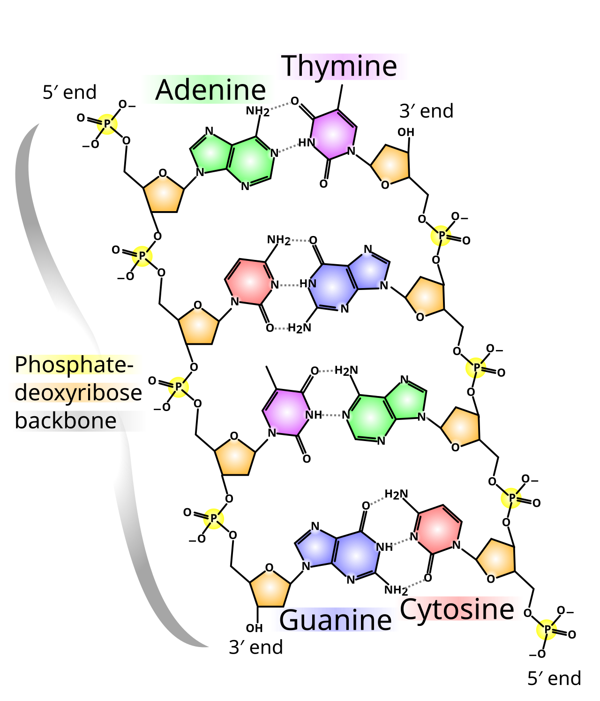
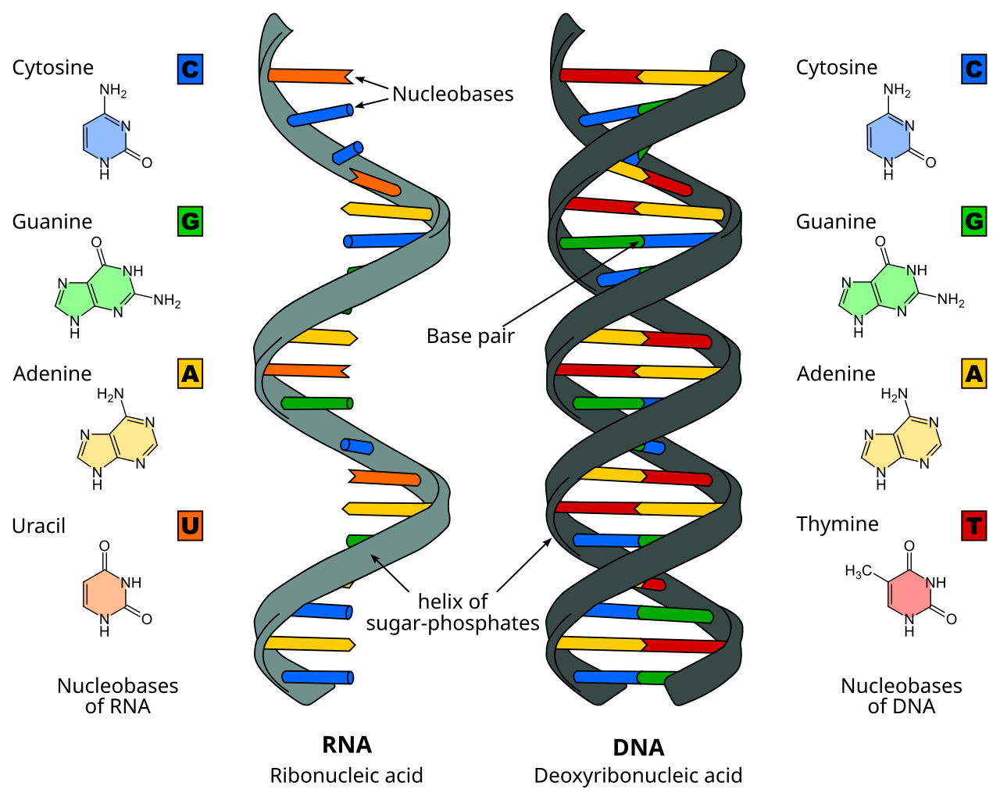
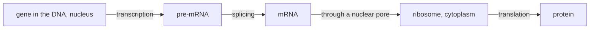
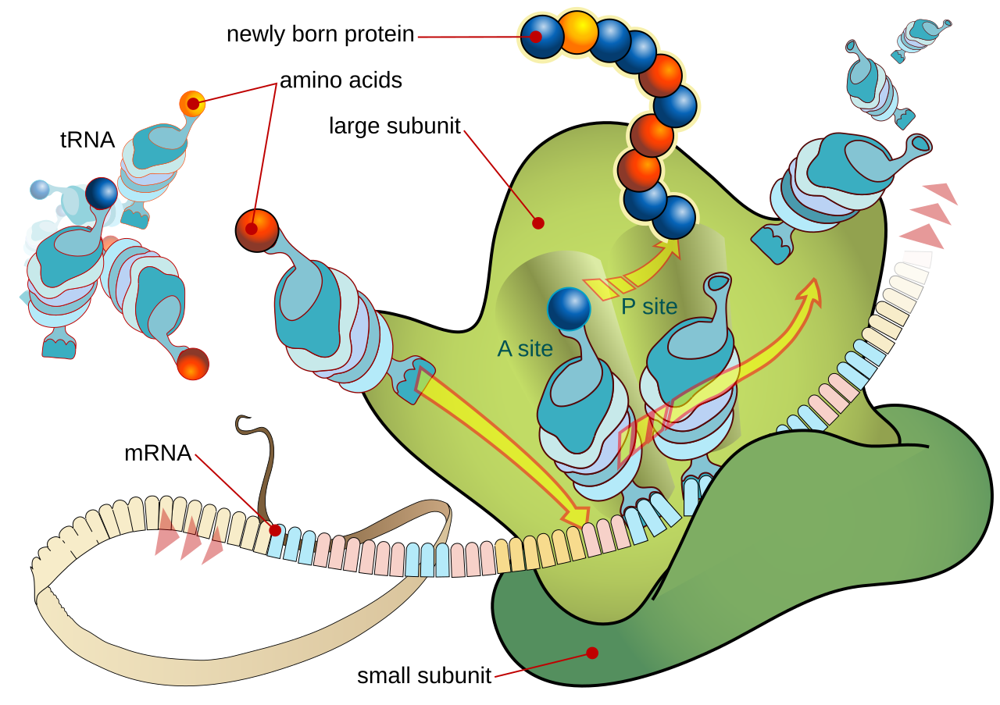

# B1 — Protein Synthesis: notes

These are English explanations of every learning outcome in [README.md](README.md), and every topic is *drafted*: written from the CCVX syllabus, the Dutch CvTE syllabus and standard VWO biology, not yet checked against an open source text or exam question.

- **In Dutch VWO:** central exam (CE).
- **Dutch source:** [CvTE syllabus biologie vwo 2027](https://www.examenblad.nl/2027/vwo/documenten/syllabus-biologie-vwo-2027) (version 2, July 2025), M1 *Eiwitsynthese* (M1.1–M1.2). A citation like *(CvTE M1.2 spec 2)* means specification 2 of M1.2; its numbers don't match the CCVX numbers.

Dutch terms are in brackets. Binas tables are named, not numbered, because the numbers differ between editions.

## B1.1 DNA

### 1. Structure of DNA and RNA

- DNA and RNA are nucleic acids (*nucleïnezuren*): long chains of nucleotides. *(CvTE M1.1 specs 1–2)*
- A nucleotide has three parts: a phosphate group, a sugar with five carbon atoms and a nitrogenous base.
- DNA has the sugar deoxyribose and the bases adenine (A), thymine (T), guanine (G) and cytosine (C); RNA has the sugar ribose and uracil (U) instead of thymine. The chemistry is in [chemistry G01](../../../CCVX-chemistry/G-society-chemistry-and-technology/G01-chemistry-of-life/README.md).
- The phosphate of one nucleotide is bonded to the sugar of the next, so each strand has a sugar–phosphate backbone with the bases sticking out to one side.
- The carbon atoms of the sugar are numbered 1' to 5'. A strand starts at a 5' end (free phosphate on carbon 5') and stops at a 3' end (free –OH on carbon 3'), so it has a direction.
- Single-strand and double-strand DNA (*enkelstrengs DNA*, *dubbelstrengs DNA*): DNA is normally a double strand, two antiparallel strands (one runs 5'→3', the other 3'→5') held together by hydrogen bonds (*waterstofbruggen*) between their bases ([chemistry B03](../../../CCVX-chemistry/B-substances-and-materials/B03-bonds-and-properties/README.md)).
- Single-stranded DNA exists only briefly, when the strands are pulled apart to be copied or read (and in PCR), and permanently in a few viruses such as bacteriophage φX174.
- Base pairing (*basenparing*) is complementary: A pairs with T through two hydrogen bonds and G with C through three. A double-ring base (A, G) always faces a single-ring base (T, C), so the double strand is equally wide everywhere.
- One strand therefore fixes the other: 5'-ATGC-3' pairs with 3'-TACG-5'.

*Part of a DNA double strand. The two strands run in opposite directions, each with a backbone of phosphate and deoxyribose and a 5' and a 3' end; A–T pairs are held by two hydrogen bonds (dotted) and G–C pairs by three. Image: Madprime, [CC BY-SA 3.0](https://creativecommons.org/licenses/by-sa/3.0/), [Wikimedia Commons](https://commons.wikimedia.org/wiki/File:DNA_chemical_structure.svg).*

- In double-stranded DNA %A = %T and %G = %C: DNA with 30% A has 30% T, 20% G and 20% C.
- DNA rich in G–C pairs needs more heat to separate its strands: 10 base pairs with 4 G–C and 6 A–T pairs are held by 4 × 3 + 6 × 2 = 24 hydrogen bonds.
- The two strands wind around each other into a double helix (helical structure, *helixstructuur*) about 2 nm wide, with one full turn about every 10 base pairs (3.4 nm).
- RNA is a single strand and much shorter; it can fold back on itself where its own bases pair, as in the cloverleaf shape of tRNA (outcome 2).

| | DNA | RNA |
|---|---|---|
| Sugar | deoxyribose | ribose |
| Bases | A, T, G, C | A, U, G, C |
| Strands | two, as a double helix | one, often folded |
| Length | very long (millions of base pairs) | short (one gene or less) |
| Where | nucleus, mitochondria, chloroplasts | made in the nucleus, works mainly outside it |

*RNA (left) is a single strand with uracil (U); DNA (right) is a double helix with thymine (T). Image: Sponk, [CC BY-SA 3.0](https://creativecommons.org/licenses/by-sa/3.0/), [Wikimedia Commons](https://commons.wikimedia.org/wiki/File:Difference_DNA_RNA-EN.svg).*

- In eukaryotes each chromosome (*chromosoom*) is one very long DNA molecule packed with proteins (*eiwitten*); a human body cell has 46 chromosomes in its nucleus.
- The DNA is wound around histones (*histonen*): small, positively charged proteins that attract the negatively charged phosphate groups.
- A nucleosome (*nucleosoom*) is a core of eight histone proteins with about 150 base pairs of DNA wrapped almost twice around it; with linker DNA in between, nucleosomes look like beads on a string. *(CvTE M4.1 spec 4)*
- The string of nucleosomes coils and folds further, and before a cell divides it condenses into compact chromosomes that are visible under a light microscope ([E02](../../E-reproduction/E02-cell-life-cycle/README.md)).
- Tightly packed DNA can't be read, so packing also helps switch genes (*genen*) off ([D01](../../D-interaction/D01-molecular-interaction/README.md)).
- Bacteria have one circular chromosome without histones, lying free in the cell, and often extra small DNA circles called plasmids (*plasmiden*, outcome 3).
- **Trap:** %A = %T and %G = %C only hold for double-stranded DNA; they don't apply to a single strand, to mRNA or to a single-stranded virus.

### 2. Functions of DNA, mRNA, tRNA and rRNA

- DNA stores the hereditary information in its base sequence (*basenvolgorde*); a gene is a stretch of DNA whose sequence codes for one RNA, usually an mRNA that codes for a protein. *(CvTE M1.1 specs 3–4)*
- DNA's structure suits storage and copying: each of the two complementary strands carries the full information, so either strand can serve as the template for replication (*DNA-replicatie*, [E01](../../E-reproduction/E01-dna-replication/README.md)) or repair.
- DNA is also chemically more stable than RNA, because deoxyribose lacks the extra –OH group that makes RNA easy to break down.
- mRNA (messenger RNA) is a single-stranded copy of one gene that carries the code from the nucleus to the ribosomes (*ribosomen*) as a row of codons.
- mRNA is broken down within minutes to hours, so a cell can stop making a protein quickly by stopping transcription (*transcriptie*, B1.2 outcome 2).
- tRNA (transfer RNA) is a short RNA of about 75–90 nucleotides that folds into a cloverleaf by base pairing within its own strand; one loop carries the anticodon and the 3' end carries the matching amino acid (*aminozuur*).
- A specific enzyme loads each tRNA with its own amino acid, which makes tRNA the adapter between a codon and an amino acid.
- rRNA (ribosomal RNA) forms the two subunits of a ribosome together with proteins; it binds the mRNA and the tRNAs and itself catalyses the peptide bond (*peptidebinding*) between the amino acids.
- Bacterial ribosomes are smaller and built differently from those in our cells, so antibiotics such as streptomycin and tetracycline block bacterial translation (*translatie*) and leave ours alone ([B05](../B05-defence-in-organisms/README.md)).
- Nuclear DNA (CCVX: “nucleic DNA”, *kern-DNA*) lies in the linear chromosomes of the nucleus, packed with histones; it holds almost all genes and comes from both parents.
- CCVX's “mitochondrial and chloroplast mtDNA” means mitochondrial DNA (mtDNA, *mitochondriaal DNA*) and chloroplast DNA (cpDNA, *chloroplast DNA*): small circular molecules without histones, like bacterial DNA, which supports the endosymbiotic theory ([F04](../../F-evolution/F04-genesis-of-life/README.md)).
- Human mtDNA has about 16,600 base pairs and 37 genes (13 for proteins of cellular respiration, 22 for tRNAs, 2 for rRNAs); it passes on only through the egg cell, so it comes from the mother ([E03](../../E-reproduction/E03-reproduction-of-organisms/README.md)).
- Chloroplast DNA codes for some photosynthesis proteins, such as the large subunit of the enzyme rubisco, and for the chloroplast's own rRNA and tRNA; most proteins of both organelles are coded by nuclear genes.
- Repetitive DNA (*repetitief DNA*) makes up about half of the human genome (*genoom*): sequences that occur many times and mostly don't code for protein.
- Tandem repeats lie head to tail: telomeres are the sequence TTAGGG repeated many times at the chromosome ends ([E02](../../E-reproduction/E02-cell-life-cycle/README.md)), and short tandem repeats (STRs) are units of 2–6 bases repeated a variable number of times.
- Other repeats are copies of transposons (jumping genes) scattered over all chromosomes.
- The number of repeats in an STR differs between people, which makes STRs the basis of DNA profiling ([E01](../../E-reproduction/E01-dna-replication/README.md)).
- **Trap:** tRNA and rRNA are never translated: their genes are only transcribed, and the folded RNA is the working product. Only mRNA is translated into protein.

### 3. Identifying the base sequence

- To read the base sequence of a piece of DNA it is sequenced, but first the piece is cut out with restriction enzymes (*restrictie-enzymen*) and multiplied by PCR or in bacteria with plasmids. CCVX's “sequences” corresponds to the CvTE's *sequencen*: sequencing, reading the order of the bases. *(CvTE M1.1 spec 5)*
- A restriction enzyme cuts double-stranded DNA at a specific recognition sequence of usually 4–8 base pairs, often a palindrome that reads the same on both strands from 5' to 3'.
- Example: EcoRI cuts GAATTC between G and A on both strands, leaving single-stranded sticky ends AATT that can pair with any other end cut by EcoRI.
- In random DNA a given 6-base site occurs on average once every 4⁶ = 4096 base pairs; enzymes with a 4-base site (once every 4⁴ = 256) cut much more often.
- Bacteria use restriction enzymes to cut up the DNA of invading bacteriophages, and they protect their own DNA by methylating its recognition sites.
- Gel electrophoresis (*gelelektroforese*): the phosphate groups make DNA fragments negatively charged, so in an electric field they move through a gel towards the positive pole, short fragments faster than long ones. The gel sorts fragments by length.
- PCR (polymerase chain reaction, *polymerasekettingreactie*) copies one chosen stretch of DNA in a tube by repeating a cycle of three temperature steps:
    - denaturation (*denaturatie*) at about 95 °C: the hydrogen bonds break and the strands separate;
    - annealing at about 50–65 °C: the primers bind to their complementary sites on either side of the target;
    - extension at about 72 °C: a heat-stable DNA polymerase (*DNA-polymerase*), the enzyme that builds DNA, adds free nucleotides to the 3' end of each primer; it comes from the hot-spring bacterium Thermus aquaticus (Taq polymerase).
- Each cycle doubles the number of copies, so one double strand gives 2ⁿ after n cycles: 2³⁰ ≈ 1.07·10⁹ after 30 cycles, in theory, at 100% efficiency.
- Strictly, double strands of exactly the target length (primer to primer) first appear in cycle 3; after n cycles there are 2ⁿ − 2n of them, so after 30 cycles practically every copy is the target fragment.
- A primer is a short single strand of DNA, for PCR about 20 synthetic nucleotides, complementary to the 3' end of the target on one strand. DNA polymerase can only extend an existing 3' end, so copying starts at the primers.
- Twenty bases are enough to be unique: a given 20-base sequence is expected by chance only once in 4²⁰ ≈ 1.1·10¹² bases, more than 300 times the human genome of about 3.2·10⁹ base pairs.
- A plasmid is a small circular DNA molecule in bacteria (and yeast), separate from the chromosome, that is copied on its own and often carries genes for antibiotic resistance.
- To clone a fragment, the plasmid and the fragment are cut with the same restriction enzyme, their sticky ends pair, DNA ligase seals them, and bacteria that take up the recombinant plasmid copy it every time they divide ([E01](../../E-reproduction/E01-dna-replication/README.md), [D01](../../D-interaction/D01-molecular-interaction/README.md)).
- Sanger sequencing: DNA polymerase copies the fragment from a primer in a mix with a few chain-stopping nucleotides (dideoxynucleotides), each base with its own fluorescent colour. This gives fragments that end at every position; sorted by length, their colours give the sequence base by base.
- Modern machines sequence millions of fragments at once, which made reading whole genomes fast and cheap; the Human Genome Project finished its sequence in 2003.
- cDNA (complementary DNA) is DNA copied from mature mRNA by the enzyme reverse transcriptase, which comes from retroviruses such as HIV. *(CvTE M3.1 spec 2)*
- cDNA has no introns ([C01](../../C-self-organization/C01-self-organization-of-cells/README.md)), so it shows a gene's coding sequence directly and can be expressed in bacteria, which can't remove introns.
- Once a sequence is known, the Binas table of the genetic code (*genetische code*) gives the amino acids it codes for, and comparing sequences reveals mutations (*mutaties*) and kinship ([F01](../../F-evolution/F01-selection/README.md)).
- **Trap:** PCR doesn't copy the whole DNA, only the stretch between the two primers; you have to know the sequences on both sides of the target to design them.

## B1.2 Protein Synthesis

### 1. Triplet code and amino acids

- A protein (*eiwit*, *proteïne*) is a chain of amino acids; cells use 20 different amino acids, and their order is coded in the base sequence of a gene. *(CvTE M1.2 spec 1)*
- The code is a triplet code (*tripletcode*): three bases code for one amino acid. A doublet code would give only 4² = 16 combinations, too few for 20 amino acids, while triplets give 4³ = 64.
- A codon is a triplet in the mRNA; the Binas table of the genetic code gives the amino acid for each of the 64 mRNA codons.
- 61 codons code for amino acids; the 3 stop codons (*stopcodons*) UAA, UAG and UGA end translation, because no tRNA fits them.
- The start codon (*startcodon*) AUG codes for methionine and marks where translation starts, so every new chain begins with methionine (often removed later).
- The code is degenerate: most amino acids have several codons (leucine, serine and arginine six each; methionine and tryptophan only one), so a change in the third base often doesn't change the amino acid.
- Codons don't overlap and have no gaps between them, so the start codon fixes the reading frame for the rest of the mRNA.
- The code is nearly universal: bacteria, plants and animals read codons the same way, so a human gene works in a bacterium. There are small exceptions, for example in mitochondria ([F01](../../F-evolution/F01-selection/README.md)).
- Deleting one nucleotide shifts the reading frame (*leesraamverschuiving*): AUG CCA GAU GGC UGG UAA (Met–Pro–Asp–Gly–Trp–stop) becomes AUG CAG AUG GCU GGU AA… (Met–Gln–Met–Ala–Gly…), while deleting three nucleotides removes just one amino acid.
- **Trap:** you can derive the amino acid sequence from a DNA sequence, but not one unique DNA sequence from an amino acid sequence, because most amino acids have several codons.

### 2. Transcription and translation

- In transcription (*transcriptie*) a gene is copied into mRNA in the nucleus; in translation (*translatie*) ribosomes in the cytoplasm (*cytoplasma*), the cell contents outside the nucleus, use the mRNA to link amino acids into a chain. *(CvTE M1.2 spec 2)*

- RNA polymerase (*RNA-polymerase*) binds to the promoter (*promotor*), a DNA sequence in front of the gene, opens the double strand and starts building RNA without a primer. *(CvTE M3.1 spec 3)*
- The template strand (CCVX: “template/matrix strand”, *template/matrijsstreng*) is the strand that is read: RNA polymerase pairs free RNA nucleotides with it (A–U, T–A, G–C, C–G).
- The coding strand (*coderende streng*) is the other strand: it has the same sequence as the mRNA, with T instead of U, so you can read the codons straight from it.
- Reading direction (*afleesrichting*): nucleic acids are always built 5'→3', so the template is read 3'→5'. The ribosome reads the mRNA 5'→3' from start codon to stop codon, and the protein grows from its amino end to its carboxyl end.
- Exam questions give either strand: from a template strand, write the complementary bases with U opposite A; from a coding strand, just replace T by U.
- Worked example: template strand 3'-TAC GGT CTA ATT-5', coding strand 5'-ATG CCA GAT TAA-3' → mRNA 5'-AUG CCA GAU UAA-3' → Met–Pro–Asp–stop.
- At the end of the gene RNA polymerase lets go. In eukaryotes the pre-mRNA is first spliced ([C01](../../C-self-organization/C01-self-organization-of-cells/README.md)), and the mature mRNA leaves the nucleus through the nuclear pores.
- Bacteria have no nucleus, so their ribosomes start translating an mRNA while it is still being transcribed.
- Translation starts when the small ribosomal subunit binds the mRNA at the start codon, a tRNA carrying methionine pairs with it, and the large subunit joins.
- An anticodon is the triplet of a tRNA that pairs with a codon, complementary and antiparallel: codon 5'-AUG-3' pairs with anticodon 3'-UAC-5' (written 5'-CAU-3').
- Elongation: the tRNA whose anticodon fits the next codon brings its amino acid, the rRNA joins it to the chain with a peptide bond, the ribosome moves three bases on, and the empty tRNA leaves to be reloaded.
- Termination: no tRNA fits a stop codon; a release protein binds instead, the chain is released and the subunits come apart.

*Translation. tRNAs bring amino acids, their anticodons pair with the codons of the mRNA, and the chain grows by one amino acid per codon. The A site and P site are where the incoming tRNA and the tRNA holding the chain sit; you don't need these names. Image: Mariana Ruiz (LadyofHats), public domain, [Wikimedia Commons](https://commons.wikimedia.org/wiki/File:Ribosome_mRNA_translation_en.svg).*

- Several ribosomes read one mRNA at the same time (a polysome), so one mRNA produces many copies of the protein.
- Proteins for use in the cytoplasm, such as the enzymes of glycolysis, are made on free ribosomes. Proteins for export, for the cell membrane or for lysosomes start with a signal sequence that docks their ribosome onto the rough endoplasmic reticulum (*ruw endoplasmatisch reticulum*, RER).
- The chain is threaded into the RER, where it folds and gets disulfide bridges (*zwavelbruggen*, outcome 3) and often sugar groups; transport vesicles take it to the Golgi apparatus (*golgi-systeem*), which modifies, sorts and packs proteins into vesicles, and secretory vesicles release them by exocytosis ([B02](../B02-metabolism-in-cells/README.md)).
- Example: a β-cell in the pancreatic islets makes insulin at the RER as one folded chain with disulfide bridges. In the Golgi apparatus and its vesicles a middle piece is cut out, leaving two chains of 21 and 30 amino acids (51 in total), which are released when blood glucose rises.
- Cells that secrete a lot of protein, such as antibody-producing plasma cells, are packed with RER and have a large Golgi apparatus.
- Genes on a plasmid are transcribed and translated in the same way, which is how bacteria with a recombinant plasmid produce a human protein such as insulin.
- DNA polymerase doesn't take part in protein synthesis: it builds new DNA during replication ([E01](../../E-reproduction/E01-dna-replication/README.md)) and in PCR, extending a primer with DNA nucleotides.
- **Trap:** don't confuse DNA polymerase with RNA polymerase. RNA polymerase transcribes a gene into RNA (with U), starting at a promoter without a primer; DNA polymerase copies DNA (with T) and needs a primer.

### 3. Primary structure determines shape and function

- A protein has four levels of folding: primary, secondary, tertiary and quaternary structure. The primary structure (*primaire structuur*) is the amino acid sequence, held together by peptide bonds (CCVX: “peptide binding”, *peptidebinding*). *(CvTE M1.2 spec 3)*
- Every amino acid has an amino group (–NH₂), a carboxyl group (–COOH) and a side group (R) on one carbon atom. The 20 side groups differ: hydrophobic (valine, leucine), polar (serine), charged (glutamic acid −, lysine +) or with sulfur (cysteine, –SH). The Binas table of amino acids gives their structural formulas.
- A peptide bond forms by condensation between the carboxyl group of one amino acid and the amino group of the next, releasing water: glycine + alanine → glycylalanine + water, C₂H₅NO₂ + C₃H₇NO₂ → C₅H₁₀N₂O₃ + H₂O ([chemistry C01](../../../CCVX-chemistry/C-chemical-processes-and-conservation-laws/C01-chemical-processes/README.md)).
- Hydrolysis is the reverse: digestive enzymes break peptide bonds by adding water.
- Secondary structure (*secundaire structuur*): the backbone folds locally into an α-helix (spiral) or a β-sheet (pleated sheet), held by hydrogen bonds between the C=O and N–H groups of the peptide bonds. Hair keratin is mostly α-helix, silk mostly β-sheet.
- Tertiary structure (*tertiaire structuur*): the whole chain folds into a 3D shape, held by bonds between side groups (hydrogen bonds, ionic bonds between + and − groups, disulfide bridges), with the hydrophobic side groups clustered inside, away from water.
- A disulfide bridge or sulfur bridge (*zwavelbrug*) is a covalent S–S bond formed by oxidation of the –SH groups of two cysteines. It is much stronger than the other bonds and staples parts of one chain, or two chains, together, as in hair keratin and antibodies.
- Quaternary structure (*quaternaire structuur*): several polypeptide chains fit together into one protein; haemoglobin has four chains (two α, two β), each with a haem group that binds O₂.
- The folded shape decides the function: an enzyme's active site, a receptor's binding site and a channel's pore only work in the right shape, and that shape follows from the sequence.
- Example: in sickle-cell anaemia one base change turns codon 6 of β-globin from GAG (glutamic acid, charged) into GUG (valine, hydrophobic). At low O₂ the haemoglobin molecules stick together into fibres, and the red blood cells become sickle-shaped and block small vessels.
- Denaturation (*denaturatie*): heat, extreme pH or heavy-metal ions break the weak bonds that hold the secondary, tertiary and quaternary structure, so the protein loses its shape and function, as when egg white sets on cooking or an enzyme stops working above its optimum temperature ([B02](../B02-metabolism-in-cells/README.md)).
- **Trap:** denaturation doesn't break peptide bonds: the primary structure stays intact and only the folding is lost. Breaking peptide bonds is hydrolysis.

### 4. Proteins determine the structure and function of biological units

- Proteins build cells and do most of their work, so the set of proteins a cell makes determines the structure and function of its organelles, and through them of tissues and organs. *(CvTE M1.2 spec 4)*
- Enzymes speed up specific reactions because their active site fits one substrate: lactase splits lactose in the small intestine ([B02](../B02-metabolism-in-cells/README.md), [chemistry E02](../../../CCVX-chemistry/E-innovation-and-chemical-research/E02-selectivity-and-specificity/README.md)).
- Structural proteins give shape and strength: collagen in tendons, bone and skin, keratin in hair and nails, and tubulin in the microtubules of the cytoskeleton.
- Membrane proteins decide what enters and leaves a cell and which signals it notices: channels, carriers, pumps such as the Na/K pump (*natrium/kalium-pomp*), and receptors ([D02](../../D-interaction/D02-cellular-interaction/README.md)).
- Motor proteins move things: myosin pulls on actin filaments in muscle contraction, and kinesin carries vesicles along microtubules.
- Other proteins transport substances (haemoglobin), act as hormones (insulin) or defend the body (antibodies, [B05](../B05-defence-in-organisms/README.md)).
- At organ level: dystrophin links the actin cytoskeleton inside a muscle fibre, through the cell membrane, to the extracellular matrix (*tussencelstof*) outside. Without it the membrane tears during contraction, the fibres die and the muscles weaken (Duchenne muscular dystrophy).
- Different cell types (*celtypen*) make different proteins, which explains their different structures and functions ([C01](../../C-self-organization/C01-self-organization-of-cells/README.md)).
- **Trap:** genes don't code for carbohydrates, fats or pigments directly; they code for the enzymes that make them. That's how a gene can change a non-protein trait, such as the type of starch in a potato ([C01](../../C-self-organization/C01-self-organization-of-cells/README.md)).

## Specimen contexts

- Duchenne muscular dystrophy (health): mutations in the dystrophin gene, often deletions of exons that shift the reading frame, cause an early stop codon and no dystrophin; the gene lies on the X chromosome, so the disease mostly affects boys. Experimental DNA therapies such as exon skipping make the splicing machinery skip an extra exon, which restores the reading frame and gives a shorter but partly working dystrophin, as in the milder Becker form. This uses B1.1 outcome 3 (finding the mutation) and B1.2 outcomes 1–4.
- Bureau GGO and GM crops (food production): the assessment checks which DNA was inserted (with PCR and sequencing), which new protein the crop makes, whether that protein could be toxic or cause allergies, and whether the gene could spread to wild relatives. Bt maize, for example, makes a protein from the bacterium Bacillus thuringiensis that kills certain caterpillars. This uses B1.1 outcome 3, B1.2 outcomes 1–4 and [D01](../../D-interaction/D01-molecular-interaction/README.md).
- Functional foods (food production): changing DNA changes which enzymes a crop makes, and so its composition; Golden rice has added genes for the enzymes that make β-carotene (provitamin A) in the grain. This uses B1.2 outcomes 1, 2 and 4 and [D01](../../D-interaction/D01-molecular-interaction/README.md).

## CCVX versus the Dutch syllabus

- **In both:** DNA and RNA structure, the functions of DNA, mRNA, tRNA and rRNA, nuclear, mitochondrial and chloroplast DNA, the ways to determine a base sequence (plasmid, primer, PCR, sequencing, restriction enzyme), the triplet code, transcription and translation with RER, Golgi apparatus, strands and reading direction, DNA polymerase, and the four levels of protein structure with peptide bonds.
- **Dutch syllabus only:** the chemistry terms atom, molecule, ion, molecular formula, structural formula and hydrogen bond (*waterstofbrug*) in M1.1 specs 1–2, and the disulfide bridge (*zwavelbrug*) in M1.2 spec 3. The notes explain hydrogen bonds and disulfide bridges; the general chemistry is in [chemistry B03](../../../CCVX-chemistry/B-substances-and-materials/B03-bonds-and-properties/README.md) and [chemistry G01](../../../CCVX-chemistry/G-society-chemistry-and-technology/G01-chemistry-of-life/README.md).
- **CCVX only:** nucleosomes (the CvTE has them in M4.1 spec 4), cDNA (CvTE M3.1 spec 2) and repetitive DNA (not in the CvTE syllabus at all); all three are explained above.
