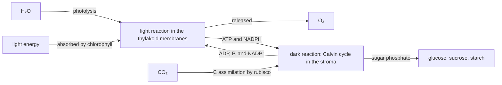
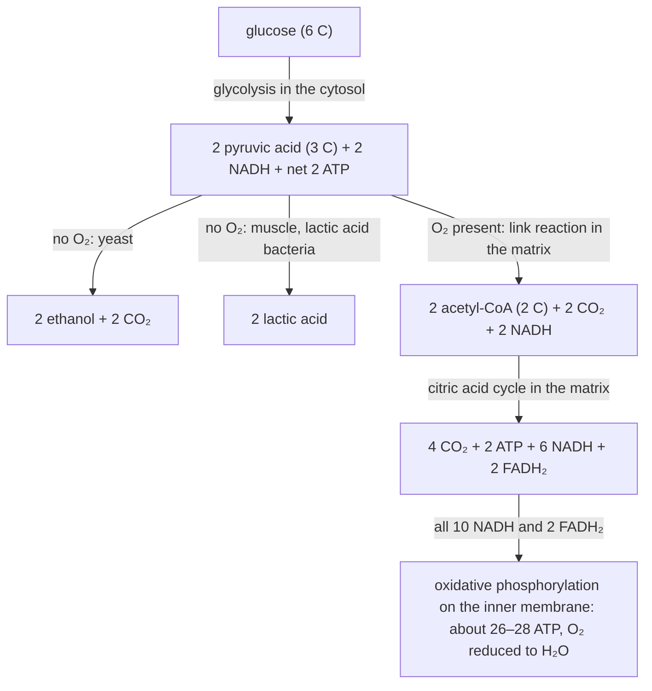

# B2 — Metabolism in Cells: notes

These are English explanations of every learning outcome in [README.md](README.md), and every topic is *drafted*: written from the CCVX syllabus, the Dutch CvTE syllabus and standard VWO biology, not yet checked against an open source text or exam question.

- **In Dutch VWO:** central exam (CE).
- **Dutch source:** [CvTE syllabus biologie vwo 2027](https://www.examenblad.nl/2027/vwo/documenten/syllabus-biologie-vwo-2027) (version 2, July 2025), M2 *Stofwisseling van de cel* (M2.1–M2.3). A citation like *(CvTE M2.3 spec 5)* means specification 5 of M2.3; its numbers don't match the CCVX numbers.

Dutch terms are in brackets. Binas tables are named, not numbered, because the numbers differ between editions.

## B2.1 Homeostasis

### 1. Characteristics of bacteria

- A bacterium (*bacterie*) is a prokaryote (*prokaryoot*): a cell without a nucleus and without membrane-bound organelles. Prokaryotes are the bacteria and the archaea. *(CvTE M2.1 spec 1)*
- Its DNA is one circular chromosome (*cirkelvormig chromosoom*) lying free in the cytoplasm (*cytoplasma*), not wound around histones as in eukaryotes.
- Many bacteria also carry plasmids (*plasmide*): small extra rings of DNA with a few genes, for example for antibiotic resistance, which they can pass on to other bacteria. Plasmids are also the usual vehicle for recombinant DNA (B2.3 outcome 8).
- Outside the cell membrane (*celmembraan*) lies a cell wall (*celwand*) of peptidoglycan, not cellulose, sometimes covered by a slime capsule.
- Inside are ribosomes (*ribosoom*), smaller than those of eukaryotes, and enzymes (*enzym*); there are no mitochondria, so dissimilation takes place in the cytoplasm and on the cell membrane.
- Some bacteria swim with flagella (*flagel*), which are rotating protein threads, unlike the microtubule-based flagella of eukaryotes.
- Bacteria are small (Escherichia coli is about 1–2 μm long; a typical eukaryotic cell is 10–100 μm) and reproduce by binary fission (*tweedeling*), under ideal conditions about every 20 minutes: 10 hours could turn one cell into 2³⁰ ≈ 1.1·10⁹ cells.
- Examples in this folder: E. coli in the gut, lactic acid bacteria (yoghurt), nitrifying bacteria (chemosynthesis) and cyanobacteria, which carry out photosynthesis (*fotosynthese*) without chloroplasts.
- A virus is not a cell: it is DNA or RNA inside a protein coat (*eiwitmantel*), sometimes surrounded by an envelope taken from the host cell's membrane. *(CvTE M2.1 spec 2)*
- A virus has no metabolism and no ribosomes, so it can only multiply inside a host cell, using the host's ribosomes, enzymes, nucleotides and ATP.
- DNA viruses (*DNA-virus*) include herpes viruses and bacteriophage T4; RNA viruses (*RNA-virus*) include the influenza virus, HIV and tobacco mosaic virus. Viruses measure tens to a few hundred nanometres, far smaller than bacteria; defence against them is in [B05](../B05-defence-in-organisms/README.md).
- **Trap:** a prokaryote does have a cell membrane, cytoplasm, ribosomes and DNA; it lacks a nucleus and membrane-bound organelles. Antibiotics attack bacterial structures such as the cell wall and ribosomes, so they don't work against viruses.

### 2. The eukaryotic cell and its parts

- A eukaryote (*eukaryoot*) has cells with a nucleus and membrane-bound organelles. Each cell takes up substances, makes its own proteins from its own DNA, produces its own ATP and keeps its interior constant, so it works as an independent unit. *(CvTE M2.1 specs 3–5)*
- Unicellular eukaryotes such as Paramecium and yeast show this most clearly: one cell is the whole organism. In multicellular organisms cells also specialise and depend on each other ([B03](../B03-metabolism-in-organisms/README.md)).
- Cytoplasm is everything inside the cell membrane except the nucleus. CCVX's groundplasm (*grondplasma*) is the usual English cytosol: the watery part of the cytoplasm around the organelles, full of dissolved ions, sugars, amino acids and enzymes.
- A chromosome (*chromosoom*) is one long DNA molecule packed with proteins (histones). Human body cells have 46; they only become visible as separate rods when they condense before division ([E02](../../E-reproduction/E02-cell-life-cycle/README.md)).

| Part | Structure | Function |
|---|---|---|
| cell nucleus (*celkern*) | double membrane with nuclear pores (*kernporie*) | holds the chromosomes; transcription; controls the cell through the proteins it codes for |
| nucleolus (*kernlichaampje*) | dark region inside the nucleus | makes rRNA and assembles ribosome subunits |
| nuclear pore | protein channel through the nuclear envelope | lets mRNA and ribosome subunits out and proteins (enzymes, histones) in |
| ribosome (*ribosoom*) | particle of RNA and protein, free or on the ER | protein synthesis ([B01](../B01-protein-synthesis/README.md)) |
| rough endoplasmic reticulum (*ruw endoplasmatisch reticulum*) | membrane network studded with ribosomes | makes and folds proteins for membranes, lysosomes and export; smooth ER (no ribosomes) makes lipids |
| Golgi apparatus (*golgi-systeem*) | stack of flat membrane sacs | modifies, sorts and packs proteins into vesicles for export, the membrane or lysosomes |
| lysosome (*lysosoom*) | vesicle with digestive enzymes, pH about 5 | digests material taken in by endocytosis and worn-out organelles |
| mitochondrion (*mitochondrie*) | double membrane, folded inner membrane, matrix, own DNA | aerobic dissimilation: most of the cell's ATP |
| chloroplast | double membrane, thylakoids containing chlorophyll (*chlorofyl*), stroma, own DNA | photosynthesis |
| plastid (*plastide*) | family of plant organelles with a double membrane and own DNA | chloroplasts, chromoplasts (pigment in petals and fruit) and starch-storing amyloplasts (potato tuber) |
| vacuole | in plant cells one large sac of cell sap | stores water, salts, sugars, pigments and waste; its water uptake builds up turgor |
| cell membrane (*celmembraan*) | phospholipid bilayer with proteins | selectively permeable boundary with transport and receptor proteins (B2.2) |
| cell wall (*celwand*) | cellulose in plants, chitin in fungi | shape and strength; stops the cell bursting; freely permeable |
| cytoskeleton (*cytoskelet*) | microtubules and actin filaments | shape, tracks for transport, movement, the spindle in cell division (B2.2) |
| centrioles (*centriolen*) | pair of short microtubule cylinders near the nucleus of animal cells | organise microtubules, such as the spindle; the same structure forms the base of cilia and flagella |
| cilia (*ciliën*) and flagella (*flagel*) | microtubule extensions of the cell, bent by the motor protein dynein | cilia are many and short (airway lining moving mucus); a flagellum is one long tail (sperm cell) |

- Plant cells have a cell wall, plastids and a large central vacuole, and flowering plants have no centrioles; animal cells have centrioles and no cell wall. Both have a nucleus, mitochondria, ER, a Golgi apparatus and ribosomes.
- Recognising parts on an electron micrograph: mitochondria show a double membrane with inner folds (cristae), chloroplasts stacks of thylakoids, rough ER membranes dotted with ribosomes, the Golgi apparatus a curved stack of flat sacs with vesicles at the edges, and the nucleus a double membrane with pores and a dark nucleolus.
- A light microscope shows the nucleus, cell wall, chloroplasts and large vacuoles; the detail of ribosomes, ER and the Golgi apparatus needs an electron microscope.
- Mitochondria and chloroplasts descend from free-living prokaryotes that an ancestral host cell engulfed and kept alive inside it: endosymbiosis (*endosymbiose*). *(CvTE M2.1 spec 3)*
- The evidence: both organelles have a double membrane, their own circular DNA and bacteria-like ribosomes, are about the size of bacteria and arise only by division of existing ones. Mitochondria descend from aerobic bacteria and chloroplasts from cyanobacteria; the theory belongs to [F04](../../F-evolution/F04-genesis-of-life/README.md).
- **Trap:** plant cells have mitochondria too and dissimilate day and night; and the selective barrier is the cell membrane, not the cell wall.

### 3. Cells maintain themselves by chemical reactions

- Metabolism (*stofwisseling*) is the total of all chemical reactions in a cell, and a cell stays alive only while they continue. *(CvTE M2.1 spec 3; M2.3 spec 2)*
- Dissimilation (*dissimilatie*) releases energy from food molecules and stores part of it in ATP; assimilation (*assimilatie*) uses that ATP to build the cell's own molecules (B2.3).
- The cell's own components are broken down and rebuilt all the time: proteins have a limited life, lysosomes digest worn-out organelles, and membranes are renewed. This turnover needs a steady supply of ATP.
- ATP also drives ion pumps and motor proteins, so transport and movement depend on chemical reactions as well.
- Enzymes make every step fast enough at body temperature and let the cell control which reactions run (B2.3 outcome 7).
- Example: a mature red blood cell has no nucleus and no mitochondria. It gets its ATP from glycolysis (*glycolyse*) alone, can't make new proteins, and lives only about 120 days.
- **Trap:** a living cell is not at chemical equilibrium; when its reactions stop (no more ATP), its gradients disappear and the cell dies.

### 4. Dynamic equilibrium in a network of cell processes

- In a dynamic equilibrium (*dynamisch evenwicht*) the amounts of substances in a cell stay roughly constant while they are continuously made, used, taken up and released: inflow equals outflow. *(CvTE M2.1 spec 6)*
- In a cell this is a steady state of an open system that costs energy, unlike a chemical equilibrium in a closed system ([chemistry C05](../../../CCVX-chemistry/C-chemical-processes-and-conservation-laws/C05-chemical-equilibrium/README.md)).
- Example: the ion pump (*ionenpomp*) called the Na⁺/K⁺ pump moves 3 Na⁺ out and 2 K⁺ in for every ATP. The ions leak back by diffusion (*diffusie*) through channels, and pumping balances the leak.
- As a result, human cells keep K⁺ at about 140 mmol L⁻¹ inside against about 5 outside, and Na⁺ at about 5–15 mmol L⁻¹ inside against about 145 outside.
- The processes form a network because they share intermediates and carriers. Molecules from glycolysis and the citric acid cycle are also starting material for amino acids and fats, and ATP and NADH link energy supply to building, transport and signalling.
- A change in one process therefore spreads: without O₂ the citric acid cycle stops, NADH accumulates, and the cell has to switch to fermentation (B2.3 outcome 5).
- **Trap:** constant concentrations don't mean that nothing happens; the turnover goes on, and only stops when the cell dies.

### 5. Homeostatic feedback in a cell

- Homeostasis (*homeostase*) is keeping the internal environment within narrow limits. Cells do it by negative feedback (*terugkoppeling*): a deviation starts a response that reverses it. *(CvTE M2.1 spec 7)*
- A receptor protein (*receptoreiwit*) detects the change, usually because a specific molecule binds to it and changes its shape. An effector, the protein or structure that acts (an enzyme, channel or pump), produces the response.
- Between them there is often a cascade: a chain of proteins that activate each other, each one activating many molecules of the next, so one signal molecule produces a large response.
- Example of whole-body homeostasis carried out by a cell: when blood glucose is low, glucagon binds receptor proteins on liver cells. A cascade inside the cell activates the enzyme that breaks down glycogen, the cell releases glucose, and the rising blood glucose reduces glucagon release ([B04](../B04-self-regulation-of-organisms/README.md)).
- Example inside the cell (end-product inhibition): ATP inhibits an early enzyme of glycolysis, so glycolysis slows when ATP is plentiful and speeds up when ATP is used up.
- Positive feedback works the other way: it reinforces a change and doesn't keep anything constant.
- Signal cascades and second messengers are covered in [D02](../../D-interaction/D02-cellular-interaction/README.md).
- **Trap:** the receptor detects and the effector acts; they are different proteins (in the glucagon example, the glucagon receptor versus the glycogen-breaking enzyme).

## B2.2 Transport

### 1. Active and passive transport and the membrane

- The cell membrane is a bilayer of phospholipids (*fosfolipiden*). Each has a hydrophilic (*hydrofiel*, polar) phosphate head facing the water and two hydrophobic (*hydrofoob*, apolar) fatty-acid tails facing the inside of the membrane; proteins float in the bilayer. *(CvTE M2.2 specs 1–2)*
- Whether a substance gets through depends on its properties. Small apolar, fat-soluble (*vetoplosbaar*) molecules such as O₂ and CO₂ dissolve in the lipid core and diffuse straight through ([chemistry B03](../../../CCVX-chemistry/B-substances-and-materials/B03-bonds-and-properties/README.md)).
- Ions and larger polar, water-soluble (*wateroplosbaar*) molecules such as glucose are kept out by the hydrophobic core and need transport proteins ([chemistry E02](../../../CCVX-chemistry/E-innovation-and-chemical-research/E02-selectivity-and-specificity/README.md)). Water passes partly through the bilayer and much faster through water-channel proteins (aquaporins).
- Passive transport (*passief transport*) goes down a concentration gradient and needs no ATP: diffusion through the bilayer, facilitated diffusion through channel or carrier proteins (glucose into most cells), and osmosis (*osmose*), the diffusion of water across a selectively permeable membrane.
- Diffusion is the net movement of particles from high to low concentration by their random motion. It is faster with a steeper gradient, a larger surface, a higher temperature and a shorter distance (Fick's law, [B03](../B03-metabolism-in-organisms/README.md)).
- Active transport (*actief transport*) moves substances against their gradient and costs ATP, using pump proteins: the Na⁺/K⁺ ion pump, proton pumps, and the pumps that let root hair cells take up K⁺ and NO₃⁻ from dilute soil water.
- Ion transport (*ionentransport*): ions cross through ion channels (passive, often gated so they open after a voltage change or when a signal molecule binds) or through ion pumps (active). Sodium chloride (*natriumchloride*, NaCl) dissolves as Na⁺ and Cl⁻, so salt always crosses as ions.
- Coupled transport: the Na⁺ gradient made by the Na⁺/K⁺ pump lets cells of the small intestine take up glucose together with Na⁺, even against the glucose gradient.
- A receptor protein in the membrane binds one specific substance. Some receptors are channels that open when the signal binds; others trigger the uptake of what they bind (cholesterol-carrying LDL particles) by endocytosis.
- Endocytosis and exocytosis (*endocytose*, *exocytose*) move large particles or bulk fluid in vesicles. In endocytosis the membrane folds inwards and pinches off a vesicle (a white blood cell engulfing a bacterium); in exocytosis a vesicle fuses with the membrane and empties outside (insulin, digestive enzymes, neurotransmitters). Both cost ATP.
- **Trap:** facilitated diffusion uses a protein but is still passive; "active" means against the gradient with energy, not "uses a protein".

### 2. Osmosis in plant and animal cells

- Water moves by osmosis towards the side with more dissolved particles; the effect differs because a plant cell has a cell wall and an animal cell doesn't. *(CvTE M2.2 spec 3)*
- An animal cell in a hypotonic solution takes in water, swells and can burst (lysis): red blood cells in pure water burst (haemolysis). In a hypertonic solution it loses water and shrivels.
- A plant cell in a hypotonic solution takes in water until its membrane presses against the wall, which pushes back, so the cell becomes firm without bursting. This pressure is turgor; it keeps leaves and non-woody stems upright.
- A plant cell in a hypertonic solution loses water from its vacuole and cytoplasm, and the shrinking cell contents pull away from the wall: plasmolysis (*plasmolyse*). The gap between wall and membrane fills with the outside solution, because the wall lets it through.
- Example: red onion epidermis in a concentrated salt or sucrose solution shows its purple vacuole shrinking under the microscope; placed back in water, the cells recover.
- A plant wilts as soon as its cells lose turgor, well before full plasmolysis. Paramecium, a freshwater protist without a cell wall, pumps out the water that keeps entering with a contractile vacuole.
- **Trap:** plant cells don't burst in pure water because the wall stops them, and animal cells can't show plasmolysis because they have no wall to shrink away from.

### 3. A selectively permeable membrane keeps the cell different from its surroundings

- A semi-permeable membrane (*semipermeabel membraan*) lets water through but no dissolved substances; it is an idealised model. *(CvTE M2.2 spec 4)*
- A real cell membrane has selective permeability (*selectief permeabel*): water and some substances pass, others don't, and transport proteins decide which ions and molecules enter or leave. With active transport, this keeps the cell contents permanently different from the surroundings (the Na⁺ and K⁺ gradients of B2.1 outcome 4).
- The osmotic value (*osmotische waarde*) of a solution is its total concentration of dissolved particles; it depends on the number of particles, not on their kind ([chemistry C02](../../../CCVX-chemistry/C-chemical-processes-and-conservation-laws/C02-chemical-calculations/README.md)).
- Example: NaCl splits into two ions, so 0.9% NaCl (9 g per litre, about 0.15 mol L⁻¹, giving about 0.3 mol L⁻¹ of particles) has about the same osmotic value as 5% glucose (about 0.28 mol L⁻¹). Both are roughly isotonic with human blood.
- Isotonic (*isotonisch*): the same osmotic value as the cell contents, so no net water flow. Hypotonic (*hypotonisch*): a lower osmotic value, so water flows into the cell. Hypertonic (*hypertonisch*): a higher osmotic value, so water flows out of it.
- Osmotic pressure (*osmotische druk*) is the pressure needed to stop water flowing into a solution from pure water across a semi-permeable membrane; the higher the osmotic value, the higher the osmotic pressure. In a plant cell the wall pressure rises until it balances the osmotic pull, and then net uptake stops.
- Water potential (*waterpotentiaal*, Ψ) expresses how strongly water tends to move. Pure water at atmospheric pressure has Ψ = 0; dissolved substances make it negative and pressure (turgor) raises it.
- Water always flows from a higher (less negative) to a lower (more negative) water potential: from wet soil into root cells, through the plant and out of the leaves into dry air ([B03](../B03-metabolism-in-organisms/README.md), transpiration stream).
- **Trap:** hypotonic and hypertonic always compare two solutions, so say which with which; and a high osmotic value means a low (more negative) water potential, which is where water goes.

### 4. The cytoskeleton in transport

- The cytoskeleton also serves as a network of tracks: microtubules run from near the nucleus to the cell edge, and many actin filaments lie just under the cell membrane. *(CvTE M2.2 spec 5)*
- Motor proteins (*motoreiwit*) use ATP to walk along these tracks with a cargo. Kinesin and dynein carry vesicles and organelles along microtubules (kinesin mostly outwards, dynein inwards), and myosin moves along actin filaments.
- Example: vesicles with neurotransmitter travel from the cell body of a motor neuron to the axon endings, which in humans can be about 1 m away.
- Cytoplasmic flow (CCVX; usual English cytoplasmic streaming, *plasmastroming*): myosin attached to organelles drags them along actin filaments, so the cytoplasm circulates. In leaf cells of Canadian waterweed (Elodea) the chloroplasts visibly circle round the vacuole; in large plant cells this spreads substances faster than diffusion could.
- The cytoskeleton also guides vesicles in endocytosis and exocytosis, pulls chromosomes apart with the spindle in cell division ([E02](../../E-reproduction/E02-cell-life-cycle/README.md)), and makes cilia beat (dynein) to move mucus along the airway lining.
- **Trap:** transport along the cytoskeleton costs ATP, so it is active and not diffusion; the motor proteins carry the cargo, and the fibres are only the tracks.

## B2.3 Assimilation and Dissimilation

### 1. Uptake and release; reactions catalysed by enzymes

- Cells take up and release substances all the time: water, O₂, CO₂, nutrients, ions and waste. *(CvTE M2.3 specs 1–2)*
- Water enters and leaves by osmosis (B2.2), is used up in photosynthesis and in hydrolysis, and is formed in condensation reactions and at the end of aerobic dissimilation.
- An autotroph (*autotroof*) makes its organic substances from inorganic ones (CO₂, H₂O, minerals), with energy from light (plants, algae, cyanobacteria) or from oxidising inorganic substances (nitrifying bacteria). A heterotroph (*heterotroof*) needs organic food made by other organisms (animals, fungi, most bacteria).
- Assimilation builds larger organic molecules from smaller ones and costs energy; dissimilation breaks organic molecules down and releases energy. Autotrophs do both.
- Each step is a chemical reaction (*chemische reactie*) catalysed (*katalyseren*: speeded up without being used up) by an enzyme, a protein that lowers the activation energy ([chemistry C10](../../../CCVX-chemistry/C-chemical-processes-and-conservation-laws/C10-activation-energy/README.md)).
- Many cell reactions are equilibrium reactions (*evenwichtsreacties*). An enzyme speeds up both directions and doesn't shift the equilibrium, so the concentrations decide the direction.
- Example: carbonic anhydrase in red blood cells catalyses CO₂ + H₂O ⇌ H₂CO₃ (which splits into H⁺ + HCO₃⁻). In the tissues, where CO₂ is high, it runs to the right; in the lungs, where CO₂ is low, to the left.
- **Trap:** an enzyme doesn't make an impossible reaction happen and doesn't change the equilibrium position; it only makes the reaction reach equilibrium faster.

### 2. Forms of energy and their conversion

- Cells use chemical energy (*chemische energie*, stored in molecules such as glucose, fat and ATP), light energy (*lichtenergie*), kinetic energy (*kinetische energie*, the energy of movement) and heat (*warmte*). *(CvTE M2.3 specs 3–4)*
- These forms change into one another: photosynthesis turns light (*licht*) into chemical energy, dissimilation turns the chemical energy of glucose into that of ATP, muscle contraction turns ATP into kinetic energy, and fireflies turn chemical energy into light.
- Every conversion loses part of the energy as heat; birds and mammals use that heat to keep their body temperature constant.
- ADP and ATP: ATP (adenosine triphosphate) is the cell's energy carrier. Its hydrolysis, ATP + H₂O → ADP + Pᵢ, releases energy that drives muscle contraction, active transport and assimilation; dissimilation and the light reaction rebuild ATP from ADP (adenosine diphosphate) and phosphate.
- ATP is used and rebuilt continuously, and a cell keeps only a small stock; long-term reserves are starch, glycogen and fat.
- NAD⁺ and NADP⁺ are electron carriers that take up two electrons and a proton: NAD⁺ + 2 e⁻ + H⁺ → NADH, and likewise NADP⁺ → NADPH. Some books write the same reaction as NAD⁺ + 2 H⁺ + 2 e⁻ → NADH + H⁺.
- NADH collects electrons in dissimilation and delivers them to the electron transport chain in the mitochondria. NADPH is made in the light reaction and delivers electrons to reduce CO₂ in the Calvin cycle: NADP for photosynthesis and building, NAD for dissimilation.
- In both mitochondria and chloroplasts, electrons (*elektron*) pass along a chain of membrane proteins whose energy pumps protons (*proton*, H⁺) across the membrane. The protons flow back through the enzyme ATP synthase, which uses that flow to make ATP.
- **Trap:** ATP is a short-term energy carrier, not an energy store; and NADH is not ATP: its electrons only yield ATP through oxidative phosphorylation.

### 3. Photosynthesis: light and dark reaction

- Photosynthesis turns light energy into chemical energy by building glucose from CO₂ and H₂O, releasing O₂; in eukaryotes it takes place in chloroplasts. *(CvTE M2.3 spec 5)*
- Net equation: 6 CO₂ + 6 H₂O → C₆H₁₂O₆ + 6 O₂, with light energy absorbed by chlorophyll.
- Written with all the water that takes part, 6 CO₂ + 12 H₂O → C₆H₁₂O₆ + 6 O₂ + 6 H₂O, it shows that all the O₂ comes from water: the 12 O atoms of 12 H₂O form 6 O₂, and the 12 O atoms of 6 CO₂ end up in glucose and the new water. Experiments with the isotope ¹⁸O confirmed this.
- Chlorophyll is the green pigment in the thylakoid membranes. It absorbs mainly blue and red light and reflects green, which is why leaves look green.
- Visible light (about 400–700 nm) is a small part of the electromagnetic spectrum (*elektromagnetisch spectrum*), and shorter wavelengths carry more energy per photon (the Binas table of the electromagnetic spectrum).
- The light reaction (*lichtreactie*) takes place in the thylakoid membranes: light excites electrons in chlorophyll, and as they pass along an electron transport chain their energy pumps H⁺ into the thylakoid space. The H⁺ flowing back through ATP synthase makes ATP, and at the end of the chain the electrons reduce NADP⁺ to NADPH.
- Chlorophyll replaces its lost electrons by splitting water (photolysis): 2 H₂O → O₂ + 4 H⁺ + 4 e⁻. The O₂ is released, and the H⁺ adds to the proton gradient.
- The dark reaction (*donkerreactie*) is the Calvin cycle in the stroma: the enzyme rubisco fixes CO₂ onto a sugar with 5 C atoms (ribulose bisphosphate, RuBP), and ATP and NADPH reduce the products to a sugar phosphate with 3 C atoms. Some of that is made into glucose; the rest regenerates RuBP. This fixing of CO₂ into organic matter is C assimilation (*C-assimilatie*).
- Per glucose the Calvin cycle fixes 6 CO₂ and uses 18 ATP and 12 NADPH (3 ATP and 2 NADPH per CO₂). Making 12 NADPH takes 24 electrons, which come from splitting 12 H₂O, which releases 6 O₂: the same numbers as in the full equation (the Binas scheme of photosynthesis).
- The dark reaction doesn't need light directly, but it runs in the light: it depends on ATP and NADPH from the light reaction, which aren't stored, so in the dark it stops within a short time.

- The conditions and limiting factors of photosynthesis in whole plants are in [B03](../B03-metabolism-in-organisms/README.md); photosynthesis as an energy conversion is also in [chemistry F03](../../../CCVX-chemistry/F-industrial-chemical-processes/F03-energy-conversion/README.md).
- **Trap:** the O₂ comes from water, not from CO₂; the "dark" reaction doesn't happen at night; and plants dissimilate day and night, so in the dark they only release CO₂.

### 4. Assimilation: building materials, fuels, reserve substances and enzymes

- Only autotrophs carry out C assimilation, but plants and animals both carry out continued assimilation (*voortgezette assimilatie*): turning simple organic molecules into all the other substances the organism needs. *(CvTE M2.3 specs 6–7)*
- Plants start from glucose plus minerals from the soil: nitrate (NO₃⁻) for the N in amino acids and nucleotides, and phosphate (PO₄³⁻) for ATP, DNA and phospholipids. Animals start from digested food: monosaccharides, amino acids, fatty acids and glycerol (digestion is in [B03](../B03-metabolism-in-organisms/README.md)).
- The products have four kinds of function: building materials (*bouwstof*: proteins, phospholipids, cellulose), fuels (*brandstof*: glucose and fatty acids, dissimilated for ATP), reserve substances (*reservestof*: starch, glycogen, fat, storage proteins in seeds) and enzymes.
- Carbohydrates (*koolhydraat*): monosaccharides (*monosacharide*) are single sugars such as glucose and fructose (both C₆H₁₂O₆), and ribose and deoxyribose (5 C atoms) in RNA and DNA.
- Disaccharides (*disacharide*) are two monosaccharides joined by condensation, which releases water: glucose + fructose → sucrose + water, C₆H₁₂O₆ + C₆H₁₂O₆ → C₁₂H₂₂O₁₁ + H₂O. Sucrose is the transport sugar of plants, lactose (glucose + galactose) is milk sugar, and maltose is two glucose units.
- Polysaccharides (*polysacharide*), roughly (C₆H₁₀O₅)ₙ, are long chains of glucose units. Starch (*zetmeel*) is the reserve of plants (potato tubers, seeds), glycogen (*glycogeen*) the more branched reserve of animals and fungi (liver, muscle), and cellulose the fibre that builds plant cell walls.
- Fat (*vet*) is glycerol plus three fatty acids (*vetzuur*) joined by condensation, releasing three water molecules: glycerol + 3 palmitic acid → fat + 3 water, C₃H₈O₃ + 3 C₁₆H₃₂O₂ → C₅₁H₉₈O₆ + 3 H₂O.
- Fat stores about 37–39 kJ g⁻¹ against about 17 kJ g⁻¹ for carbohydrate and protein, more than twice as much, so it is a light reserve for animals and for seeds.
- Phospholipids (*fosfolipide*) are glycerol with two fatty acids and a phosphate group: a hydrophilic head with two hydrophobic tails, the building block of membranes.
- Proteins (*eiwit*) are chains of amino acids (*aminozuur*) linked by peptide bonds in condensation reactions: 2 glycine → dipeptide + water, 2 C₂H₅NO₂ → C₄H₈N₂O₃ + H₂O. Proteins are built from 20 kinds of amino acids (the Binas table of amino acids).
- Essential amino acids (*essentieel aminozuur*) can't be made by the body and must come from food. Humans need nine: histidine, isoleucine, leucine, lysine, methionine, phenylalanine, threonine, tryptophan and valine; older books say eight for adults, counting histidine only for children.
- The other amino acids are non-essential (*niet-essentieel aminozuur*): the body makes them from other substances. Plants make all 20 themselves.
- DNA is assimilated from nucleotides (sugar, phosphate and base) whenever a cell copies its DNA ([E01](../../E-reproduction/E01-dna-replication/README.md)).
- The extracellular matrix (*tussencelstof*) is material that cells secrete around themselves: collagen fibres in tendons and cartilage, and in bone collagen hardened with calcium phosphate (Ca²⁺ and PO₄³⁻). The plant cell wall plays the same role in plants.
- The chemistry of these molecules (structural formulas, saturated and unsaturated fats, hydrolysis) is in [chemistry G01](../../../CCVX-chemistry/G-society-chemistry-and-technology/G01-chemistry-of-life/README.md).
- **Trap:** animals assimilate too (continued assimilation), just not C assimilation; starch is the plant reserve, glycogen the animal reserve, and cellulose a building material, not a reserve.

### 5. Dissimilation: anaerobic and aerobic

- Aerobic (*aeroob*) dissimilation breaks glucose down completely to CO₂ and H₂O using O₂: C₆H₁₂O₆ + 6 O₂ → 6 CO₂ + 6 H₂O. It is also called combustion (*verbranding*), because the net reaction equals burning glucose, but it runs in enzyme-controlled steps at body temperature and stores part of the energy in ATP. *(CvTE M2.3 specs 8–9)*
- Step 1, glycolysis, in the cytosol (groundplasm): glucose (6 C) is split into 2 pyruvic acid (*pyrodruivenzuur*, 3 C). It uses 2 ATP and makes 4, so it nets 2 ATP, plus 2 NADH, and needs no O₂.
- Step 2, the link reaction, in the mitochondrial matrix: each pyruvic acid loses one CO₂ and becomes an acetyl group (2 C) bound to coenzyme A (acetyl-CoA). Per glucose this gives 2 CO₂ and 2 NADH.
- Step 3, the citric acid cycle (*citroenzuurcyclus*), in the mitochondrial matrix: the acetyl group joins a 4 C acid to form citric acid (6 C), which is broken down step by step back to the 4 C acid, releasing 2 CO₂ per turn. Two turns per glucose give 4 CO₂, 2 ATP, 6 NADH and 2 FADH₂ (FADH₂ is a second electron carrier).
- Step 4, oxidative phosphorylation (*oxidatieve fosforylering*), on the inner mitochondrial membrane: NADH and FADH₂ hand their electrons to the electron transport chain. The electrons' energy pumps H⁺ from the matrix into the space between the two membranes, and the H⁺ flowing back through ATP synthase drives ATP production.
- O₂ is the final electron acceptor at the end of the chain: O₂ + 4 H⁺ + 4 e⁻ → 2 H₂O. Without O₂ the chain stops, NADH can't be turned back into NAD⁺, and the citric acid cycle stops too.
- Bookkeeping per glucose: 10 NADH and 2 FADH₂ deliver 24 electrons, exactly enough to reduce 6 O₂, and the 6 CO₂ come from the link reaction (2) and the citric acid cycle (4).

| Step | Where | ATP per glucose |
|---|---|---|
| glycolysis | cytosol | net 2 |
| link reaction | mitochondrial matrix | 0 |
| citric acid cycle | mitochondrial matrix | 2 |
| oxidative phosphorylation | inner mitochondrial membrane | about 26–28 (older books 32–34) |
| total | | about 30–32 (older Dutch textbooks 36 or 38) |

- The total is a range because the ATP yield per NADH and FADH₂ (current estimates about 2.5 and 1.5, older books 3 and 2) and the route by which NADH from glycolysis enters the mitochondrion both vary (the Binas scheme of dissimilation shows the steps).
- Oxidising agent (*oxidator*) and reducing agent (*reductor*): glucose, and then NADH, is the reducing agent that donates electrons and is oxidised to CO₂; O₂ is the oxidising agent that accepts them and is reduced to H₂O. As half-equations: C₆H₁₂O₆ + 6 H₂O → 6 CO₂ + 24 H⁺ + 24 e⁻ and 6 O₂ + 24 H⁺ + 24 e⁻ → 12 H₂O (redox in [chemistry C01](../../../CCVX-chemistry/C-chemical-processes-and-conservation-laws/C01-chemical-processes/README.md)).
- Anaerobic (*anaeroob*) dissimilation runs without O₂, and only glycolysis makes ATP: net 2 per glucose. To keep glycolysis going, its NADH must hand the electrons to pyruvic acid or a product of it, which regenerates NAD⁺; this is fermentation (*gisting*).
- Alcoholic fermentation: yeast, and plant roots in waterlogged soil, convert pyruvic acid into ethanal + CO₂, and NADH reduces the ethanal to ethanol, the alcohol: net C₆H₁₂O₆ → 2 C₂H₅OH + 2 CO₂. The CO₂ makes bread rise; beer, wine and bioethanol use the alcohol.
- Lactic acid fermentation: NADH reduces pyruvic acid directly to lactic acid (*melkzuur*): net C₆H₁₂O₆ → 2 C₃H₆O₃, without CO₂. It takes place in muscle cells working with too little O₂, in red blood cells (no mitochondria), and in lactic acid bacteria making yoghurt, cheese and sauerkraut.
- Methane formation: in O₂-free places such as marshes, rice fields, the rumen of cows, landfills and biogas installations, bacteria and methane-producing archaea (methanogens, often called methane bacteria) together break organic matter down to methane (*methaan*) and CO₂, overall C₆H₁₂O₆ → 3 CH₄ + 3 CO₂.
- The methanogens themselves make CH₄ from CO₂ and hydrogen (CO₂ + 4 H₂ → CH₄ + 2 H₂O) or from acetic acid (CH₃COOH → CH₄ + CO₂). Methane is a greenhouse gas ([B08](../B08-regulation-of-ecosystems/README.md)) and the fuel in biogas ([chemistry F03](../../../CCVX-chemistry/F-industrial-chemical-processes/F03-energy-conversion/README.md)).
- Ethanol, lactic acid and methane still contain most of the energy of the glucose, so aerobic dissimilation yields about 15–16 times as much ATP (about 30–32 against 2).

- **Trap:** fermentation also starts with glycolysis, which is its only ATP source; lactic acid fermentation makes no CO₂; and yeast is a facultative anaerobe: with O₂ it dissimilates aerobically.

### 6. Reaction equations

- Reaction equations (*reactievergelijking*) describe assimilation, dissimilation and their partial reactions, using molecular formulas (*molecuulformule*, such as C₆H₁₂O₆) or structural formulas (*structuurformule*, which show how the atoms are bonded). Both sides must have the same atoms and the same total charge. *(CvTE M2.3 spec 10)*

| Process | Equation |
|---|---|
| net photosynthesis | 6 CO₂ + 6 H₂O → C₆H₁₂O₆ + 6 O₂ |
| photolysis of water (light reaction) | 2 H₂O → O₂ + 4 H⁺ + 4 e⁻ |
| reduction of NAD⁺ (NADP⁺ likewise) | NAD⁺ + 2 e⁻ + H⁺ → NADH |
| hydrolysis of ATP | ATP + H₂O → ADP + Pᵢ |
| aerobic dissimilation | C₆H₁₂O₆ + 6 O₂ → 6 CO₂ + 6 H₂O |
| glycolysis (carbon and electron carriers) | C₆H₁₂O₆ + 2 NAD⁺ → 2 C₃H₄O₃ + 2 NADH + 2 H⁺, plus net 2 ATP |
| O₂ as final electron acceptor | O₂ + 4 H⁺ + 4 e⁻ → 2 H₂O |
| alcoholic fermentation | C₆H₁₂O₆ → 2 C₂H₅OH + 2 CO₂ |
| lactic acid fermentation | C₆H₁₂O₆ → 2 C₃H₆O₃ |
| methane formation (overall) | C₆H₁₂O₆ → 3 CH₄ + 3 CO₂ |
| methanogens | CO₂ + 4 H₂ → CH₄ + 2 H₂O |
| nitrification step 1 (chemosynthesis) | 2 NH₃ + 3 O₂ → 2 NO₂⁻ + 2 H⁺ + 2 H₂O |
| nitrification step 2 (chemosynthesis) | 2 NO₂⁻ + O₂ → 2 NO₃⁻ |
| condensation to a disaccharide | C₆H₁₂O₆ + C₆H₁₂O₆ → C₁₂H₂₂O₁₁ + H₂O |
| catalase | 2 H₂O₂ → 2 H₂O + O₂ |

- Photosynthesis and aerobic dissimilation have the same net equation in opposite directions, but they are different processes, with different enzymes, carriers (NADPH versus NADH) and compartments (chloroplast versus cytosol and mitochondrion).
- The Dutch syllabus expects the names and symbols of the following elements and the names and formulas of the following substances; the table adds a role of each in cells.

| Element or substance | Role in cells |
|---|---|
| calcium, Ca; ion Ca²⁺ | bone and teeth (calcium phosphate), muscle contraction, signalling |
| chlorine (*chloor*), Cl; ion Cl⁻ (chloride) | main negative ion outside cells; HCl in gastric juice |
| phosphorus (*fosfor*), P | in phosphate: ATP, DNA, RNA, phospholipids, bone |
| iron (*ijzer*), Fe | haemoglobin (O₂ binding) and the cytochromes of the electron transport chain |
| potassium (*kalium*), K; ion K⁺ | main positive ion inside cells; plant nutrient |
| carbon (*koolstof*), C | skeleton of every organic molecule |
| nitrogen (*stikstof*), N | amino acids, nucleotide bases, ATP, chlorophyll |
| sodium (*natrium*), Na; ion Na⁺ | main positive ion outside cells; Na⁺/K⁺ pump, nerve impulses |
| hydrogen (*waterstof*), H | in water and organic molecules; H⁺ gradients drive ATP synthase |
| oxygen (*zuurstof*), O | in water and organic molecules |
| ammonia (*ammoniak*), NH₃ | formed when amino acids are broken down; energy source of nitrifying bacteria |
| carbon dioxide (*koolstofdioxide*), CO₂ | product of dissimilation and alcoholic fermentation; raw material of photosynthesis |
| phosphate (*fosfaat*), PO₄³⁻ | taken up by plants for ATP, DNA and phospholipids |
| glucose, C₆H₁₂O₆ | product of photosynthesis; main fuel of dissimilation |
| methane (*methaan*), CH₄ | made by methanogens in O₂-free places |
| nitrate (*nitraat*), NO₃⁻ | main nitrogen source of plants; end product of nitrification |
| nitrite (*nitriet*), NO₂⁻ | intermediate of nitrification |
| nitrogen gas (*stikstofgas*), N₂ | 78% of air; only nitrogen-fixing bacteria can use it |
| water, H₂O | solvent; used in photosynthesis and hydrolysis, formed in aerobic dissimilation |
| oxygen gas (*zuurstofgas*), O₂ | product of photolysis; final electron acceptor in aerobic dissimilation |

- **Trap:** check the charges as well as the atoms (photolysis only balances with 4 e⁻); and the net photosynthesis equation cancels water on both sides, which hides that the O₂ comes from water.

### 7. Where and how enzymes work; temperature and pH

- Enzyme action (*enzymwerking*): the substrate (*substraat*) binds to the active site of the enzyme, which fits it in shape and chemical properties, forming an enzyme–substrate complex (*enzymsubstraatcomplex*). The reaction takes place, the products are released, and the unchanged enzyme binds a new substrate molecule. *(CvTE M2.3 specs 11–12)*
- Because the active site fits only certain substrates, each enzyme is specific: amylase breaks starch down to maltose but doesn't act on cellulose or proteins ([chemistry E02](../../../CCVX-chemistry/E-innovation-and-chemical-research/E02-selectivity-and-specificity/README.md)).
- Enzymes work in fixed places in the cell: glycolysis enzymes in the cytosol, citric acid cycle enzymes in the matrix, the electron transport chain and ATP synthase in the inner mitochondrial membrane, rubisco in the stroma, digestive enzymes in lysosomes. Others work outside the cell after exocytosis, such as the digestive enzymes in the gut (the Binas table of digestion).
- An indicator shows a reaction by a colour change. Iodine solution turns blue-black with starch, so a fading blue-black shows amylase at work; Benedict's or Fehling's reagent gives a brick-red colour with reducing sugars such as glucose and maltose when heated; and bromothymol blue turns from blue to yellow when acid forms, for example from CO₂.
- Temperature: activity rises with temperature, because molecules move faster and meet more often, up to the optimum, near body temperature (37 °C) for many human enzymes.
- Above the optimum the enzyme denatures (*denaturatie*): the weak bonds (hydrogen bonds, ionic interactions) that hold its folding break, the active site loses its shape, and activity falls steeply, usually for good.
- Cold slows enzymes down without denaturing them, so activity returns on warming (the principle of the fridge and freezer). Enzymes from hot-spring bacteria resist heat: Taq polymerase from Thermus aquaticus survives the repeated heating to about 95 °C in PCR ([B01](../B01-protein-synthesis/README.md)).
- pH: a change in pH changes the charges of amino acid side chains, which alters the bonds that hold the enzyme's shape and its binding of the substrate; far from the optimum the enzyme denatures.
- Each enzyme has its own pH optimum: pepsin in the stomach about pH 2, salivary amylase about pH 7, trypsin in the small intestine about pH 8. Lysosome enzymes work best at about pH 5, so they are much less active if they leak into the cytosol (about pH 7.2).
- An optimum curve (*optimumkromme*) plots activity against temperature or pH: it rises to a peak at the optimum and then falls. The temperature curve is lopsided, a gradual rise then a steep drop once denaturation starts; the pH curve is roughly symmetrical.
- Activation energy and energy diagrams are in [chemistry C10](../../../CCVX-chemistry/C-chemical-processes-and-conservation-laws/C10-activation-energy/README.md).
- **Trap:** cold inactivates but doesn't denature, heat denatures; and denaturation changes the folding, not the amino acid sequence, because the peptide bonds stay intact.

### 8. Microorganisms in biotechnology

- Biotechnology uses the metabolism of microorganisms (*micro-organismen*: bacteria, yeasts and moulds), because they grow fast, need simple food and are easy to modify genetically. *(CvTE M2.3 spec 13)*
- Fermentation (*fermentatie*) in biotechnology means growing microorganisms in a fermenter (bioreactor) under controlled, sterile conditions of temperature, pH, O₂ and nutrients to make a product; it includes aerobic processes.
- Traditional products: bread, beer and wine (yeast, alcoholic fermentation), and yoghurt, cheese and sauerkraut (lactic acid bacteria). Industrial products: penicillin from the mould Penicillium, citric acid from the mould Aspergillus niger, enzymes for washing powders, bioethanol and biogas.
- Recombinant DNA technology (*recombinant-DNA-technologie*): a gene, for example for human insulin, is cut out with restriction enzymes, inserted into a plasmid and put into bacteria or yeast, and the transgenic microorganisms then make the human protein in a fermenter.
- Human insulin made this way has been on the market since 1982; chymosin for cheese making and a hepatitis B vaccine (made in yeast) are produced the same way.
- This works because the genetic code is universal: a bacterium translates a human gene into the same amino acid sequence ([F01](../../F-evolution/F01-selection/README.md)). Bacteria can't remove introns, so a cDNA copy of the gene is used ([B01](../B01-protein-synthesis/README.md); gene technology in [D01](../../D-interaction/D01-molecular-interaction/README.md)).
- Microorganisms are also the target of food tests: PCR detects the DNA of Salmonella or Listeria faster than growing samples on culture plates for days (specimen context).
- **Trap:** fermentation in biotechnology (*fermentatie*) is any controlled culture of microorganisms, even with O₂; fermentation in dissimilation (*gisting*) is anaerobic glycolysis plus the regeneration of NAD⁺.

### 9. Photosynthesis versus chemosynthesis

- Both are C assimilation by autotrophs, and the difference is the energy source: photosynthesis uses light, while chemosynthesis (*chemosynthese*) uses energy released by oxidising inorganic substances. *(CvTE M2.3 spec 14)*
- Nitrifying bacteria are the standard example. Nitrosomonas oxidises ammonia to nitrite, 2 NH₃ + 3 O₂ → 2 NO₂⁻ + 2 H⁺ + 2 H₂O, and Nitrobacter oxidises nitrite to nitrate, 2 NO₂⁻ + O₂ → 2 NO₃⁻; both use the energy to fix CO₂ in a Calvin cycle, as plants do.
- At deep-sea hydrothermal vents (black smokers), bacteria oxidise hydrogen sulfide, 2 H₂S + O₂ → 2 S + 2 H₂O, and are the producers of a food web without sunlight; tube worms there carry such bacteria inside their bodies ([F04](../../F-evolution/F04-genesis-of-life/README.md)). Iron bacteria oxidise Fe²⁺ to Fe³⁺ (4 Fe²⁺ + O₂ + 4 H⁺ → 4 Fe³⁺ + 2 H₂O).
- Conditions: photosynthesis needs light, so it only runs in daylight and in the sunlit upper layer of water. Chemosynthesis also runs in the dark, wherever its inorganic substance and usually O₂ are available: in soil, sediments, caves and the deep sea.
- Nitrifying bacteria therefore need well-aerated soil; a waterlogged soil lacks O₂.

| | Photosynthesis | Chemosynthesis |
|---|---|---|
| energy source | light | oxidation of inorganic substances (NH₃, NO₂⁻, H₂S, Fe²⁺) |
| electrons for reducing CO₂ | from water, so O₂ is released | from the inorganic substance; no O₂ released, usually O₂ used |
| organisms | plants, algae, cyanobacteria | only certain bacteria and archaea |
| when and where | in the light | also in the dark |

- Photosynthetic and chemosynthetic organisms are both producers; their roles in energy flow and the nitrogen cycle are in [B08](../B08-regulation-of-ecosystems/README.md).
- **Trap:** chemosynthesis is not photosynthesis in the dark (plants can't do it); and the Calvin cycle of plants still depends on light, indirectly.

## Specimen contexts

- Health and healthcare (MERRF family study): MERRF (myoclonic epilepsy with ragged-red fibres) is usually caused by a point mutation in a mitochondrial tRNA gene, so mitochondria make faulty proteins for oxidative phosphorylation and cells, especially in muscle and brain, run short of ATP and can build up lactic acid. Mitochondria come with the egg cell, so the disorder is inherited from the mother, and the share of mutated mitochondria varies between cells and between relatives, which makes testing family members worthwhile (B2.1 outcome 2, B2.3 outcome 5; inheritance in [E03](../../E-reproduction/E03-reproduction-of-organisms/README.md)).
- Nutrition (rapid microbial tests): food producers need to find dangerous bacteria such as Salmonella, Listeria and EHEC (a toxin-producing E. coli) quickly. Tests use the bacteria's characteristics and metabolism: growth on selective media with an indicator that changes colour when a particular sugar is fermented, specific enzyme reactions, or PCR on their DNA (B2.1 outcome 1, B2.3 outcomes 7–8).

## CCVX versus the Dutch syllabus

- **In both:** the structure of prokaryotic and eukaryotic cells, homeostasis by feedback, membrane transport and osmosis, photosynthesis, assimilation, aerobic and anaerobic dissimilation, enzymes, biotechnology and chemosynthesis.
- **Dutch syllabus only:** the virus details (protein coat, DNA and RNA viruses), endosymbiosis, the circular chromosome, water-soluble and fat-soluble substances with glucose, O₂, CO₂ and NaCl as named examples, equilibrium reactions, NAD⁺/NADH and NADP⁺/NADPH with protons and electrons, the electromagnetic spectrum, continued assimilation, essential and non-essential amino acids, oxidising and reducing agent, molecular and structural formulas with the named elements and substances, substrate and enzyme–substrate complex, indicator, denaturation and the optimum curve. The notes cover all of these, most of them briefly. *(CvTE M2.1 specs 1–3; M2.2 specs 1–2; M2.3 specs 2–12)*
- **CCVX only:** cytoplasmic flow (cytoplasmic streaming); B2.1 outcome 3 (cells maintain themselves by chemical reactions), which has no CvTE specification of its own; and the conditions under which photosynthesis and chemosynthesis can take place (B2.3 outcome 9). CCVX also words B2.3 outcome 1 as cells absorbing and releasing water, where CvTE says substances. *(README; CvTE M2.2 spec 5; M2.3 specs 1 and 14)*
