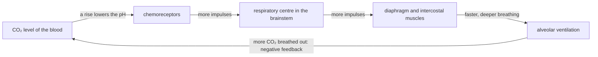
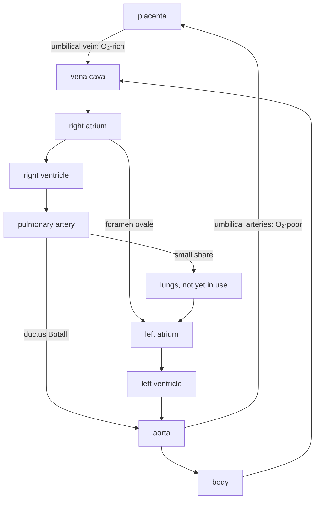

# B3 — Metabolism in Organisms: notes

These are English explanations of every learning outcome in [README.md](README.md), and every topic is *drafted*: written from the CCVX syllabus, the Dutch CvTE syllabus and standard VWO biology, not yet checked against an open source text or exam question.

- **In Dutch VWO:** central exam (CE).
- **Dutch source:** [CvTE syllabus biologie vwo 2027](https://www.examenblad.nl/2027/vwo/documenten/syllabus-biologie-vwo-2027) (version 2, July 2025), O1 *Stofwisseling van het organisme* (O1.1–O1.6). A citation like *(CvTE O1.3 spec 4)* means specification 4 of O1.3; its numbers don't match the CCVX numbers.

Dutch terms are in brackets. Binas tables are named, not numbered, because the numbers differ between editions.

## B3.1 Organs

### 1. Cells, tissues, organs and organ systems

- Cells (*cellen*) of one type, together with the intercellular substance (*tussencelstof*) they make, form a tissue (*weefsel*); several tissues together form an organ (*orgaan*), and organs that share a task form an organ system (*orgaanstelsel*). *(CvTE O1.1 spec 1)*
- The arrangement gives each level abilities its parts lack: one muscle cell can only shorten, but a ring of muscle cells around a tube can squeeze the tube shut.
- Animal tissues come in four groups: epithelium (*dekweefsel*) covers and lines surfaces, connective tissue (*bindweefsel*) supports and binds, muscle tissue (*spierweefsel*) contracts, and nerve tissue (*zenuwweefsel*) carries impulses.
- The gut wall is an organ built from all four: a mucous membrane (*slijmvlies*) with glands that secretes and absorbs, connective tissue with blood vessels (*bloedvaten*), nerves that coordinate, and two layers of smooth muscle that move the contents.
- Those two layers are the circular and longitudinal muscles (*kringspieren en lengtespieren*): circular muscle cells run around the gut and narrow it when they contract, longitudinal ones run along it and shorten it; together they push food along by peristalsis (B3.4 outcome 1). *(CvTE O1.4 spec 1)*
- Plants are organised the same way: a leaf is an organ of epidermis, palisade parenchyma (*palissadeparenchym*) and spongy parenchyma (*sponsparenchym*) for photosynthesis (*fotosynthese*), with xylem (*hout*) and phloem (*bast*) in the veins for transport.
- **Trap:** blood is a tissue as well: a connective tissue whose intercellular substance, the blood plasma (*bloedplasma*), is liquid.

### 2. Human organ systems for transport, respiration, food processing and excretion

- Four organ systems supply and clean the internal environment (*inwendig milieu*): the circulation (*bloedsomloop*) transports, the respiratory system exchanges gases, the digestive system breaks down and absorbs food, and the excretory organs remove the waste products (*afvalstoffen*) of metabolism. *(CvTE O1.3 spec 1, O1.4 spec 1, O1.5 spec 1 and O1.6 spec 1)*
- In CCVX's B3.3, "respiration" means breathing and gas exchange (*ademhaling*), not cellular respiration; the cell process is dissimilation (*dissimilatie*), covered in [B02](../B02-metabolism-in-cells/README.md).
- The organs on the CCVX list and their main job (structure and mechanism follow in B3.3–B3.6; the Binas diagrams of the heart and the kidney show two of them in section):

| Organ | System | Main function |
|---|---|---|
| heart (*hart*) | transport | muscular pump that keeps blood moving through the vessels |
| heart valves (*hartkleppen*) | transport | let blood pass in one direction only |
| artery (*slagader*) | transport | carries blood away from the heart, at high pressure |
| blood vessel: probably means vein (*ader*) | transport | carries blood back to the heart, at low pressure |
| capillary (*haarvat*) | transport | thin-walled vessel where blood exchanges substances with the tissue fluid (*weefselvloeistof*) |
| lymph system (*lymfesysteem*) | transport | returns surplus tissue fluid to the blood; part of the defence |
| lungs (*longen*) | respiration | gas exchange organ in the chest |
| trachea (*luchtpijp*) | respiration | windpipe that carries air from the throat into the chest |
| bronchi (*bronchiën*) | respiration | airways that branch from the trachea into the lungs |
| alveoli (*longblaasjes*) | respiration | tiny air sacs where O₂ and CO₂ diffuse between air and blood |
| oesophagus (*slokdarm*) | food processing | muscular tube that moves food from the throat to the stomach |
| stomach (*maag*) | food processing | stores and churns food; its acid kills microbes; protein digestion starts |
| duodenum (*twaalfvingerige darm*) | food processing | first part of the small intestine; receives bile (*gal*) and pancreatic juice (*alvleessap*) |
| pancreas (*alvleesklier*) | food processing | makes pancreatic juice with enzymes for carbohydrates, proteins and fats |
| liver (*lever*) | food processing, excretion | makes bile, processes absorbed nutrients (*voedingsstoffen*), makes urea (*ureum*) |
| gall bladder (*galblaas*) | food processing | stores and concentrates bile |
| small intestine (*dunne darm*) | food processing | finishes digestion and absorbs most nutrients |
| intestinal villi (*darmvlokken*) | food processing | finger-shaped outgrowths of the small-intestine wall that enlarge its absorbing surface |
| large intestine (*dikke darm*) | food processing | absorbs water and salts; houses the intestinal bacteria (*darmbacteriën*) |
| rectum (*endeldarm*) | food processing | stores faeces until defecation |
| kidneys (*nieren*) | excretion | filter the blood and make urine; regulate water, salts and pH |
| nephron (*niereenheid*) | excretion | functional unit of the kidney, about a million per kidney |
| sweat glands (*zweetklieren*) | excretion | make sweat (*zweet*), mainly for cooling, with some excretion |

- "Blood vessel" (*bloedvat*) normally covers arteries, veins and capillaries alike; Dutch *ader* means a vein but is also used for any blood vessel, which probably explains the CCVX list.
- **Trap:** the pancreas works in two systems: its digestive juice leaves through a duct into the gut (exocrine, *exocrien*), while its islets of Langerhans (*eilandjes van Langerhans*) release insulin and glucagon into the blood (endocrine, *endocrien*; see [B04](../B04-self-regulation-of-organisms/README.md)).

### 3. Organs and organ systems in humans and other animals

- Animals solve the same tasks with differently built organs, but the principles are shared: a large, thin, moist exchange surface, a steep concentration difference and, in bigger animals, a transport system. *(CvTE O1.1 spec 2)*
- Gas exchange (*gaswisseling*): mammals have lungs with alveoli; birds have lungs plus air sacs that keep air flowing one way through the lungs; insects have tracheae (*tracheeën*), air tubes that branch to every cell; earthworms use their moist skin; fish use gills (*kieuwen*).
- Gills are thin, much-folded outgrowths with a huge surface and dense capillaries; water passes them in one direction, and the blood inside flows the opposite way (the counterflow principle, *tegenstroomprincipe*, B3.6 outcome 2).
- Circulation: insects and snails have an open circulation (*open circulatiesysteem*), vertebrates and earthworms a closed one (*gesloten bloedsomloop*); fish have a single circulation (*enkele bloedsomloop*) with one atrium (*boezem*) and one ventricle (*kamer*), mammals and birds a double circulation (*dubbele bloedsomloop*) with a four-chambered heart (B3.6 outcome 1).
- Digestion: ruminants (*herkauwers*) such as cows have a stomach with several chambers in which microorganisms break down cellulose, and herbivores have longer guts than carnivores of similar size because plant food is harder to digest.
- Excretion of nitrogen: most fish release ammonia (NH₃) through their gills straight into the water, mammals make urea, and birds, most reptiles and insects make uric acid (*urinezuur*), which costs very little water.
- Vertebrates share one body plan, with the same organs (heart, lungs or gills, liver, kidneys, gut) in comparable positions.
- **Trap:** insect tracheae (air tubes), plant tracheids (*tracheïden*, water-conducting cells) and the human trachea (windpipe) share a name but are unrelated structures.

### 4. Gas exchange, absorption and transport in prokaryotes, plants and animals

- The bigger an organism, the smaller its surface compared with its volume: a 1 mm cube has 6 mm² of surface per mm³, a 10 mm cube only 0.6 mm² per mm³, so large organisms need enlarged exchange surfaces and a transport system. *(CvTE O1.1 spec 5)*
- Prokaryotes are single small cells: O₂ and CO₂ diffuse straight through the cell membrane and diffusion (*diffusie*) inside the cell is fast enough, so they need no organs.
- Prokaryotes absorb nutrients through the cell membrane by diffusion and active transport (*actief transport*); decomposing bacteria first release enzymes outside the cell and then take up the small products.
- Plants have no breathing movements and no blood: gases diffuse through the stomata (*huidmondjes*), pores in the leaf epidermis, into air spaces between the cells, and through small pores in bark (lenticels, *lenticellen*). *(CvTE O1.3 spec 5)*
- Plants don't digest food, as they make their own organic substances (*organische stoffen*); they absorb water and mineral ions through root hairs (*wortelharen*), long thin outgrowths of root epidermis cells that give the root an enormous surface. *(CvTE O1.6 spec 7)*
- Plants transport through two systems of tubes without a pump; tracheids and sieve tube elements are their conducting cells. Tracheids (*tracheïden*) are dead, lignified xylem cells that carry water and minerals upwards (the CvTE names the wider xylem vessel, *houtvat*); sieve tube elements are living phloem cells without a nucleus that join into sieve tubes (*bastvaten*) carrying sugars (B3.6 outcome 6).
- Animals digest their food in a gut and absorb the products; small flat animals such as flatworms manage with diffusion, but larger animals ventilate a gas exchange organ and pump blood around with a heart.
- The CvTE also compares digestion (*vertering*) and excretion (*uitscheiding*): prokaryotes digest outside the cell and lose waste by diffusion, plants store some waste in vacuoles or in leaves they shed, and animals have excretory organs such as kidneys.
- **Trap:** plants exchange gases day and night; in the dark they take up O₂ and give off CO₂ just like animals (B3.3 outcome 5).

### 5. How organ systems interrelate, and what an organ malfunction does

- Organ systems depend on each other: the gut and lungs take in glucose and O₂, the blood carries both to every cell for dissimilation, and the resulting CO₂ and urea leave through the lungs and kidneys. *(CvTE O1.1 specs 3–4)*
- The nervous and hormonal systems coordinate the others: adrenaline, for example, raises heart rate (*hartslagfrequentie*) and breathing at the same time ([B04](../B04-self-regulation-of-organisms/README.md)).
- The hormone EPO links the kidneys to the bone marrow (*beenmerg*): when the O₂ supply falls, as at high altitude, the kidneys release more EPO and the marrow makes more red blood cells (*rode bloedcellen*).
- Kidney failure: urea, salts, water and acid build up in the blood, which causes oedema (*oedeem*) and can disturb the heart rhythm (through a high K⁺ level); dialysis (*dialyse*) or a donor kidney takes over.
- Liver cirrhosis: less albumin in the plasma causes oedema, less bile hampers fat digestion, and bile pigments (*galkleurstoffen*) build up (jaundice, *geelzucht*).
- Cystic fibrosis (*taaislijmziekte*): one faulty chloride channel makes mucus thick, which clogs the airways (infections, poor gas exchange) and the pancreatic duct (enzymes fail to reach the duodenum, so fat is poorly digested), and makes sweat extra salty.
- **Trap:** the symptom can show up in another organ than the cause: when the left ventricle pumps too weakly, blood backs up into the lungs, fluid leaks into the alveoli, and the patient is short of breath because of a heart problem.

## B3.2 Photosynthesis

### 1. Autotrophic because of photosynthesis

- An autotroph (*autotroof*) makes its own organic substances from inorganic ones; plants, algae and cyanobacteria use light energy for this, in photosynthesis (*fotosynthese*). *(CvTE O1.2 spec 1)*
- A heterotroph (*heterotroof*) needs ready-made organic substances from other organisms: animals, fungi and most bacteria.
- Organic/inorganic substances: organic substances (*organische stoffen*) are the carbon compounds organisms build, such as glucose, starch (*zetmeel*), fats (*vetten*), proteins (*eiwitten*) and DNA; inorganic substances (*anorganische stoffen*) include water, CO₂, O₂ and mineral ions such as nitrate (NO₃⁻) and phosphate (PO₄³⁻). CO₂ contains carbon but counts as inorganic.
- Carbon assimilation (*koolstofassimilatie*) is building CO₂ into organic substances; the light and dark reactions (*lichtreactie*, *donkerreactie*) behind it are cell biology, in [B02](../B02-metabolism-in-cells/README.md).
- The net photosynthesis reaction is the overall equation that sums up both stages: 6 CO₂ + 6 H₂O → C₆H₁₂O₆ + 6 O₂, driven by light absorbed by chlorophyll (*chlorofyl*). *(CvTE M2.3 spec 10; Binas scheme of photosynthesis)*
- Written as 6 CO₂ + 12 H₂O → C₆H₁₂O₆ + 6 O₂ + 6 H₂O, it shows that all the O₂ comes from water: the 12 O atoms in 6 O₂ come from the 12 water molecules split in the light reaction.
- **Trap:** "net photosynthesis" has a second meaning: the gas exchange you measure, which is gross photosynthesis minus dissimilation; at the compensation point (*compensatiepunt*) it is zero (B3.3 outcome 5).

### 2. Conditions for photosynthesis in plants

- Photosynthesis needs light, CO₂, water, chloroplasts (*chloroplasten*) with chlorophyll, a suitable temperature, and minerals such as nitrogen and magnesium to build chlorophyll and enzymes. *(CvTE O1.2 spec 2)*
- Chloroplasts are the organelles that carry it out; most are in the palisade and spongy parenchyma of the leaf, and their chlorophyll absorbs mainly red and blue light.
- Light supplies the energy; CO₂, the carbon source, diffuses in through the stomata; water arrives from the roots through the xylem and is split in the light reaction, which releases the O₂.
- Temperature acts mainly on the enzymes of the dark reaction: the rate rises up to an optimum and drops when the enzymes start to denature.
- A limiting factor (*beperkende factor*) is the condition in shortest supply: it sets the rate, and raising it speeds photosynthesis up until another factor becomes limiting. Light, CO₂, temperature and water are the usual limiting factors.
- In a graph of rate against light intensity the curve rises and then levels off; a higher CO₂ concentration, or a temperature closer to the optimum, gives a higher plateau.
- Greenhouse growers use this: in bright light CO₂ is often limiting, so they add CO₂; in winter light is limiting, so they use assimilation lighting (*assimilatiebelichting*).
- **Trap:** adding more of a factor that isn't limiting doesn't raise the rate at all.

### 3. Photosynthesis as the basis for continued assimilation and dissimilation

- Continued assimilation (*voortgezette assimilatie*) means building all other organic substances from the glucose of photosynthesis: sucrose for transport, starch for storage, cellulose for cell walls, and fats and oils. *(CvTE O1.2 spec 3)*
- For proteins and nucleic acids the plant also needs minerals: nitrogen from nitrate or ammonium (NH₄⁺) for amino acids (*aminozuren*) and bases, and phosphorus from phosphate for DNA, RNA, ATP and phospholipids.
- Dissimilation (*dissimilatie*) breaks glucose down to make ATP; aerobic dissimilation is C₆H₁₂O₆ + 6 O₂ → 6 CO₂ + 6 H₂O. The ATP powers continued assimilation, active transport and growth. *(Binas scheme of dissimilation)*
- So photosynthesis delivers both the building material and, through dissimilation, the energy for everything else in the plant; heterotrophs depend on it too, through food chains and the O₂ in the air.
- A plant only gains biomass if, over 24 hours, photosynthesis makes more organic matter than dissimilation uses.
- Heterotrophs do continued assimilation as well: from digested nutrients, animals build their own glycogen (*glycogeen*), fats and proteins (B3.4).
- **Trap:** plants dissimilate in the light too; photosynthesis doesn't replace dissimilation during the day.

## B3.3 Respiration

### 1. Gas exchange organs in eukaryotes, especially humans

- Gas exchange (*gaswisseling*) is taking up O₂ and releasing CO₂ by diffusion across a moist surface; "respiration" here means breathing plus gas exchange (*ademhaling*). *(CvTE O1.3 spec 1)*
- Single-celled eukaryotes such as amoebae exchange gases across their cell membrane, plants through stomata (outcome 5), and animals through skin, gills, tracheae or lungs (B3.1 outcome 3).
- In humans air passes the nose (which warms, moistens and filters it), the throat and larynx, the trachea, the bronchi and ever narrower bronchioles (*bronchiolen*) before reaching the alveoli.
- The lungs are two spongy, elastic organs in the airtight chest cavity, each wrapped in pleural membranes; they have no muscle that can expand them.
- The trachea is kept open by C-shaped rings of cartilage (*kraakbeen*) and lined with ciliated epithelium (*trilhaarepitheel*) and mucus cells: the mucus traps dust and microbes, and the cilia sweep it up to the throat.
- The bronchi branch from the trachea into the lungs and keep branching; the bronchioles lack cartilage but have smooth muscle, which can narrow them, as in an asthma attack.
- The alveoli are hundreds of millions of tiny air sacs, each wrapped in capillaries, with a total surface of tens of square metres.
- **Trap:** gas exchange happens only in the alveoli; the trachea, bronchi and bronchioles only conduct air, and together they form the dead space (*dode ruimte*, outcome 3).

### 2. Structure, mechanism and function of gas exchange organs

- Fick's law (outcome 4) explains how every gas exchange organ is built: diffusion is faster through a larger surface, across a thinner barrier and down a steeper concentration difference, so these organs are large, thin, moist and richly supplied with blood. *(CvTE O1.3 spec 2)*
- In the alveoli, the vast number of sacs gives the area, the alveolar wall and the capillary wall are each a single flat cell (together less than 1 µm), and the moist lining lets the gases dissolve before they diffuse.
- A film of surfactant inside the alveoli lowers the surface tension so they don't collapse on breathing out; premature babies often lack it and struggle to breathe.
- Breathing and blood flow keep the concentration difference steep: fresh air keeps alveolar O₂ high and CO₂ low, and flowing blood carries the O₂ off and brings new CO₂.
- In a bony fish each gill arch (*kieuwboog*) carries many filaments covered in thin plates (lamellae), and water flows in through the mouth, across the gills and out under the gill cover (*kieuwdeksel*), always one way.
- Water holds about 30 times less O₂ per litre than air (at 20 °C) and is about 800 times denser, so ventilating gills costs a lot of energy and they must extract O₂ efficiently.
- In the lamellae the blood flows against the water (counterflow principle, B3.6 outcome 2): all along the lamella the water still holds more O₂ than the blood it meets, so the blood can leave with almost the O₂ level of fresh water.
- Insect tracheae carry air through openings in the body wall (spiracles) directly to the cells, so insect blood hardly transports O₂.
- **Trap:** a fish out of water suffocates not because air lacks O₂ but because its gill lamellae collapse and stick together, which shrinks the exchange surface.

### 3. How pulmonary ventilation comes about and is regulated

- Pulmonary ventilation (*longventilatie*) is refreshing the air in the alveoli; the respiratory muscles (*ademhalingsspieren*) bring it about by changing the volume, and so the pressure, of the chest cavity. *(CvTE O1.3 spec 3)*
- Two pleural membranes, one on the lung and one on the chest wall, enclose a thin film of fluid, the interpleural space (*interpleurale ruimte*); its pressure is below atmospheric, so the lungs cling to the chest wall and follow its movements.
- Breathing in: the diaphragm (*middenrif*) contracts and flattens, and the external intercostal muscles (*tussenribspieren*) lift the ribs up and out; the chest volume increases, the pressure in the lungs drops below atmospheric pressure, and air flows in.
- Breathing out at rest is passive: the muscles relax, the elastic lungs and chest wall recoil, the pressure in the lungs rises above atmospheric, and air flows out; in forced breathing out the internal intercostal and abdominal muscles help.
- These are the ventilation movements (*ventilatiebewegingen*): chest breathing (*borstademhaling*) mainly with the intercostal muscles, and abdominal breathing (*buikademhaling*) mainly with the diaphragm.
- If air enters the interpleural space, through a stab wound for example, the lung loses its grip on the chest wall and collapses: a pneumothorax (*klaplong*).
- A spirometer measures lung volumes. Typical values for a young adult man (women's are about 20–25% lower, and all vary with size, age and fitness): tidal volume (*ademvolume*) about 0.5 L, inspiratory reserve volume about 3.0 L, expiratory reserve volume about 1.1 L, residual volume (*restvolume*) about 1.2 L.
- Vital capacity (*vitale capaciteit*) is the most air you can breathe out after breathing in as deeply as possible: tidal volume + inspiratory reserve + expiratory reserve = 0.5 + 3.0 + 1.1 = 4.6 L here.
- The residual volume stays in the lungs even after the deepest breath out, so the alveoli always hold air and gas exchange goes on between breaths; a spirometer can't measure it.
- Lung capacity (*longcapaciteit*), the total lung capacity, is vital capacity + residual volume: 4.6 + 1.2 = 5.8 L.
- Minute ventilation (*ademminuutvolume*) is breathing rate × tidal volume: 12 per minute × 0.5 L = 6.0 L per minute at rest.
- Dead space (*dode ruimte*) is the volume of the airways, about 0.15 L, where no gas exchange happens: of a 0.5 L breath only 0.35 L (70%) is fresh air for the alveoli, an alveolar ventilation of 12 × 0.35 = 4.2 L per minute.
- Shallow breathing wastes more of each breath: 24 breaths of 0.25 L and 6 breaths of 1.0 L both move 6.0 L per minute, but bring 24 × 0.10 = 2.4 L and 6 × 0.85 = 5.1 L of fresh air to the alveoli.
- A snorkel adds its own volume to the dead space, so the snorkeller has to breathe more deeply for the same alveolar ventilation.
- The respiratory centre (*ademhalingscentrum*) in the brainstem (*hersenstam*) sets the rhythm: it sends impulses along motor nerves to the diaphragm and intercostal muscles.
- Chemoreceptors detect the CO₂ level, mostly through the pH it causes; some lie in the brainstem, others in small bodies on the aortic arch and the carotid arteries, and these also respond to a strong fall in O₂.
- When CO₂ rises, during exercise for example, the pH falls, the chemoreceptors fire more, and the respiratory centre makes breathing faster and deeper until CO₂ is back to normal: negative feedback ([B04](../B04-self-regulation-of-organisms/README.md)).

- You can change your breathing on purpose (talking, holding your breath), but a rising CO₂ level eventually forces you to breathe again.
- **Trap:** the main trigger for breathing is rising CO₂, not falling O₂; that's why hyperventilating before a dive is dangerous: CO₂ drops, the urge to breathe comes late, and the diver can black out from O₂ shortage first.

### 4. Uptake, transport and release of O₂ and CO₂; haemoglobin and myoglobin

- O₂ and CO₂ cross the exchange surfaces only by diffusion (*diffusie*), from high to low concentration or partial pressure (*zuurstofdruk*, *koolstofdioxidedruk*): in the lungs O₂ enters the blood and CO₂ leaves it, in the tissues it's the other way round. *(CvTE O1.3 spec 4)*
- CCVX's "Fick principle" corresponds to the CvTE *wet van Fick*, Fick's law of diffusion: the amount diffusing per second is proportional to area × concentration difference ÷ distance. In English physiology "Fick principle" usually names something else (working out blood flow from O₂ uptake), so here it probably means the diffusion law.
- The CvTE measures diffusion rate per area, in mol m⁻² s⁻¹ or g m⁻² s⁻¹; per square metre it depends on the concentration difference ÷ distance and on the gas, and the total amount per second also scales with the area. *(CvTE appendix 6)*
- So halving the area halves the rate, doubling the thickness of the barrier also halves it, and both together leave a quarter: emphysema destroys alveolar walls (less area), and fluid or scar tissue in the lungs thickens the barrier.
- O₂ concentration and CO₂ concentration (*zuurstofconcentratie*, *koolstofdioxideconcentratie*) are usually given as partial pressures: alveolar air has about 100 mmHg (13.3 kPa) O₂ and 40 mmHg (5.3 kPa) CO₂; blood arriving at the lungs about 40 mmHg O₂ and 46 mmHg (6.1 kPa) CO₂.
- The CO₂ difference is small, but CO₂ dissolves far better in water and diffuses about 20 times as fast as O₂, so it is exchanged just as completely.
- Inhaled air contains about 21% O₂ and 0.04% CO₂; exhaled air still about 16% O₂ (enough for mouth-to-mouth resuscitation) and about 4% CO₂, a hundred times as much.
- O₂ dissolves poorly in plasma, so about 98% of it travels bound to haemoglobin (*hemoglobine*) in the red blood cells; each haemoglobin molecule has four haem groups with an iron ion (Fe²⁺), each binding one O₂.
- The saturation curve (*verzadigingscurve*), or oxygen dissociation curve, plots haemoglobin's % saturation against pO₂; it is S-shaped because each O₂ that binds makes binding the next one easier.
- In the lungs (about 100 mmHg) haemoglobin is about 97–98% saturated and in resting tissue (about 40 mmHg) still about 75%, so at rest it gives up only about a quarter of its O₂ and keeps a reserve.
- On the steep part of the curve a small drop in pO₂ releases a lot of O₂: at 20 mmHg (2.7 kPa), as in a hard-working muscle, haemoglobin is only about a third saturated, so about two-thirds of its O₂ has been released.
- Bohr effect (*Bohr-effect*): more CO₂ and a lower pH lower haemoglobin's affinity for O₂, so the curve shifts to the right and more O₂ is released, exactly in the most active tissues; in the lungs CO₂ leaves and the affinity rises again. A higher temperature shifts the curve the same way.
- Myoglobin (*myoglobine*), the red O₂-binding protein in muscle cells, has a single haem group, so its curve is not S-shaped, and a higher affinity than haemoglobin, so its curve lies to the left: it takes over O₂ from haemoglobin and releases it only when the muscle's pO₂ falls very low.
- Diving mammals such as seals and whales store extra O₂ for long dives in muscles packed with myoglobin.
- Fetal haemoglobin also binds O₂ more strongly than adult haemoglobin, so the fetus can take O₂ from the mother's blood (B3.6 outcome 3).
- Carbon monoxide (CO) binds haemoglobin about 200–250 times more strongly than O₂ and so blocks O₂ transport.
- CO₂ transport: about 7% travels dissolved in the plasma, about 23% bound to the protein part of haemoglobin, and about 70% as HCO₃⁻; textbooks round these shares differently.
- In the red blood cells the enzyme carbonic anhydrase speeds up CO₂ + H₂O ⇌ H₂CO₃ ⇌ H⁺ + HCO₃⁻; the HCO₃⁻ moves out into the plasma and haemoglobin binds the H⁺.
- Haemoglobin and HCO₃⁻ buffers (*bufferende werking van hemoglobine en HCO₃⁻*): haemoglobin takes up H⁺, and HCO₃⁻ binds H⁺ as H⁺ + HCO₃⁻ → H₂CO₃, which keeps blood pH at about 7.4 while large amounts of CO₂ pass through. *(CvTE O2.1 specs 1–2; [chemistry C01](../../../CCVX-chemistry/C-chemical-processes-and-conservation-laws/C01-chemical-processes/README.md))*
- In the lungs everything runs backwards: HCO₃⁻ returns into the red blood cells and joins H⁺ to form H₂CO₃, which splits into H₂O and CO₂, and the CO₂ diffuses into the alveoli.
- H₂CO₃, carbonic acid, is the weak acid that forms when CO₂ dissolves in water ([chemistry 05-acids-and-bases](../../../CCVX-chemistry/0-basic-knowledge/05-acids-and-bases/README.md)).
- **Trap:** CO₂ doesn't bind to haemoglobin's iron (that is where O₂ binds), and most CO₂ travels not bound to haemoglobin but as HCO₃⁻, mainly in the plasma.

### 5. Gas exchange in plants, photosynthesis and dissimilation

- All living plant cells dissimilate and use O₂ day and night; cells with chloroplasts also photosynthesize in the light, which is the assimilation of CO₂; the net gas exchange through the stomata is the difference between the two. *(CvTE O1.3 spec 5)*
- Stomata are pores between two guard cells (*sluitcellen*), in most leaves mainly on the underside; when the guard cells take up K⁺ by active transport, water follows by osmosis (*osmose*), the turgor rises, and because their inner walls are thicker the cells bend apart and open the pore.
- Behind the stomata, air spaces in the spongy parenchyma let CO₂ and O₂ diffuse to and from every leaf cell.
- In bright light photosynthesis outpaces dissimilation, so the leaf takes up CO₂ and releases O₂; in the dark only dissimilation runs, so it takes up O₂ and releases CO₂.
- At the compensation point the two rates are equal and there is no net gas exchange; a plant only grows if it spends enough time above it.
- Stomata are a compromise: open, they let in CO₂ for assimilation but let out water vapour; in drought they close, CO₂ becomes the limiting factor and photosynthesis slows down.
- The position follows the function: floating water-lily leaves have their stomata on the upper side, and desert plants have few, sunken stomata under a thick waxy cuticle.
- **Trap:** plants don't breathe CO₂ "instead of" O₂; they need O₂ for dissimilation all the time, and only the net direction of gas exchange depends on light.

## B3.4 Digestion

### 1. Digestive organs in eukaryotes, especially humans

- Digestion (*spijsvertering*) breaks large food molecules into small ones that can be absorbed; amoebae digest inside food vacuoles, fungi release enzymes onto their food and absorb the products, and animals digest in a gut. *(CvTE O1.4 spec 1)*
- In humans food passes the mouth, throat, oesophagus, stomach, small intestine, large intestine and rectum to the anus; the salivary glands (*speekselklieren*), pancreas and liver deliver their juices through ducts.
- Mouth: the teeth cut and grind food, and the salivary glands add saliva (*speeksel*), which moistens it and starts the digestion of starch.
- Oesophagus: a muscular tube that pushes swallowed food to the stomach by peristalsis, which works even upside down.
- Stomach: a muscular bag that keeps food for a few hours, mixes it with gastric juice (*maagsap*) into a thick liquid called chyme, and lets it into the duodenum in small portions through a ring muscle, the pylorus (*maagportier*).
- Duodenum: the first part of the small intestine, where bile and pancreatic juice flow in through a duct.
- Liver and gall bladder: the liver makes bile (*gal*) continuously, and the gall bladder stores and concentrates it and squeezes it into the duodenum when fatty food arrives.
- Small intestine: several metres long; digestion is completed there and most nutrients and water are absorbed through its villi.
- Large intestine: absorbs much of the remaining water and salts and holds most of the intestinal bacteria; the rectum stores the faeces until defecation.
- Intestinal peristalsis (*darmperistaltiek*) is a wave of muscle contraction that moves the contents along: the circular muscles (*kringspieren*) contract behind the food and narrow the gut there while the part ahead relaxes; the longitudinal muscles (*lengtespieren*) shorten and widen a section, so the two layers act as antagonists.
- **Trap:** the liver makes bile; the gall bladder only stores and concentrates it.

### 2. Structure and function of the digestive organs

- The gut's structures mostly serve to enlarge a surface, to mix and move the contents, or to protect the wall. *(CvTE O1.4 spec 2)*
- The inner surface of the small intestine is folded, the folds carry intestinal villi (up to about 1 mm long), and the cells on the villi carry microvilli, which together make the absorbing surface enormous.
- Each villus (*darmvlok*) has a single layer of epithelial cells (short diffusion distance), a capillary network that carries away sugars and amino acids, and a central lymph vessel (*lymfevat*) that takes up fats.
- Epithelial cells that absorb by active transport contain many mitochondria, which supply the ATP.
- The stomach wall has a third, diagonal muscle layer for churning, deep folds with glands, and a thick layer of mucus (*slijm*) with HCO₃⁻ that protects it against its own acid and pepsin.
- Ring muscles (sphincters) at the entrance and exit of the stomach and at the anus control the passage; in Dutch these are also called *kringspieren*.
- Protein-digesting enzymes are made as inactive pro-enzymes (*pro-enzymen*), such as pepsinogen and trypsinogen, so they don't digest the cells and ducts that produce them; they are activated only in the stomach or the duodenum (outcome 3).
- How long the gut is and how long food stays in it decide how much can be digested and absorbed, which is why herbivores have longer guts than carnivores (B3.1 outcome 3).
- **Trap:** most water is absorbed in the small intestine, not the large intestine; the large intestine takes up much of what is left.

### 3. Where and how nutrients are digested and absorbed, and what affects this

- Nutrients (*voedingsstoffen*) are the substances in food that the body uses: carbohydrates, proteins, fats, vitamins (*vitaminen*), minerals and water; large molecules (starch, proteins, fats) must be digested first, small ones are absorbed as they are. *(CvTE O1.4 specs 3–4)*
- Mechanical and chemical digestion: mechanical digestion (*mechanische vertering*) breaks food into smaller pieces by chewing and churning without changing the molecules, which gives enzymes more surface to work on; chemical digestion (*chemische vertering*) splits the molecules by hydrolysis, catalysed by enzymes.
- Hydrolysis uses water to break the bond: maltose, for example, is split as C₁₂H₂₂O₁₁ + H₂O → 2 C₆H₁₂O₆ ([chemistry G01](../../../CCVX-chemistry/G-society-chemistry-and-technology/G01-chemistry-of-life/README.md)).
- Digestive juices (*verteringssappen*) bring the enzymes and set the pH: *(Binas table on digestion)*

| Digestive juice | Made by | Works in | Main contents |
|---|---|---|---|
| saliva | salivary glands | mouth | amylase, mucus, water |
| gastric juice | glands in the stomach wall | stomach | hydrochloric acid (HCl), pepsinogen, mucus |
| bile | liver, stored in the gall bladder | duodenum | bile salts, bile pigments, cholesterol; no enzymes |
| pancreatic juice (*alvleessap*) | pancreas | duodenum | HCO₃⁻, amylase, trypsinogen and other protein-digesting enzymes, lipase |
| intestinal juice (*darmsap*) and enzymes on the villi | small-intestine wall | small intestine | maltase, sucrase, lactase, peptidases |

- Digestive enzymes for carbohydrates: amylase in saliva and pancreatic juice splits starch into maltose; maltase splits maltose into glucose, sucrase splits sucrose into glucose and fructose, and lactase splits lactose into glucose and galactose. Human enzymes can't split cellulose.
- Enzymes for proteins: pepsin in the stomach cuts proteins into shorter polypeptides, trypsin in the duodenum cuts these into short peptides, and peptidases on the intestinal wall release the amino acids.
- The pro-enzymes are switched on where they are needed: pepsinogen becomes pepsin through the acid (and through pepsin itself); trypsinogen becomes trypsin through an enzyme of the duodenal wall (enterokinase), and trypsin then activates the other pancreatic pro-enzymes.
- Enzymes for fats: lipase from the pancreas splits fats (triglycerides) into fatty acids and glycerol (in practice mostly into fatty acids and monoglycerides).
- Bile contains bile salts (*galzouten*) that emulsify the fats. Emulsification (*emulgeren*): each bile salt has a fat-soluble part that sits in the fat and a water-soluble part that faces the water, so large fat drops break up into tiny droplets with a far larger total surface for lipase.
- Digestive hormones (*spijsverteringshormonen*) from the stomach and duodenum coordinate the juices; cholecystokinin, for example, released when fat reaches the duodenum, makes the gall bladder contract and the pancreas release enzymes ([B04](../B04-self-regulation-of-organisms/README.md)).
- Vitamins (*vitaminen*) are needed in small amounts and are absorbed without digestion; the fat-soluble ones (A, D, E, K) are absorbed along with fats and so need bile, the water-soluble ones (B vitamins, C) don't. Vitamin B12 is absorbed only at the end of the small intestine, with the help of a factor made by the stomach wall.
- Products of digestion (*verteringsproducten*): monosaccharides (glucose, fructose, galactose), amino acids, fatty acids and glycerol or monoglycerides; these are small enough to be absorbed.
- Absorption (*resorptie*): glucose and amino acids enter the cells of the villi mostly by active transport and then pass into the capillaries, which drain through the hepatic portal vein (*poortader*) to the liver.
- Fatty acids and monoglycerides are fat-soluble, so they diffuse through the cell membranes ([chemistry E02](../../../CCVX-chemistry/E-innovation-and-chemical-research/E02-selectivity-and-specificity/README.md)); inside the cells they are rebuilt into fats and packed with protein into particles that enter the central lymph vessel and reach the blood without passing the liver first.
- Water follows the absorbed nutrients and salts by osmosis.
- Dietary fibre (*voedingsvezel*) is plant material that human enzymes can't digest, such as cellulose: it adds bulk, holds water and stretches the gut wall, which stimulates peristalsis, prevents constipation and makes you feel full.
- Intestinal bacteria (*darmbacteriën*), mostly in the large intestine, ferment dietary fibre and make vitamin K and some B vitamins; they also crowd out harmful microbes, and antibiotics can upset this balance.
- pH: every enzyme has an optimum pH: salivary amylase about 7 (it stops working once the stomach acid reaches it), pepsin about 2, and the pancreatic enzymes slightly alkaline, about 7–8, after the HCO₃⁻ in pancreatic juice has neutralised the acid chyme ([B02](../B02-metabolism-in-cells/README.md), [chemistry E02](../../../CCVX-chemistry/E-innovation-and-chemical-research/E02-selectivity-and-specificity/README.md)).
- Temperature: human digestive enzymes work best at about body temperature, 37 °C; they work more slowly when colder and denature well above their optimum.
- Other factors: without enough lactase (lactose intolerance) lactose reaches the bacteria of the large intestine, giving gas and diarrhoea; in coeliac disease (*coeliakie*) an immune reaction to gluten flattens the villi and reduces absorption; a blocked bile duct hampers the uptake of fat and vitamin K.
- **Trap:** bile contains no enzymes and digests nothing chemically: it only emulsifies, and lipase does the splitting.

## B3.5 Excretion

### 1. Excretory organs in eukaryotes, especially humans

- Excretion (*uitscheiding*) is the removal of waste products of metabolism, such as CO₂, urea and bile pigments, and of surplus water and salts; in humans the kidneys, liver, lungs and skin (*huid*) do this. *(CvTE O1.5 spec 1)*
- Faeces are mainly undigested food remains and bacteria that never entered the body's cells, so defecation isn't excretion, except for the bile pigments in the faeces.
- Single-celled eukaryotes lose waste by diffusion, and those in fresh water pump out surplus water with a contractile vacuole; plants have no excretory organs (B3.1 outcome 4).
- The kidneys lie against the back wall of the abdomen; each has an outer renal cortex (*nierschors*), an inner renal medulla (*niermerg*) and a renal pelvis (*nierbekken*) that collects the urine. *(Binas diagram of the kidney)*
- Urine flows from the renal pelvis through a ureter (*urineleider*) into the bladder (*urineblaas*), a stretchy muscular bag that stores it, and leaves through the urethra (*urinebuis*); stretch receptors in the bladder wall signal when it is full.
- Each kidney contains about a million nephrons: a glomerulus, a knot of capillaries, sits in a Bowman's capsule (*kapsel van Bowman*), a double-walled cup that continues as a long renal tubule (*nierbuisje*) with a loop of Henle (*lis van Henle*), which drains into a collecting duct (*verzamelbuis*).
- The glomeruli, capsules and coiled parts of the tubules lie in the cortex; the loops of Henle and the collecting ducts run down into the medulla.
- Ultrafiltration (*ultrafiltratie*): the blood pressure (*bloeddruk*) in the glomerulus pushes water and small dissolved particles (glucose, amino acids, salts, urea) through the capillary wall and the inner wall of the capsule, while blood cells and large proteins stay in the blood. *(CvTE O1.5 spec 3)*
- The liquid in the capsule is the renal ultrafiltrate (*voorurine*), usually called primary urine: about 125 mL per minute, which is about 180 L per day (textbooks give 150–180 L).
- Reabsorption (*reabsorptie*, *terugresorptie*): along the tubule, useful substances return to the capillaries around it: all glucose and amino acids and most salts by active transport, and water by osmosis.
- Tubule cells also actively secrete some substances into the urine, such as H⁺, K⁺ and many drugs.
- What is left is urine: about 1.5 L per day (roughly 1–2 L), so about 99% of the filtrate is reabsorbed, and the kidneys filter the whole plasma volume (about 3 L) roughly 60 times a day.
- The liver is made of tens of thousands of liver lobules (*leverlobjes*), small six-sided units: blood from the hepatic portal vein and the hepatic artery flows from their corners past rows of liver cells to a central vein, while bile flows the other way, between the cells, to bile ducts at the corners.
- Sweat glands are coiled tubes deep in the dermis (*lederhuid*), surrounded by capillaries, with a duct that opens in a pore at the surface of the epidermis (*opperhuid*).
- **Trap:** the renal ultrafiltrate still contains glucose and amino acids, but normal urine doesn't, because all of them are reabsorbed.

### 2. Structure and function of the excretory organs

- Each part of the nephron is built for its step: high pressure for filtering, a large surface for reabsorption, and long loops for concentrating the urine. *(CvTE O1.5 spec 2)*
- The vessel that brings blood into the glomerulus is wider than the one that takes it out, so the pressure in the glomerulus stays high and drives ultrafiltration.
- The filter has openings too small for blood cells and large proteins such as albumin; protein in the urine signals a damaged filter.
- The first, coiled part of the tubule does most of the reabsorption, and its cells have microvilli (large surface) and many mitochondria (ATP for active transport).
- The loops of Henle pump salt out into the surrounding medulla, which gives it a high osmotic value (*osmotische waarde*); the collecting ducts run through this salty tissue, so water can leave them by osmosis (outcome 3).
- Fluid flows down one limb of the loop and up the other, an example of the counterflow principle (B3.6 outcome 2); the longer the loops, the more concentrated the urine can be, so desert rodents such as the kangaroo rat, with very long loops, hardly need to drink.
- An artificial kidney (*kunstnier*) imitates the filter by dialysis: blood flows along a membrane, against the flow of a dialysis fluid that contains no urea but normal levels of glucose and salts, so urea diffuses out while glucose and salts stay.
- In the liver lobule, wide and leaky capillaries let blood flow slowly past every liver cell, which can then take up, store or convert substances from it.
- The coiled part of a sweat gland makes a fluid much like plasma without proteins, and its duct takes back much of the salt, so sweat is more dilute than blood (in cystic fibrosis this fails and sweat is very salty).
- **Trap:** glucose in the urine in diabetes doesn't mean the filter leaks: the blood glucose is so high that the filtrate holds more glucose than the tubule carriers can reabsorb.

### 3. The role of the liver, kidneys, lungs and skin in excretion

- Each organ removes particular waste: the liver makes urea and excretes bile pigments and cholesterol in the bile, the kidneys excrete urea, water, salts and acid, the lungs CO₂, and the skin water and salts in sweat. *(CvTE O1.5 spec 3)*
- Urea (*ureum*): the liver removes the amino group from surplus amino acids; the ammonia (NH₃) that forms is very toxic, so the liver converts it into the far less toxic, water-soluble urea, 2 NH₃ + CO₂ → CO(NH₂)₂ + H₂O, which the blood carries to the kidneys.
- Bile salts (*galzouten*) are made in the liver from cholesterol; after emulsifying fats, most are reabsorbed at the end of the small intestine and reused, and the rest leaves with the faeces, one of the ways the body gets rid of cholesterol.
- Bile pigments (*galkleurstoffen*) such as bilirubin come from the haem of broken-down red blood cells; the liver excretes them in bile, they turn faeces brown, and a breakdown product makes urine yellow.
- If bile pigments build up in the blood (liver disease, a blocked bile duct, or fast breakdown of red blood cells), the skin and eyes turn yellow: jaundice.
- The liver also breaks down alcohol and turns many drugs and toxins into water-soluble substances that the kidneys can excrete.
- Water regulation (*waterhuishouding*): the body gains water from drinking, food and dissimilation and loses it in urine, sweat, breath and faeces; the kidneys keep the balance by varying the volume of urine.
- Osmotic value (*osmotische waarde*) measures the concentration of dissolved particles: the higher it is, the more strongly a solution draws in water by osmosis ([B02](../B02-metabolism-in-cells/README.md)); the kidneys keep the osmotic value of the blood almost constant.
- ADH (antidiuretic hormone): when the blood's osmotic value rises, the hypothalamus detects it and the pituitary gland (*hypofyse*) releases more ADH, which makes the collecting ducts permeable to water; more water is then reabsorbed into the salty medulla, giving a small volume of concentrated urine ([B04](../B04-self-regulation-of-organisms/README.md); Binas table of human hormones).
- With a water surplus the reverse happens: little ADH, collecting ducts that stay closed to water, and a lot of dilute urine; alcohol suppresses ADH release, which is why it makes you urinate more.
- HCO₃⁻ buffers: the kidneys keep blood pH at about 7.4 by reabsorbing the filtered HCO₃⁻ and secreting H⁺ into the urine, so urine pH can vary between roughly 4.5 and 8 ([chemistry C01](../../../CCVX-chemistry/C-chemical-processes-and-conservation-laws/C01-chemical-processes/README.md)).
- The lungs excrete CO₂, the main waste product of dissimilation; breathing out more CO₂ also removes acid, because it pulls CO₂ + H₂O ⇌ H⁺ + HCO₃⁻ to the left.
- Sweat (*zweet*) is mostly water with NaCl and a little urea; its evaporation cools the skin, which is the main reason we sweat, so excretion by the skin is a side effect.
- **Trap:** the liver makes urea but doesn't excrete it; the kidneys do.

## B3.6 Transport

### 1. The circulation with heart and blood vessels

- The circulation (*bloedsomloop*) moves blood, driven by the heart, through arteries, capillaries and veins, carrying O₂, CO₂, nutrients, waste products, hormones and heat. *(CvTE O1.6 spec 1)*
- Open and closed circulation: in an open circulation (*open circulatiesysteem*), as in insects and snails, the heart pumps blood into the body cavity, where it bathes the organs before it flows back to the heart; in a closed circulation (*gesloten bloedsomloop*), as in vertebrates, earthworms and squid, the blood stays in vessels and exchanges substances through the capillary walls.
- A closed circulation can keep a higher pressure and send blood where it's needed, which suits larger, active animals.
- Single and double circulation: in a single circulation (*enkele bloedsomloop*), as in fish, blood passes the heart once per round, from heart to gills to body and back; the pressure is low after the gill capillaries, so blood moves slowly through the body.
- In a double circulation (*dubbele bloedsomloop*), as in mammals and birds, blood passes the heart twice per round, through two separate circuits; in amphibians and most reptiles the ventricle isn't fully divided, so some blood mixes.
- Small circulation (*kleine bloedsomloop*), the pulmonary circulation: right ventricle → pulmonary arteries (*longslagaders*) → lung capillaries → pulmonary veins (*longaders*) → left atrium; the blood picks up O₂ and gives off CO₂.
- Large circulation (*grote bloedsomloop*), the systemic circulation: left ventricle → aorta → arteries → capillaries in all organs → veins → venae cavae (*holle aders*) → right atrium.
- The heart has two atria (*boezems*) that receive blood and two ventricles (*kamers*) that pump it out; a dividing wall (septum, *tussenschot*) keeps oxygen-rich blood on the left apart from oxygen-poor blood on the right. *(Binas diagram of the heart)*
- In systole the heart muscle contracts, the atria first and then the ventricles; in diastole it relaxes and the chambers fill from the veins, mostly passively.
- At 75 beats per minute one cycle lasts 0.8 s, of which the ventricles spend about 0.3 s in systole and the rest in diastole; when the heart rate rises, diastole shortens most.
- The heartbeat starts in the heart itself: the sinoatrial node (*sinusknoop*), a patch of special muscle cells in the wall of the right atrium, fires impulses on its own and acts as the pacemaker.
- The impulse spreads across both atria, which contract; a non-conducting layer separates them from the ventricles except at the AV node (*AV-knoop*), which delays the impulse by about 0.1 s so the atria can empty first.
- The bundle of His (*bundel van His*) then carries the impulse down the septum to the tip of the heart, and its branches spread it through the ventricle walls, so the ventricles contract from the bottom up and squeeze blood into the arteries.
- Heart rate (*hartslagfrequentie*) is the number of beats per minute, at rest about 60–80; stroke volume (*slagvolume*) is the volume one ventricle pumps out per beat, at rest about 70 mL.
- Cardiac output (*hartminuutvolume*) = heart rate × stroke volume: 70 per minute × 70 mL = 4.9 L, about 5 L per minute at rest, so the whole blood volume (about 5 L) passes the heart about once a minute.
- In hard exercise both rise, for example to 180 per minute × 110 mL = 19.8 L per minute, about four times the resting value; a trained athlete has a larger stroke volume and so a lower resting heart rate, for example 50 × 100 mL = 5.0 L per minute.
- The autonomic nervous system and adrenaline adjust rate and force: orthosympathetic (sympathetic) nerves speed the heart up, and the parasympathetic vagus nerve slows it down ([B04](../B04-self-regulation-of-organisms/README.md)).
- **Trap:** the heart doesn't need nerves to beat: the sinoatrial node sets the rhythm, and nerves and hormones only change its rate, which is why a transplanted heart, with its nerves cut, still beats.

### 2. Structure and function of the heart and blood vessels

- Each part of the heart and vessels is built for its pressure and its job: pumping, withstanding pressure, preventing backflow or exchanging substances. *(CvTE O1.6 spec 2)*
- Heart valves let blood flow one way only: the atrioventricular valves (*zeilvormige kleppen*; tricuspid on the right, bicuspid or mitral on the left) close when the ventricles contract, held by tendons (*peesdraden*) so they don't flip into the atria; the semilunar valves (*halvemaanvormige kleppen*) at the start of the aorta and the pulmonary artery close when the ventricles relax.
- The closing valves make the heart sounds; a leaky or narrowed valve forces the heart to work harder.
- The left ventricle has a much thicker wall than the right because it drives blood through the whole body at high pressure, while the right one pumps only through the nearby lungs; both pump the same volume per beat.
- The heart muscle gets its own blood from the coronary arteries (*kransslagaders*); if one is blocked, the part of the muscle it supplies dies: a heart attack (*hartinfarct*).
- Arteries carry blood away from the heart; their thick wall with elastic fibres stretches during systole and recoils during diastole, which keeps blood moving between beats, and smooth muscle in small arteries controls how much blood each organ gets.
- Blood pressure (*bloeddruk*) in the large arteries swings between a systolic pressure (*bovendruk*) of about 120 mmHg (16.0 kPa) and a diastolic pressure (*onderdruk*) of about 80 mmHg (10.7 kPa), written 120/80; it falls along the circulation and is lowest in the large veins near the heart.
- Veins (*aders*) carry blood back to the heart at low pressure: their wall is thinner, their lumen wider, and valves stop backflow; contracting skeletal muscles squeeze the veins and push blood towards the heart.
- If vein valves fail, blood pools in the legs and the veins bulge: varicose veins (*spataderen*).
- Capillaries have a wall of a single layer of flat cells and are about as narrow as a red blood cell (5–10 µm); together they have a huge total cross-section, so blood flows slowly through them and has time for exchange.
- Counterflow principle (*tegenstroomprincipe*), usually called the countercurrent principle: when two fluids flow past each other in opposite directions, a difference in concentration or temperature remains along the whole length, so exchange goes on all the way; with flow in the same direction they soon become equal and exchange stops.
- In the simplest model (equal flows), flow in the same direction gets the receiving fluid at most halfway to the level of the giving fluid, while counterflow can get it close to that level; fish gills use it for O₂ (B3.3 outcome 2), the kidney's loops of Henle for salt (B3.5 outcome 2), and artificial kidneys for urea.
- The same principle saves heat: in the legs of wading birds and the flippers of whales, arteries run right next to veins, so warm blood flowing out heats the cold blood flowing back and little heat is lost.
- Atherosclerosis (*atherosclerose*): cholesterol and other fats build up in the artery wall, which narrows and stiffens the artery, raises blood pressure and can trigger a blood clot (outcome 4).
- **Trap:** arteries and veins are named for their direction, not their O₂ content: the pulmonary artery carries oxygen-poor blood, the pulmonary vein oxygen-rich blood.

### 3. Embryonic circulation and the circulation after birth

- In the embryonic circulation (*embryonale bloedsomloop*) the placenta, not the lungs, is the organ for gas exchange, nutrient uptake and excretion; the fetal lungs are filled with fluid and receive little blood. *(CvTE O1.6 spec 3)*
- The umbilical vein (*navelstrengader*) carries oxygen-rich, nutrient-rich blood from the placenta to the fetus; partly through the liver and partly past it, this blood reaches the inferior vena cava and so the right atrium.
- Two umbilical arteries (*navelstrengslagaders*) carry oxygen-poor blood with CO₂ and urea from the fetus back to the placenta.
- The foramen ovale is an opening with a flap in the wall between the atria; much of the blood flows straight from the right atrium into the left one, bypassing the lungs.
- The ductus arteriosus (*ductus Botalli*) is a short vessel between the pulmonary artery and the aorta; most of the blood the right ventricle pumps out flows through it into the aorta instead of into the lungs.
- In the placenta the blood of mother and fetus doesn't mix: substances diffuse across the thin walls of the placental villi, and fetal haemoglobin's higher O₂ affinity helps take O₂ from the mother's blood ([E03](../../E-reproduction/E03-reproduction-of-organisms/README.md)).

- At birth the first breaths open up the lungs, much more blood flows through them and returns to the left atrium, and the flow from the placenta stops; the pressure in the left atrium now exceeds that in the right, which presses the flap of the foramen ovale shut.
- The ductus Botalli constricts in the first days after birth and later becomes a ligament; the umbilical vessels close as well.
- In both situations the heart has four chambers and the circulation is closed; the differences are the placenta instead of the lungs, the two shunts, the umbilical vessels, and partly mixed blood, so fetal arterial blood carries less O₂.
- If the foramen ovale or the ductus Botalli stays open, oxygen-rich and oxygen-poor blood keep mixing or the lungs get too much blood, and the heart must work harder; an operation can close the gap.
- **Trap:** the umbilical vein carries oxygen-rich blood and the umbilical arteries oxygen-poor blood, because the names refer to the direction relative to the fetal heart.

### 4. Blood, plasma, tissue fluid and lymph, and how tissue fluid and lymph form

- Blood composition (*bloedsamenstelling*): an adult has about 5 L of blood, about 55% plasma and about 45% cells, nearly all of them red blood cells. *(CvTE O1.6 specs 4–5; Binas table on blood)*
- Blood plasma (*bloedplasma*) is about 90% water and about 7% proteins (albumin, antibodies, and clotting factors such as fibrinogen); the remaining few percent are salts, nutrients, waste products, hormones and dissolved gases.
- Nutrients and waste products (*voedingsstoffen*, *afvalstoffen*) travel dissolved in the plasma: glucose, amino acids, fats (packed in lipoproteins), vitamins and salts, and urea, CO₂ (as HCO₃⁻) and bilirubin.
- Red blood cells (*rode bloedcellen*), about 5 million per mm³, carry O₂: they are biconcave discs without a nucleus or mitochondria, packed with haemoglobin; the shape gives a large surface and a short diffusion distance, and they live about 120 days.
- Oxygen transport and carbon dioxide transport (*zuurstoftransport*, *koolstofdioxidetransport*): about 98% of the O₂ travels bound to haemoglobin; CO₂ travels mostly as HCO₃⁻ in the plasma, partly bound to haemoglobin and a little dissolved (B3.3 outcome 4).
- Haemoglobin loads O₂ in the lungs and unloads it in the tissues thanks to its S-shaped saturation curve and the Bohr effect, the right shift caused by CO₂ and acid (heat adds to it); myoglobin in muscle binds O₂ more strongly and stores it (B3.3 outcome 4).
- Buffer substances: HCO₃⁻, haemoglobin, plasma proteins and phosphate take up or release H⁺ and keep blood pH between about 7.35 and 7.45.
- The HCO₃⁻ buffer works both ways: acid is taken up as H⁺ + HCO₃⁻ → H₂CO₃, which leaves through the lungs as H₂CO₃ → CO₂ + H₂O, and base is neutralised as OH⁻ + H₂CO₃ → HCO₃⁻ + H₂O ([chemistry C01](../../../CCVX-chemistry/C-chemical-processes-and-conservation-laws/C01-chemical-processes/README.md)).
- White blood cells (*witte bloedcellen*), about 4 to 10 thousand per mm³, defend the body: phagocytes engulf microbes, and lymphocytes (B and T cells) make antibodies or kill infected cells ([B05](../B05-defence-in-organisms/README.md)).
- Platelets (*bloedplaatjes*) are small cell fragments without a nucleus that start blood clotting.
- Coagulation (*bloedstolling*): at a wound, platelets stick to the damaged wall and to each other, and they and the damaged tissue release substances that start a chain of reactions; this needs Ca²⁺ and clotting factors made in the liver, several of them with the help of vitamin K, and at the end thrombin turns soluble fibrinogen into insoluble fibrin threads that trap blood cells into a clot.
- In haemophilia (*hemofilie*) a hereditary lack of a clotting factor makes small wounds bleed for a long time; a clot inside an intact vessel (thrombosis, *trombose*) can block it.
- Bone marrow (*beenmerg*): red bone marrow in flat bones (breastbone, ribs, pelvis, vertebrae) and the ends of long bones makes all blood cells from stem cells; the kidney hormone EPO stimulates red blood cell production.
- Cholesterol is a lipid the body needs for cell membranes and to make steroid hormones, vitamin D and bile salts; the liver makes most of it, and it travels in the blood packed in lipoproteins.
- LDL carries cholesterol from the liver to the tissues and, in excess, deposits it in artery walls (atherosclerosis); HDL takes surplus cholesterol back to the liver, so a high LDL level raises the risk of heart attacks and strokes.
- Tissue fluid (*weefselvloeistof*) is the liquid between the cells: plasma that has left the capillaries without the blood cells and most of the proteins; every cell exchanges substances with it.
- Colloid osmotic pressure (*colloïd-osmotische druk*) is the osmotic pull of the plasma proteins, mainly albumin, which stay in the capillary and draw water into it.
- Filtration pressure (*filtratiedruk*) is the blood pressure pushing fluid out: at the arterial end of a capillary it is higher than the colloid osmotic pressure, so water with small dissolved substances is pushed out into the tissue; along the capillary it falls while the colloid osmotic pressure stays about the same, so at the venous end the pull wins and most of the fluid is drawn back in.
- The fluid that doesn't return, plus proteins that leaked out, enters lymph capillaries and is then called lymph (*lymfe*).
- Oedema (*oedeem*) is swelling from too much tissue fluid; it develops when the colloid osmotic pressure falls (too little albumin, as in protein malnutrition or liver or kidney disease), when capillary pressure rises (heart failure), when capillaries leak (inflammation) or when lymph vessels are blocked (outcome 5).
- **Trap:** a low albumin level gives oedema even at normal blood pressure: the plasma proteins are what pull tissue fluid back into the capillaries.

### 5. The blood vessel system and the lymph system

- The lymph system is a one-way drainage system alongside the blood vessel system (*bloedvatenstelsel*): it starts with blind-ended lymph capillaries between the cells and ends by emptying into the veins. *(CvTE O1.6 spec 6)*
- Lymph capillaries are very permeable, so they take up tissue fluid as well as proteins and fat particles that can't enter blood capillaries.
- Lymph vessels (*lymfevaten*) merge into larger ones with valves, like veins; there's no heart for the lymph: contracting skeletal muscles and breathing movements, helped by rhythmic contractions of the larger lymph vessels themselves, push it along.
- Lymph nodes (*lymfeknopen*) along the vessels filter the lymph; their white blood cells catch microbes, which is why nodes swell during an infection ([B05](../B05-defence-in-organisms/README.md)).
- The thoracic duct (*borstbuis*), the largest lymph vessel, runs up along the spine through the chest and empties into a large vein near the left collarbone (the left subclavian vein); it drains the lower body and the left side of the upper body.
- After a fatty meal the absorbed fat makes the lymph in the gut's lymph vessels and the thoracic duct milky; this is how fat from the villi reaches the blood.
- The two systems balance each other: the blood loses fluid to the tissues and the lymph brings it back; if lymph vessels are blocked, as in elephantiasis, where parasitic worms clog them, fluid builds up and causes oedema.
- The spleen (*milt*) filters blood rather than lymph but contains the same kind of lymphoid tissue, and it breaks down old red blood cells ([B05](../B05-defence-in-organisms/README.md)).
- **Trap:** lymph doesn't circulate in a loop: it flows one way, from the tissues to the veins.

### 6. Transport of water, salts and assimilation products in plants

- Plants carry water and minerals upwards in the xylem (*hout*) and assimilation products (*assimilatieproducten*) in all directions in the phloem (*bast*); both run together in vascular bundles (*vaatbundels*) in roots, stems and leaf veins. *(CvTE O1.6 spec 7)*
- Root hairs absorb water by osmosis, because their contents have a higher osmotic value than soil water, and take up mineral ions such as NO₃⁻, PO₄³⁻ and K⁺ by active transport, which needs ATP from dissimilation, so roots need O₂ ([B02](../B02-metabolism-in-cells/README.md)).
- In waterlogged soil the roots run short of O₂, take up fewer ions and can die, which is why growers keep soil and growing media well aerated.
- Water crosses the root cortex to the xylem in the centre; at the endodermis a waterproof band in the cell walls (*bandje van Caspary*) forces it through the cells, so the plant controls which ions enter the xylem.
- Root pressure (*worteldruk*): root cells pump ions into the xylem, water follows by osmosis and the pressure pushes the sap up a little; it shows as drops on leaf edges early in the morning (guttation, *guttatie*) and as sap oozing from a cut stem, and matters most when evaporation is low.
- Evaporation flow is CCVX's name for the transpiration stream (CvTE: *verdamping*, evaporation): water evaporates from the wet cell walls inside the leaf and diffuses out through the stomata, which pulls a continuous column of water up through the xylem from the roots.
- Cohesion (*cohesiekracht*): water molecules attract each other through hydrogen bonds, so the column holds together under the pull and doesn't break ([chemistry B03](../../../CCVX-chemistry/B-substances-and-materials/B03-bonds-and-properties/README.md)).
- Adhesion (*adhesiekracht*): water molecules are also attracted to the hydrophilic xylem walls, which helps water creep up narrow tubes and keeps the column attached to the wall.
- Suction alone can lift water at most about 10 m (1.013·10⁵ Pa ÷ (998 kg m⁻³ × 9.81 m s⁻²) = 10.3 m), so trees over 100 m tall depend on the cohesion of a water column under tension.
- Tracheids and xylem vessels (*houtvaten*) are dead, hollow and stiffened with lignin, so they don't collapse under this tension; they also support the plant.
- Transpiration increases with light (open stomata), temperature, wind and dry air, and falls when the stomata close; most water a plant takes up evaporates, and only a small part is used in photosynthesis.
- Inorganic and organic sap flow: the inorganic sap flow (*anorganische sapstroom*) is water with dissolved minerals in the xylem, driven by evaporation and root pressure; the organic sap flow (*organische sapstroom*) is the solution of assimilation products in the phloem.
- Sieve tubes are rows of living sieve tube elements without a nucleus, joined end to end by sieve plates (*zeefplaten*) full of pores; each element has a companion cell (*begeleidende cel*) with a nucleus and many mitochondria that loads it with sugar by active transport.
- The phloem carries mainly sucrose, plus amino acids, from a source, where sugar is made or released (leaves, storage organs in spring), to a sink, where it is used or stored (growing tips, roots, fruits, seeds, tubers), so up or down.
- At the source, loading sugar raises the osmotic value in the sieve tube, water enters from the xylem by osmosis and the pressure rises; at the sink, sugar is removed and water leaves, so the sap flows from source to sink under pressure.
- Aphids push their mouthparts into a sieve tube and drink the sugary sap; removing a ring of bark, and with it the phloem, makes the bark above the ring swell with sugar and eventually starves the roots.
- Relationship with photosynthesis and dissimilation: the xylem supplies water and minerals for photosynthesis and continued assimilation, the phloem distributes the products, and dissimilation supplies ATP for loading the phloem and for ion uptake in the roots.
- Storage: sinks turn sugar into insoluble starch (potato tubers, cereal grains), which doesn't draw in water by osmosis, or store sucrose (sugar beet roots), oil (sunflower seeds) or protein (bean seeds).
- **Trap:** water rises in the xylem mainly because evaporation pulls it from above, not because the roots push it: root pressure is far too weak for tall plants.

## Specimen contexts

- Health and healthcare (a family with obesity considering an appetite-inhibitor trial): obesity develops when energy intake exceeds energy use over a long time, and continued assimilation turns the surplus into stored fat (B3.2 outcome 3, B3.4 outcome 3). An appetite inhibitor aims to cut intake, while appetite itself is regulated by hormones and the brain ([B04](../B04-self-regulation-of-organisms/README.md)); obesity raises the risk of high blood pressure, atherosclerosis and type 2 diabetes, which strain several organ systems at once (B3.1 outcome 5, B3.6 outcomes 2 and 4).
- Food production (plant scientists studying optimum growing conditions for crops): yield depends on net photosynthesis, so growers raise whichever limiting factor holds it back: light, CO₂, temperature, water or minerals (B3.2 outcome 2). Water and mineral uptake needs well-aerated roots and a transpiration stream through open stomata, which also let CO₂ in (B3.3 outcome 5, B3.6 outcome 6), and crop protection meets plant transport where pests such as aphids feed on phloem sap.

## CCVX versus the Dutch syllabus

- **In both:** all six topics with matching outcomes (B3.1–B3.6 against CvTE O1.1–O1.6), including Fick's law (CCVX: "Fick principle"), the counterflow principle and nearly all the specific concepts.
- **Dutch syllabus only:** respiratory muscles (*ademhalingsspieren*), residual volume (*restvolume*), interpleural space (*interpleurale ruimte*), chemoreceptor and respiratory centre (*ademhalingscentrum*) *(CvTE O1.3 spec 3)*; O₂ and CO₂ pressure (*zuurstofdruk*, *koolstofdioxidedruk*) and the saturation curve (*verzadigingscurve*) *(O1.3 spec 4)*; salivary gland (*speekselklier*), pro-enzymes (*pro-enzymen*) and dietary fibre (*voedingsvezel*) *(O1.4 specs 1 and 3)*; liver lobule (*leverlobje*), renal cortex and medulla (*nierschors*, *niermerg*), Bowman's capsule (*kapsel van Bowman*), glomerulus, renal tubules (*nierbuisjes*) and bladder (*urineblaas*) *(O1.5 spec 1)*; systolic and diastolic pressure (*bovendruk*, *onderdruk*) *(O1.6 specs 1–2)*; umbilical artery and vein (*navelstrengslagader*, *navelstrengader*), foramen ovale and ductus Botalli *(O1.6 spec 3)*; lymph vessel (*lymfevat*), oedema (*oedeem*) and thoracic duct (*borstbuis*) *(O1.6 specs 5–6)*; organic and inorganic sap flow (*organische* and *anorganische sapstroom*) *(O1.6 spec 7)*; and digestion and excretion in the comparison of prokaryotes, plants and animals *(O1.1 spec 5)*. The notes cover all of them briefly.
- **CCVX only:** gills (the CvTE names none, though its *tegenstroomprincipe* applies to them); tracheids (the CvTE names the xylem vessel, *houtvat*); vitamins, with pH and temperature named as factors in digestion (the CvTE just says "factors"); the net photosynthesis reaction (the CvTE asks for reaction equations in M2.3 spec 10); and haemoglobin and HCO₃⁻ buffers under respiration, excretion and transport, whose buffering the CvTE lists only under homeostasis *(O2.1 specs 1–2)*.
