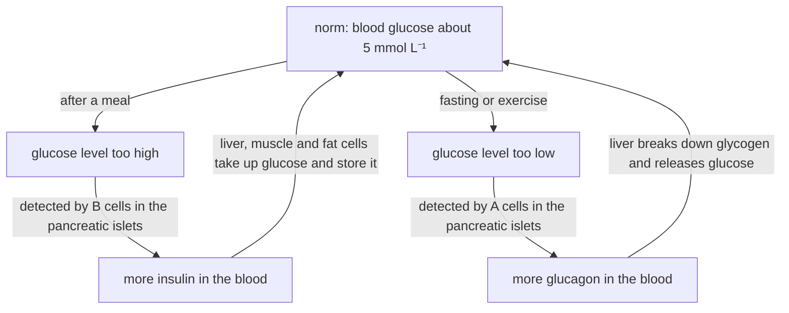

# B4 — Self-Regulation of Organisms: notes

These are English explanations of every learning outcome in [README.md](README.md), and every topic is *drafted*: written from the CCVX syllabus, the Dutch CvTE syllabus and standard VWO biology, not yet checked against an open source text or exam question.

- **In Dutch VWO:** central exam (CE).
- **Dutch source:** [CvTE syllabus biologie vwo 2027](https://www.examenblad.nl/2027/vwo/documenten/syllabus-biologie-vwo-2027) (version 2, July 2025), O2 *Zelfregulatie van het organisme* (O2.1–O2.3); O2.3 also refers to M4.2 *Celcommunicatie en interactie met (a)biotische factoren* for signal processing. A citation like *(CvTE O2.1 spec 3)* means specification 3 of O2.1; its numbers don't match the CCVX numbers.

Dutch terms are in brackets. Binas tables are named, not numbered, because the numbers differ between editions.

## B4.1 Homeostasis

### 1. Lungs, liver, kidneys, nervous and hormonal system

- Homeostasis (*homeostase*) is keeping the internal environment (*inwendig milieu*) within narrow limits while the external environment (*uitwendig milieu*) changes: your core temperature stays about 37 °C on a freezing day and on a hot one. *(CvTE O2.1 spec 1)*
- The internal environment is the blood plasma and the tissue fluid that surround the cells. Its temperature, pH, osmotic value (*osmotische waarde*) and chemical composition (*chemische samenstelling*) must stay right, because enzymes, membranes and ion gradients only work within narrow limits.
- The osmotic value is a measure of the concentration of dissolved particles. If the osmotic value of the tissue fluid rises, cells lose water by osmosis and shrink; if it falls, they take up water and swell.
- The lungs (*longen*) take up O₂ and remove CO₂. Because CO₂ forms an acid in water, the breathing rate also helps set the pH of the blood; the lungs lose some water and heat as well. See [B03](../B03-metabolism-in-organisms/README.md).
- The liver (*lever*) keeps the glucose level (*glucoseconcentratie*) steady by storing glucose as glycogen (*glycogeen*) and releasing it again. It also turns surplus amino acids into urea, breaks down alcohol, drugs, hormones and old red blood cells, makes plasma proteins, and produces a lot of heat.
- The kidneys (*nieren*) set the water content and osmotic value of the blood (water regulation, *waterhuishouding*), the concentrations of ions such as Na⁺ and K⁺, and the pH, by excreting H⁺ and keeping HCO₃⁻. They remove urea and foreign substances, and they make the hormone EPO. *(CvTE O1.5 spec 3)*
- The skin (*huid*), which the Dutch syllabus adds to this list, regulates heat loss through sweating and through the blood flow just under its surface.
- The nervous system (*zenuwstelsel*) regulates fast: impulses along neurons reach specific muscles and glands within milliseconds. When you start to run, your breathing and heart rate rise within seconds.
- The hormonal system (*hormoonstelsel*) regulates more slowly but for longer: hormones travel in the blood to all cells, but only target cells with a matching receptor respond. ADH, for example, adjusts urine production over minutes to hours.
- "Receptor" has two meanings. A sensory receptor is a sense cell or nerve ending that detects a stimulus, such as a thermoreceptor in the skin. A receptor protein is a molecule on or in a target cell that binds a hormone or neurotransmitter.
- Receptors in cell membranes (*receptor in celmembraan*) bind water-soluble (hydrophilic) hormones that can't cross the phospholipid bilayer: peptide hormones (*peptidehormoon*) such as insulin, glucagon, ADH and EPO, and also adrenaline. Inside the cell a second messenger such as cAMP passes the signal on and activates enzymes, so the effect starts within seconds to minutes. *(CvTE O2.2 spec 3; M4.2 spec 4)*
- Receptors in the cytoplasm (*receptor in cytoplasma*) bind lipid-soluble steroid hormones (*steroïdhormoon*), such as cortisol, oestrogen and testosterone, which diffuse through the membrane. The hormone–receptor complex acts in the nucleus as a transcription factor that switches genes on or off, so the effect is slower (hours) but lasts longer. Thyroid hormone also acts inside the cell, on gene expression. Cell signalling in general is in [D02](../../D-interaction/D02-cellular-interaction/README.md). *(CvTE M4.2 spec 4)*
- **Trap:** the contents of the gut, the air in the lungs and the urine in the bladder belong to the external environment, even though they are inside the body. A substance only enters the internal environment when it crosses an epithelium into the blood or tissue fluid.

### 2. Structure of the liver, lungs, skin and kidneys

- All four organs change the composition of the blood, and their structure shows it: a large exchange surface, a short diffusion distance and a rich blood supply. *(CvTE O2.1 spec 2)*
- The liver consists of liver lobules (*leverlobje*). Blood from the hepatic portal vein (*poortader*), which comes from the intestines, and O₂-rich blood from the hepatic artery (*leverslagader*) flow through wide capillaries between rows of liver cells to a central vein in each lobule, and then leave through the hepatic vein (*leverader*). *(CvTE O1.5 spec 1)*
- Because of the portal vein, all glucose and amino acids absorbed in the small intestine pass the liver before they reach the rest of the body, so the liver can store surplus glucose straight after a meal.
- Liver cells contain many mitochondria and much endoplasmic reticulum, which fits their work in making plasma proteins, breaking down toxins and producing heat.
- The lungs contain hundreds of millions of alveoli (*longblaasjes*), each with a wall of one thin cell layer, surrounded by capillaries and covered by a moist film. Ventilation keeps refreshing the air, so the O₂ and CO₂ gradients stay steep; this is Fick's law of diffusion in [B03](../B03-metabolism-in-organisms/README.md). *(CvTE O1.3 specs 1–2)*
- The skin has an epidermis (*opperhuid*) whose horny outer layer limits water loss. The dermis (*lederhuid*) below it contains sweat glands (*zweetklieren*), temperature receptors and arterioles that control how much warm blood flows just under the surface. Fat in the subcutaneous tissue (*onderhuids bindweefsel*) insulates.
- Each kidney contains about a million nephrons (*niereenheden*). In the cortex (*nierschors*) each glomerulus (*glomerulus*) in a Bowman's capsule (*kapsel van Bowman*) filters plasma into pre-urine (*voorurine*) by ultrafiltration (*ultrafiltratie*); the tubules (*nierbuisjes*) then reabsorb (*terugresorptie*) what the body needs. *(CvTE O1.5 specs 1–3)*
- The two kidneys together form about 125 mL of pre-urine per minute, which is about 180 L a day. About 1.5 L of urine is left, so about 99% of the filtered volume is reabsorbed.
- The loops of Henle (*lis van Henle*) build up a high osmotic value in the medulla (*niermerg*) by the countercurrent principle (*tegenstroomprincipe*). The collecting ducts (*verzamelbuisjes*) run through this medulla, so when ADH makes them permeable, water leaves them by osmosis.
- The cells of the first part of the tubule have microvilli (a large surface) and many mitochondria (ATP for active transport), which fits the reabsorption of glucose, amino acids and salts there.
- **Trap:** urea is made in the liver, from the amino groups of amino acids, but it is excreted by the kidneys. The liver makes it; it does not remove it from the body.

### 3. The regulation cycle

- A regulation cycle (*regelkring*) keeps a variable close to its norm or set value (*normwaarde*). A receptor measures the actual value, a control centre (*regelcentrum*) compares it with the norm, and if they differ the control centre signals an effector, whose action changes the value. *(CvTE O2.1 specs 3–4)*
- In negative feedback (*negatieve terugkoppeling*) the effector's action counteracts the deviation, so the value returns to the norm and the signal to the effector weakens. Body temperature rises, you sweat, the temperature falls, and the sweating stops. All homeostasis works this way.
- In positive feedback (*positieve terugkoppeling*) the effect strengthens the deviation, so the change speeds up until something ends it. During birth, stretching of the cervix causes oxytocin release, which causes stronger contractions and more stretching, until the baby is born. Other examples are blood clotting, the LH peak before ovulation ([E03](../../E-reproduction/E03-reproduction-of-organisms/README.md)) and the opening of Na⁺ channels during an action potential.
- The norm itself can be reset. In fever (*koorts*), substances released by white blood cells during an infection raise the set value in the hypothalamus, so you shiver and feel cold while your temperature rises. See [B05](../B05-defence-in-organisms/README.md).
- To infer a regulation cycle from a description: (1) name the regulated variable and its norm; (2) find the receptor and the control centre; (3) find the signal (nerve impulses or a hormone) and the effector; (4) check whether the effect reduces the deviation (negative feedback) or increases it (positive feedback).
- **Trap:** "negative" doesn't mean "decrease". Negative feedback raises a value that is too low just as well as it lowers one that is too high, and positive feedback isn't "good" feedback.

#### Glucose level

- The fasting glucose level is about 4–6 mmol L⁻¹, on average about 5 mmol L⁻¹ (0.9 g L⁻¹). *(CvTE O2.1 specs 1–2; Binas table of blood values)* About 5 L of blood then holds only about 4.5 g of glucose, so the liver has to buffer it all the time.
- The pancreatic islets (*eilandjes van Langerhans*) are receptor and control centre in one. Their B cells (β cells) detect a high glucose level and secrete insulin (*insuline*); their A cells (α cells) detect a low level and secrete glucagon.
- Insulin makes liver, muscle and fat cells take up glucose: liver and muscle cells store it as glycogen, and fat cells turn it into fat. Glucagon makes liver cells break glycogen down and release glucose. Adrenaline and cortisol raise the glucose level too.
- Both loops are negative feedback: as the glucose level returns to the norm, the islet cells secrete less of the hormone, so the response switches itself off.

- Above about 9–10 mmol L⁻¹ the kidney tubules can't reabsorb all the filtered glucose, so glucose appears in the urine, a classic sign of untreated diabetes.
- **Trap:** muscle glycogen can't raise the blood glucose level. Muscle cells lack the enzyme that releases free glucose and have no glucagon receptors, so they use their glycogen themselves; only the liver releases glucose into the blood.

#### Water regulation and osmotic value

- Osmoreceptors in the hypothalamus detect a rising osmotic value of the blood, for example after sweating or a salty meal. The hypothalamus then makes more ADH, which the posterior lobe of the pituitary releases into the blood. *(CvTE O1.5 spec 3)*
- ADH makes the collecting ducts insert water channels (aquaporins), so more water is reabsorbed and a small volume of concentrated urine is produced. The osmotic value falls and ADH release decreases: negative feedback. Thirst makes you drink as well.
- After drinking a lot of water the osmotic value falls, ADH release drops, and you produce a large volume of dilute urine.
- Alcohol inhibits ADH release, which is why drinking alcohol makes you urinate more and can dehydrate you. In diabetes insipidus ADH is missing or doesn't work, and the patient produces many litres of dilute urine a day.
- **Trap:** ADH stands for anti-diuretic hormone: more ADH means less urine, and more concentrated urine.

#### Temperature

- In temperature regulation (*temperatuurregulatie*) the norm is a core temperature of about 37 °C. Temperature receptors (*temperatuurreceptor*) in the skin and in the hypothalamus itself report to the control centre in the hypothalamus.
- When you are too warm, the arterioles in the skin widen (vasodilation), so more warm blood flows just under the surface and loses heat. The sweat glands secrete sweat, and its evaporation takes heat away.
- When you are too cold, the skin arterioles narrow (vasoconstriction), you shiver (muscle contractions that release heat), your hairs stand up (goose bumps, of little use in humans), and thyroid hormone and adrenaline raise the metabolic rate. Behaviour helps too: putting on clothes.
- During exercise the muscles release a lot of heat, so you sweat, and the loss of water then involves the ADH cycle as well.
- **Trap:** in the cold it is the arterioles in the skin that narrow; the blood vessels don't move away from the skin surface.

#### pH: the haemoglobin and HCO₃⁻ buffers

- Arterial blood has a pH of 7.35–7.45, about 7.4. The range is narrower than it looks: a fall of 0.3 pH units means twice as much H⁺.
- A buffer is a weak acid together with its conjugate base: it takes up added H⁺ or OH⁻, so the pH hardly changes. The chemistry is in [chemistry C01](../../../CCVX-chemistry/C-chemical-processes-and-conservation-laws/C01-chemical-processes/README.md) and [chemistry 05](../../../CCVX-chemistry/0-basic-knowledge/05-acids-and-bases/README.md).
- The HCO₃⁻ buffer (*bufferende werking van HCO₃⁻*) is CO₂ + H₂O ⇌ H₂CO₃ ⇌ H⁺ + HCO₃⁻; the enzyme carbonic anhydrase in red blood cells speeds up the first step. *(CvTE O2.1 specs 1–2)*
- Extra acid is buffered by H⁺ + HCO₃⁻ → H₂CO₃ → CO₂ + H₂O, and the lungs breathe out the extra CO₂. Extra base is buffered by OH⁻ + H₂CO₃ → HCO₃⁻ + H₂O.
- In the haemoglobin buffer (*bufferende werking van hemoglobine*) haemoglobin binds H⁺, simplified as Hb + H⁺ ⇌ HbH⁺. Haemoglobin that has released its O₂ binds H⁺ more readily, so in active tissues it picks up the H⁺ formed from CO₂ just as it unloads O₂ (the Bohr effect in [B03](../B03-metabolism-in-organisms/README.md)).
- The lungs correct the pH within minutes by changing how much CO₂ they remove; the kidneys correct it over hours to days by excreting H⁺ and keeping HCO₃⁻. Urine pH can range from roughly 4.5 to 8 while the blood stays near 7.4.
- During intense exercise, lactic acid releases H⁺ (C₃H₆O₃ ⇌ H⁺ + C₃H₅O₃⁻). HCO₃⁻ buffers it, and the extra CO₂ that forms makes you breathe harder.
- **Trap:** CO₂ itself acidifies the blood. Hyperventilating (breathing out too much CO₂) raises the pH, and holding your breath lowers it.

#### O₂ and CO₂ concentration

- Gas concentrations in blood are usually given as partial pressures, pO₂ and pCO₂ (*zuurstofdruk*, *koolstofdioxidedruk*): the part of the total pressure due to that gas. A gas diffuses from a high to a low partial pressure. *(CvTE O2.1 specs 1–2; O1.3 spec 4)*
- Typical values: arterial pO₂ about 100 mmHg (13.3 kPa) and pCO₂ about 40 mmHg (5.3 kPa); venous blood from resting tissue has pO₂ about 40 mmHg and pCO₂ about 46 mmHg (6.1 kPa). Dry air at sea level has a pO₂ of about 21% × 760 mmHg ≈ 160 mmHg.
- Chemical receptors (*chemische receptoren*) measure these values. Central ones in the medulla oblongata (*verlengde merg*) respond to the CO₂ level (pH) of the fluid around the brain. Peripheral ones in the aortic arch (*aortaboog*) and the carotid arteries (*halsslagaders*) respond to a high pCO₂, a low pH and a strongly reduced pO₂.
- They send impulses to the breathing centre (*ademhalingscentrum*) in the medulla oblongata, which makes the breathing muscles breathe deeper and faster. *(CvTE O1.3 spec 3)*
- At high altitude the air still contains 21% O₂, but the total pressure is lower, so the pO₂ is lower. You breathe faster, the kidneys soon release more EPO, and over weeks the number of red blood cells rises, which is the idea behind altitude training.
- **Trap:** in healthy people the main stimulus to breathe is a rising pCO₂ (falling pH), not a falling pO₂. Hyperventilating before a dive lowers the pCO₂ and delays the urge to breathe, so a diver can black out from O₂ shortage under water.

#### Blood pressure

- Pressure receptors (*drukreceptoren in de aorta*) in the wall of the aortic arch, and similar ones in the carotid arteries, are stretch receptors. A higher blood pressure (*bloeddruk*) stretches the wall more, so they send more impulses to the cardiovascular centre in the medulla oblongata. *(CvTE O2.1 specs 1–2)*
- When the pressure is too high, the medulla sends more impulses through the parasympathetic vagus nerve, which lowers the heart rate, and fewer through sympathetic nerves, so arterioles widen; the pressure falls. When it is too low, for example on standing up quickly or after blood loss, the reverse happens.
- In the longer term the kidneys set the blood volume. ADH and aldosterone make them retain more water and Na⁺, which raises the volume and the pressure.
- A normal adult resting pressure is about 120/80 mmHg: systolic (*bovendruk*) over diastolic (*onderdruk*). *(CvTE O1.6 specs 1–2)*
- **Trap:** of the chemical and pressure receptors in the aorta, the pressure receptors are mechanoreceptors (they sense stretch) and the chemical receptors sense O₂, CO₂ and pH. Both lie in the aortic wall, but they feed different regulation cycles.

### 4. Interrelationships in the regulation of body processes

- Regulation cycles affect each other because they share organs and signals, so one response often disturbs another variable. *(CvTE O2.1 spec 5)*
- Sweating cools you but costs water and salts: the osmotic value rises and ADH release goes up. The widened skin arterioles also lower the blood pressure, so the pressure receptors make the heart beat faster.
- During exercise the muscles use more O₂ and glucose and release CO₂, H⁺ and heat. Breathing and heart rate rise, adrenaline and glucagon rise while insulin falls (so the glucose level is kept up), and you sweat.
- The hypothalamus links the two systems: it receives nerve impulses, controls the pituitary with releasing hormones and makes ADH. In the other direction, sympathetic nerves make the adrenal medulla release adrenaline.
- The nervous system acts fast and briefly, hormones slowly but for longer. In a fright, sympathetic nerves raise your heart rate within a second, and adrenaline keeps it high for minutes.
- One organ often serves several cycles: the kidneys help regulate water, salts, pH, blood pressure and the number of red blood cells (EPO).
- **Trap:** the hypothalamus belongs to the brain but also releases hormones, so a regulation that a question calls "nervous" or "hormonal" often involves both.

### 5. Disturbance and restoration of the dynamic equilibrium

- A dynamic equilibrium (*dynamisch evenwicht*) is kept by continuous activity: values fluctuate around the norm while substances keep entering and leaving. The glucose level rises after a meal and falls during exercise but stays within limits. *(CvTE O2.1 spec 6)*
- The equilibrium is disturbed when a disturbance is too large for the cycle, such as heat stroke during a marathon on a hot day, or when a part of the cycle fails: the receptor, the control centre, the signal or the effector.
- In diabetes mellitus type 1 the immune system has destroyed the B cells, so there is no insulin. The glucose level stays high, glucose appears in the urine, and the body breaks down more fat; the liver turns the fatty acids into acidic ketone bodies, which can lower the blood pH. Patients inject insulin, or use a pump, and match it to food and exercise.
- In type 2 the target cells respond less to insulin (insulin resistance), linked to overweight and too little exercise. It is treated with diet, exercise and weight loss, then tablets, and sometimes later with insulin.
- Other examples: kidney failure upsets water, salts, urea and pH and is treated with dialysis or a transplant; high blood pressure is treated with less salt, more exercise and medication; dehydration is treated with water and salts.
- **Trap:** in type 2 diabetes the problem is at first the response of the target cells, not a lack of insulin, so insulin injections are not the first treatment.

## B4.2 Hormonal regulation

### 1. Regulation cycles in the hormonal system

- A hormonal regulation cycle works like any other, but its signal is a hormone level (*hormoonconcentratie*) in the blood. Often the hormone level is itself the regulated variable, kept steady by negative feedback on the gland that makes it. *(CvTE O2.2 spec 1)*
- The hypothalamus releases releasing hormones (*releasing hormoon*), such as TRH, which reach the anterior lobe of the pituitary through a short system of blood vessels. The pituitary then releases a stimulating hormone, such as TSH, which makes the target gland, here the thyroid, release its own hormone, thyroxine.
- A high thyroxine level inhibits the release of TRH and TSH: negative feedback, so the thyroxine level stays steady. The same pattern controls cortisol (CRH → ACTH → cortisol) and the sex hormones (GnRH → FSH and LH → oestrogen or testosterone).
- Predicting with this axis: in iodine deficiency the thyroid can't make enough thyroxine, so the negative feedback is weak, TSH stays high, and the thyroid grows into a goitre (*krop*). That is why iodine is added to salt, in the Netherlands for example to the salt bakers use for bread.
- Another prediction: anabolic steroids (synthetic hormones that act like testosterone) inhibit the hypothalamus and pituitary, so FSH and LH fall, and the testes make less testosterone and sperm and shrink.
- The hormone level also depends on breakdown: the liver and kidneys inactivate and remove hormones, so a gland must keep secreting to keep the level up. After the thyroid is removed, a patient takes thyroxine tablets for life.
- A hormone cycle can also use positive feedback: a rising oestrogen level before ovulation causes a sudden LH peak (see [E03](../../E-reproduction/E03-reproduction-of-organisms/README.md)).
- **Trap:** in a negative-feedback axis a high level of the end hormone lowers the pituitary hormone. Someone who takes too much thyroxine has a low TSH level, and someone with iodine deficiency a high one.

### 2. Hormone glands, their hormones and the target organs

- A hormone (*hormoon*) is a signal substance that a hormone gland (*hormoonklier*) releases into the blood. It reaches every cell, but only the cells of a target organ (*doelwitorgaan*) with a matching hormone receptor (*hormoonreceptor*) respond. *(CvTE O2.2 specs 2–3)*
- Endocrine (*endocrien*) glands have no duct and release hormones straight into the blood. Exocrine (*exocrien*) glands release their product through a duct onto a surface or into a cavity: sweat glands, salivary glands, and the part of the pancreas that releases pancreatic juice into the duodenum. The pancreas is both, because its islets are endocrine.
- The pituitary gland (*hypofyse*) hangs below the hypothalamus. Its anterior lobe (*voorkwab*) makes its own hormones under the control of releasing hormones; its posterior lobe (*achterkwab*) stores and releases ADH and oxytocin, which nerve cells in the hypothalamus make.
- The main glands and their hormones: *(Binas table of human hormones)*

| Gland | Hormone | Target and effect |
|---|---|---|
| hypothalamus | releasing hormones, e.g. TRH, CRH, GnRH; ADH and oxytocin (released by the posterior pituitary) | anterior pituitary releases its hormones |
| pituitary, anterior lobe | TSH; ACTH; FSH and LH; growth hormone | thyroid; adrenal cortex; ovaries and testes; growth of bone and muscle |
| pituitary, posterior lobe | ADH; oxytocin | collecting ducts reabsorb more water; uterus contracts during birth, milk is ejected |
| thyroid gland (*schildklier*) | thyroid hormone (*schildklierhormoon*): thyroxine, which contains iodine | almost all cells: higher metabolic rate and heat production; growth and brain development |
| adrenal glands (*bijnieren*), medulla | adrenaline | heart beats faster and harder, bronchioles widen, liver releases glucose |
| adrenal glands, cortex | cortisol; aldosterone | higher glucose level, less inflammation; kidneys reabsorb more Na⁺ and water follows |
| pancreatic islets (*eilandjes van Langerhans*) | insulin from B cells; glucagon from A cells | liver, muscle and fat cells take up and store glucose; liver releases glucose |
| kidneys (*nieren*) | EPO (erythropoietin) | red bone marrow (*rood beenmerg*) makes more red blood cells |
| ovaries (*eierstokken*) | oestrogen; progesterone | female sex characteristics and build-up of the uterine lining; lining maintained |
| testes (*teelballen*) | testosterone | sperm production, male sex characteristics, muscle growth |
| stomach and duodenum wall | digestive hormones (*(spijs)verteringshormoon*): gastrin; secretin and CCK | stomach releases gastric juice; pancreas releases its juice and the gall bladder bile |

- Oestrogen, progesterone and testosterone are the main sex hormones (*geslachtshormoon*); their role in the menstrual cycle, puberty and contraception is in [E03](../../E-reproduction/E03-reproduction-of-organisms/README.md).
- Digestive hormones come from scattered endocrine cells in the gut wall, not from a separate gland. Food in the stomach triggers gastrin, acidic chyme in the duodenum triggers secretin (pancreatic juice rich in HCO₃⁻), and fats and proteins there trigger CCK (enzymes from the pancreas, bile from the gall bladder). See [B03](../B03-metabolism-in-organisms/README.md).
- One hormone can cause different responses in different target cells, because they carry different receptor types. Adrenaline speeds up the heart and narrows the arterioles in the skin and gut, but widens those in skeletal muscles.
- To infer how a target organ responds, check whether its cells have the receptor and what the hormone does to the regulated variable. A liver cell with glucagon receptors breaks down glycogen; a muscle cell without them doesn't.
- **Trap:** adrenaline comes from the adrenal medulla, but cortisol and aldosterone come from the adrenal cortex; and the digestive enzymes of the pancreas are exocrine, while only the islets are endocrine.

### 3. Hormonal regulation and homeostasis

- Many homeostatic cycles use hormones as the signal to the effector: insulin and glucagon for the glucose level, ADH and aldosterone for water, salt and blood pressure, thyroxine for metabolic rate and heat, and EPO for the O₂-transport capacity of the blood. *(CvTE O2.2 spec 4)*
- The EPO cycle: a low O₂ level in kidney tissue, after blood loss or at altitude, increases EPO release. Over days to weeks the bone marrow makes more red blood cells, the blood carries more O₂, and EPO release falls again: negative feedback.
- Doping with EPO pushes the haematocrit (*hematocriet*), the volume percentage of red blood cells, above its norm. More O₂ reaches the muscles, which improves endurance, but the thicker blood flows less easily and raises the risk of blood clots, heart attack and stroke.
- Doping control uses blood tests and the athlete's biological passport, a series of blood values measured over time, in which unusual changes stand out.
- Two hormones with opposite effects give fine control: insulin lowers the glucose level and glucagon raises it.
- In stress, adrenaline (within seconds) and cortisol (over minutes to hours) raise the glucose level for action. Long-lasting stress keeps cortisol high, which suppresses the immune system.
- **Trap:** insulin is the only hormone that lowers the glucose level, while several raise it (glucagon, adrenaline, cortisol, growth hormone), so no other hormone can take over when insulin is lacking.

### 4. The hormonal system and the senses, musculature and nervous system

- The hormonal and nervous systems meet in the hypothalamus, which receives nerve impulses and responds with hormones: releasing hormones for the pituitary, and ADH and oxytocin. *(closest: CvTE O2.1 spec 5)*
- Senses can trigger hormone release. Something frightening that you see activates sympathetic nerves, which make the adrenal medulla release adrenaline. Light on the retina inhibits melatonin release by the pineal gland (*pijnappelklier*), which sets the day–night rhythm. A baby suckling stimulates touch receptors in the nipple, which leads to oxytocin release and milk ejection.
- Hormones act on muscles. Adrenaline acts on heart muscle and on the smooth muscle of bronchioles and arterioles, oxytocin on the smooth muscle of the uterus, and testosterone makes skeletal muscles grow. See [B06](../B06-movement-of-the-organism/README.md).
- Hormones act on the nervous system too. Thyroid hormone is essential for brain development, which is why Dutch newborns are screened for a shortage of it with the heel prick (*hielprik*); sex hormones influence behaviour ([D04](../../D-interaction/D04-sexuality/README.md)).
- **Trap:** the adrenal medulla is controlled by sympathetic nerves, not by a pituitary hormone, so adrenaline appears within seconds. The adrenal cortex is controlled by ACTH and responds more slowly.

## B4.3 Neural Regulation

### 1. Structure and mechanism of the nervous system and signal processing

#### Central and peripheral nervous system

- The central nervous system (*centraal zenuwstelsel*, CNS) is the brain and the spinal cord, where information is processed. The peripheral nervous system (*perifeer zenuwstelsel*, PNS) is everything outside it: 12 pairs of cranial nerves (*hersenzenuwen*), 31 pairs of spinal nerves (*ruggenmergszenuwen*) and the ganglia, which connect the CNS with receptors and effectors. *(CvTE O2.3 specs 1–2)*
- A nerve (*zenuw*) is a bundle of thousands of nerve fibres from many neurons, wrapped in connective tissue. Most nerves are mixed: they contain both sensory and motor fibres.
- The "large brain" in CCVX is the cerebrum (*grote hersenen*): two hemispheres connected by the corpus callosum (*hersenbalk*). Its outer layer, the cerebral cortex (*hersenschors*), is folded, which gives it a large surface; conscious perception, voluntary movement, memory, language and thinking happen there. *(Binas diagram of the brain)*
- The control is mostly crossed: the left hemisphere receives sensations from, and moves, the right half of the body.
- The centres in the cerebral cortex (*centra in de hersenschors*) each have their own task. The primary motor cortex, just in front of the central groove in the frontal lobe, starts voluntary movements. The primary sensory cortex, just behind it in the parietal lobe, receives touch, pain, temperature and body position. Vision arrives in the occipital lobe and hearing in the temporal lobe.
- Body parts with fine control or fine feeling, such as the fingers and lips, have relatively large areas in the motor and sensory cortex. Association areas combine information, and in most people the language centres are in the left hemisphere.
- The "small brain" in CCVX is the cerebellum (*kleine hersenen*). It coordinates movement and balance by comparing the intended movement with feedback from muscles, joints, the balance organ and the eyes, and it helps you learn movements such as cycling. Alcohol disturbs it, which is why drunk people stagger. See [B06](../B06-movement-of-the-organism/README.md).
- The brainstem (*hersenstam*) is the midbrain, the pons and the medulla oblongata. It contains vital centres for breathing, heart rate and blood pressure, and reflex centres for swallowing, coughing and the pupil reflex ([B07](../B07-perception-by-organisms/README.md)); all tracts between brain and spinal cord pass through it.
- Just above the brainstem, in the diencephalon (*tussenhersenen*), lie the thalamus, which relays sensory information to the cortex, and the hypothalamus, which regulates temperature, water balance and hunger and controls the pituitary.
- The spinal cord (*ruggenmerg*) runs inside the vertebral column. It conducts impulses between body and brain through tracts in its white matter, and it is the control centre for spinal reflexes.
- Sensory fibres enter the spinal cord through the dorsal root, which carries a spinal ganglion containing the cell bodies of the sensory neurons; motor fibres leave through the ventral root. The two roots join into a spinal nerve.
- Grey matter (*grijze stof*) consists of cell bodies, dendrites and synapses. White matter (*witte stof*) consists of myelinated axons; myelin is fatty, which makes it white.
- **Trap:** the arrangement is reversed between brain and spinal cord. In the cerebrum the grey matter is on the outside (the cortex) and the white matter inside; in the spinal cord the grey matter is inside (a butterfly shape in cross-section) and the white matter outside.

#### Autonomic and animal nervous system

- The CCVX "animal nervous system" is the somatic nervous system (*animaal zenuwstelsel*). It handles conscious perception and the voluntary control of skeletal muscles, with one motor neuron running from the CNS to the muscle, for example when you decide to kick a ball. *(CvTE O2.3 specs 1–2)*
- The autonomic (vegetative) nervous system (*autonoom zenuwstelsel*, *vegetatief zenuwstelsel*) regulates the internal organs without conscious control: heart muscle, smooth muscle in the gut, blood vessels, bronchioles and iris, and glands. Its route uses two neurons in series, with a synapse in a ganglion outside the CNS.
- The CCVX "orthosympathetic" system is the sympathetic nervous system (*orthosympatisch zenuwstelsel*). It prepares the body for action, "fight or flight": heart rate and blood pressure rise, bronchioles and pupils widen, the liver releases glucose, digestion slows, and the adrenal medulla releases adrenaline. Most of its neurons that end on organs release noradrenaline.
- The parasympathetic nervous system (*parasympatisch zenuwstelsel*) dominates at rest, "rest and digest": the heart rate falls, saliva production and peristalsis increase, the pupils narrow and the bladder empties. Its main nerve is the vagus nerve (*nervus vagus*), and its neurons that end on organs release acetylcholine.
- Most organs receive both, and the two work antagonistically: the balance between them sets, for example, the heart rate.
- **Trap:** the sympathetic system doesn't stimulate everything (it slows digestion), and the parasympathetic system doesn't inhibit everything (it stimulates digestion). "Autonomic" means not consciously controlled, not without the brain: centres in the brainstem and hypothalamus steer it.

#### Neurons, Schwann cells and myelin

- A neuron (*zenuwcel*) has a cell body (*cellichaam*) with the nucleus, dendrites (*dendrieten*) that carry impulses towards the cell body, and an axon that carries them away to the axon terminals, where it forms synapses. *(CvTE O2.3 specs 1–2)*
- A sensory neuron (*sensorisch neuron*) carries impulses from a receptor to the CNS, for example from a pain receptor in a finger. Its cell body lies in a ganglion just outside the spinal cord or brain.
- The CCVX "relay neuron" is an interneuron (*schakelneuron*). It lies entirely inside the CNS and connects other neurons; most neurons in the CNS are of this kind, and they do the processing.
- A motor neuron (*motorisch neuron*) carries impulses from the CNS to an effector, a muscle or gland. Its cell body lies in the grey matter of the spinal cord or brainstem, and its axon can be about a metre long, from the lower spinal cord to a foot muscle.
- Schwann cells (*cellen van Schwann*) are support cells in the PNS that wrap themselves many times around an axon. Their layered membranes form the myelin sheath (*myelineschede*), a fatty, insulating layer. In the CNS other support cells, the oligodendrocytes, form the myelin.
- Between neighbouring Schwann cells are short gaps without myelin, the nodes of Ranvier (*insnoeringen van Ranvier*).
- In multiple sclerosis (MS) the immune system damages the myelin in the CNS, so conduction slows or fails, which can affect vision, movement and sensation.
- **Trap:** a nerve is not a neuron. A nerve contains thousands of fibres from many neurons, often sensory and motor fibres together.

#### Resting potential and the Na/K pump

- At rest the inside of a neuron is about −70 mV relative to the outside: the resting potential (*rustpotentiaal*). *(CvTE M4.2 spec 2)*
- The Na/K pump (*natrium/kalium-pomp*), the sodium–potassium pump, is a membrane protein that uses one ATP to pump 3 Na⁺ out and 2 K⁺ in, both against their concentration gradients (active transport). So Na⁺ is concentrated outside the cell and K⁺ inside, and each cycle moves one net positive charge out. See [B02](../B02-metabolism-in-cells/README.md) and [D02](../../D-interaction/D02-cellular-interaction/README.md).
- At rest the membrane lets K⁺ through much more easily than Na⁺, because K⁺ leak channels are open. K⁺ diffuses out along its gradient and leaves behind negatively charged proteins and other anions that can't follow, so the inside becomes negative.
- **Trap:** the resting potential is mainly due to K⁺ leaking out; the pump's main job is to maintain the gradients. An impulse itself runs on diffusion of ions through channels, and one impulse hardly changes the concentrations.

#### Action potential, threshold and refractory period

- A stimulus (*prikkel*) depolarises the membrane locally: the inside becomes less negative. If the potential reaches the threshold (*prikkeldrempel*, the CCVX "stimulation threshold"), about −55 mV (some textbooks say −50 mV), voltage-gated Na⁺ channels open. *(CvTE M4.2 spec 2)*
- Na⁺ rushes in, and the inside briefly becomes positive, to about +30 mV: the action potential (*actiepotentiaal*). This is positive feedback, because depolarisation opens more Na⁺ channels, which depolarises further.
- Within about a millisecond the Na⁺ channels close and voltage-gated K⁺ channels open. K⁺ flows out, the membrane repolarises, briefly overshoots below −70 mV (hyperpolarisation), and then returns to the resting potential.
- The action potential is all-or-none: below the threshold nothing happens, above it the action potential always has the same size. A stronger stimulus gives a higher frequency of action potentials, and activates more neurons, but never bigger action potentials.
- During and just after an action potential the Na⁺ channels can't open again (the absolute refractory period, about 1–2 ms), and after that a stronger stimulus than normal is needed (the relative refractory period). Together this is the refractory period (*refractaire periode*).
- The refractory period makes an impulse travel in one direction only, and it caps the frequency: at 1–2 ms per action potential, at most about 500–1000 per second.
- **Trap:** a stronger stimulus doesn't give a bigger action potential, it gives more action potentials per second.

#### Impulse conduction and saltatory conduction

- In impulse conduction (*impulsgeleiding*), the Na⁺ flowing in at one spot sets up local currents that depolarise the neighbouring membrane to threshold. The action potential is rebuilt at each spot and so travels along the axon; it can't run backwards, because the membrane behind it is refractory. *(CvTE M4.2 spec 2)*
- In a myelinated axon, ions can only cross the membrane at the nodes of Ranvier, so the action potential jumps from node to node: saltatory conduction (*sprongsgewijze impulsgeleiding*). This is much faster, and it costs less energy because fewer ions have to be pumped back.
- Thick myelinated fibres conduct at up to about 100 m s⁻¹ and thin unmyelinated ones at about 1 m s⁻¹, so covering 1 m takes about 10 ms instead of about 1 s.
- A thicker axon also conducts faster. Squids have unmyelinated but very thick giant axons for a fast escape response.
- **Trap:** myelin speeds conduction by insulating; it doesn't conduct the impulse itself. The action potential only arises at the nodes.

#### Synapse, neurotransmitters, excitatory and inhibitory

- A synapse (*synaps*) is the junction between an axon terminal and another neuron, muscle cell or gland cell, separated by a narrow synaptic cleft. *(CvTE M4.2 spec 2)*
- An action potential arriving at the terminal opens voltage-gated Ca²⁺ channels, and Ca²⁺ flows in. This makes vesicles full of neurotransmitter (*neurotransmitter*) fuse with the presynaptic membrane (exocytosis).
- The neurotransmitter diffuses across the cleft and binds to receptor proteins in the postsynaptic membrane, which opens ion channels there.
- The signal ends when the neurotransmitter is removed: an enzyme breaks it down (acetylcholinesterase breaks down acetylcholine), or the presynaptic cell takes it back up (dopamine, serotonin, noradrenaline).
- At an excitatory (*exciterend*) synapse, Na⁺ channels open and the postsynaptic membrane depolarises, which brings it closer to threshold. At an inhibitory (*inhiberend*) synapse, Cl⁻ or K⁺ channels open and the membrane hyperpolarises, which takes it further from threshold. *(CvTE O2.3 spec 3)*
- Glutamate is the main excitatory neurotransmitter in the brain and GABA the main inhibitory one. Acetylcholine acts at the junction between motor neuron and skeletal muscle and in the parasympathetic system, noradrenaline in the sympathetic system.
- A neuron in the CNS often receives thousands of synapses. It only fires when the sum of all excitatory and inhibitory inputs, from several synapses at once (spatial summation) or in quick succession (temporal summation), reaches threshold at the start of its axon: this is signal processing.
- Synapses make conduction one-way, because only the presynaptic side has vesicles and only the postsynaptic side has receptors, and each synapse adds a small delay.
- Many drugs and poisons act at synapses. Curare blocks the acetylcholine receptors of skeletal muscle (paralysis); nerve gases and some insecticides block acetylcholinesterase, so muscles keep contracting; some antidepressants block the reuptake of serotonin.
- **Trap:** whether a synapse is excitatory or inhibitory depends on the receptor in the postsynaptic membrane, not just on the neurotransmitter. Acetylcholine makes skeletal muscle contract but slows the heart.

#### Stimuli and receptor types

- A stimulus is a change in the internal or external environment that a receptor can detect. The receptor turns it into a graded receptor potential and, if that passes threshold, into impulses (*impuls*) in a sensory neuron. *(CvTE O2.3 specs 1–2)*
- Mechanical receptors (mechanoreceptors, *mechanoreceptoren*) respond to deformation: touch, pressure, stretch (muscle spindles and the pressure receptors in the aorta), sound and balance (hair cells in the inner ear).
- Chemical receptors (chemoreceptors) respond to substances: taste and smell, and CO₂, H⁺ and O₂ in the blood.
- Temperature receptors are separate warm and cold receptors in the skin; the hypothalamus has its own.
- Light receptors (*lichtreceptor*) are the rods and cones in the retina, explained in [B07](../B07-perception-by-organisms/README.md).
- Touch receptors (*tastreceptor*) are mechanoreceptors in the skin, densest in the fingertips and lips.
- Pain receptors are free nerve endings that respond to tissue damage, from strong pressure, heat or chemicals released by damaged cells. They hardly adapt, so pain keeps warning you as long as the damage lasts. The Dutch syllabus lists the pain nerve (*pijnzenuw*): the sensory fibres that start at these endings and carry the pain impulses.
- **Trap:** a receptor is named after its adequate stimulus, but what you feel depends on the brain area where its impulses arrive (see [B07](../B07-perception-by-organisms/README.md)).

### 2. Regulation cycles in the nervous system

- A neural regulation cycle uses a receptor, a sensory neuron, a control centre in the CNS, a motor neuron and an effector, and the feedback runs through receptors that measure the result. *(CvTE O2.3 spec 3)*
- The reflex arc (*reflexboog*) is the simplest neural pathway: receptor → sensory neuron → (relay neuron) → motor neuron → effector. A reflex is fast, automatic and the same every time; the brain is informed through tracts in the spinal cord but isn't needed for the response.
- In the knee-jerk reflex, a tap on the tendon below the kneecap stretches the muscle spindles in the thigh muscle. The sensory neuron synapses directly with the motor neuron of that muscle in the spinal cord (one synapse, no relay neuron), the muscle contracts and the lower leg kicks forward.
- In the withdrawal reflex, touching a hot plate stimulates pain receptors. Excitatory relay neurons in the spinal cord activate the motor neurons of the flexor, which pulls the hand away, while inhibitory relay neurons stop the extensor from opposing it. The pain is often felt only once the hand is already moving.
- Excitatory and inhibitory synapses together let one signal contract a muscle and relax its antagonist at the same time.
- The brain can override reflexes: you can keep holding a hot dish so as not to drop it, because impulses from the brain inhibit the motor neurons.
- Larger neural regulation cycles have their control centre in the brainstem or hypothalamus: blood pressure (pressure receptors in the aorta), breathing (chemical receptors) and the pupil reflex ([B07](../B07-perception-by-organisms/README.md)); the hypothalamus regulates temperature through nerves to sweat glands, skin arterioles and muscles.
- **Trap:** a reflex is involuntary, but the brain still receives the information and can suppress or strengthen the reflex.

### 3. The nervous system and the functioning of the organism

- The nervous system combines information from all senses and internal receptors and coordinates muscles and glands, so the organism acts as one whole. While cycling, for example, balance, steering, breathing and heart rate are all adjusted together. *(CvTE O2.3 spec 4)*
- Damage shows which part does what. After a complete spinal cord injury there is no feeling and no voluntary movement below the injury. A stroke in the left motor cortex paralyses the right side of the body and often affects speech. In MS, impulses are slowed or blocked.
- Learning, memory and behaviour are also functions of the nervous system; behaviour is in [D03](../../D-interaction/D03-behaviour-and-interaction/README.md).
- Substances that act at synapses change how the organism functions. Alcohol slows reactions and disturbs coordination, and cocaine blocks the reuptake of dopamine.
- **Trap:** below a spinal cord injury the reflexes can still work, because the reflex arc through the spinal cord is intact; what is lost is the connection with the brain.

### 4. The nervous system and the senses, musculature and hormonal system

- The senses feed information to the CNS through sensory neurons, and the CNS sends commands back: to skeletal muscles through the animal (somatic) nervous system, and to smooth muscle, heart muscle and glands through the autonomic nervous system. *(closest: CvTE O2.3 spec 4)*
- Muscles also report back: muscle spindles and tendon spindles tell the CNS the length and tension of each muscle ([B06](../B06-movement-of-the-organism/README.md)). Senses and perception are in [B07](../B07-perception-by-organisms/README.md).
- The nervous system controls hormone release: the hypothalamus releases releasing hormones and makes ADH and oxytocin, and sympathetic nerves make the adrenal medulla release adrenaline.
- Hormones in turn act on the nervous system: thyroid hormone is needed for brain development, sex hormones influence behaviour, and adrenaline makes you alert.
- The two systems differ in route and speed. Nervous signals run electrically along neurons and chemically across synapses, reach specific cells within milliseconds and stop quickly. Hormones travel through the blood, reach every cell with a matching receptor, act after seconds to hours and last longer.
- **Trap:** both systems use chemical messengers; the difference is the route. Noradrenaline, for example, is a neurotransmitter of sympathetic neurons and also a hormone of the adrenal medulla.

## Specimen contexts

- Sport, an exercise physiologist studying an athlete's blood values: values such as haemoglobin, haematocrit, glucose and lactate show the O₂-transport capacity, the fuel supply and the acid load. Natural changes, such as more EPO and red blood cells after altitude training, must be told apart from doping with EPO or blood transfusions, which the biological passport helps to detect. This uses B4.1 (pH, glucose, O₂) and B4.2 (EPO, adrenaline, insulin and glucagon during exercise).
- Nutrition, a trial on foods and neural and hormonal regulation in ADHD: ADHD is linked to signalling by neurotransmitters such as dopamine and noradrenaline in the brain, and the usual medicine, methylphenidate, raises their concentration in synapses by blocking their reuptake. A food trial, such as one with an elimination diet, needs a control group and preferably a double-blind design, because ratings of behaviour are easily influenced by expectations. This uses B4.3 (synapses and neurotransmitters) and B4.2.

## CCVX versus the Dutch syllabus

- **In both:** homeostasis with regulation cycles and feedback, the organs and hormone glands listed above with their hormones, target organs and receptors in the membrane or cytoplasm, and the nervous system with impulse conduction, synapses and the reflex arc (the CvTE puts the synapse, Na/K pump and membrane potentials in M4.2).
- **Dutch syllabus only:** releasing hormones (*releasing hormoon*), sex hormones (*geslachtshormoon*), pCO₂ and pO₂, the pain nerve (*pijnzenuw*), and the terms steroid hormone and peptide hormone (M4.2 spec 4). These notes cover all of them briefly; sex hormones are covered fully in [E03](../../E-reproduction/E03-reproduction-of-organisms/README.md).
- **CCVX only:** "chemical composition" as a regulated variable, "mechanical" receptors as a named type (the CvTE names only temperature, light and touch receptors, chemical receptors, pressure receptors in the aorta and the pain nerve), and the separate outcomes on how the hormonal and nervous systems relate to the senses and musculature (B4.2 spec 4, B4.3 spec 4), which O2 has no specification for.
