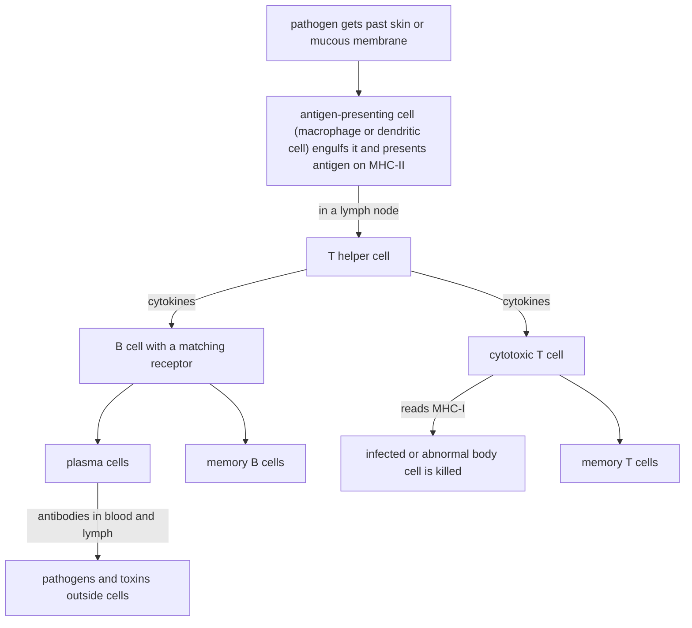

# B5 — Defence in Organisms: notes

These are English explanations of every learning outcome in [README.md](README.md), and every topic is *drafted*: written from the CCVX syllabus, the Dutch CvTE syllabus and standard VWO biology, not yet checked against an open source text or exam question.

- **In Dutch VWO:** central exam (CE).
- **Dutch source:** [CvTE syllabus biologie vwo 2027](https://www.examenblad.nl/2027/vwo/documenten/syllabus-biologie-vwo-2027) (version 2, July 2025), O3 *Afweer van het organisme* (O3.1). A citation like *(CvTE O3.1 spec 5)* means specification 5 of O3.1; its numbers don't match the CCVX numbers.

Dutch terms are in brackets. Binas tables are named, not numbered, because the numbers differ between editions.

## B5.1 Defence

### 1. Organs and cells of the defence system

#### Organs and barriers

- The defence system (*afweer*) is a team of barriers, organs, cells and dissolved proteins that keeps out or destroys pathogens (*ziekteverwekkers*), toxins and abnormal body cells. *(CvTE O3.1 specs 1–2)*
- Skin and mucous membranes (*huid*, *slijmvliezen*) are the first barrier. The outer layer of the skin consists of dead, keratinized cells that microorganisms can hardly cross, and sweat and sebum make its surface slightly acidic.
- Mucous membranes line the airways, the digestive tract and the urogenital tract. Their sticky mucus traps microorganisms and dust, and in the trachea and bronchi cilia sweep the mucus up to the throat, where it is swallowed.
- Secretions add chemical defence: lysozyme in tears and saliva breaks down bacterial cell walls, and the strongly acidic gastric juice kills most swallowed microorganisms. Harmless bacteria on the skin and in the gut also crowd out pathogens.
- Blood (*bloed*) carries white blood cells (*witte bloedcellen*) and antibodies to every tissue, and blood clotting closes wounds so that fewer microorganisms get in. Its composition is in the Binas table of blood. *(CvTE O1.6 spec 4)*
- Lymph (*lymfe*) is tissue fluid (*weefselvloeistof*) that has entered the lymph vessels (*lymfevaten*). It passes through lymph nodes and returns to the blood through the thoracic duct (*borstbuis*), which empties into a large vein at the base of the neck; its formation is in [B03](../B03-metabolism-in-organisms/README.md). *(CvTE O1.6 specs 5–6)*
- Red bone marrow (*beenmerg*) contains the stem cells that make all blood cells, including every type of white blood cell. B cells also mature there; T cells are made there but mature in the thymus (*thymus*), behind the breastbone.
- Lymph nodes (*lymfeknopen*) are small organs along the lymph vessels, packed with lymphocytes and macrophages. They filter the lymph, and the specific response usually starts in them, which is why the nodes in your neck swell during a throat infection.
- The spleen (*milt*), in the upper left of the abdomen, does the same for the blood: it removes pathogens and old red blood cells, and its lymphocytes start responses against antigens that circulate in the blood.

#### Cells

- Phagocytes (*fagocyten*) engulf and digest microorganisms and debris (phagocytosis, *fagocytose*) with enzymes from their lysosomes. Neutrophils (*neutrofiele granulocyten*) are the most common white blood cells and the first to arrive at an infection; dead neutrophils and bacteria form pus.
- Macrophages (*macrofagen*) develop from monocytes that leave the blood and settle in tissues, lymph nodes and the spleen. They engulf pathogens, release signalling substances that attract other white blood cells, and show fragments of what they digested on MHC-II molecules, which makes them antigen-presenting cells (*antigeenpresenterende cellen*). Dendritic cells are antigen-presenting cells too: they pick up antigens in the tissues and carry them to the lymph nodes.
- Mast cells (*mestcellen*) sit in the skin, the mucous membranes and connective tissue, with granules full of histamine. They release it after tissue damage or, in an allergy, when an allergen binds to the IgE antibodies on their surface.
- Mediators (*mediatoren*) are the signalling substances immune cells use to coordinate the response. Histamine widens blood vessels and makes capillaries leaky; cytokines (*cytokinen*) such as interleukins, made by T helper cells and macrophages, activate lymphocytes and make them divide; interferons, made by virus-infected cells, protect neighbouring cells against virus replication. *(CvTE M4.2 spec 3)*
- T and B cells are lymphocytes (*lymfocyten*). Each lymphocyte has receptors of a single shape that fit one specific antigen, so the body has millions of different lymphocyte clones before it ever meets a pathogen.
- T helper cells (*T-helpercellen*) recognize antigen fragments on the MHC-II molecules of antigen-presenting cells. Once activated they divide and release cytokines that activate the matching B cells and cytotoxic T cells, so most specific responses depend on them; HIV infects exactly these cells (see [D04](../../D-interaction/D04-sexuality/README.md)).
- Cytotoxic T cells (*cytotoxische T-cellen*, also called killer T cells) recognize antigen fragments on the MHC-I molecules of body cells. They kill infected, cancerous or transplanted cells with perforin, which punches holes in the membrane, and enzymes that make the cell self-destruct (apoptosis, see [C01](../../C-self-organization/C01-self-organization-of-cells/README.md)).
- B cells (*B-cellen*) carry antibody molecules in their membrane as receptors, so they recognize a free antigen directly. A B cell that has bound its antigen and is then activated by a matching T helper cell divides into many plasma cells and memory cells (clonal selection, *klonale selectie*).
- Plasma cells (*plasmacellen*) are B cells specialized in secreting antibodies; they are full of rough endoplasmic reticulum and Golgi apparatus, the structures that make and export proteins. *(CvTE M3.1 spec 5)*
- Memory cells (*geheugencellen*) are long-lived B and T cells that stay behind after an infection. At a second contact with the same antigen they react much faster and more strongly, which is the basis of immunity.

#### How they work together

- A pathogen that gets past the skin or a mucous membrane first meets macrophages and mast cells in the tissue, which start an inflammation and attract neutrophils.
- Antigen-presenting cells carry fragments of the pathogen with the lymph to the nearest lymph node (or the spleen, for antigens in the blood) and present them to T helper cells there.
- Activated T helper cells activate the matching B cells and cytotoxic T cells. Plasma cells send antibodies into the blood and lymph, cytotoxic T cells travel to the infected tissue, and memory cells remain.
- Bone marrow and thymus supply the cells, blood and lymph transport them, and lymph nodes and spleen are where they meet the antigens.

- **Trap:** T helper cells don't make antibodies and don't kill infected cells themselves; they activate the cells that do (B cells, which become plasma cells, and cytotoxic T cells).

### 2. Specific and non-specific response; self and non-self

#### Innate (non-specific) defence

- Innate or non-specific defence (*aangeboren (niet-specifieke) afweer*) is present from birth, reacts within minutes to hours and treats every intruder the same way. It has no memory: a second infection gets the same response as the first. *(CvTE O3.1 specs 3–5)*
- Its first line is the barriers of outcome 1. Inside the body it works with phagocytosis by neutrophils and macrophages, plasma proteins that attack bacteria (complement, *complement*), interferons, and natural killer cells that kill virus-infected cells and tumour cells.
- Inflammation (*ontstekingsreactie*) is the typical non-specific response to damage or infection. Mast cells release histamine and other mediators, so arterioles widen (redness, warmth) and capillaries leak plasma into the tissue (swelling); phagocytes squeeze out of the capillaries, and swelling and mediators cause pain.
- Fever (*koorts*) is caused by substances from macrophages that raise the set point of the temperature centre in the hypothalamus. A higher temperature slows the growth of many pathogens and speeds up immune reactions; temperature regulation is in [B04](../B04-self-regulation-of-organisms/README.md).

#### Acquired (specific) defence

- Acquired or specific defence (*verworven (specifieke) afweer*) recognizes one particular antigen with the receptors of T and B cells. A first response takes days, because the few matching lymphocytes must first be selected and multiply, but it leaves memory cells.
- An antigen (*antigeen*) is a molecule, or part of one, that the specific defence recognizes: usually a protein or polysaccharide on a virus, bacterium, pollen grain or foreign cell, or a toxin. The small part that actually fits the receptor or antibody is the epitope (*epitoop*).
- An antibody (*antistof*, also *immunoglobuline*) is a Y-shaped protein of four polypeptide chains (two heavy, two light) held together by disulfide bridges. The tips of the two arms are variable and form two identical binding sites for one epitope; protein structure is in [chemistry G01](../../../CCVX-chemistry/G-society-chemistry-and-technology/G01-chemistry-of-life/README.md).
- Antigens and antibodies fit together like a substrate and the active site of an enzyme: only a complementary shape binds (see [chemistry E02](../../../CCVX-chemistry/E-innovation-and-chemical-research/E02-selectivity-and-specificity/README.md)). Each B-cell clone makes antibodies against one epitope.
- Antibodies don't kill by themselves. They neutralize toxins and viruses by covering the parts these use to attach to cells, clump pathogens together (agglutination, *agglutinatie*) because each antibody has two binding sites, and mark pathogens for phagocytes and complement.
- The antibody classes differ in their constant part: IgM comes first in a primary response, IgG dominates later and crosses the placenta, IgA protects mucous membranes and is in breast milk, and IgE binds to mast cells (allergy).
- The humoral response (*humorale respons*) is the antibody response: B cells become plasma cells whose antibodies circulate in the body fluids. It works against pathogens and toxins outside cells.
- The cellular response (*cellulaire respons*) is carried out by cytotoxic T cells, which kill body cells that show a foreign antigen on their MHC-I molecules. It works against pathogens inside cells, such as viruses, and against cancer cells and transplants.
- The humoral and cellular response both need T helper cells and both leave memory cells; in most infections they work side by side.
- The primary response (*primaire reactie*) to a first contact has a lag of several days and peaks after roughly one to two weeks, mainly with IgM. The secondary response (*secundaire reactie*), carried by memory cells, starts sooner, rises faster, reaches a much higher antibody concentration (mainly IgG) and lasts longer, so the pathogen is usually cleared before you feel ill.

#### Self and non-self, MHC-I and MHC-II

- Self (*lichaamseigen*) means molecules and cells of your own body; non-self (*lichaamsvreemd*) means everything foreign, such as pathogens, transplanted cells and red blood cells with foreign blood-group antigens.
- Lymphocytes whose receptors bind strongly to self molecules are removed or switched off while they mature (T cells in the thymus, B cells in the bone marrow), so the specific defence normally tolerates self.
- When this tolerance fails, the defence attacks the body's own tissue: an autoimmune disease (*auto-immuunziekte*). In type 1 diabetes, T cells destroy the insulin-producing cells of the pancreatic islets ([B04](../B04-self-regulation-of-organisms/README.md)).
- MHC molecules (major histocompatibility complex; in humans also called HLA) are membrane proteins that hold up protein fragments for T cells to inspect. CCVX's "MHCI and MHCII receptors" are these molecules; the Dutch syllabus also calls them *MHC-I-receptor* and *MHC-II-receptor*, although they present antigens rather than receive signals.
- MHC-I molecules are on almost all body cells that have a nucleus (not on red blood cells). They show fragments of the proteins the cell makes itself, including viral proteins in an infected cell, and cytotoxic T cells read them.
- MHC-II molecules are only on antigen-presenting cells: macrophages, dendritic cells and B cells. They show fragments of material the cell has engulfed, and T helper cells read them.
- MHC genes have very many alleles, so apart from identical twins every person has a different set of MHC molecules. That makes MHC the main non-self signal on transplanted tissue.
- Some virus-infected and cancer cells stop making MHC-I and so hide from cytotoxic T cells; natural killer cells recognize and kill such cells because MHC-I is missing.

#### Natural and artificial, active and passive immunity

- Immunity (*immuniteit*) is protection against one specific pathogen.
- Active and passive immunity differ in who made the antibodies. Active immunity (*actieve immuniteit*): your own B cells made them and memory cells formed. Passive immunity (*passieve immuniteit*): you received ready-made antibodies.
- Natural and artificial immunity differ in how it came about: natural immunity (*natuurlijke immuniteit*) arises without medical help, artificial immunity (*kunstmatige immuniteit*) is given medically.
- Active immunity takes one to two weeks to build up but lasts for years, because memory cells form. Passive immunity works at once but fades within weeks to months, because the received antibodies are broken down and no memory cells form.

| | Natural | Artificial |
|---|---|---|
| Active (own antibodies and memory cells) | after having the disease, e.g. measles or chickenpox | vaccination, e.g. the MMR or tetanus vaccine |
| Passive (received antibodies) | IgG from the mother across the placenta; IgA in breast milk | injected antibodies (serum), e.g. against snake venom, or anti-D for a rhesus-negative mother |

#### Vaccination

- Vaccination (*vaccinatie*) gives antigens without the disease: killed or weakened pathogens, purified parts of them, inactivated toxins (tetanus, diphtheria), or mRNA that makes body cells produce one viral protein for a short time (COVID-19 vaccines).
- The first dose causes a primary response and memory cells. A booster dose, or a later infection with the real pathogen, then causes a secondary response that clears the pathogen before it can make you ill.
- When enough people in a population are immune, a pathogen can hardly spread, which also protects people who can't be vaccinated (herd immunity, *groepsimmuniteit*). The Dutch National Immunisation Programme (*Rijksvaccinatieprogramma*) offers vaccinations to all children partly for this reason.
- **Trap:** A vaccine gives active immunity, even though it is artificial. An injection of antibodies gives passive immunity and leaves no memory cells.

#### Transplantation

- In a transplantation (*transplantatie*) an organ or tissue goes from a donor (*donor*) to a recipient, which CCVX and the Dutch syllabus call the acceptor (*acceptor*).
- The recipient's T cells recognize the donor's MHC molecules as non-self, and cytotoxic T cells attack the transplant: rejection (*afstoting*). Antibodies against the donor tissue can add to the damage.
- Rejection is limited by choosing a donor whose MHC (HLA) types match as closely as possible (a close relative is more likely to match) and whose ABO blood group is compatible, and by lifelong immunosuppressive drugs (*immunosuppressiva*), which also make the recipient more vulnerable to infections.
- Transplants between identical twins are not rejected, because their MHC molecules are the same; the first successful kidney transplant, in 1954, was between identical twins. A cornea transplant is rarely rejected because the cornea has no blood vessels.
- In a bone marrow (stem cell) transplant the donor's immune cells can attack the recipient's body instead (graft-versus-host disease).

#### Blood transfusion, ABO system and rhesus factor

- In a blood transfusion (*bloedtransfusie*) a recipient receives blood or, more often, one component such as red blood cells. The danger is the recipient's antibodies binding to antigens on the donor's red blood cells, which makes those cells clump (agglutination) and burst (haemolysis, *hemolyse*).
- In the ABO system (*AB0-systeem*) red blood cells carry antigen A, antigen B, both or neither: sugar chains on the cell membrane. The plasma contains antibodies against the antigens the person lacks; anti-A and anti-B appear early in life without any contact with foreign blood.
- The rhesus factor (*resusfactor*) is the D antigen. Rhesus-positive (Rh+) people have it; rhesus-negative (Rh−) people lack it and only make anti-D after contact with Rh+ blood (sensitization), so an Rh− recipient shouldn't receive Rh+ red cells even the first time.
- The rule for red cells: the donor's red cells must not carry an antigen against which the recipient has, or would make, antibodies. The donor's own antibodies matter little, because they are diluted in the recipient's plasma and red-cell concentrates contain little plasma anyway.

| Blood group | Antigens on red cells | Antibodies in plasma | Can receive red cells from | Can give red cells to |
|---|---|---|---|---|
| A | A | anti-B | A, O | A, AB |
| B | B | anti-A | B, O | B, AB |
| AB | A and B | none | A, B, AB, O | AB |
| O | none | anti-A and anti-B | O | A, B, AB, O |

- Adding the rhesus factor: Rh+ recipients can receive Rh+ and Rh− red cells, Rh− recipients only Rh−. So O− is the universal red-cell donor and AB+ the universal red-cell recipient; in practice hospitals give the same group and first test donor blood against recipient blood (cross-match, *kruisproef*). The Binas table on blood groups summarizes the groups.
- For plasma the rule is reversed, because now the donor's antibodies are given: AB plasma (no antibodies) suits every recipient, and O plasma only suits group O.
- The ABO groups are inherited through three alleles (IA and IB codominant, i recessive: group O is ii), and rhesus-positive (D) is dominant over rhesus-negative (d); the crosses belong to [E03](../../E-reproduction/E03-reproduction-of-organisms/README.md). *(CvTE M7.1 spec 4)*
- An Rh− mother carrying an Rh+ child can be sensitized at birth, when some of the child's blood enters her circulation. In a next pregnancy with an Rh+ child her anti-D, an IgG, crosses the placenta and destroys the child's red blood cells (see [E03](../../E-reproduction/E03-reproduction-of-organisms/README.md)).
- This is prevented with an anti-D injection during pregnancy and after the birth: the injected antibodies remove the child's red cells from her blood before her own B cells react. Anti-A and anti-B are mostly IgM, which hardly crosses the placenta, so ABO differences between mother and child usually cause only mild problems.
- **Trap:** Group O has no antigens but both antibodies; group AB has both antigens but no antibodies. Compatibility depends on the donor's antigens and the recipient's antibodies, not the other way round.

#### Allergy

- An allergy (*allergie*) is a specific immune response against a harmless substance, an allergen (*allergeen*), such as grass pollen, house dust mite droppings, cat dander, peanut proteins or bee venom.
- At the first contact (sensitization) B cells make IgE against the allergen, and the IgE binds to mast cells; there are no symptoms yet.
- At every later contact the allergen binds to the IgE on the mast cells, which then release histamine and other mediators within minutes: sneezing, a runny nose, itchy eyes, a skin rash or narrowed airways (asthma).
- In anaphylactic shock (*anafylactische shock*) this happens throughout the body: blood vessels widen everywhere, blood pressure falls and the airways swell, so an adrenaline injection is needed immediately.
- Antihistamines block histamine receptors and relieve the symptoms; avoiding the allergen and immunotherapy with slowly increasing doses of it are the other options.
- **Trap:** The first contact with an allergen doesn't cause allergic symptoms; it only sensitizes. An allergy is a specific (acquired) response, even though mast cells and histamine also take part in non-specific inflammation.

#### Pathogens, antibiotics and resistance

- The types of pathogen differ in structure, and that decides how they can be fought. *(CvTE O3.1 spec 6)*
- A virus (*virus*) is not a cell: it is DNA or RNA in a protein coat, sometimes with a membrane envelope. It has no metabolism of its own and multiplies only inside host cells; examples are influenza, measles, HIV and HPV.
- A bacterium (*bacterie*) is a prokaryotic cell with a cell wall, its own ribosomes and its own metabolism; many cause disease with toxins. Examples are EHEC, chlamydia, salmonella and the tuberculosis bacterium.
- A fungus (*schimmel*) is a eukaryote with a chitin cell wall, such as the yeast that causes thrush and the fungi of athlete's foot; fungi also cause many crop diseases.
- A parasite (*parasiet*), in this list, is a eukaryote that lives on or in its host: a single-celled organism such as the malaria parasite, a worm such as a tapeworm, or an ectoparasite such as a louse or a tick.
- An antibiotic (*antibioticum*) kills bacteria or stops their growth by hitting structures that human cells lack or build differently: penicillin blocks cell-wall synthesis and tetracyclines block bacterial ribosomes. Alexander Fleming discovered penicillin, made by a mould, in 1928.
- Antibiotics don't work against viruses, which have no cell wall, ribosomes or metabolism of their own. Viral infections are prevented with vaccines and sometimes treated with antiviral drugs that block a viral enzyme.
- Resistance (*resistentie*) means a bacterium carries a gene that protects it, for example for an enzyme that breaks down the antibiotic or a pump that removes it. Such genes arise by chance mutations or are taken up from other bacteria, often on plasmids. *(CvTE M8.2 spec 4)*
- Using an antibiotic kills the sensitive bacteria and leaves the resistant ones, which multiply: selection. The more antibiotics are used, the stronger this selection pressure; see [F02](../../F-evolution/F02-speciation/README.md). *(CvTE P4.3 spec 1)*
- Examples are MRSA, a Staphylococcus aureus that resists many penicillin-like antibiotics, and gonorrhoea bacteria that have become resistant to several antibiotics.
- Resistance is limited by using antibiotics only against bacterial infections, taking them exactly as prescribed, preventing infections with hygiene and vaccination, and restricting their use in livestock (see the specimen contexts).
- **Trap:** Bacteria become resistant, not people. And the antibiotic doesn't create the resistance gene; it selects bacteria that already carry it.

### 3. Defence mechanisms of plants

- Plants have no white blood cells, antibodies or circulating defence cells. Each cell defends itself, and the plant relies on barriers, defensive substances and inherited resistance. *(CvTE O3.1 spec 7)*
- Mechanical defences (*mechanische afweer*) are physical structures: the waxy cuticle and epidermis keep out fungi and bacteria, bark and cork protect stems, thorns and spines (hawthorn, cactus) and prickles (rose) deter grazers, and tough, lignified cell walls are hard to chew and digest.
- Wounds and infection sites are sealed off with extra cell-wall material and cork, so that a pathogen can't spread through the plant.
- Chemical defences (*chemische afweer*) are substances that are toxic, bitter or indigestible. Nicotine in tobacco and caffeine in coffee and tea are toxic to many insects, tannins make leaves hard to digest, and plants such as cassava and white clover release cyanide (HCN) when their cells are damaged.
- Hairs can combine both: a stinging nettle hair has a brittle tip that breaks off in the skin and injects irritating substances, including histamine.
- Some chemical defences are made only after an attack: antimicrobial substances (phytoalexins) at an infection site, or the hypersensitive response, in which the cells around an infection die quickly so that the pathogen is trapped.
- Plants also signal: maize plants damaged by caterpillars release volatile substances that attract parasitic wasps, which lay their eggs in the caterpillars. *(CvTE P3.1 spec 1)*
- Resistance (*resistentie*) in plants is an inherited ability to withstand a particular pathogen or pest, often because the plant has a receptor that recognizes a molecule of that pathogen and switches on its defences quickly. Plant breeders cross resistance genes from wild relatives into crop varieties ([F01](../../F-evolution/F01-selection/README.md)).
- CCVX's "mechanical and chemical defences in plants" resemble the human barriers (the cuticle works like skin, defensive substances like lysozyme or stomach acid), but plants have no antibodies and no memory cells.
- **Trap:** "Resistance" means three different things in this subdomain: a crop variety that withstands a pathogen, bacteria that survive an antibiotic, and the overall strength of a person's defence ("lowered resistance" in the influenza context).

## Specimen contexts

- Influenza vaccine (health and healthcare): Influenza viruses change their surface proteins haemagglutinin (H) and neuraminidase (N) through random mutations (antigenic drift), so antibodies and memory cells from earlier years fit new strains less well, and a larger change can produce a new subtype and a pandemic. Every year the WHO and institutes such as the RIVM use worldwide surveillance to predict which strains will circulate, and the vaccine is made from those strains; people with lowered resistance, such as older people and people with a chronic illness, are offered it because influenza is more dangerous for them. Uses outcomes 1 and 2 (antigens, memory cells, vaccination as artificial active immunity).
- EHEC on vegetables (food production): EHEC is a strain of the gut bacterium E. coli that produces Shiga toxin, which damages the intestinal wall and blood vessels and can cause bloody diarrhoea and kidney failure (haemolytic uraemic syndrome), especially in young children. Vegetables can be contaminated through manure or irrigation water, so testing, hygiene, washing and heating are the main defences; antibiotics are usually not given because they can increase the release of toxin. Uses outcome 2 (bacteria versus viruses, toxins, antibiotics) and the barriers of outcome 1.
- Antibiotics in livestock (social environment): Antibiotics given to many animals at once select for resistant bacteria such as livestock-associated MRSA, which can pass to farmers and vets and, through meat and the environment, to other people; resistance genes on plasmids can also move into other bacterial species. The EU banned antibiotics as growth promoters in 2006 and the Netherlands has since cut veterinary use sharply; a considered opinion weighs animal health and farm income against public health. Uses outcome 2 (antibiotics, resistance as selection) and [F02](../../F-evolution/F02-speciation/README.md).

## CCVX versus the Dutch syllabus

- **In both:** organs and cells of the defence system, specific and non-specific response, humoral and cellular response, antigens and antibodies, self and non-self, MHC-I and MHC-II, natural, artificial, active and passive immunity, vaccination, transplantation, blood transfusion, ABO system, rhesus factor, donor and acceptor, and mechanical and chemical defence in plants.
- **Dutch syllabus only:** bone marrow; T helper cells and cytotoxic T cells as separate types; plasma cells, memory cells and mast cells; allergy as a named concept (CCVX mentions allergens only in its end term); the pathogen types virus, bacterium, fungus and parasite; antibiotics and resistance (CCVX has antibiotics only in a specimen context); and resistance in plants. *(CvTE O3.1 specs 1, 3–7)* The notes cover all of these in full.
- **CCVX only:** the spleen and mediators, which the Dutch list doesn't name; both are explained in outcome 1.
