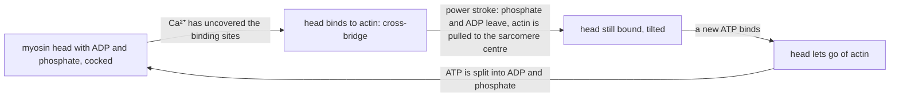

# B6 — Movement of the Organism: notes

These are English explanations of every learning outcome in [README.md](README.md), and every topic is *drafted*: written from the CCVX syllabus and standard VWO biology, not yet checked against an open source text or exam question.

- **In Dutch VWO:** school exam (SE) only, as O4 *Beweging van het organisme*, so the [CvTE syllabus biologie vwo 2027](https://www.examenblad.nl/2027/vwo/documenten/syllabus-biologie-vwo-2027) doesn't specify it. CCVX still tests it.
- **Overlap:** CvTE O2.3 *Neurale regulatie* (reflex arc, motor neurons) and M2.2 *Transport* spec 5 (motor protein, cytoskeleton). A citation like *(overlap: CvTE O2.3 spec 3)* points there.

Dutch terms are in brackets. Binas tables are named, not numbered, because the numbers differ between editions.

## 1. Organs for movement: muscles, senses and nerves

- Movement needs three kinds of organs working together: muscles as effectors, senses that report length, tension, position and balance, and nerves that carry commands and feedback. Neural regulation (*neurale regulatie*) ties them together. *(overlap: CvTE O2.3 specs 1–2)*
- The nervous system itself, with motor neurons, synapses and impulse conduction, is explained in [B04](../B04-self-regulation-of-organisms/README.md), and the senses in [B07](../B07-perception-by-organisms/README.md).

### Striated and smooth muscles

- Skeletal muscle is striated muscle (*dwarsgestreepte spier*): it is under voluntary control through the animal (somatic) nervous system, although reflexes can also make it contract. Its long, cylindrical fibres have many nuclei and show stripes under the microscope; it contracts fast and powerfully but tires.
- Smooth muscle (*gladde spier*) lies in the walls of the gut, blood vessels, bronchioles, bladder and uterus, and in the iris. It contracts involuntarily, under the autonomic nervous system, hormones or stretch.
- Smooth muscle cells are spindle-shaped with one nucleus, and their actin and myosin don't lie in regular rows, so there are no stripes. They contract slowly but can stay contracted for a long time on little ATP.
- In the gut wall, circular muscle (*kringspier*) and longitudinal muscle (*lengtespier*) are smooth muscles that push food along by peristalsis. *(overlap: CvTE O1.4 spec 1)*
- Heart muscle (*hartspier*) is striated but involuntary. Its branched cells are joined by intercalated discs that pass the impulse straight from cell to cell, it starts its own beat in the sinoatrial node, and its long refractory period prevents a sustained contraction, so the heart can refill between beats. See [B03](../B03-metabolism-in-organisms/README.md).
- **Trap:** "striated" describes the structure and "voluntary" the control. Heart muscle is striated yet involuntary.

### From muscle to actin and myosin

- A skeletal muscle (*spier*) is wrapped in connective tissue and consists of bundles of muscle fibres (*spiervezels*), with a tendon at each end.
- A muscle fibre is one muscle cell (*spiercel*): a very long cell, often several centimetres, with many nuclei, formed in the embryo by the fusion of many cells.
- The fibre is packed with myofibrils (*myofibrillen*). Between them lie many mitochondria and the sarcoplasmic reticulum (*sarcoplasmatisch reticulum*), the endoplasmic reticulum of the muscle cell, which stores Ca²⁺.
- A myofibril is a chain of sarcomeres (*sarcomeren*), each bounded by two Z-lines. Thin filaments of actin (*actine*) are anchored to the Z-lines, and thick filaments of myosin (*myosine*) lie in the middle, overlapping the actin.
- Light bands (actin only) alternate with dark bands (myosin, partly overlapping actin), and because the sarcomeres of neighbouring myofibrils lie in line, the whole fibre looks striated.
- **Trap:** keep the levels apart. A muscle fibre is a whole cell, a myofibril is a structure inside that cell, and actin and myosin filaments are protein strands inside the myofibril.

### Sliding filaments: the roles of ATP and Ca²⁺

- An impulse in a motor neuron (*motorisch neuron*) reaches the motor end plate (*motorische eindplaat*), the synapse between the neuron and the muscle fibre. Acetylcholine released there starts an action potential in the muscle cell membrane, which spreads into the fibre through narrow tubes (T-tubules). *(overlap: CvTE O2.3 specs 1–2; M4.2 spec 2)*
- The action potential makes the sarcoplasmic reticulum release Ca²⁺. Ca²⁺ binds to a regulatory protein on the actin filament (troponin), which shifts a second protein (tropomyosin) and uncovers the binding sites for myosin.
- Myosin heads then bind to actin, forming cross-bridges, and tilt, pulling the actin filaments towards the centre of the sarcomere: the power stroke. Binding a new ATP makes the head let go, and splitting that ATP into ADP and phosphate cocks the head again for the next stroke.
- Myosin is a motor protein (*motoreiwit*): it turns the chemical energy of ATP into movement. Other motor proteins, kinesin and dynein, move along the microtubules of the cytoskeleton (*cytoskelet*), carrying vesicles and bending cilia and flagella; actin filaments are themselves part of the cytoskeleton. See [B02](../B02-metabolism-in-cells/README.md). *(overlap: CvTE M2.2 spec 5)*

- The filaments slide past each other, so each sarcomere, and therefore the whole muscle, shortens, while the actin and myosin filaments keep their own length. The light bands and the centre zone become narrower; the dark band stays the same width.
- When the impulses stop, Ca²⁺ is pumped back into the sarcoplasmic reticulum by active transport, which costs ATP. The binding sites are covered again, the cross-bridges let go, and the muscle is stretched again by its antagonist or by gravity.
- After death the ATP runs out, so the myosin heads can't let go of actin, and the muscles become stiff (rigor mortis).
- **Trap:** ATP is needed to release the myosin head and to pump Ca²⁺ back, not only for the power stroke. That is why a lack of ATP makes a muscle stiff rather than slack.

### Energy for contraction

- The ATP stock in a muscle lasts only a few seconds of maximal effort. Creatine phosphate (*creatinefosfaat*) quickly rebuilds ATP from ADP for several seconds more, for example in a short sprint.
- Anaerobic dissimilation, glycolysis followed by lactic acid fermentation (C₆H₁₂O₆ → 2 C₃H₆O₃), delivers ATP fast but only 2 ATP per glucose, and the lactic acid (*melkzuur*) lowers the pH in the muscle. *(overlap: CvTE M2.3 spec 8)*
- Aerobic dissimilation (C₆H₁₂O₆ + 6 O₂ → 6 CO₂ + 6 H₂O) starts more slowly but delivers about 30–32 ATP per glucose (older Dutch textbooks say 36 or 38), about 15 times as much. It burns glucose from glycogen and also fatty acids. *(overlap: CvTE M2.3 spec 9)*
- Myoglobin (*myoglobine*) in the muscle binds O₂ more strongly than haemoglobin does, so it takes O₂ over from the blood and keeps a small store in the muscle. *(overlap: CvTE O1.3 spec 4)*
- Red, slow fibres have many mitochondria, much myoglobin and many capillaries: they work aerobically and tire slowly, which suits endurance. White, fast fibres have fewer mitochondria and rely more on glycolysis: they are fast and strong but tire quickly, which suits sprinting.
- Form and function in animals: chicken breast meat is white (the bird only flaps in short bursts), while the breast muscle of birds that fly for a long time, such as pigeons and ducks, is dark red.
- **Trap:** lactic acid is not what makes your muscles sore the next day; see warming up and cooling down below.

### Tendons, antagonists and tone

- A tendon (*pees*) is a strong cord of connective tissue, made of collagen fibres, that connects a muscle to a bone and passes on its pulling force. Tendons stretch little, but some store elastic energy: the Achilles tendon during running, and the long leg tendons of a hopping kangaroo.
- A muscle can only pull, by contracting; it can't push. So muscles work in antagonist pairs (*antagonisten*): one bends a joint, the flexor (*buigspier*), and the other straightens it, the extensor (*strekspier*). At the elbow the biceps bends and the triceps straightens.
- While one muscle of a pair contracts, its antagonist relaxes, because an inhibitory relay neuron in the spinal cord inhibits its motor neurons (see [B04](../B04-self-regulation-of-organisms/README.md)).
- Antagonists also occur without bones: the circular and longitudinal muscles of the gut wall, and the circular and radial muscles of the iris ([B07](../B07-perception-by-organisms/README.md)).
- Tone (muscle tone, *spiertonus*) is the slight, continuous tension of a resting muscle, because a few of its motor units are active at any moment. Reflexes from the muscle spindles maintain it under control of the brainstem and cerebellum; it keeps you upright, and it drops during sleep.
- **Trap:** tendons connect muscle to bone; ligaments (*gewrichtsbanden*) connect bone to bone in a joint.

### Muscle tension

- Muscle tension (*spierspanning*) is the force a muscle exerts on its tendons.
- A motor unit (*motorische eenheid*) is one motor neuron with all the muscle fibres it controls; they always contract together, all-or-none. Muscles for fine control, such as the eye muscles, have small motor units with few fibres per neuron; large leg muscles have units of hundreds to thousands of fibres, for force.
- The nervous system grades the tension in two ways: by recruitment (activating more motor units) and by frequency (impulses in quick succession add up, until at high frequency the twitches fuse into one smooth, maximal contraction).
- In an isometric contraction the tension rises but the length stays the same, as when you hold a heavy bag still. In an isotonic contraction the muscle shortens at a roughly constant tension, as when you lift the bag.
- A sarcomere develops the most force at a medium length, where actin and myosin overlap best. Overstretched, too few cross-bridges can form; very short, the filaments get in each other's way.
- **Trap:** a single muscle fibre can't contract "a little"; the gradation of force comes from the number of active motor units and the impulse frequency.

### Muscle spindle and tendon spindle

- A muscle spindle (*spierspoeltje*) is a stretch receptor that lies inside the muscle, parallel to the muscle fibres. It measures the muscle's length and how fast that length changes. *(overlap: CvTE O2.3 spec 3)*
- Stretching a muscle stimulates its muscle spindles, and their sensory neurons synapse directly with the motor neurons of the same muscle in the spinal cord: a monosynaptic reflex arc (*reflexboog*). The muscle contracts, while a relay neuron inhibits the antagonist.
- This stretch reflex is the knee-jerk reflex, and it keeps you balanced: when you sway forward, the calf muscles are stretched and contract. It also maintains muscle tone.
- The CCVX "tendon spindle" is the Golgi tendon organ (*peesspoeltje*): a receptor in the tendon, in series with the muscle, that measures tension.
- When the tension becomes very high, the tendon spindles excite an inhibitory relay neuron in the spinal cord, which inhibits the motor neurons of the same muscle. The muscle relaxes, which protects muscle and tendon from tearing; at normal force the tendon spindles keep reporting the tension, which the CNS uses for fine control.
- Together with receptors in the joints, both spindles tell the cerebellum and cortex where your limbs are and how they move (proprioception, *proprioceptie*), even with your eyes closed.
- **Trap:** the muscle spindle measures length and its reflex makes the same muscle contract (one excitatory synapse); the tendon spindle measures tension and its reflex makes the same muscle relax (through an inhibitory relay neuron).

### Neural regulation of movement

- Movement is regulated at three levels: the spinal cord (reflexes), the brainstem and cerebellum (posture, balance and coordination), and the cerebral cortex (voluntary movement). *(overlap: CvTE O2.3 specs 1–2)*
- A voluntary movement is planned in association areas and started by the primary motor cortex. The impulses run through tracts that cross to the other side to motor neurons in the brainstem and spinal cord, so the left motor cortex moves the right side of the body.
- The cerebellum compares the intended movement with feedback from muscle spindles, tendon spindles, the balance organ and the eyes, and corrects it, which makes movements smooth and well timed. Practice makes a movement automatic, with an important role for the cerebellum.
- The balance organ (*evenwichtsorgaan*) in the inner ear helps: its semicircular canals (*halfcirkelvormige kanalen*) detect rotation of the head, and its otolith organs detect gravity and linear acceleration. Touch receptors in the soles of the feet and the eyes add information. *(Binas diagram of the ear)*
- In Parkinson's disease, neurons deep in the brain that release dopamine die, and movements become slow and stiff, with a tremor, even though the motor cortex and the muscles themselves work.
- **Trap:** the motor cortex starts a movement but doesn't control it alone. With a damaged cerebellum, movements are clumsy and badly timed even though muscle strength is normal.

### Form and function in humans and animals

- In vertebrates the muscles pull on an internal skeleton of bones, which act as levers around the joints. The biceps attaches close to the elbow, so a small shortening moves the hand a long way and fast, at the cost of force.
- Insects have an exoskeleton of chitin, and their muscles attach to its inside; their legs also have flexor–extensor pairs.
- An earthworm has a hydrostatic skeleton: fluid in its segments. Contracting the circular muscles makes a segment long and thin, contracting the longitudinal muscles makes it short and thick, and bristles anchor the segments while waves of contraction move the worm forward.
- **Trap:** an exoskeleton doesn't put the muscles on the outside; they sit inside the skeleton, attached to its inner surface.

## 2. Training and rehabilitation programmes

### Principles of a training programme

- A training programme deliberately disturbs the body's equilibrium with a load above normal (overload), so that the body adapts and performs better afterwards.
- After a training session you are first more tired; during recovery your capacity rises to slightly above the starting level (supercompensation, *supercompensatie*). The next session works best when it falls in that phase.
- Progression: the load has to increase gradually as the body adapts, otherwise the improvement stops.
- Specificity: the body adapts only the muscles and type of effort that are trained, so a marathon runner doesn't become a sprinter.
- Recovery and reversibility: with too little rest, performance declines (overtraining), and when training stops, the gains disappear again within weeks.
- A programme sets the frequency, intensity, duration and type of exercise, matched to the person's goal, starting condition and age.
- **Trap:** the improvement happens during recovery, not during the training itself, so training without enough rest makes you worse, not better.

### Strength training

- Strength training (*krachttraining*) uses a high load with few repetitions, such as lifting heavy weights.
- In the first weeks the gain is mainly neural: more motor units are activated at the same time and the coordination between muscles improves.
- Later the muscle fibres grow thicker, with more myofibrils and so more actin and myosin (hypertrophy); the number of fibres hardly changes.
- **Trap:** a beginner's early strength gain comes mostly from the nervous system, not from bigger muscles.

### Endurance training and endurance

- Endurance (*uithoudingsvermogen*) is the ability to keep up an effort for a long time. It depends on how well O₂ is transported (lungs, heart and blood) and used (mitochondria in the muscles).
- Endurance training (*duurtraining*) means long efforts at moderate intensity, such as running, cycling or swimming.
- In the muscles it gives more mitochondria, more capillaries, more myoglobin and more enzymes of aerobic dissimilation, so the fibres burn more fat and form less lactic acid at the same pace.
- The heart grows larger and stronger, so its stroke volume (*slagvolume*) rises and the resting heart rate falls; the blood volume increases too. *(overlap: CvTE O1.6 specs 1–2)*
- Cardiac output is heart rate × stroke volume. With typical values, an untrained person at rest pumps 70 beats min⁻¹ × 70 mL = 4.9 L min⁻¹, and a trained athlete 50 beats min⁻¹ × 100 mL = 5.0 L min⁻¹: about the same output with fewer beats.
- **Trap:** a low resting heart rate in an athlete is a sign of a large stroke volume, not of a weak heart.

### Warming up and cooling down

- Warming up (*warming-up*) is light exercise before an intense effort. A higher muscle temperature makes enzymes work faster, impulses travel faster and muscles contract faster and more forcefully, and haemoglobin releases O₂ more easily.
- Warming up also increases the blood flow to the muscles, makes muscles and tendons more pliable, which is why it is used to lower the risk of injury, and rehearses the movements to come.
- Cooling down (*cooling-down*) is gradually decreasing the activity after an effort. The muscle pump keeps blood flowing back to the heart, which prevents blood from pooling in the legs and dizziness; light activity also clears lactate faster than rest, and the heart rate and temperature return gradually.
- **Trap:** muscle soreness the day after unusual effort comes from small injuries in the muscle fibres, especially after lengthening contractions such as running downhill, not from lactic acid, which has been cleared long before the soreness starts.

### Doping

- Doping is the use of banned substances or methods to improve performance; several are hormones, explained in [B04](../B04-self-regulation-of-organisms/README.md).
- EPO and blood transfusions increase the number of red blood cells, so the blood carries more O₂ and endurance improves; the thicker blood raises the risk of clots, stroke and heart attack.
- Anabolic steroids, testosterone and substances derived from it, increase protein synthesis in the muscles, so muscle mass and strength increase. Through negative feedback they lower FSH and LH, so the testes shrink and make less sperm; in women they have masculinising effects, and they can damage the heart and liver.
- Growth hormone stimulates the growth of muscle and bone.
- Stimulants such as amphetamine suppress the feeling of fatigue, so athletes can push on until they overheat or collapse.
- Beta blockers block the effect of adrenaline on the heart, which lowers the heart rate and reduces trembling; that is why they are banned in precision sports such as shooting and archery.
- Diuretics increase urine production; athletes misuse them to lose weight fast or to dilute other substances in their urine.
- **Trap:** a "natural" hormone such as testosterone or EPO is not harmless as doping: the abnormally high level causes the side effects, and negative feedback shuts down the body's own production.

### Rehabilitation programmes

- Rehabilitation (*revalidatie*) is a programme to restore function after an injury, operation, illness or a period of immobilisation.
- Without use, muscles shrink within weeks (atrophy) and tendons and bones weaken, and coordination gets worse. Astronauts in weightlessness lose muscle and bone mass for the same reason.
- A rehabilitation programme starts with a low load and exercises for the range of motion, increases the load step by step (progression), and trains the strength and endurance of the affected muscles; pain and swelling set the pace.
- It also retrains coordination and proprioception. After a sprained ankle, balance exercises on an unstable surface train the muscle spindles, joint receptors and reflexes that protect the joint, which lowers the chance of a new sprain.
- After a stroke, physiotherapy repeats movements over and over, so that other parts of the brain take over some of the lost function (the plasticity of the brain).
- After a heart attack, cardiac rehabilitation uses supervised endurance training.
- Animals are rehabilitated in the same way: horses and dogs, for example, with controlled walking and with exercise in water, which carries part of the body weight.
- **Trap:** rest alone doesn't restore function: without a gradually increasing load the muscles, tendons and the reflexes that protect the joint stay weak.

## Specimen contexts

- Health, activity programmes from health insurers to reduce cardiovascular disease: regular endurance exercise lowers the resting heart rate and blood pressure, improves the blood fats (more HDL cholesterol) and the response to insulin, and helps control body weight, which lowers the risk of atherosclerosis, heart attack, stroke and type 2 diabetes. Dutch and WHO guidelines advise adults at least 150 minutes a week of moderate-intensity activity, for example 30 minutes on 5 days, plus muscle-strengthening activities at least twice a week; designing such a programme uses outcome 2.
- Sport, the clap skate (*klapschaats*): on a classic skate the blade is fixed to the whole shoe, so the skater must keep the foot flat to stop the tip of the blade from digging into the ice, and the push-off comes almost entirely from extending the hip and knee. The clap skate has a hinge under the front of the shoe, so the heel can rise while the whole blade stays on the ice: the calf muscles can extend the ankle at the end of the push-off, which makes each push-off longer and stronger, and a spring snaps the blade back with the clap that gives the skate its name. This uses outcome 1 (muscles, joints and antagonists, and form and function).
