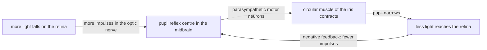

# B7 — Perception by Organisms: notes

These are English explanations of every learning outcome in [README.md](README.md), and every topic is *drafted*: written from the CCVX syllabus and standard VWO biology, not yet checked against an open source text or exam question.

- **In Dutch VWO:** school exam (SE) only, as O5 *Waarneming door het organisme*, so the [CvTE syllabus biologie vwo 2027](https://www.examenblad.nl/2027/vwo/documenten/syllabus-biologie-vwo-2027) doesn't specify it. CCVX still tests it.
- **Overlap:** CvTE O2.3 *Neurale regulatie* (sensory neurons, receptor types, brain centres, reflex arc) and M4.2 spec 2 (impulse conduction, threshold). A citation like *(overlap: CvTE O2.3 specs 1–2)* points there.

Dutch terms are in brackets. Binas tables are named, not numbered, because the numbers differ between editions.

## 1. How a sense works, and the role of the brain centres

- A sense organ (*zintuig*) contains receptor cells (sense cells, *zintuigcellen*) that are specialised for one kind of stimulus (*prikkel*). The sense organ only detects; perception (*waarneming*) itself happens in the brain. *(overlap: CvTE O2.3 specs 1–2; O2.1 specs 1–2)*
- The chain runs: stimulus → receptor, which turns it into a graded receptor potential → if that passes the threshold, impulses in sensory neurons → spinal cord or brainstem → for most senses the thalamus → a sensory centre in the cerebral cortex, where the impulses become a conscious perception.
- The "peripheral" part in CCVX is the peripheral nervous system (*perifeer zenuwstelsel*): the sensory nerves that carry the impulses from the sense organs to the central nervous system (*centraal zenuwstelsel*, CNS: spinal cord, brainstem and brain). See [B04](../B04-self-regulation-of-organisms/README.md) for the whole nervous system.
- Sensory neurons (*sensorisch neuron*) carry the impulses to the CNS. Relay neurons (the CCVX term; usual English interneurons, *schakelneuron*) pass them on and process them in the spinal cord and brain, and motor neurons (*motorisch neuron*) carry the response to the muscles. *(overlap: CvTE O2.3 specs 1–2)*
- Impulse conduction (*impulsgeleiding*) is the same in every sensory neuron: action potentials of the same size travel along the fibre, faster in myelinated fibres. A stronger stimulus gives more impulses per second, not bigger ones. *(overlap: CvTE M4.2 spec 2)*
- The cortex has separate centres (*centra in de hersenschors*). The centre of sensation (primary sensory cortex, at the front of the parietal lobe) receives touch, pain, temperature and body position; the centre of movement (primary motor cortex, just in front of it in the frontal lobe) starts voluntary movements; the centre of vision (*gezichtscentrum*, the visual cortex) lies in the occipital lobe at the back. *(Binas diagram of the brain)*
- In the sensory and motor cortex the body is mapped, with large areas for sensitive or finely controlled parts such as the fingers and lips. The mapping is crossed: the right hemisphere receives touch from the left half of the body.
- Association areas around these centres link a perception with memory and meaning, for example to recognise a face.
- The "large brain" (cerebrum, *grote hersenen*) is where conscious perception happens. The "small brain" (cerebellum, *kleine hersenen*) uses information from the balance organ, the muscle spindles and the eyes, unconsciously, to coordinate movement.
- The brainstem (*hersenstam*) contains reflex centres for the senses, such as those for the pupil reflex, the blink reflex and the eye movements that keep an image still when the head moves. The spinal cord (*ruggenmerg*) carries touch and pain impulses from the body up to the brain, and handles spinal reflexes.
- Perception is interpretation. The brain fills in gaps, such as the blind spot, and can be fooled by optical illusions; phantom pain, felt in an amputated limb that is no longer there, shows that the sensation is made in the brain.
- **Trap:** all impulses look the same; what you perceive depends on which brain centre they reach. Pressure on a closed eye makes you see flashes of light, because the impulses from the retina arrive in the visual cortex.

## 2. Structure of the eye

- The wall of the eye has three layers. The outer one is the tough, white sclera (*harde oogvlies*), whose transparent front is the cornea (*hoornvlies*). Inside it lies the choroid (*vaatvlies*), with blood vessels and dark pigment that absorbs stray light, and the innermost layer is the retina (*netvlies*), with the light receptors. *(Binas diagram of the eye)*
- At the front, the iris (*regenboogvlies*) surrounds the pupil, the opening that lets light in. Behind the iris hangs the lens (*ooglens*), held by suspensory ligaments (*lensbandjes*) from the ring-shaped ciliary body (*straalvormig lichaam*), which contains the ciliary muscle.
- Aqueous humour (*kamerwater*) fills the space in front of the lens and the jelly-like vitreous body (*glasachtig lichaam*) the space behind it.
- Light passes cornea → aqueous humour → pupil → lens → vitreous body → retina. The cornea does most of the refraction, about two-thirds, and the lens fine-tunes it; the image on the retina is smaller than the object and upside down, and the brain interprets it the right way up.

### Lens and accommodation

- Accommodation (*accommodatie*) is changing the shape of the lens to focus on objects at different distances.
- To see something nearby, the ring-shaped ciliary muscle contracts, so the ring gets smaller and the suspensory ligaments slacken. The elastic lens then becomes rounder, refracts more strongly, and focuses the nearby object on the retina.
- To see far away, the ciliary muscle relaxes, the ring widens, the ligaments pull tight and the lens becomes flatter.
- With age the lens loses its elasticity, so it can no longer round up for near vision: presbyopia (*ouderdomsverziendheid*), usually noticed in one's forties and corrected with reading glasses with converging lenses.
- **Trap:** for near vision the ciliary muscle contracts but the ligaments become slack, not tight; the lens rounds up by its own elasticity.

### Retina, rods, cones, macula and blind spot

- In the retina, light first passes layers of nerve cells and then reaches the rods (*staafjes*) and cones (*kegeltjes*) at the back, against the pigment layer. Their signals pass through bipolar cells to ganglion cells, whose axons together form the optic nerve (*oogzenuw*).
- Rods are very sensitive to light and have one light-sensitive pigment (rhodopsin), so they work in dim light but don't see colour. Many rods connect to one ganglion cell, which adds up weak signals but gives a less sharp image; rods lie mainly in the outer parts of the retina.
- Cones need more light. There are three types, most sensitive to blue, green and red light respectively, and the brain compares their signals to see colour. In red–green colour blindness one cone type is missing or abnormal; the genes are on the X chromosome, so it is much more common in men ([E03](../../E-reproduction/E03-reproduction-of-organisms/README.md)).
- There are roughly 20 times as many rods as cones: about 120 million rods and 6 million cones per eye.
- The macula (yellow spot, *gele vlek*) is a small area in the centre of the retina, on the line of sight, packed with cones. At its centre is the fovea, a pit containing only cones, each connected to roughly its own ganglion cell, which gives the sharpest vision; you turn your eyes so that the image of what you look at falls there.
- That is why, at night, a faint star is easier to see if you look slightly next to it: its image then falls on the rods outside the yellow spot.
- The blind spot (*blinde vlek*) is where the fibres of the optic nerve and the blood vessels leave the eye, on the nose side of the yellow spot. It has no rods or cones, but you don't notice it, because the brain fills in the gap and the blind spots of your two eyes cover different parts of the visual field.
- **Trap:** the blind spot is not the yellow spot. The yellow spot gives the sharpest vision, the blind spot no vision at all.

### Optic chiasm and the visual pathway

- The two optic nerves meet below the brain in the optic chiasm (*chiasma opticum*). There the fibres from the nasal half of each retina, the half nearest the nose, cross to the other side, while the fibres from the temporal (outer) half stay on the same side.
- The lens inverts the image, so the left half of the visual field (*gezichtsveld*) falls on the right half of each retina: the nasal half of the left eye and the temporal half of the right eye. After the chiasm both run on the right side, through the thalamus, to the right visual cortex.
- So each hemisphere sees the opposite half of the visual field with both eyes, and it can combine the two slightly different images into depth perception.
- Damage shows the pattern. Cutting one optic nerve blinds that eye. Damage to the middle of the chiasm, for example by a pituitary tumour pressing on it ([B04](../B04-self-regulation-of-organisms/README.md)), destroys the crossing nasal fibres and so the outer half of the visual field of both eyes. Damage behind the chiasm on the right side removes the left half of the visual field of both eyes.
- **Trap:** only the fibres from the nasal halves of the retinas cross, not all fibres; and the left visual field ends up in the right hemisphere.

### Myopia and its correcting lens

- In myopia (*bijziendheid*) the eyeball is too long, or the cornea and lens refract too strongly, so the image of a distant object is focused in front of the retina. Distant objects are blurred; nearby ones can still be seen sharply.
- A diverging lens (concave, negative lens, *holle lens*) in front of the eye spreads the light a little, so the focus moves back onto the retina.
- Lens strength is given in dioptres (*dioptrie*): P = 1 / f, with the focal length f in metres, negative for a diverging lens. A myope who sees sharply only up to 0.5 m (the far point) needs a lens of about −2.0 D, whose focal length is −0.5 m.
- In hypermetropia (*verziendheid*) the eyeball is too short, the image falls behind the retina, and a converging lens (convex, positive lens, *bolle lens*) corrects it.
- **Trap:** presbyopia is not the same as hypermetropia: presbyopia comes from a lens that lost its elasticity, hypermetropia from an eyeball that is too short.

## 3. Adequate stimulus and response

- The adequate stimulus (*adequate prikkel*) of a receptor is the kind of stimulus it is most sensitive to, the one with the lowest threshold: light for rods and cones, sound vibrations for the hair cells in the cochlea, stretch for muscle spindles. *(overlap: CvTE O2.3 specs 1–2)*
- Receptors are grouped by their adequate stimulus. Mechanical receptors (*mechanoreceptoren*) respond to deformation: touch, pressure, stretch, sound and balance. Chemical receptors (*chemische receptoren*) respond to substances: taste, smell, and CO₂ and O₂ in the blood. Light receptors (*lichtreceptor*) are the rods and cones.
- Temperature receptors (*temperatuurreceptor*) are separate warm and cold receptors in the skin. Touch receptors (*tastreceptor*) are mechanoreceptors in the dermis, densest in the fingertips and lips. Pain receptors are free nerve endings that respond to tissue damage from strong pressure, heat or chemicals; the Dutch syllabus lists the pain nerve (*pijnzenuw*) that carries their impulses.
- A strong stimulus of another kind can sometimes excite a receptor too: pressure on the eye gives flashes of light. Some chemicals act on temperature and pain receptors: menthol stimulates cold receptors, so mint feels cool, and capsaicin from chilli peppers stimulates heat-sensitive pain receptors, so it feels hot.
- The stimulus threshold (*prikkeldrempel*) is the weakest stimulus that produces impulses. Above it, a stronger stimulus gives a higher impulse frequency and activates more receptors, so the sensation is stronger. *(overlap: CvTE M4.2 spec 2)*
- The response runs through the CNS to effectors. A reflex runs through the spinal cord or brainstem and is fast and automatic; a voluntary reaction runs through the cortex and is slower, because more synapses and more processing are involved.
- The reaction time is the time from stimulus to response: transduction in the receptor, conduction along the sensory nerve, processing across synapses in the brain, conduction to the muscle, and the start of contraction. People react faster to a sound than to a light.
- Adaptation (*adaptatie*) happens at the receptor: under a constant stimulus the receptor sends fewer and fewer impulses, so the sensation fades. You stop feeling your clothes or a ring, and the smell in a room fades; touch receptors adapt fast, pain receptors hardly at all, so pain keeps warning you.
- The eye adapts to darkness: over about 20–30 minutes in dim light it becomes far more sensitive, mainly because the rods rebuild their light-sensitive pigment.
- Habituation (*habituatie*, also *gewenning*) happens in the CNS and is a simple form of learning: the response to a repeated, harmless stimulus decreases, while the receptors still send their impulses. You stop noticing a ticking clock or the traffic outside, yet you notice at once when the clock stops. Habituation in behaviour is in [D03](../../D-interaction/D03-behaviour-and-interaction/README.md).
- **Trap:** adaptation and habituation both make you react less, but adaptation is in the receptor (it fires less) and habituation is in the CNS (the brain stops responding to impulses that still arrive). A habituated response comes back at once with a new or changed stimulus; an adapted receptor needs time to recover.

## 4. Regulation cycles in the senses

- The senses contain regulation cycles that keep their input within a usable range, with a norm, a receptor, a control centre, an effector and negative feedback, as in [B04](../B04-self-regulation-of-organisms/README.md). *(overlap: CvTE O2.3 spec 3)*
- The pupil reflex (*pupilreflex*) regulates the amount of light that falls on the retina. Light-sensitive cells in the retina are the receptor, a reflex centre in the midbrain (part of the brainstem) is the control centre, and the muscles of the iris are the effector.
- More light makes the circular muscle (*kringspier*) of the iris contract, through parasympathetic motor neurons, so the pupil narrows and less light reaches the retina: negative feedback. In dim light the radial muscle of the iris, controlled by the sympathetic system, widens the pupil.
- The pupil reflex is a reflex arc (*reflexboog*): receptor, sensory neurons in the optic nerve, a centre in the brainstem and motor neurons to the iris. Both pupils react, even when light falls on one eye only.

- A doctor shines a light into the eyes to test the brainstem, and the eye doctor uses eye drops that block the parasympathetic signal to the iris, which widen the pupil so the retina can be inspected.
- Accommodation is also feedback: the brain adjusts the ciliary muscle until the image on the retina is sharp. Looking at something close also turns both eyes inward and narrows the pupils.
- The balance organ works with a reflex too: when the head turns, it makes the eye muscles turn the eyes the other way, so the image stays still on the retina.
- **Trap:** the pupil reflex regulates the amount of light on the retina; the sharpness of the image is set by accommodation of the lens. And the circular muscle narrows the pupil, while the radial muscle widens it.

## 5. Senses, musculature, nervous system and hormonal system

- Senses provide the input for movement: the eyes, the balance organ, muscle spindles, tendon spindles and touch receptors in the soles of the feet guide posture and movement through the cerebellum and the motor cortex ([B06](../B06-movement-of-the-organism/README.md)).
- Muscles serve the senses as well: six eye muscles turn each eyeball towards what you look at, the iris muscles set the pupil, and the ciliary muscle accommodates the lens.
- Sensory, relay and motor neurons link senses to muscles. Reflex arcs give fast protection: the blink reflex when something touches the cornea, the pupil reflex in bright light, and the withdrawal reflex after pain.
- Senses trigger hormones. Light falling on the retina inhibits the release of melatonin by the pineal gland (*pijnappelklier*); this helps set the biological clock, which is why daylight at the new local time helps you get over jet lag. Seeing danger activates the sympathetic system and the release of adrenaline, which in turn widen the pupils.
- **Trap:** the iris and ciliary muscles are smooth muscles under the autonomic nervous system, but the six muscles that move the eyeball are striated muscles that you can move at will.

## 6. Use of the senses and the functioning of the organism

- The senses let an organism respond to its surroundings and to its own body: finding food, avoiding danger, finding a mate, communicating, finding its way, and, with internal receptors such as the chemical and pressure receptors in the aorta, keeping homeostasis.
- The senses of animals fit their way of life. Predators such as cats and owls have eyes at the front with overlapping visual fields, for depth perception; prey animals such as rabbits and horses have eyes at the sides, for an almost all-round view.
- Nocturnal animals have many rods, and cats have a reflective layer behind the retina that makes their eyes shine in the dark. Birds of prey have very densely packed cones and see very sharply.
- Some animals use stimuli that humans can't perceive: bats find prey from the echoes of their ultrasound calls, bees see ultraviolet light, and some snakes sense the infrared radiation of warm-blooded prey.
- Losing a sense shows how much the organism depends on it. In nerve damage from diabetes, people may not feel wounds on their feet, which can then become badly infected; people born unable to feel pain often injure themselves.
- The brain can compensate: in people blind from early childhood, the visual cortex becomes active when they read Braille with their fingers.
- **Trap:** a sense doesn't simply record the world. Each receptor passes on only its own kind of stimulus, and the brain selects and interprets, so different species perceive the same environment differently.

## Specimen contexts

- Health, an optician advising on lenses to correct myopia: a myopic eye focuses distant objects in front of the retina, so it needs a diverging (negative) lens, either as glasses or as a contact lens. A contact lens sits on the cornea and glasses about 12 mm in front of it, so a myope needs a slightly weaker contact lens: for a far point of 20 cm, −5.0 D as a contact lens against about −5.3 D in glasses; laser surgery instead flattens the cornea. This uses outcome 2 (structure of the eye, accommodation and myopia).
- Sport, start training to reduce false starts: the start signal is a sound that has to pass the hair cells of the inner ear, the auditory nerve, the brainstem, the cortex, the motor cortex, the motor neurons in the spinal cord and the leg muscles, and every step and synapse takes time. World Athletics rules count a reaction faster than 0.100 s after the gun, measured by sensors in the starting blocks, as a false start, because a real reaction to the sound is not considered possible that fast; start training therefore aims at a fast, consistent reaction to the sound instead of guessing the moment of the gun. This uses outcomes 1, 3 and 5.
