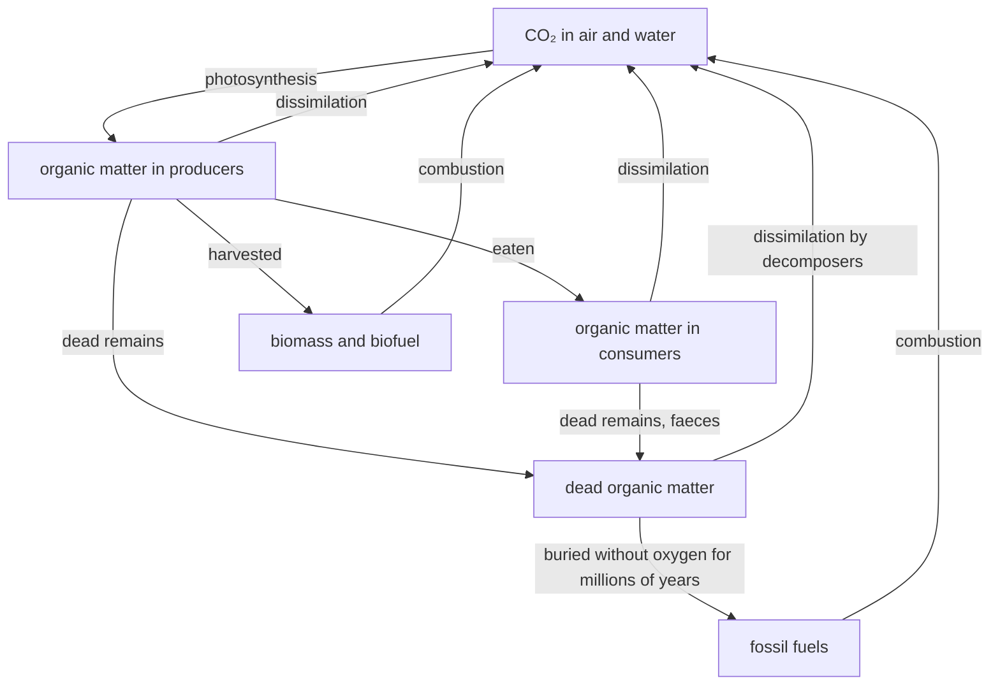
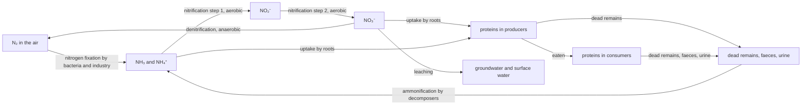

# B8 — Regulation of Ecosystems: notes

These are English explanations of every learning outcome in [README.md](README.md), and every topic is *drafted*: written from the CCVX syllabus, the Dutch CvTE syllabus and standard VWO biology, not yet checked against an open source text or exam question.

- **In Dutch VWO:** central exam (CE).
- **Dutch source:** [CvTE syllabus biologie vwo 2027](https://www.examenblad.nl/2027/vwo/documenten/syllabus-biologie-vwo-2027) (version 2, July 2025), P1 *Regulatie van ecosystemen* (P1.1–P1.3). A citation like *(CvTE P1.2 spec 3)* means specification 3 of P1.2; its numbers don't match the CCVX numbers.

Dutch terms are in brackets. Binas tables are named, not numbered, because the numbers differ between editions.

## B8.1 Energy Flows

### 1. Energy flows, what influences them, and disturbance

- An energy flow (*energiestroom*) is the one-way route of energy through an ecosystem: from sunlight to chemical energy in the organic substances of producers, then to consumers and decomposers, and finally to heat that leaves the ecosystem. *(CvTE P1.1 specs 1 and 3)*
- Producers (*producenten*) make organic substances from inorganic ones, nearly always by photosynthesis: plants, algae and cyanobacteria.
- Consumers (*consumenten*) eat other organisms: herbivores are consumers of the first order (*consumenten van de eerste orde*), carnivores that eat herbivores are consumers of the second order, and so on.
- Decomposers (*reducenten*), mainly bacteria and fungi, break down dead remains, faeces and urine to inorganic substances, and so get energy from every trophic level. Detritivores (*afvaleters*) such as earthworms speed this up by breaking dead material into small pieces.
- Trophic levels (*trofische niveaus*) are the feeding steps: producers are level 1, herbivores level 2, carnivores level 3 and higher.
- At each step most of the energy is lost: not everything is eaten (roots, wood), not everything eaten is absorbed (faeces), and most absorbed energy is used in dissimilation for maintenance, movement and body heat, and leaves as heat. Only about 10% (roughly 5–20%) of the production of one level becomes production of the next.
- Factors that influence the flow: light, temperature, water, CO₂ and minerals (N, P) limit photosynthesis and so the input; the number of trophic levels; and the kind of consumer, because birds and mammals (endotherms) spend far more energy on body heat than ectotherms such as insects.
- Climate change (*klimaatverandering*) disturbs energy flows by shifting timing and conditions: Dutch research on great tits (*koolmezen*) found that warmer springs moved the caterpillar peak forward more than the birds' breeding, so many chicks hatch after the food peak.
- Overfishing (*overbevissing*) takes fish out faster than they reproduce, so less energy reaches the higher trophic levels and their prey are released from predation; the cod fishery off Newfoundland collapsed in the early 1990s.
- Deforestation (*ontbossing*) replaces forest with cropland or pasture: far less biomass per hectare, lost habitat, and CO₂ released by burning and decomposition (B8.2 outcome 2).
- **Trap:** Energy isn't recycled. Matter cycles between organisms and their environment, but energy leaves the ecosystem as heat and has to be supplied again by the sun.

### 2. Energy flow models

- Energy flow models show who feeds on whom and how much energy passes on: a food chain (*voedselketen*), a food web (*voedselweb*), ecological pyramids, and box-and-arrow diagrams of the energy flow. *(CvTE P1.1 specs 1–2)*
- The processes in these models are photosynthesis or chemosynthesis, feeding, dissimilation and decomposition; the organisms are producers, consumers and decomposers.
- Organic/inorganic substances: organic substances (*organische stoffen*) are carbon compounds made by organisms, such as glucose, starch, proteins and fats, and they contain chemical energy. Inorganic substances (*anorganische stoffen*) are CO₂, H₂O, O₂ and minerals such as NO₃⁻, NH₄⁺ and PO₄³⁻; CO₂ and carbonates contain carbon but are inorganic.
- Autotrophs (*autotrofen*) make their own organic substances from inorganic ones. Heterotrophs (*heterotrofen*) need organic substances from other organisms as their source of energy and carbon: animals, fungi and most bacteria, decomposers included.
- CCVX lists phototroph, chemotroph and autotroph: phototrophs get their energy from light, chemotrophs from chemical reactions. The Dutch syllabus combines the terms: photoautotrophs (*foto-autotrofen*) such as plants, algae and cyanobacteria use light, and chemoautotrophs (*chemo-autotrofen*) use energy from oxidising inorganic substances (chemosynthesis, *chemosynthese*), such as nitrifying bacteria (NH₄⁺, NO₂⁻) and bacteria at deep-sea hot springs (H₂S). See [B02](../B02-metabolism-in-cells/README.md).
- Gross primary production, GPP, which CCVX writes as BPP (*bruto primaire productie*), is all the organic matter, or chemical energy, that the producers make per area per time.
- Net primary production, NPP (*netto primaire productie*), is what remains after the producers' own dissimilation: NPP = GPP − R, where R is the respiration of the producers. NPP is the food available to consumers and decomposers, plus the growth of the producers.
- Productivity (*productiviteit*) is production per area per time, for example in kJ m⁻² year⁻¹ or g dry mass m⁻² year⁻¹; it is high in tropical rainforests and estuaries and low in deserts and the open ocean.
- Biomass (*biomassa*) is the mass of organisms in an area at one moment, usually as dry mass, for example in kg m⁻²; production is the new biomass formed per time.
- Worked example, with invented round numbers in kJ m⁻² year⁻¹: grass in a meadow has GPP = 25 000 and uses 13 000 in its own dissimilation, so NPP = 25 000 − 13 000 = 12 000, which is 48% of GPP.
- A consumer's budget is intake = faeces + absorbed, and absorbed = dissimilation (lost as heat) + production (growth and offspring). Grasshoppers that eat 4 000 of the grass and lose 1 600 in faeces absorb 2 400; if they use 1 200 of that in dissimilation, their production is 1 200.
- The 8 000 of the NPP that the grasshoppers don't eat goes to decomposers as dead plant material, or stays as plant growth.
- The transfer efficiency, or ecological efficiency (*ecologisch rendement*), is the production of a trophic level divided by the production of the level below, × 100%. For the grasshoppers it is 1 200 / 12 000 × 100% = 10%. Some questions use intake or absorbed energy instead of production: use the definition the question gives.
- Following the energy further up the chain gives a pyramid of energy (*energiepiramide*), in which each bar is the production of one trophic level:

| Trophic level | Production (kJ m⁻² year⁻¹) | Transfer efficiency |
|---|---|---|
| grass (NPP) | 12 000 | – |
| grasshoppers | 1 200 | 1 200 / 12 000 = 10% |
| frogs | 96 | 96 / 1 200 = 8% |
| grass snakes (*ringslangen*) | 4.8 | 4.8 / 96 = 5% |

- The grass snakes get 4.8 / 12 000 × 100% = 0.04% of the NPP, which is why food chains seldom have more than four or five links.
- Pyramids of numbers and of biomass (*piramides van aantallen en van biomassa*) can be upside down: one oak feeds thousands of caterpillars, and in the sea the fast-dividing phytoplankton can have less biomass at one moment than the zooplankton that eats it. A pyramid of energy production is never upside down.
- **Trap:** English ecology texts call the absorbed part of the food "assimilated", but in Dutch biology *assimilatie* means building the organism's own organic substances. Read how the question defines each term.

### 3. Measures that influence energy flows

- Choices about energy use change ecosystems for better or worse; the main choices are between fossil fuels, biofuels and biomass, and the energy transition (*energietransitie*) to renewable sources such as sun and wind. *(CvTE P1.1 spec 4)*
- Fossil fuels (*fossiele brandstoffen*) such as coal, oil and natural gas formed from organisms buried millions of years ago. Their energy is sunlight fixed by photosynthesis long ago, and burning them adds CO₂ that had been out of the carbon cycle for millions of years.
- A biofuel (*biobrandstof*) is made from recent biomass: bioethanol by fermenting the sugar of sugar cane or maize, C₆H₁₂O₆ → 2 C₂H₅OH + 2 CO₂; biodiesel from vegetable oil such as rapeseed oil; biogas (methane) by fermenting manure.
- Burning bioethanol, C₂H₅OH + 3 O₂ → 2 CO₂ + 3 H₂O, releases carbon that the crop took up only recently, so in principle the burning itself adds no extra CO₂ to the air, unlike burning a fossil fuel.
- Biomass (*biomassa*) burnt as fuel, such as wood pellets, is only renewable if the plants grow back, and a forest takes decades to take up again the CO₂ released by burning it.
- Every energy source affects ecosystems: plantations for palm oil and soya replace rainforest, hydroelectric dams block migrating fish, wind turbines kill some birds and bats, and fossil fuels drive climate change.
- Eating lower in the food chain saves energy: at about 10% per step, 1 000 kJ of meat costs about 10 000 kJ of plant food (5 000 kJ at 20%, 20 000 kJ at 5%), so a mainly plant-based diet needs far less farmland. See the ecological footprint in [D05](../../D-interaction/D05-interaction-in-ecosystems/README.md).
- Fishing quotas and protected sea areas let fish stocks recover, and protecting forests keeps their production and their stored carbon. Biofuels and fossil fuels from the chemistry side are in [chemistry F03](../../../CCVX-chemistry/F-industrial-chemical-processes/F03-energy-conversion/README.md).
- **Trap:** A biofuel isn't automatically carbon-neutral. Fertiliser, machinery, transport and above all clearing forest or draining peatland for the crop release extra CO₂ (and N₂O).

## B8.2 Cycles

### 1. Producers, consumers and decomposers in the carbon and nitrogen cycles

- In a cycle (*kringloop*) an element passes from the inorganic environment into organisms and back: producers take it in, consumers pass it along the food chain, and decomposers return it to the inorganic form. *(CvTE P1.2 specs 1–2)*
- Carbon cycle (*koolstofkringloop*): producers fix CO₂ from air or water by photosynthesis (*fotosynthese*), 6 CO₂ + 6 H₂O → C₆H₁₂O₆ + 6 O₂, using light energy absorbed by chlorophyll (the Binas schemes of photosynthesis and dissimilation).
- All organisms, producers included, release CO₂ again by dissimilation (*dissimilatie*): C₆H₁₂O₆ + 6 O₂ → 6 CO₂ + 6 H₂O.
- Decomposers dissimilate dead remains to CO₂ when O₂ is present (aerobic, *aeroob*). Without O₂ (anaerobic, *anaeroob*), microorganisms break organic matter down to methane (*methaan*) and CO₂, overall for glucose C₆H₁₂O₆ → 3 CH₄ + 3 CO₂.
- Methane-producing microorganisms (archaea) live in swamps, rice paddies, landfill sites, biogas plants and the rumen of cattle.
- Carbon is stored for a long time in wood, in peat (waterlogged soil where decomposition is slow), in fossil fuels and, as inorganic CaCO₃, in limestone made of shells. Burning (*verbranding*) fossil fuels or biomass returns it as CO₂; for natural gas, CH₄ + 2 O₂ → CO₂ + 2 H₂O.
- Nitrogen cycle (*stikstofkringloop*): nitrogen fixation (*stikstofbinding*) turns nitrogen gas (*stikstofgas*, N₂) from the air into ammonia (*ammoniak*, NH₃). Bacteria do this: some free-living soil bacteria, cyanobacteria, and rhizobia in the root nodules of legumes such as clover, peas and soya.
- Lightning also fixes a little nitrogen, as nitrogen oxides that rain brings down as nitrate.
- Industry fixes nitrogen with the Haber–Bosch process, N₂ + 3 H₂ → 2 NH₃, to make artificial fertiliser.
- In soil water, ammonia takes up H⁺ and becomes ammonium (*ammonium*): NH₃ + H⁺ ⇌ NH₄⁺.
- Producers take up nitrate (*nitraat*, NO₃⁻) and ammonium through their roots and use the N to build amino acids, proteins and nucleic acids; consumers get their N by eating and excrete the surplus, for example as urea in urine.
- Ammonification (*ammonificatie*): decomposers break down the proteins in dead remains, faeces and urine and release the N as NH₃ and NH₄⁺. Urea in manure, for example, is split by CO(NH₂)₂ + H₂O → 2 NH₃ + CO₂, which is why stables smell of ammonia.
- Nitrification (*nitrificatie*), step 1: chemoautotrophic bacteria such as Nitrosomonas oxidise ammonium to nitrite (*nitriet*): 2 NH₄⁺ + 3 O₂ → 2 NO₂⁻ + 4 H⁺ + 2 H₂O.
- Nitrification, step 2: bacteria such as Nitrobacter oxidise nitrite to nitrate: 2 NO₂⁻ + O₂ → 2 NO₃⁻. Overall NH₄⁺ + 2 O₂ → NO₃⁻ + 2 H⁺ + H₂O, so both steps need O₂ and the H⁺ makes the soil more acidic.
- Denitrification (*denitrificatie*): in waterlogged, oxygen-poor soil and mud, bacteria use nitrate instead of O₂ to dissimilate organic matter and release N₂ (with some N₂O) to the air. With glucose: 5 C₆H₁₂O₆ + 24 NO₃⁻ + 24 H⁺ → 30 CO₂ + 12 N₂ + 42 H₂O.
- CCVX pairs nitrification/denitrification because they work in opposite directions: nitrification makes nitrate and needs O₂, denitrification removes nitrate and only happens without O₂.
- Quantifying carbon: in the photosynthesis equation 6 × 44.01 = 264.06 g CO₂ gives 180.16 g glucose and 6 × 32.00 = 192.00 g O₂, so each kg of glucose fixes 1.47 kg CO₂ and releases 1.07 kg O₂. Mole and mass calculations are in [chemistry C02](../../../CCVX-chemistry/C-chemical-processes-and-conservation-laws/C02-chemical-calculations/README.md), element cycles in [chemistry C03](../../../CCVX-chemistry/C-chemical-processes-and-conservation-laws/C03-conservation-laws-and-cycles/README.md).
- Quantifying a carbon budget, with invented numbers in tonnes of carbon per hectare per year: a forest with GPP 14 and producer respiration 7 has NPP 7. If its consumers and decomposers respire 5, it stores 7 − 5 = 2 t C, which is 2 × 44.01/12.01 = 7.3 t CO₂ taken from the air; if they respire more than the NPP, the ecosystem is a net CO₂ source.
- Quantifying nitrogen, with assumed numbers: a pig farm buys 100 tonnes of soya meal with 45% protein, and protein contains about 16% N, so that is 100 × 0.45 × 0.16 = 7.2 t N. If the pigs keep 30% of it (2.2 t) in their bodies, the other 5.0 t N ends up in their manure.
- **Trap:** Don't mix up nitrogen fixation (N₂ to NH₃) with nitrification (NH₄⁺ to NO₂⁻ to NO₃⁻). The step that returns N₂ to the air is denitrification.

### 2. Showing cycles, the factors that influence them, and disturbance

- A cycle is shown as reservoirs (air, water, soil, organisms, fossil stores) linked by arrows for the processes, as in the carbon and nitrogen cycles below. *(CvTE P1.2 specs 3–4)*

- Oxygen decides which processes run: nitrification and aerobic decomposition need O₂, while in waterlogged soil denitrification and methane formation take over and dead plant material piles up as peat.
- Decomposers and nitrifying bacteria work faster when it is warm, moist and not too acid; in cold, wet or very acid soil, such as a bog, breakdown is slow.
- Leaching (*uitspoeling*): nitrate is negatively charged and isn't held by the negatively charged clay and humus particles, so rainwater carries it down to the groundwater and into ditches, while positive ammonium binds to these particles. Phosphate binds strongly to soil, but leaches from soils that are saturated with it after years of heavy manuring.
- The EU limit for nitrate in groundwater and drinking water is 50 mg NO₃⁻ per litre, which is 50 × 14.01/62.01 = 11.3 mg N per litre: check whether a question gives nitrate or nitrogen.
- Eutrophication (*eutrofiering*, also *vermesting*) is an excess of nutrients, mainly nitrate and phosphate. In a lake or ditch it goes step by step:
  1. Fertiliser and manure leach or run off from the land, and sewage adds phosphate.
  2. Algae and cyanobacteria grow explosively (an algal bloom), and the water turns green and turbid.
  3. Submerged water plants get too little light and die.
  4. When the algae die, aerobic decomposers break them down and use up much of the O₂, especially in warm water, which holds less O₂.
  5. Fish and other animals suffocate, and at the bottom anaerobic breakdown produces toxic hydrogen sulfide (H₂S) and methane.
  6. Few species remain, and some cyanobacteria (*blauwalg*) make toxins, which leads to swimming bans in summer.
- In fresh water phosphate is often the limiting nutrient, in the sea more often nitrogen.
- On land, ammonia from manure and NOₓ from traffic and industry are deposited on nature areas; heathland and dunes, adapted to poor soil, are then overgrown by fast-growing grasses such as purple moor grass (*pijpenstrootje*).
- The greenhouse effect (*broeikaseffect*): sunlight passes through the atmosphere and warms the surface, the surface radiates infrared (heat radiation), and greenhouse gases (*broeikasgassen*: water vapour, CO₂, CH₄ and N₂O) absorb part of it and radiate it in all directions, partly back to the surface. This keeps the mean surface temperature at about 15 °C instead of about −18 °C, a difference of 33 °C.
- The enhanced greenhouse effect (*versterkt broeikaseffect*) is the extra warming from human emissions: CO₂ from fossil fuels and deforestation, CH₄ from cattle, rice paddies, landfill and gas leaks, and N₂O from fertilised soil. CO₂ rose from about 280 ppm before industrialisation to more than 420 ppm in the 2020s, about 50% higher, which causes global warming and climate change.
- Part of the extra CO₂ dissolves in the oceans, CO₂ + H₂O ⇌ H⁺ + HCO₃⁻; the extra H⁺ lowers the pH (ocean acidification), so corals and shellfish build their calcium carbonate skeletons less easily.
- Draining peatland lets O₂ into the peat, which decomposers then break down to CO₂, and the land subsides, as in the Dutch peat meadows.
- **Trap:** The greenhouse effect itself is natural and keeps the Earth habitable; the problem is the enhanced greenhouse effect. The hole in the ozone layer is a different problem (UV radiation, CFCs).

### 3. Measures that influence nutrient cycles and the Earth system

- Measures can close cycles and cut losses to the environment, which protects biodiversity and the Earth system (*systeem Aarde*), in which the cycles of air, oceans, soil and organisms are linked worldwide. *(CvTE P1.2 spec 5)*
- Fertilising only what the crop takes up and keeping fewer animals per hectare reduce nitrate leaching and ammonia emission; injecting manure into the soil instead of spreading it on top cuts the ammonia emission.
- Reuse (*hergebruik*) and recycling (*recyclen*) keep nutrients in the cycle: compost, manure instead of artificial fertiliser, and phosphate recovered from sewage. Phosphate rock is a finite resource, so recycling P matters.
- Sewage treatment plants remove nitrogen by nitrification followed by denitrification, and remove phosphate, before the water goes back to rivers.
- For carbon: burn less fossil fuel, protect and plant forests, and raise the water table in drained peatland so that the peat stops decomposing.
- Consequences for biodiversity (*gevolgen voor de biodiversiteit*): extra N and P favour a few fast-growing species (grasses, stinging nettles, brambles) over the many species of nutrient-poor soils. Lower inputs, and removing nutrients by mowing and taking away the hay or by sod cutting (*plaggen*) on heathland, bring species back; see [F03](../../F-evolution/F03-biodiversity/README.md).
- **Trap:** Recycling inside one area doesn't remove a surplus: as long as more N and P come in (feed, fertiliser) than leave in products, the difference ends up in the environment.

## B8.3 Dynamics and Equilibrium

### 1. What an ecosystem is and what it comprises

- An ecosystem (*ecosysteem*) is a community together with its abiotic environment and all the interactions between them, such as a lake, a heathland or a beech forest. *(CvTE P1.3 specs 1–2)*
- A population (*populatie*) is all the individuals of one species in an area at the same time, which can interbreed; a community (*levensgemeenschap*) is all the populations of different species in that area.
- Biotic factors (*biotische factoren*) are influences from organisms: food, predators, competitors, parasites, partners and people. Abiotic factors (*abiotische factoren*) are non-living: light, temperature, water, soil, pH, salinity, O₂ and minerals.
- The habitat (*habitat*) is where a species lives, its address; its niche (*niche*) is its role and the full set of conditions and resources it uses, its profession: what it eats, when and where it is active, where it breeds. More in [D05](../../D-interaction/D05-interaction-in-ecosystems/README.md).
- Species composition (*soortensamenstelling*) is which species live in an ecosystem and how many of each. It differs between ecosystems with their abiotic factors, which indicator species (*indicatorsoorten*) reveal, such as stinging nettles on nitrogen-rich soil; see [C03](../../C-self-organization/C03-self-organization-of-ecosystems/README.md).
- A microclimate (*microklimaat*) is the local climate of a small area, which differs from the general climate: a forest floor is darker, more humid, less windy and cooler in summer than an open field nearby. More in D05.
- Reasoning through how a change in one component spreads through an ecosystem is the skill in [A12](../../A-skills/A12-ecological-thinking/README.md).
- **Trap:** Habitat and niche aren't the same: two species can share a habitat, such as one pond, and still have different niches, such as eating plankton or eating snails.

### 2. Competition in the dynamics of an ecosystem

- Competition (*concurrentie*) is the use of the same scarce resource (food, light, water, space, nest sites) by several organisms, which harms all of them; B8.3 asks what it does for the maintenance and development of an ecosystem, and the forms and examples are in D05. *(CvTE P1.3 spec 4)*
- Within a population, competition rises with density: more individuals means less food each, fewer births and more deaths, so the population is held around its carrying capacity. This negative feedback is one of the ways an ecosystem regulates itself.
- Between populations of different species, competition is strongest where niches overlap. Species with the same niche can't coexist for long, so species divide the resources and the species composition settles.
- In the development of an ecosystem, competition drives succession: trees that grow up shade out light-demanding heather and grasses (see C03).
- **Trap:** Competition harms both sides (−/−), unlike predation and parasitism, where one side gains.

### 3. Biotic and abiotic factors in the dynamics

- Dynamics (*dynamiek*) are the changes in population sizes and species composition over time; B8.3 asks how biotic and abiotic factors cause them. *(CvTE P1.3 spec 3)*
- A population changes by birth (*geboorte*), death (*sterfte*) and migration (*migratie*): change = births − deaths + immigration − emigration. With 500 deer, 150 births, 100 deaths, 20 arriving and 30 leaving, there are 500 + 150 − 100 + 20 − 30 = 540 deer a year later, 8% more.
- Migration, moving into or out of an area, lets species colonise new places and brings in new alleles; seasonal migration, such as swallows wintering in Africa, makes numbers rise and fall through the year.
- Biotic factors such as food shortage, predators and disease grow stronger as a population grows, so they damp its numbers; predator and prey numbers can cycle, as lynx and snowshoe hare in Canada do roughly every 10 years.
- Abiotic factors work through tolerance (*tolerantie*): each species lives only within a range of each factor, does best at its optimum (*optimum*), and is held back by the factor furthest from what it needs, the limiting factor (*beperkende factor*). A dry summer or a hard winter can therefore cut a population back; details in D05.
- Island theory (*eilandtheorie*), MacArthur and Wilson's theory of island biogeography: the number of species on an island is an equilibrium between the arrival of new species and the extinction of species already there, so large islands and islands close to the mainland have more species. Isolated nature reserves in farmland behave like islands.
- Biodiversity (*biodiversiteit*) is the variety of life at the level of genes, species and ecosystems. A food web with many species has alternative routes, so the loss of one species disturbs it less; see [F03](../../F-evolution/F03-biodiversity/README.md).
- **Trap:** In population dynamics, migration means any immigration or emigration that changes the numbers, not only the seasonal journeys of birds.

### 4. Measures that influence self-regulation

- People influence how ecosystems maintain themselves, on purpose or not; nature management (*natuurbeheer*) is the deliberate part. *(CvTE P1.3 spec 5)*
- Introduced species (*exoten*) are brought by people outside their natural range. Some spread fast because their natural enemies are missing and outcompete native species, such as Japanese knotweed (*Japanse duizendknoop*), and the muskrat (*muskusrat*) digs burrows in Dutch dikes, so it is controlled.
- Preventing introductions and removing invasive species protect the native species.
- Mowing and taking away the hay, grazing by sheep or cattle, and sod cutting keep heathland and species-rich grassland from turning into forest, and they remove nutrients.
- Following island theory, nature areas are linked by corridors and wildlife overpasses (*ecoducten*) so that animals can migrate and small populations don't die out; in the Netherlands this network is the Natuurnetwerk Nederland.
- Cutting nitrogen deposition and fertiliser use, and restoring water levels, bring back the abiotic conditions that native species need.
- **Trap:** Nature management often works against succession: heathland arose from centuries of grazing and sod cutting, and turns into forest without them.

## Specimen contexts

- Importing soya from Brazil as pig feed (sustainability): growing soya can mean clearing Amazon rainforest or Cerrado savanna, which releases CO₂ and destroys habitat and biodiversity, and feeding it to pigs adds a trophic level that loses most of the energy (B8.1, B8.3). The N in the soya (largely fixed from the air, because soya is a legume) and its P end up in Dutch pig manure, so the cycle is open: Brazilian soils need fertiliser while Dutch soil and water get a surplus, with leaching, eutrophication and ammonia deposition (B8.2, worked example in B8.2 outcome 1). Measures the committee can weigh are deforestation-free soya, European protein crops, fewer pigs, manure processing and eating less meat (B8.1 outcome 3, B8.2 outcome 3, B8.3 outcome 4).

## CCVX versus the Dutch syllabus

- **In both:** energy flow and its models with GPP (BPP), NPP and productivity, the carbon and nitrogen cycles with all their steps, and competition and biotic and abiotic factors in ecosystem dynamics.
- **Dutch syllabus only:** climate change, overfishing and deforestation (P1.1 spec 3); energy transition (P1.1 spec 4); aerobic, anaerobic, ammonia, ammonium, nitrate, nitrite, methane and nitrogen gas (P1.2 spec 3); greenhouse gases (P1.2 spec 4); reuse, recycling and consequences for biodiversity (P1.2 spec 5); habitat, community and species composition (P1.3 spec 1); indicator species and the differences between ecosystems, which CCVX has in C3.1 item 3 (P1.3 spec 2); birth, death, limiting factor, tolerance, optimum and island theory (P1.3 spec 3); nature management (P1.3 spec 5). The notes cover all of them briefly, with limiting factor, tolerance and optimum in more detail in D05.
- **CCVX only:** very little: phototroph and chemotroph as separate words (the Dutch syllabus only has *foto-autotroof* and *chemo-autotroof*), biomass also in the list for cycles, and biodiversity under dynamics and equilibrium, where the Dutch syllabus has it under cycles (P1.2 spec 5).
