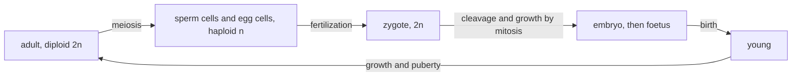
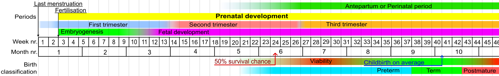
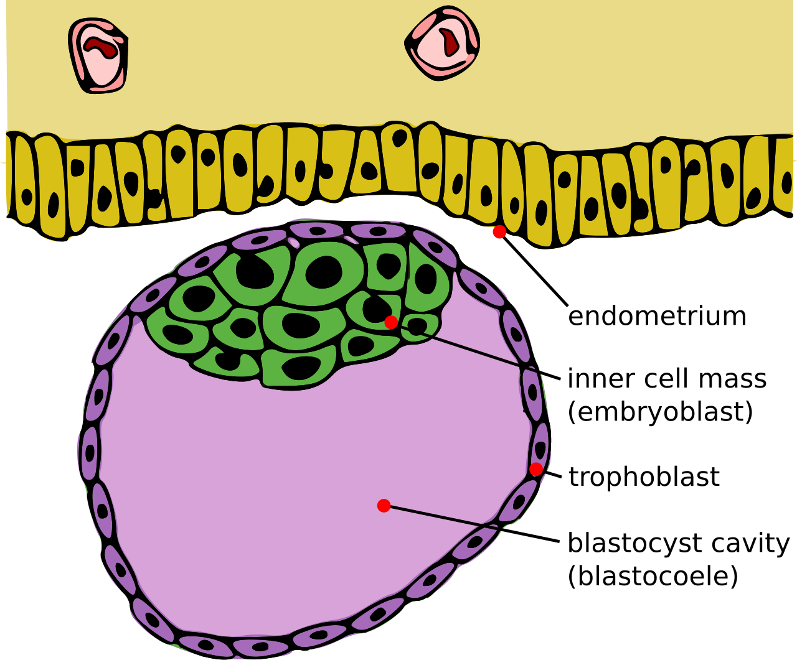
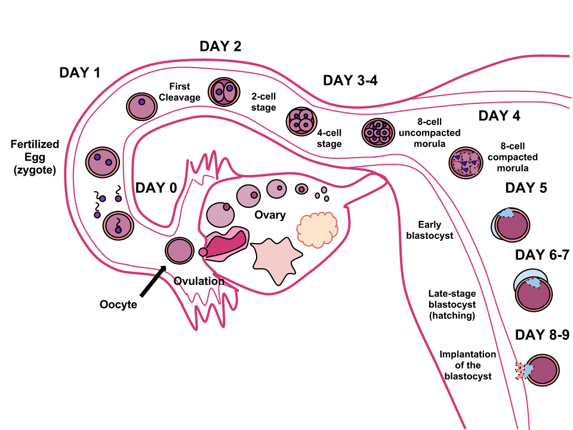
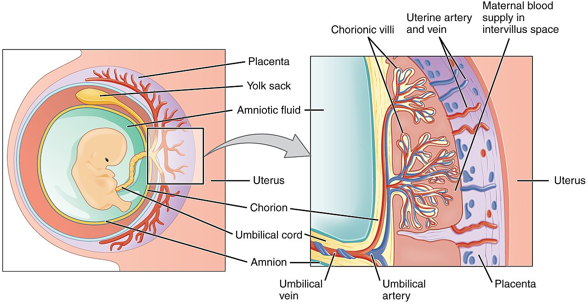
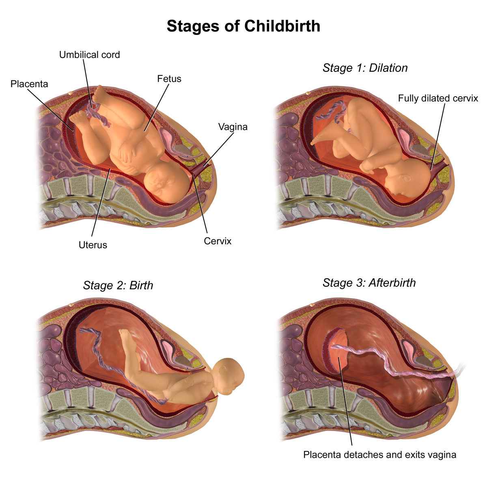

# C2 — Self-Organization of Organisms: notes

These are English explanations of every learning outcome in [README.md](README.md), and every topic is *drafted*: written from the CCVX syllabus and standard VWO biology, not yet checked against an open source text or exam question.

- **In Dutch VWO:** school exam (SE) only, as O6 *Zelforganisatie van het organisme*, so the [CvTE syllabus biologie vwo 2027](https://www.examenblad.nl/2027/vwo/documenten/syllabus-biologie-vwo-2027) doesn't specify it. CCVX still tests it.
- **Overlap:** CvTE O9.1 *Voortplanting* (life cycle, gametes, zygote, cleavage, embryo, foetus, placenta), O1.6 spec 3 (embryonic circulation), M3.2 spec 6, M4.1 spec 5 and M8.2 spec 2 (cancer, proto-oncogenes, tumour suppressor genes, mutagens), M7.1 (genotype, environment, epigenetics) and P1.3 (biotic and abiotic factors, limiting factor). A citation like *(overlap: CvTE O9.1 spec 5)* points there.

Dutch terms are in brackets. Binas tables are named, not numbered, because the numbers differ between editions.

## 1. Life cycles of plants, insects and mammals

- A life cycle (*levenscyclus*) is the series of stages from a fertilized egg to an adult that reproduces, after which the cycle starts again. In sexual reproduction it alternates between diploid (2n) and haploid (n) cells: meiosis halves the chromosome number and fertilization restores it. *(overlap: CvTE O9.1 spec 1)*
- Reproductive cells (*voortplantingscellen*), or gametes (*gameten*), are haploid. Fertilization (*bevruchting*) is the fusion of a male and a female gamete, and of their nuclei, into a diploid zygote (*zygote*). *(overlap: CvTE O9.1 specs 3–4)*
- A sperm cell (*zaadcel*) is small and mobile: a head with the nucleus and a cap of enzymes (acrosome) that digest a way through the coats around the egg, a midpiece full of mitochondria for energy, and a tail (flagellum). A man produces millions every day.
- An egg cell (*eicel*) is large and immobile: a human egg is about 0.1 mm across, with cytoplasm containing nutrients and organelles for the first days, surrounded by a protective coat and follicle cells. Once one sperm cell has entered, the coat changes so that no other sperm cell can get in.
- Mammals: the adult forms gametes by meiosis in the testes and ovaries, fertilization is internal (in humans in the oviduct), and the zygote develops into an embryo and foetus in the uterus, fed through a placenta in placental mammals. After birth the young drink milk, grow, mature sexually in puberty and reproduce; human body cells have 46 chromosomes, gametes 23.

- Flowering plants: a seed germinates (*kieming*) into a seedling (*kiemplant*), which grows until it flowers. Pollen is carried to the stigma (pollination, *bestuiving*), and a pollen tube grows to the ovule (*zaadbeginsel*) and delivers two male gametes.
- One male gamete fertilizes the egg cell, which grows into the embryo; the other fuses with two other nuclei and forms the endosperm, the food store of the seed (double fertilization). The ovule becomes the seed and the ovary the fruit, which helps disperse the seeds.
- CCVX's "germ" probably means *kiem*: the embryo inside a seed, as in "wheat germ". It consists of an embryonic root, an embryonic shoot and one or two seed leaves (cotyledons, *zaadlobben*); the seed coat (*zaadhuid*) protects it, and the endosperm or the cotyledons feed it until the seedling can photosynthesize. (If CCVX means germ cells, *kiemcellen*, the cells that give rise to gametes, see reproductive cells above.)
- Plant life cycles alternate between a diploid generation that makes spores by meiosis and a haploid generation that makes gametes (alternation of generations, *generatiewisseling*). In flowering plants the haploid generation is tiny (pollen grain and embryo sac); in mosses it is the green plant itself.
- Many plants also reproduce asexually, by runners (strawberry), tubers (potato), bulbs (tulip) or cuttings (*stekken*). The offspring are clones, which growers use to keep a variety uniform.
- Insects grow by moulting (*vervelling*): their exoskeleton of chitin can't grow, so they shed it and form a new, larger one. The hormone ecdysone triggers each moult.
- In complete metamorphosis (*volledige gedaanteverwisseling*) the stages are egg, larva (*larve*), pupa (*pop*) and imago (*imago*, the adult). The larva (caterpillar, maggot, grub) looks nothing like the adult and is specialized in eating and growing; in the pupa most larval tissue is broken down and the adult body is built from groups of cells set aside for this; the imago reproduces and spreads, and doesn't grow any more.
- In incomplete metamorphosis (*onvolledige gedaanteverwisseling*) there is no pupa: the egg hatches into a nymph (*nimf*), a young stage that looks like a small adult without functional wings or reproductive organs, and becomes the imago after several moults.
- Complete and incomplete metamorphosis compared:

| | Complete metamorphosis | Incomplete metamorphosis |
|---|---|---|
| Stages | egg, larva, pupa, imago | egg, nymph, imago |
| Young stage | looks very different from the adult | looks like a small adult without wings |
| Pupa | yes | no |
| Examples | butterflies, beetles, flies, bees, ants | grasshoppers, locusts, cockroaches, aphids |

- An advantage of complete metamorphosis is that larva and imago usually live on different food in different places, so they don't compete with each other.
- **Trap:** The pupa is not a resting stage in which nothing happens: inside it the whole body is rebuilt. In incomplete metamorphosis the young stage still moults several times; it just has no pupa.

## 2. Phases from zygote to birth

- Weeks of pregnancy are counted in two ways. Doctors and midwives count from the first day of the last menstrual period (LMP), about two weeks before fertilization; embryologists count from fertilization. A full-term pregnancy lasts about 40 weeks (280 days) after the LMP, which is about 38 weeks (266 days) after fertilization. *(overlap: CvTE O9.1 spec 5)*

*Weeks of pregnancy counted from the last menstrual period, as doctors count them: fertilization at the end of week 2, the embryo until the end of week 10, the foetus from week 11, and birth on average at week 40. Image: Mikael Häggström, public domain, [Wikimedia Commons](https://commons.wikimedia.org/wiki/File:Prenatal_development_table.svg).*

- Fertilization takes place in the upper part of the oviduct (*eileider*), usually within a day of ovulation. The zygote is the first diploid cell of the new individual.
- Cleavage divisions (*klievingsdelingen*) are mitotic divisions without growth in between, so the cells get smaller with every division while the whole embryo stays the same size. The first division takes place about a day after fertilization. *(overlap: CvTE O9.1 specs 3–4)*
- The morula (*morula*) is a solid ball of about 16 cells (after four cleavage divisions), about 3–4 days after fertilization, still on its way through the oviduct.
- The blastula (*blastula*; in mammals called blastocyst, *blastocyste*) is a hollow ball of cells around a fluid-filled cavity, about 4–5 days after fertilization, when it reaches the uterus. Its outer layer (trophoblast) will form the chorion and the embryo's part of the placenta; its inner cell mass, made of embryonic stem cells, will form the embryo itself ([C01](../C01-self-organization-of-cells/README.md)).

*A blastocyst against the uterine lining (endometrium), just before implantation. The inner cell mass (embryoblast) becomes the embryo; the trophoblast forms the chorion and the embryo's part of the placenta. Image: Seans Potato Business, [CC BY-SA 3.0](https://creativecommons.org/licenses/by-sa/3.0/), [Wikimedia Commons](https://commons.wikimedia.org/wiki/File:Blastocyst_English.svg).*

- About 6–7 days after fertilization (week 3 counted from the LMP) the blastocyst starts to burrow into the uterine lining (implantation, *innesteling*). It then makes hCG (*HCG*), which keeps the corpus luteum (*geel lichaam*) producing progesterone, so the uterine lining stays and menstruation stops; pregnancy tests detect hCG in urine. *(overlap: CvTE O9.1 spec 7)*

*From ovulation to implantation: fertilization in the oviduct, cleavage on the way to the uterus, and implantation of the blastocyst in the uterine lining. The days and cell numbers are approximate and differ a little between sources. Image: Ttrue12, [CC BY-SA 3.0](https://creativecommons.org/licenses/by-sa/3.0/), [Wikimedia Commons](https://commons.wikimedia.org/wiki/File:Human_Fertilization.png).*

- In the third week after fertilization the embryo forms three germ layers (*kiembladen*): ectoderm (skin and nervous system), mesoderm (muscles, bone, blood, heart, kidneys) and endoderm (lining of gut and lungs, liver, pancreas).
- The embryo (*embryo*) is the developing individual until the end of week 8 after fertilization (week 10 after the LMP). In this period all organs are laid down: the heart starts beating about three weeks after fertilization (about five weeks after the LMP), and the neural tube, the start of the brain and spinal cord, closes about four weeks after fertilization. *(overlap: CvTE O9.1 spec 5)*
- The foetus (*foetus*) is the developing individual from week 9 after fertilization (week 11 after the LMP) until birth. Its organs are already there; they grow and mature, and most weight is gained in the last months.
- The chorion (*chorion*) is the outer membrane around the embryo. It grows finger-like villi (*vlokken*) into the uterine wall, which form the embryo's part of the placenta; chorionic villus sampling (*vlokkentest*) takes a few villi to test for chromosome abnormalities.
- The amnion (*amnion*) is the thin inner membrane that encloses the embryo in amniotic fluid (*vruchtwater*). The fluid cushions shocks, keeps the temperature stable and gives the foetus room to move and practise breathing movements; amniocentesis (*vruchtwaterpunctie*) samples it, with foetal cells, for chromosome tests.
- The placenta (*placenta*) consists of the chorionic villi and the uterine lining. The villi hang in spaces filled with the mother's blood, while foetal blood flows through capillaries inside them, so the two bloods don't mix: they are separated by a thin layer of cells.
- Across that layer O₂, glucose, amino acids, fatty acids, water, salts and IgG antibodies pass from mother to foetus, and CO₂ and urea pass from foetus to mother, by diffusion and active transport. The placenta also makes hormones (hCG, progesterone, oestrogen).
- Foetal haemoglobin binds O₂ more strongly than adult haemoglobin, which helps the foetus take up O₂ from the mother's blood ([B03](../../B-self-regulation/B03-metabolism-in-organisms/README.md)).
- The umbilical cord (*navelstreng*) connects the foetus with the placenta. Its two umbilical arteries (*navelstrengslagaders*) carry oxygen-poor blood from the foetus to the placenta, and its one umbilical vein (*navelstrengader*) carries oxygen-rich blood back to the foetus. *(overlap: CvTE O1.6 spec 3)*

*The embryo inside the amnion and chorion, and a close-up of the placenta: chorionic villi with the embryo's blood vessels hang in spaces filled with the mother's blood, so the two bloods don't mix. "Yolk sack" should read yolk sac. Image: OpenStax College, Anatomy & Physiology, [CC BY 3.0](https://creativecommons.org/licenses/by/3.0/), [Wikimedia Commons](https://commons.wikimedia.org/wiki/File:2910_The_Placenta-02.jpg).*

- At birth (*geboorte*), about 38 weeks after fertilization, oxytocin released by the posterior pituitary makes the uterus contract. The contractions press the baby against the cervix, which causes more oxytocin release: positive feedback (*positieve terugkoppeling*) that goes on until the baby is born. *(overlap: CvTE O2.1 spec 3)*
- Birth goes in three stages. In dilation (*ontsluiting*) the contractions open the cervix until it is fully dilated, about 10 cm; in expulsion (*uitdrijving*) the mother pushes along with the contractions and the baby is born; in the afterbirth (*nageboorte*) the placenta and membranes come loose and are pushed out.

*The three stages of birth; stage 2 is the expulsion. Image: BruceBlaus, [CC BY-SA 4.0](https://creativecommons.org/licenses/by-sa/4.0/), [Wikimedia Commons](https://commons.wikimedia.org/wiki/File:Stages_of_Childbirth.png).*

| Phase | After fertilization | After the LMP | What happens |
|---|---|---|---|
| Zygote | day 0 | about 2 weeks | fertilization in the oviduct |
| Morula | day 3–4 | week 3 | solid ball of about 16 cells |
| Blastula (blastocyst) | day 4–5 | week 3 | hollow ball reaches the uterus |
| Implantation | from day 6–7 | week 3 | burrows into the uterine lining; hCG |
| Embryo | until the end of week 8 | until the end of week 10 | all organs laid down |
| Foetus | week 9 until birth | week 11 until birth | growth and maturation |
| Birth | about 38 weeks | about 40 weeks | oxytocin, contractions |

- The 20-week scan (*twintigwekenecho*), which checks the foetus for structural abnormalities, is named after week 20 counted from the LMP, which is about 18 weeks after fertilization.
- **Trap:** The umbilical vein carries oxygen-rich blood and the umbilical arteries oxygen-poor blood, because arteries and veins are named after the direction of flow (away from or towards the heart), not after their O₂ content. Always check whether weeks are counted from fertilization or from the LMP: the difference is about two weeks.

## 3. Nutrition, stimulants and stress before birth

- Everything an embryo or foetus receives comes from the mother's blood through the placenta, so her nutrition, her use of stimulants and her stress affect prenatal development (*prenatale ontwikkeling*). *(overlap: CvTE O9.1 spec 5)*
- The effect depends on timing. In the first two weeks after fertilization a harmful substance usually either kills the embryo or does no lasting harm; in the embryonic period (weeks 3–8 after fertilization) it can cause malformations of the organs being formed; in the foetal period it mainly disturbs growth and brain development.
- The placenta is not a perfect barrier: it stops most bacteria and, apart from IgG antibodies, most large proteins, but small and fat-soluble molecules such as alcohol, nicotine, carbon monoxide and many medicines and drugs pass easily, and so do some viruses (rubella) and parasites (the toxoplasmosis parasite).
- Nutrition (*voeding*): the foetus needs energy, protein, vitamins and minerals to grow. A shortage leads to low birth weight and, as the Hunger Winter shows, to effects later in life (see the specimen contexts).
- Folic acid (*foliumzuur*), a B vitamin, is needed for cell division. A shortage around conception raises the risk of a neural tube defect such as spina bifida (*open ruggetje*), because the neural tube closes about four weeks after fertilization, often before a woman knows she is pregnant.
- The Dutch advice is therefore a daily supplement of 0.4 mg (400 µg) folic acid, starting at least four weeks before conception.
- Large amounts of vitamin A, for example from liver, can cause malformations, and food infections such as listeriosis (from raw-milk cheese or raw fish and meat) and toxoplasmosis (from raw meat or cat faeces) can harm the foetus, so pregnant women are advised to avoid these foods.
- CCVX's "stimulants" probably translates *genotmiddelen*: alcohol, tobacco, caffeine and drugs.
- Alcohol crosses the placenta freely, and the foetus can hardly break it down. It can cause foetal alcohol syndrome (*foetaal alcoholsyndroom*): slow growth, a typical face (narrow eye openings, a thin upper lip, a smooth groove above the lip) and brain damage with learning and behaviour problems; no safe amount is known, so the advice is no alcohol at all.
- Smoking: nicotine narrows blood vessels, including those of the placenta, and carbon monoxide binds to haemoglobin much more strongly than O₂, so the foetus gets less O₂. Babies of mothers who smoke are on average lighter and are more often born prematurely.
- Drugs and medicines: cocaine narrows blood vessels; a baby whose mother used heroin or methadone goes through withdrawal after birth; and the sleeping pill thalidomide (Softenon), taken in early pregnancy around 1960, caused babies to be born with severely shortened arms and legs.
- A high caffeine intake is linked to lower birth weight, so pregnant women are advised to limit coffee and energy drinks.
- Stress: in a stressed mother the level of the stress hormone cortisol rises. The placenta inactivates much of it, but severe or long-lasting stress is linked to lower birth weight, premature birth and a more reactive stress system in the child, possibly through epigenetic changes ([E03](../../E-reproduction/E03-reproduction-of-organisms/README.md)).
- A congenital abnormality (*aangeboren afwijking*) is any abnormality present at birth. It can have a genetic cause (Down syndrome: an extra chromosome 21), an environmental cause during pregnancy (foetal alcohol syndrome, rubella, thalidomide) or both (spina bifida).
- A hereditary disease (*erfelijke ziekte*) is caused by an allele inherited from one or both parents, and can show at birth or only much later: cystic fibrosis (recessive) usually shows in early childhood, Huntington's disease (dominant) usually only between about 30 and 50. The inheritance patterns are in [E03](../../E-reproduction/E03-reproduction-of-organisms/README.md).
- So not every congenital abnormality is hereditary, and not every hereditary disease is visible at birth. Down syndrome is congenital and genetic but usually not inherited: it mostly results from an error in meiosis (non-disjunction), which happens more often in older mothers.
- Prevention: folic acid; no alcohol, smoking or drugs; care with medicines and certain foods; vaccination against rubella (part of the MMR vaccine) long before pregnancy; and screening. The Dutch newborn heel prick (*hielprik*) detects treatable conditions such as PKU and congenital hypothyroidism, so treatment can start before damage is done.
- **Trap:** "Congenital" means present at birth, whatever the cause; "hereditary" means passed on through the genes. (In [D03](../../D-interaction/D03-behaviour-and-interaction/README.md) CCVX uses "congenital" for innate behaviour.)

## 4. Internal and external factors in human development

- A person's physical development runs through life stages: fast growth in the first year, slower growth in childhood, a growth spurt in puberty (on average about two years earlier in girls than in boys), adulthood and ageing. *(overlap: CvTE M7.1 spec 1)*
- At every stage the phenotype (*fenotype*) results from the genotype (*genotype*) together with environmental factors (*milieufactoren*). Adult height, for example, depends strongly on genes, but a child only reaches that potential with enough food and good health.
- Internal factors (*inwendige factoren*) are genes and hormones. Growth hormone from the pituitary stimulates growth in length during childhood; too little gives short stature, too much before the growth plates close gives gigantism.
- Thyroid hormone is needed for growth and brain development; a baby born with too little of it (congenital hypothyroidism) is found through the heel prick and treated with tablets.
- Sex hormones cause the growth spurt and the secondary sex characteristics of puberty, and eventually close the growth plates (*groeischijven*), which ends growth in length. Hormones are in [B04](../../B-self-regulation/B04-self-regulation-of-organisms/README.md) and the Binas table of human hormones.
- Ageing (*veroudering*) is partly internal: telomeres shorten with every division, so most body cells can divide only about 50 times (40–60), and DNA damage accumulates ([E02](../../E-reproduction/E02-cell-life-cycle/README.md)).
- External factors (*uitwendige factoren*) are food (energy, protein, calcium and vitamin D for bones, iodine), physical activity, sleep, sunlight, infections, pollution, smoking, alcohol, stress, the social environment and access to healthcare.
- The average height of Dutch people has risen strongly since the 19th century, too fast for genetic change: better food, hygiene and healthcare let more people reach their genetic potential.
- Environmental factors can also change the activity of genes without changing the DNA sequence, for example by DNA methylation (epigenetics, *epigenetica*); some of these changes last a lifetime ([D01](../../D-interaction/D01-molecular-interaction/README.md)). *(overlap: CvTE M7.1 spec 5)*
- Cancer (*kanker*) is a group of diseases in which body cells divide uncontrollably, ignore signals to stop dividing or to die (apoptosis), invade surrounding tissue, and can spread through blood and lymph to form secondary tumours (metastases, *uitzaaiingen*). *(overlap: CvTE M3.2 spec 6)*
- A benign tumour (*goedaardige tumor*) grows locally and doesn't spread; a malignant tumour (*kwaadaardige tumor*) invades and spreads, and only malignant tumours count as cancer ([E02](../../E-reproduction/E02-cell-life-cycle/README.md)).
- Cancer and its causes: cancer develops when one cell lineage accumulates mutations in several genes. Proto-oncogenes (*proto-oncogenen*), which normally stimulate division, become overactive oncogenes, and tumour suppressor genes (*tumorsuppressorgenen*), which normally stop division or trigger repair or apoptosis, are switched off (p53 is the best-known example). *(overlap: CvTE M4.1 spec 5)*
- Because several mutations are needed, cancer becomes more common with age. Mutagenic (*mutagene*) substances and radiation raise the mutation rate: tobacco smoke, UV light (skin cancer), X-rays and radon. Asbestos and alcohol also raise the risk of cancer, and some viruses cause it, such as HPV (cervical cancer) and hepatitis B (liver cancer). *(overlap: CvTE M8.2 spec 2)*
- Some people inherit a mutation in a tumour suppressor gene, such as BRCA1 or BRCA2, which gives a much higher risk of breast and ovarian cancer: they inherit the higher risk, not the cancer itself.
- Prevention of cancer: not smoking, protecting the skin against sunburn (especially in childhood, see [E01](../../E-reproduction/E01-dna-replication/README.md)), limiting alcohol, a healthy weight, diet and exercise, and vaccination against HPV and hepatitis B. Screening, such as the Dutch population screening for breast, cervical and colorectal cancer, finds cancer early, when treatment works best.
- **Trap:** Cancer is a genetic disease of body cells (mutations in somatic cells) but usually not a hereditary disease; only a higher risk can be inherited. And a tumour is not always cancer.

## 5. Biotic and abiotic factors in crop development

- The development of a crop from seed to harvest depends on abiotic factors (*abiotische factoren*: non-living conditions) and biotic factors (*biotische factoren*: other organisms). *(overlap: CvTE P1.3 spec 2)*
- For each factor a plant has a tolerance range (*tolerantie*) with an optimum (*optimum*), and growth is limited by the factor that is furthest from its optimum: the limiting factor (*beperkende factor*). *(overlap: CvTE P1.3 spec 3; CvTE O1.2 spec 2)*
- Light: its intensity drives photosynthesis, 6 CO₂ + 6 H₂O → C₆H₁₂O₆ + 6 O₂ (the Binas scheme of photosynthesis), and the length of the night controls flowering. Short-day plants such as chrysanthemum flower when the nights are long enough; long-day plants such as spinach flower when the nights are short.
- Temperature affects the rate of enzyme reactions, so germination, growth and ripening speed up towards the optimum and slow down above it. Some crops, such as winter wheat, only flower after a cold period.
- CO₂ is often the limiting factor for photosynthesis in a closed greenhouse, so growers add CO₂.
- Water is needed for germination, cell turgor, transport and photosynthesis. Minerals are needed too: nitrate for proteins and DNA, phosphate for DNA, ATP and membranes, and potassium for the water balance of cells and enzyme activity.
- Roots need O₂ for dissimilation, C₆H₁₂O₆ + 6 O₂ → 6 CO₂ + 6 H₂O, so waterlogged soil damages crops. Soil pH and salt concentration also matter: most crops grow poorly in very acidic or salty soil.
- Biotic factors: weeds compete with the crop for light, water and minerals; herbivores (aphids, caterpillars, whitefly, spider mites) and pathogens (fungi, bacteria, viruses) damage it, and the plant's own defences ([B05](../../B-self-regulation/B05-defence-in-organisms/README.md)) limit the damage.
- Useful organisms: bees and bumblebees pollinate crops (bumblebees pollinate greenhouse tomatoes), Rhizobium bacteria in the root nodules of legumes fix nitrogen, and mycorrhizal fungi help roots take up phosphate (mutualism). *(overlap: CvTE P3.1 spec 2)*
- Biological control (*biologische bestrijding*) uses natural enemies instead of pesticides: the parasitic wasp Encarsia formosa against whitefly, the predatory mite Phytoseiulus persimilis against spider mites, and ladybirds against aphids ([D05](../../D-interaction/D05-interaction-in-ecosystems/README.md), [B08](../../B-self-regulation/B08-regulation-of-ecosystems/README.md)). *(overlap: CvTE P3.2 spec 3)*
- **Trap:** Improving a factor that isn't limiting doesn't increase growth: extra CO₂ in dim light helps little, because light is then the limiting factor. And shading by weeds is a biotic factor (competition), even though what the crop then lacks, light, is abiotic.

## Specimen contexts

- Growers and the crop life cycle (food production): Growers intervene at every stage: they choose seeds or clones, control the germination temperature, graft vegetable plants onto vigorous rootstocks, steer flowering with day length (blackout screens and lamps for chrysanthemums), put bumblebees in the greenhouse, add CO₂, water and nutrients, use biological control, and pick and ripen fruit at the right moment (the plant hormone ethylene makes fruit ripen). Uses outcomes 1 and 5.
- The Hunger Winter (health): In the winter of 1944–45, until the liberation in May 1945, the occupied western Netherlands suffered a severe famine, with official food rations far below what people need. People who were in the womb during the famine had, as adults, on average a poorer glucose tolerance (a higher blood glucose level after a glucose drink) than people born before or conceived after it, and people conceived during the famine still had different DNA methylation of a growth gene (IGF2) about 60 years later. A likely explanation is that the foetus adapted its metabolism to scarcity, which becomes a disadvantage when food is plentiful later. Uses outcomes 2–4 and epigenetics.
