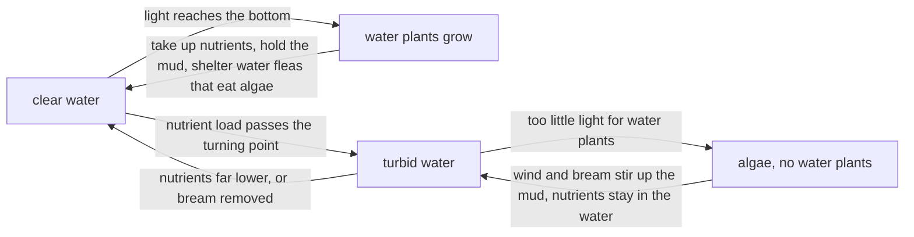

# C3 — Self-Organization of Ecosystems: notes

These are English explanations of every learning outcome in [README.md](README.md), and every topic is *drafted*: written from the CCVX syllabus, the Dutch CvTE syllabus and standard VWO biology, not yet checked against an open source text or exam question.

- **In Dutch VWO:** central exam (CE).
- **Dutch source:** [CvTE syllabus biologie vwo 2027](https://www.examenblad.nl/2027/vwo/documenten/syllabus-biologie-vwo-2027) (version 2, July 2025), P2 *Zelforganisatie van ecosystemen* (P2.1). A citation like *(CvTE P2.1 spec 3)* means specification 3 of P2.1; its numbers don't match the CCVX numbers.

Dutch terms are in brackets. Binas tables are named, not numbered, because the numbers differ between editions.

## C3.1 Dynamics and Equilibrium

### 1. Development of an ecosystem

- An ecosystem develops by succession (*successie*): a gradual, directional change in its species composition over years to centuries, from bare or disturbed ground to a fairly stable end stage. *(CvTE P2.1 spec 1)*
- Primary succession (*primaire successie*) starts on ground without soil or life, such as new sand flats and dunes, cooled lava or rock left by a glacier.
- Secondary succession (*secundaire successie*) starts where soil, seeds and roots remain, such as abandoned farmland, a burnt forest or a clear-felled plot, so it goes faster.
- Pioneer species (*pioniersoorten*) colonise first: they tolerate harsh conditions (drought, salt, few nutrients, large temperature swings), spread easily with many small seeds or spores and grow fast, but compete poorly. Examples are lichens and mosses on rock, glasswort (*zeekraal*) on bare salt mud and marram grass (*helm*) on drifting sand.
- In a Dutch dune succession, sand couch grass (*biestarwegras*) and marram grass trap blowing sand and build dunes, mosses and lichens cover the older grey dunes, and sea buckthorn (*duindoorn*) scrub follows, enriching the soil with nitrogen fixed by bacteria in its root nodules; woodland can grow on the oldest dunes.
- A climax ecosystem (*climaxecosysteem*) is the fairly stable end stage, in dynamic equilibrium with climate and soil; in most of the Netherlands that would be deciduous forest.
- In a climax ecosystem the GPP is about equal to the dissimilation of all its organisms together, so the biomass hardly grows any more; in early stages production exceeds respiration and biomass builds up (GPP and NPP are in [B08](../../B-self-regulation/B08-regulation-of-ecosystems/README.md)).
- During succession, soil depth, organic matter, biomass and the complexity of the food web increase. Biodiversity (*biodiversiteit*) usually increases too, though it often peaks before the climax; see [F03](../../F-evolution/F03-biodiversity/README.md).
- **Trap:** Whether succession is primary or secondary depends on whether soil is already there, not on whether the place had life before: an abandoned field or a burnt forest is secondary succession.

### 2. Successive changes and how transitions happen

- Each stage changes the abiotic factors (more humus, more water held, more nutrients, more shade and shelter) until the site suits other species, which then outcompete the earlier ones: a transition comes from changed conditions plus competition (*concurrentie*). *(CvTE P2.1 specs 1–2)*
- Light is often decisive: shrubs and trees that grow up shade out light-demanding pioneers, heather and grasses.
- Tolerances (*tolerantiegrenzen*, tolerance limits): each species survives only between a minimum and a maximum of every abiotic factor, so once succession pushes a factor beyond a species' tolerances, that species disappears. Tolerance and optimum are explained further in [D05](../../D-interaction/D05-interaction-in-ecosystems/README.md).
- The growth curve (*groeicurve*) of a species that colonises a site is S-shaped (logistic). Growth starts slowly with few parents, speeds up while resources are plentiful (exponential, J-shaped), and slows as competition for food, space or nest sites rises, until births and deaths balance at the carrying capacity (*draagkracht*, CCVX "capacity").
- A simple model is growth per year = r × N × (1 − N/K), where N is the population size, r the maximum growth rate per individual and K the carrying capacity. With K = 1 000 and r = 0.5 per year, the population grows by 45 a year at N = 100, by 125 a year at N = 500 (the fastest, at K/2), by 45 a year again at N = 900, and not at all at N = 1 000.
- An ecotone (‘gradient ecosystem’), in Dutch *gradiëntecosysteem*, is a transition zone between two ecosystems in which an abiotic factor changes gradually, such as from salt to fresh water in an estuary or from wet to dry on a lake shore. With many conditions close together it holds species of both ecosystems plus species of the transition itself, so its biodiversity is often high.
- Along a gradient the stages of succession can lie side by side: on the shore of a silting-up lake you pass from open water through water plants and reed to alder carr (*elzenbroekbos*), the same series that the lake goes through in time as it fills in (*verlanding*).
- **Trap:** The S-curve levels off because resources run short and competition increases, not because the organisms stop reproducing by themselves; the carrying capacity is a property of the environment for that species.

### 3. Differences between ecosystems

- Ecosystems differ in their abiotic factors (soil, water, salinity, pH, nutrients, light, temperature) and, as a result, in their populations: species composition, dominant producers and food webs. *(CvTE P1.3 spec 2)*

| Ecosystem | Abiotic factors | Typical species |
|---|---|---|
| dry heathland (*heide*) | sandy, dry, acid, poor in nutrients | heather (*struikhei*), sand lizard (*zandhagedis*) |
| raised bog (*hoogveen*) | waterlogged, very acid, fed only by rain, very poor in nutrients | peat moss (*veenmos*), sundew (*zonnedauw*) |
| salt marsh (*kwelder*) | clay and silt, salty, flooded by the sea at high tides | glasswort (*zeekraal*), sea lavender (*lamsoor*) |

- Indicator species (*indicatorsoorten*) have narrow tolerances for one factor, so their presence shows its value: stinging nettles (*grote brandnetels*) show nitrogen-rich soil, sundew nutrient-poor wet soil, glasswort salty soil, and stonefly larvae (*steenvlieglarven*) clean, oxygen-rich water.
- **Trap:** The presence of an indicator species is the evidence; its absence proves little, because the species may simply never have reached the site.

### 4. Dynamics in an ecosystem

- The dynamics are the changes in numbers and species composition over time: births, deaths and migration change each population, and populations affect each other through food, competition and disease. *(CvTE P1.3 spec 3; P2.1 spec 2)*
- Most populations fluctuate around their carrying capacity in a dynamic equilibrium (*dynamisch evenwicht*): a good year brings many young, then food runs short and more die; predator and prey numbers rise and fall in turn.
- Disturbances such as storms, fire, floods, heavy grazing or the fall of an old tree reset succession locally, so an ecosystem is often a mosaic of stages.
- Competition within and between populations decides which species persist; the forms are in [D05](../../D-interaction/D05-interaction-in-ecosystems/README.md), its role in self-regulation in [B08](../../B-self-regulation/B08-regulation-of-ecosystems/README.md).
- The gene pool (*genenpool*) is all the alleles of all the individuals of a population. A large, varied gene pool lets a population adapt by natural selection when conditions change; a population started by a few individuals, or shrunk to a few, has a small gene pool (see [F01](../../F-evolution/F01-selection/README.md) and [F02](../../F-evolution/F02-speciation/README.md)).
- An ecosystem with high biodiversity contains several species with different tolerances for each role, so after a change some of them still fill each role and the ecosystem recovers more easily.
- **Trap:** A dynamic equilibrium doesn't mean constant numbers: they fluctuate around an average, while births and deaths balance in the long run.

### 5. Different equilibrium states

- An ecosystem can have more than one stable state under the same conditions, each held in place by its own feedback; a large enough change pushes it past a turning point into the other state. *(CvTE P2.1 spec 3)*
- Carrying capacity (*draagkracht*), which CCVX calls capacity, is the largest population of a species that an area can support in the long run with its food, water and space. It changes with the conditions: in a hard winter it falls, and the animals above it die.
- A shallow lake can be clear or turbid. In the clear state, submerged water plants such as stoneworts (*kranswieren*) take up nutrients, hold the mud in place and shelter water fleas that eat algae, so the water stays clear.
- In the turbid state, algae block the light so that no water plants grow, and wind and bream (*brasem*) stir up the mud, so the water stays turbid.
- The turning point (*omslagpunt*), in usual English the tipping point: when the phosphate load passes a critical value, a clear lake suddenly flips to the turbid state. Going back needs a much lower nutrient level than the one at which it flipped, or extra help such as removing much of the bream (biomanipulation).
- Tolerance limits explain the flip: once the light at the bottom drops below what the water plants tolerate, they die and the other feedback takes over.

- Other examples: heathland can flip to grassland under nitrogen deposition, and a heathland or hay meadow is a state that grazing or mowing holds in place.
- **Trap:** After a flip, going back to the nutrient level just before the turning point isn't enough; the lake stays turbid until the level is much lower.

### 6. Measures that influence self-organisation and the Earth system

- People steer how ecosystems develop through nature management, introduced species and climate change, and the effects can reach the whole Earth system. *(CvTE P2.1 spec 4)*
- Nature management (*natuurbeheer*) either holds succession at a chosen stage (mowing hay meadows, grazing and sod cutting on heathland) or lets natural processes run, with large grazers and natural water levels; making room for rivers to flood creates new floodplain nature.
- Introduced species (*exoten*) can change the course of succession: American black cherry (*Amerikaanse vogelkers*), planted in Dutch forests in the 20th century, spread so much that foresters call it *bospest*, because it shades out the seedlings of other trees.
- Climate change (*klimaatverandering*) moves the areas where conditions stay within a species' tolerance limits: many species shift towards the poles or uphill, and species that can't keep up decline.
- Building with nature uses natural processes, such as drifting sand and growing dunes or salt marshes, to protect the coast instead of only concrete and steel (see the first specimen context).
- At the scale of the Earth system, deforestation, extra nitrogen from fertiliser and CO₂ emissions change conditions far from where they happen.
- **Trap:** Not every introduced species is a problem: most don't spread, and only a minority become invasive, often where their natural enemies are missing.

## Specimen contexts

- Building with nature to protect the coast (sustainability): instead of only hard structures, engineers use natural processes, such as the Sand Motor (*Zandmotor*), a large amount of sand placed off the South Holland coast in 2011 that waves, currents and wind spread along the beach and into the dunes. Pioneer plants such as marram grass trap the blowing sand so that dunes grow (primary succession, outcomes 1–2), and salt marshes in front of dikes damp the waves (an ecotone with a salt gradient, outcomes 2 and 6).
- Food relationships in the Oostvaardersplassen (sustainability): in this Flevoland reserve, grazing by geese and by large grazers (Heck cattle, Konik horses, red deer) holds back succession to woodland, and with no large predators the numbers of grazers were set by the winter food supply, their carrying capacity. After many animals starved in hard winters and the public objected, the management was changed to keep their numbers lower (outcomes 4–6).
- Public attitudes to nature (world view): residents differ in what they see as good nature, from tidy, managed parks and farmland to wild, self-regulating nature, and in whether animals should be fed, culled or left alone. Planners take these views into account, while biologists add the facts about succession, carrying capacity and biodiversity (outcome 6; see [A09](../../A-skills/A09-evaluation-and-judgment/README.md) and [A10](../../A-skills/A10-perception/README.md)).

## CCVX versus the Dutch syllabus

- **In both:** succession, pioneer species, climax ecosystem, ecotone (*gradiëntecosysteem*), competition, carrying capacity (*draagkracht*), tolerance limits, turning point (*omslagpunt*) and introduced species (*exoot*).
- **Dutch syllabus only:** the growth curve (*groeicurve*, P2.1 spec 2), and nature management and climate change (P2.1 spec 4); the notes cover them.
- **CCVX only:** indicator species, biodiversity and gene pool, and outcomes 3 (differences between ecosystems) and 4 (dynamics); the Dutch syllabus has these elsewhere, in P1.3 specs 2–3 (indicator species, differences, dynamics), P1.2 spec 5 and P3.2 spec 1 (biodiversity) and M8.4 spec 1 (gene pool).
