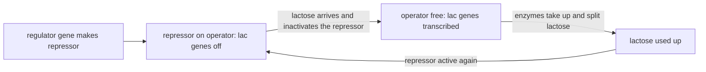

# D1 — Molecular Interaction: notes

These are English explanations of every learning outcome in [README.md](README.md), and every topic is *drafted*: written from the CCVX syllabus, the Dutch CvTE syllabus and standard VWO biology, not yet checked against an open source text or exam question.

- **In Dutch VWO:** central exam (CE).
- **Dutch source:** [CvTE syllabus biologie vwo 2027](https://www.examenblad.nl/2027/vwo/documenten/syllabus-biologie-vwo-2027) (version 2, July 2025), M4.1 *Genregulatie en interactie met (a)biotische factoren*. A citation like *(CvTE M4.1 spec 2)* means specification 2 of M4.1; its numbers don't match the CCVX numbers.

Dutch terms are in brackets. Binas tables are named, not numbered, because the numbers differ between editions.

## D1.1 Gene Regulation and Interaction with Biotic and Abiotic Factors

### 1. Gene regulation mechanisms and their importance

- Gene regulation (*genregulatie*) is the control of whether, when and how much a gene (*gen*) is expressed. *(CvTE M4.1 specs 1–3)*
- It matters for three reasons: a cell saves energy and building materials by making only the proteins (*eiwitten*) it needs, it can react to changes in its environment, and in a multicellular organism its cells can become different cell types (*celtypen*) although they share one genome (*genoom*) ([C01](../../C-self-organization/C01-self-organization-of-cells/README.md)).
- Genes are regulated at several levels: DNA packing (outcome 4), transcription (*transcriptie*, this outcome), splicing ([C01](../../C-self-organization/C01-self-organization-of-cells/README.md)), breakdown and translation (*translatie*) of the mRNA (RNAi, outcome 4), and the activity and breakdown of the protein itself.
- Structural genes (*structuurgenen*) code for proteins with a task in the cell's structure or metabolism, such as enzymes (*enzymen*); regulator genes (*regulatorgenen*) code for proteins that control other genes, such as repressors and transcription factors (*transcriptiefactoren*).
- In prokaryotes, the operon model (Jacob and Monod, 1961) applies: structural genes for one task often lie side by side under one promoter (CCVX: “promotor”, *promotor*) and one operator, and are transcribed together into one mRNA.
- The promoter is the DNA sequence where RNA polymerase (*RNA-polymerase*) binds; the operator is a short DNA sequence between the promoter and the structural genes, where a repressor protein can bind and block RNA polymerase.
- The lac operon of the bacterium E. coli has three structural genes, two of which code for the proteins that take up lactose and split it; a separate regulator gene with its own promoter keeps making the repressor.
- Without lactose the repressor sits on the operator, so the lactose genes are off. When lactose is present, a lactose derivative (allolactose) binds to the repressor, changes its shape and pulls it off the operator, so RNA polymerase can transcribe the genes.
- When the lactose is used up, the repressor becomes active again and the genes switch off: a negative feedback loop.

- The trp operon works the other way round (repressible): the genes for making the amino acid (*aminozuur*) tryptophan are normally on, and when tryptophan is plentiful it binds to the repressor, which then binds the operator and switches the genes off.
- Eukaryotes usually have no operons: each gene has its own promoter, and RNA polymerase can only start once a set of transcription factors, proteins that bind to specific DNA sequences, is bound at the promoter.
- Activators are transcription factors that bind to enhancer sequences, sometimes thousands of base pairs away, and increase transcription; other proteins repress it, and the combination of factors present in a cell decides which of its genes are expressed.
- Signals act through these factors: steroid hormones (*steroïdhormonen*) become transcription factors once they have bound their receptor ([D02](../D02-cellular-interaction/README.md)), and in drought the plant hormone abscisic acid switches on genes that protect the plant against water loss.
- **Trap:** promoter and operator are DNA sequences, the repressor is a protein made by the regulator gene, and lactose doesn't bind to DNA: it switches the genes on by inactivating the repressor.

### 2. Cells use proteins for their functioning

- Almost everything a cell does is done by proteins, so regulating genes comes down to regulating which proteins a cell has, and how many. *(closest: CvTE M1.2 spec 4 and M3.1 spec 5)*
- Enzymes catalyse nearly all reactions of metabolism; a cell controls a pathway through how much enzyme it makes (gene regulation, as in the lac operon) and how active the enzymes are, for example when the end product of a pathway inhibits its first enzyme.
- Other proteins receive signals (receptors), carry substances across membranes (channels, carriers, pumps), give shape (structural proteins), move cell parts (motor proteins) or control genes (transcription factors, repressors) ([C01](../../C-self-organization/C01-self-organization-of-cells/README.md)).
- Proteins wear out and are broken down, so cells keep making them; the balance between production and breakdown sets how much of each protein is present.
- A virus, DNA or RNA in a protein coat, has no metabolism of its own: it can only multiply inside a host cell, using the host's ribosomes, enzymes and nucleotides to make its own proteins and copies ([B05](../../B-self-regulation/B05-defence-in-organisms/README.md)).
- **Trap:** switching a gene off doesn't stop its protein at once: protein already made keeps working until it is broken down, so gene regulation acts more slowly than regulation of enzyme activity.

### 3. Biotic and abiotic factors change protein variation

- CCVX's “protein variation” probably means variation in which proteins a cell makes and how much of each. The phenotype (*fenotype*) results from genotype plus environment, so abiotic factors (temperature, light, water, salt, radiation) and biotic factors (pathogens, viruses, other organisms, food) change gene expression (*genexpressie*). *(closest: CvTE M4.1 spec 4; M7.1 spec 1)*
- Abiotic examples: heat switches on genes for heat-shock proteins, which protect other proteins; UV light makes pigment cells in the skin produce more melanin (tanning); drought makes plants close their stomata and make protective proteins.
- Salt makes plant cells produce transport proteins that pump Na⁺ out of the cytoplasm (*cytoplasma*) or into the vacuole.
- Biotic examples: an infection makes immune cells produce antibodies and cytokines ([B05](../../B-self-regulation/B05-defence-in-organisms/README.md)), and tomato plants damaged by caterpillars switch on genes for protease inhibitors that hamper the insects' digestion.
- Viruses change the gene expression of their host: retroviruses such as HIV insert a DNA copy of their genome into a host chromosome, where the host's RNA polymerase transcribes it.
- Recombinant DNA (the technique: *recombinant-DNA-technologie*) is DNA assembled from pieces of different origin: cut with restriction enzymes (*restrictie-enzymen*), joined with DNA ligase and brought into cells with a vector such as a plasmid (*plasmide*), a virus or, for plants, the bacterium Agrobacterium tumefaciens ([E01](../../E-reproduction/E01-dna-replication/README.md), [B01](../../B-self-regulation/B01-protein-synthesis/README.md)). *(CvTE M8.4 spec 3)*
- Transgenic (*transgeen*): the new DNA comes from a species that couldn't be crossed with the host, such as Bt maize with a bacterial gene for an insect-killing protein, or bacteria that make human insulin.
- Cisgenic (*cisgeen*): the new gene, with its own promoter, comes from the same species or a crossable relative, such as the potatoes that Wageningen researchers gave late-blight resistance genes from wild potato species.
- For drought and salt tolerance, crops can be given genes for, for example, a transporter that stores Na⁺ in the vacuole or enzymes that make protective solutes, often behind a promoter that is only active under stress.
- **Trap:** a cisgenic plant is still genetically modified: it is made with recombinant DNA techniques, and only the origin of the gene differs from a transgenic plant.

### 4. Gene expression is dynamic; epigenetics

- Gene expression changes all the time, with development, signals and environment; besides transcription factors, the packing of DNA and small RNA molecules regulate it. *(CvTE M4.1 spec 4)*
- Nucleosomes (*nucleosomen*) are units of DNA wound around eight histone proteins. Tightly packed nucleosomes keep RNA polymerase away so the genes are silent, loose packing lets genes be read, and chemical groups attached to the histones (such as acetyl groups) loosen or tighten the packing.
- Methylation (*methylering*): enzymes attach methyl groups (–CH₃) to cytosines in the DNA, mostly where a C is followed by a G; a heavily methylated promoter keeps its gene switched off.
- Epigenetics (*epigenetica*; CCVX: “epigenetic”) covers changes in gene expression that are passed on to daughter cells without a change in the base sequence (*basenvolgorde*); after replication, enzymes copy the methylation pattern onto the new strand.
- The environment can change these marks: people who were exposed to the Dutch Hunger Winter (1944–1945) before birth still had different methylation of a growth-factor gene (IGF2) about 60 years later, and the group had more health problems such as obesity and heart disease.
- In female mammals one X chromosome in each body cell is switched off early in development by methylation and dense packing; in tortoiseshell cats, patches where a different X chromosome is active have a different fur colour.
- Most epigenetic marks are erased when gametes (*gameten*) form, but some seem to pass to the next generation, giving inheritance that doesn't follow Mendel's laws ([E03](../../E-reproduction/E03-reproduction-of-organisms/README.md)).
- RNAi (RNA interference; CCVX: “iRNA”): short double-stranded RNA is cut into pieces of about 20–25 nucleotides; in a protein complex, one strand finds mRNA with the complementary sequence and has it cut up or blocks its translation, so the gene is silenced after transcription.
- Cells use their own microRNAs this way to fine-tune genes, and plants and invertebrates use RNAi against viruses; it was discovered in the worm C. elegans (Nobel Prize 2006).
- Applications: researchers silence genes to find out what they do, non-browning apples have their browning enzyme (polyphenol oxidase) silenced, and the first RNAi medicine (2018) silences a liver gene whose faulty protein damages nerves.
- **Trap:** epigenetic changes affect whether a gene is read, not its base sequence: they aren't mutations (*mutaties*), and they can be reversed.

### 5. Mutagenic factors disturb gene regulation

- A mutagenic factor (*mutagene factor*) changes the base sequence of DNA: radiation (UV, X-rays, radioactivity), chemicals (benzo[a]pyrene in tobacco smoke, aflatoxin from mould on nuts) and some viruses ([F01](../../F-evolution/F01-selection/README.md)). *(CvTE M4.1 spec 5)*
- A mutation in a regulatory sequence (promoter, operator, enhancer) or in a regulator gene can lock a gene on or off, or make it react to the wrong signals: an E. coli operator that the repressor can no longer bind keeps the lac genes on even without lactose.
- Proto-oncogenes (*proto-oncogenen*) are normal genes that stimulate cell division, such as the genes for growth-factor receptors and for the signal protein Ras. A mutation can turn one into an oncogene (*oncogen*) that is always active, like a stuck accelerator, and one mutated copy is enough.
- Tumour suppressor genes (*tumorsuppressorgenen*; CCVX: “suppressor”) slow down division, repair DNA or start apoptosis (*apoptose*), such as the genes for p53 and BRCA1. A cell only loses this brake when both copies are broken.
- Cancer (*kanker*) usually needs several such mutations in one cell, so the risk rises with age and exposure; someone who inherits one broken BRCA1 copy needs only one more hit per cell, so carriers have a much higher risk of breast cancer ([E02](../../E-reproduction/E02-cell-life-cycle/README.md)).
- Human papillomavirus (HPV) makes proteins that inactivate p53 and another tumour suppressor protein, which can lead to cervical cancer; Dutch children are offered vaccination against HPV.
- **Trap:** proto-oncogenes aren't cancer genes that healthy people lack: everyone has and needs them, and only a mutated, overactive version (an oncogene) drives cancer.

## Specimen contexts

- Targeted chemotherapy (health): tumours differ in which genes are mutated or overactive, so researchers measure gene expression in a tumour to choose a drug aimed at the abnormal protein; trastuzumab blocks the HER2 receptor in breast cancers that make too much of it, and imatinib blocks the overactive enzyme made by a fused gene in chronic myeloid leukaemia. Gene-expression tests such as the Dutch MammaPrint (70 genes) also help decide whether chemotherapy is useful at all. This uses outcomes 1, 4 and 5 and [E02](../../E-reproduction/E02-cell-life-cycle/README.md).
- Drought- and salt-tolerant GM crops (food production): plant scientists add or change genes so that crops make proteins that protect them against water shortage or salt, such as transporters that store Na⁺ in the vacuole, controlled by promoters that respond to stress. This uses outcomes 1 and 3 (recombinant DNA, cisgenic and transgenic) and [F01](../../F-evolution/F01-selection/README.md).

## CCVX versus the Dutch syllabus

- **In both:** the importance of gene regulation, prokaryotic regulation with structural genes, regulator genes, promoter, operator and repressor, epigenetics, RNAi, mutagenic factors, proto-oncogenes and tumour suppressor genes.
- **Dutch syllabus only:** eukaryotic regulation with transcription factor and activator (M4.1 spec 3), and nucleosome and methylation (M4.1 spec 4); CCVX lists these under C1 (transcription factor, activator, nucleosomes), B1 (nucleosomes) and E3 (methylation) instead. All are covered above.
- **CCVX only:** genome, enzymes, virus, recombinant DNA, cisgenic and transgenic (the CvTE has the last three in M8.4 spec 3, and recombinant DNA technology also in M2.3 spec 13), and outcomes 2 and 3 (cells use proteins; biotic and abiotic factors change protein variation), which have no matching M4.1 specification.
