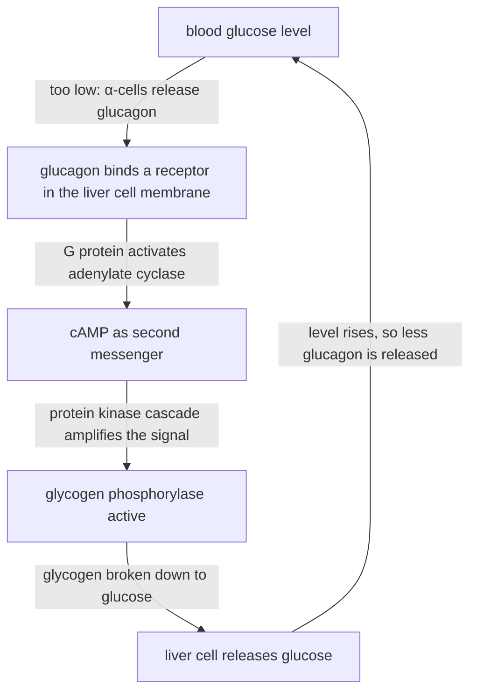

# D2 — Cellular Interaction: notes

These are English explanations of every learning outcome in [README.md](README.md), and every topic is *drafted*: written from the CCVX syllabus, the Dutch CvTE syllabus and standard VWO biology, not yet checked against an open source text or exam question.

- **In Dutch VWO:** central exam (CE).
- **Dutch source:** [CvTE syllabus biologie vwo 2027](https://www.examenblad.nl/2027/vwo/documenten/syllabus-biologie-vwo-2027) (version 2, July 2025), M4.2 *Celcommunicatie en interactie met (a)biotische factoren*. A citation like *(CvTE M4.2 spec 4)* means specification 4 of M4.2; its numbers don't match the CCVX numbers.

Dutch terms are in brackets. Binas tables are named, not numbered, because the numbers differ between editions.

## D2.1 Cell Communication and Interaction with Biotic and Abiotic Factors

### 1. Receiving, processing and responding to signals

- Cell communication (*celcommunicatie*) has three linked steps: a receptor receives a signal, a chain of molecules inside the cell processes it, and the cell responds. *(CvTE M4.2 specs 1–2)*
- Signal substances (*signaalstoffen*) carry the messages between cells: hormones (*hormonen*), neurotransmitters, cytokines and growth factors in animals, and plant hormones such as auxin.
- A receptor is a protein (*eiwit*) whose binding site fits one specific signal substance, as an enzyme fits its substrate; only target cells with the matching receptor react.
- Water-soluble signal substances can't cross the phospholipid bilayer, so they bind receptors in the cell membrane; lipid-soluble ones, such as steroid hormones (*steroïdhormonen*), diffuse through it to receptors inside the cell (outcome 3; [chemistry B03](../../../CCVX-chemistry/B-substances-and-materials/B03-bonds-and-properties/README.md)).
- A second messenger is a small molecule, such as cAMP or Ca²⁺, that forms or is released inside the cell when the first messenger (the signal substance) binds a membrane receptor; it carries the signal on through the cytoplasm (*cytoplasma*).
- A signal cascade (*signaalcascade*) is a chain of proteins in which each activates the next, usually enzymes (protein kinases) that switch other enzymes on or off by attaching a phosphate group.
- Every activated enzyme activates many molecules of the next one, so the signal is amplified: if each activates 100, three steps give 100³ = 10⁶ active molecules, which is why a few hormone molecules can cause a large response.
- Example: glucagon or adrenaline binds a receptor in the membrane of a liver cell, and a G protein activates the enzyme adenylate cyclase, which makes cAMP from ATP. cAMP activates protein kinase A, which starts an enzyme cascade that ends with glycogen phosphorylase breaking down glycogen, and the liver cell releases glucose into the blood.

- The response (*respons*) is the end result: a change in enzyme activity, channels that open or close, secretion, contraction, cell division or a change in gene expression.
- Signals have to be switched off again: the signal substance is broken down or taken back up, and enzymes break down the second messenger, so the cell is ready for the next signal.
- The Na/K pump (*natrium/kalium-pomp*) is a membrane protein that uses one ATP to pump 3 Na⁺ out of the cell and 2 K⁺ in, both against their concentration gradient (active transport, [B02](../../B-self-regulation/B02-metabolism-in-cells/README.md)).
- As a result Na⁺ is roughly ten times more concentrated outside the cell and K⁺ roughly thirty times more concentrated inside. Nerve impulses use these gradients, and so do the carriers that take up glucose together with Na⁺ in the gut and kidney.
- Each pump cycle moves 3 positive charges out and 2 in, so one net positive charge leaves per ATP, which makes the inside slightly more negative.
- Impulse conduction (*impulsgeleiding*) is how a neuron processes and passes on a signal; [B04](../../B-self-regulation/B04-self-regulation-of-organisms/README.md) explains it in full. In short:
    - at rest the inside of a neuron is about −70 mV compared with the outside (resting potential, *rustpotentiaal*), mainly because K⁺ leaks out through open K⁺ channels;
    - a stimulus that depolarises the membrane past the threshold (*prikkeldrempel*), about −55 mV (textbooks give −50 to −55 mV), opens voltage-gated Na⁺ channels; Na⁺ flows in and the inside briefly becomes positive, up to about +30 to +40 mV: an action potential (*actiepotentiaal*);
    - the Na⁺ channels then close and K⁺ channels open, K⁺ flows out and the membrane repolarises; during the refractory period (*refractaire periode*) no new action potential can start there, so the impulse travels in one direction;
    - an action potential is all-or-nothing: a stronger stimulus gives more impulses per second, not bigger ones;
    - in a myelinated axon the impulse jumps from one gap in the myelin sheath to the next (saltatory conduction, *sprongsgewijze impulsgeleiding*), reaching up to about 100 m s⁻¹ against about 1 m s⁻¹ in thin unmyelinated axons.
- The Na/K pump doesn't produce the action potential itself: the ion channels do, and the pump maintains the gradients they use.
- **Trap:** a signal substance that binds a membrane receptor stays outside the cell; the second messenger is a different molecule that carries the signal on inside.

### 2. Short and long distances: neurons and hormones

- Cells communicate over short distances by direct contact or local signal substances, and over long distances through nerve cells (*zenuwcellen*) and hormones. *(CvTE M4.2 spec 3)*
- Cell junctions are connections between neighbouring cells. Gap junctions are protein channels that link the cytoplasm of two cells so ions and small molecules pass directly, which makes heart muscle cells contract in step.
- Plant cells are linked in a similar way by plasmodesmata, strands of cytoplasm that run through the cell walls.
- Other junctions hold cells together rather than pass signals: tight junctions seal the gaps between the epithelial cells of the gut, and desmosomes rivet skin cells to each other.
- Some signals only work by touch: an antigen-presenting cell shows an antigen in its MHC molecules to a T cell, which has to bind it directly ([B05](../../B-self-regulation/B05-defence-in-organisms/README.md)).
- Cytokines are small proteins by which immune cells and other cells signal to nearby cells: interleukins make lymphocytes divide and interferons make neighbouring cells resist viruses; some cytokines also act far away, for example by causing fever.
- A synapse (*synaps*) is the junction where a neuron passes its signal to another neuron, a muscle cell or a gland cell; an impulse arriving at the axon ending makes vesicles release a neurotransmitter into the narrow synaptic cleft.
- The neurotransmitter, such as acetylcholine, diffuses across the cleft and binds to receptors that open ion channels. At an excitatory (*exciterend*) synapse Na⁺ flows in and the next cell gets closer to its threshold; at an inhibitory (*inhiberend*) synapse, for example with GABA, the inside of the next cell becomes more negative.
- The neurotransmitter is quickly broken down (acetylcholine by acetylcholinesterase) or taken back up, so each signal is short, and the synapse works in one direction because only the axon ending releases transmitter.
- Long distance through neurons: an axon can be about 1 m long (from the spinal cord to the foot), and at 100 m s⁻¹ an impulse covers 1 m in about 0.01 s, so neural signals are fast, short and aimed at specific cells.
- Long distance through hormones: glands release hormones into the blood, which passes every cell, but only target cells with the matching receptor respond. This is slower (at rest the blood takes about a minute to go round the body) but can last longer and reach many organs at once; the Binas table of human hormones lists gland, hormone and effect.
- The two systems overlap: neurons of the hypothalamus release the hormones ADH and oxytocin into the blood at the pituitary gland, and adrenaline is a hormone of the adrenal medulla while the closely related noradrenaline is a neurotransmitter.
- **Trap:** a hormone reaches every cell through the blood; the specificity lies in the receptors of the target cells, not in where the hormone is delivered.

### 3. Responses in the cytoplasm versus responses that change gene expression

- CCVX's “responses in cell plasma” probably means responses in the cytoplasm: changes in the activity of proteins that are already there, as opposed to responses that switch genes on or off and so promote gene expression (*genexpressie*). *(CvTE M4.2 spec 4)*
- Peptide hormones (*peptidehormonen*, also *eiwithormonen*), such as insulin, glucagon and ADH, are water-soluble, so they bind a receptor in the cell membrane (*receptor in celmembraan*) and act through second messengers and cascades.
- Their typical response happens in the cytoplasm within seconds to minutes: enzymes are switched on, channels open or vesicles fuse with the membrane; insulin, for example, makes muscle and fat cells build glucose transporters into their membrane.
- Steroid hormones (*steroïdhormonen*), such as cortisol, aldosterone, oestrogen, progesterone and testosterone, are made from cholesterol and are lipid-soluble, so they diffuse through the membrane and bind a receptor in the cytoplasm (*receptor in het cytoplasma*) or in the nucleus.
- The hormone–receptor complex binds to DNA in the nucleus as a transcription factor (*transcriptiefactor*, [D01](../D01-molecular-interaction/README.md)) and switches particular genes on or off, so new proteins are made; this response takes hours and lasts longer.
- Examples: testosterone switches on genes for muscle proteins in muscle cells, and oestrogen makes the cells of the uterine lining grow and divide.
- Thyroid hormone isn't a steroid, but it also acts through a receptor inside the cell and changes gene expression ([B04](../../B-self-regulation/B04-self-regulation-of-organisms/README.md)).
- A membrane receptor can lead to gene expression too: growth factors bind membrane receptors, but their cascade ends in the nucleus, where it switches on genes for cell division ([E02](../../E-reproduction/E02-cell-life-cycle/README.md)).
- **Trap:** whether a hormone uses a membrane receptor depends on whether it can cross the membrane, not on its size or gland: lipid-soluble steroids can, water-soluble hormones can't, and that includes adrenaline, which is neither a peptide nor a steroid but a small molecule made from the amino acid (*aminozuur*) tyrosine.

### 4. Effects on other levels of organisation

- Cell communication links the levels of organisation: a signal between molecules changes cells, and the combined responses of many cells change tissues, organs, the organism and even populations. *(CvTE M4.2 spec 5)*
- Organism level: during a fright, adrenaline makes liver cells release glucose, heart muscle cells contract faster and more strongly, and the smooth muscle of the airways relaxes, which together prepare the body for fight or flight.
- Homeostasis: insulin and glucagon signalling between the pancreas and the liver keeps the blood glucose level within narrow limits ([B04](../../B-self-regulation/B04-self-regulation-of-organisms/README.md)).
- When communication fails, disease follows: in type 1 diabetes the β-cells are destroyed, so there is no insulin signal; in type 2 diabetes the target cells respond poorly to insulin; in myasthenia gravis antibodies block the acetylcholine receptors of muscle cells, so the muscles become weak.
- Cholera toxin keeps a G protein in gut cells permanently switched on, so cAMP stays high and the cells release Cl⁻ into the gut, and water follows by osmosis: severe diarrhoea at the level of the organism.
- Abiotic factors such as poisons can disturb communication: nerve agents and some insecticides block acetylcholinesterase, so acetylcholine keeps stimulating the muscles.
- Population level: bacteria measure their population density with signal substances (quorum sensing) and only then switch on certain genes, such as those for light production in Vibrio fischeri; crowded C. elegans larvae sense a pheromone and switch to a resistant resting stage, the dauer larva.
- **Trap:** the same signal can cause different responses in different cells, because they have different receptors or cascades: adrenaline makes heart muscle contract more strongly but relaxes the smooth muscle of the airways.

## Specimen contexts

- C. elegans as a model organism (health): this transparent nematode, about 1 mm long, has exactly 959 body cells as an adult hermaphrodite, 302 of them neurons, and the origin of every cell is known. Many of its signalling pathways also exist in humans: its vulva forms when one cell (the anchor cell) sends a growth-factor signal that activates a receptor and a Ras cascade in neighbouring cells, the kind of pathway that is overactive in many human cancers, and abiotic and biotic factors such as heat, food shortage and crowding switch its larvae to the dauer stage. This uses all four outcomes and links to apoptosis (*apoptose*, [C01](../../C-self-organization/C01-self-organization-of-cells/README.md)) and RNAi ([D01](../D01-molecular-interaction/README.md)).

## CCVX versus the Dutch syllabus

- **In both:** all eight CCVX concepts (signal substances, second messenger, synapse, cell junctions, receptor, response, signal cascade, Na/K pump) and the four outcomes.
- **Dutch syllabus only:** the impulse-conduction terms of M4.2 spec 2 (impulse conduction, saltatory conduction, neurotransmitter, resting potential, action potential, threshold, refractory period, excitatory, inhibitory), which CCVX lists under B4.3, so they are summarised here and explained in [B04](../../B-self-regulation/B04-self-regulation-of-organisms/README.md); and nerve cell, hormone and cytokine (spec 3) and steroid hormone, peptide hormone and the two receptor locations (spec 4), which are explained above.
- **CCVX only:** nothing: every CCVX term of D2 is in M4.2, and CCVX's “responses in cell plasma” are the CvTE's *responsen in het cytoplasma*.
