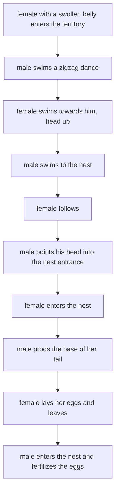

# D3 — Behaviour and Interaction: notes

These are English explanations of every learning outcome in [README.md](README.md), and every topic is *drafted*: written from the CCVX syllabus and standard VWO biology, not yet checked against an open source text or exam question.

- **In Dutch VWO:** school exam (SE) only, as O7 *Gedrag en interactie*, so the [CvTE syllabus biologie vwo 2027](https://www.examenblad.nl/2027/vwo/documenten/syllabus-biologie-vwo-2027) doesn't specify it. CCVX still tests it.
- **Overlap:** CvTE O2.2 and O2.3 (hormones, reflex arc), M7.1 (genotype, environment, epigenetics), P4.1 spec 3 (emergent property) and P4.3 (selection). A citation like *(overlap: CvTE O2.3 spec 3)* points there.

Dutch terms are in brackets. Binas tables are named, not numbered, because the numbers differ between editions.

## 1. Behaviour as actions and reactions

- Behaviour (*gedrag*) is everything an animal does that can be observed: movements, postures, sounds, colour changes, releasing scents. It consists of actions that start from the animal itself, such as exploring or grooming, and reactions to stimuli (*prikkels*).
- A reaction runs from stimulus to response: a sense organ turns the stimulus into impulses, the nervous system processes them, and effectors (muscles, glands) produce the response (*reactie*).
- External factors (*uitwendige factoren*) are the stimuli from the environment, abiotic (light, temperature, day length) or biotic (food, predators, partners, rivals).
- Often one simple feature of a complex situation triggers the behaviour: the sign stimulus (*sleutelprikkel*). Tinbergen found that a male three-spined stickleback (*driedoornige stekelbaars*) in the breeding season attacks crude models with a red underside but hardly attacks a lifelike model without red: the red belly of a rival is the sign stimulus.
- Herring gull (*zilvermeeuw*) chicks peck at the red spot on the parent's yellow bill, which makes the parent regurgitate food. They also peck at a cardboard model of a head with a red spot, and much less at one without it.
- A reflex (*reflex*) is a fast, automatic, innate reaction to a stimulus through a reflex arc (*reflexboog*): receptor, sensory neuron, sometimes an interneuron, motor neuron, effector. Examples are the knee-jerk reflex, pulling your hand back from something hot and a baby's sucking reflex. *(overlap: CvTE O2.3 spec 3)*
- An instinct (*instinct*) is innate, species-typical behaviour that is more complex than a reflex: a fixed series of movements (fixed action pattern, *vast actiepatroon*) set off by a sign stimulus that, once started, usually runs to the end. A greylag goose (*grauwe gans*) that sees an egg outside its nest rolls it back with its bill, and finishes the movement even if the egg is taken away halfway.
- Whether a stimulus triggers the behaviour depends on the animal's motivation (*motivatie*), its internal readiness: a hungry animal reacts to food, a fed one hardly does. Behaviour therefore results from external stimuli and internal factors together (outcome 3).
- **Trap:** A reflex happens regardless of motivation and isn't learned. An instinct isn't learned either, but whether it occurs depends on motivation and on the right sign stimulus.

## 2. Organism and environment: a dynamic relationship

- An organism and its environment influence each other continuously: the environment triggers and shapes behaviour, and behaviour changes the environment and so the stimuli the animal receives next.
- Woodlice (*pissebedden*) walk faster and turn more often in dry places and slow down in humid ones, so without "knowing" where to go they end up in humid places where they don't dry out. Such an undirected change in activity is a kinesis; a movement straight towards or away from a stimulus is a taxis, such as woodlice moving away from light.
- A lizard basks in the sun until it is warm enough and then seeks shade: its behaviour regulates its body temperature, and its body temperature in turn determines its behaviour.
- Animals change their environment: beavers build dams, birds build nests, many mammals mark their territory with scent. These changes in turn affect their own behaviour and that of other organisms.
- Other organisms are part of the environment: a predator's behaviour changes that of its prey and the other way round, and a rival or a partner sets off territorial or courtship behaviour.
- Behaviour also changes with experience (learning, outcome 4) and with life stage (outcome 5), so the same stimulus doesn't always give the same reaction.
- **Trap:** "Environment" means abiotic and biotic factors, and the biotic ones include members of the same species.

## 3. Internal factors

- Internal factors (*inwendige factoren*) determine the motivation: hormones, the biological clock, the state of the metabolism (hunger, thirst) and impulses from brain centres. *(overlap: CvTE O2.2 spec 3)*
- Hormones: testosterone increases territorial and aggressive behaviour in the males of many vertebrates, oxytocin promotes maternal care and bonding in mammals, and adrenaline prepares for fight or flight ([B04](../../B-self-regulation/B04-self-regulation-of-organisms/README.md), the Binas table of human hormones).
- In seasonal breeders such as many songbirds, the lengthening days of spring act through the hypothalamus and pituitary on the gonads, whose sex hormones then switch on song, territorial and courtship behaviour.
- The biological clock (*biologische klok*) is an internal rhythm of about 24 hours (circadian rhythm); in mammals it sits in a small area of the hypothalamus. Daylight entering the eyes resets it every day, and in the dark the pineal gland (*pijnappelklier*) releases melatonin, which promotes sleep.
- Without daylight cues the clock keeps running with a period that is not exactly 24 hours (in most people slightly longer), which shows that it is internal; jet lag and night shifts disturb it. Annual rhythms control migration and hibernation.
- Changes in metabolism: a low energy reserve makes an animal hungry (the stomach hormone ghrelin increases hunger, the fat-tissue hormone leptin reduces it), a high osmotic value of the blood makes it thirsty, and migratory birds first build up fat stores.
- Impulses from brain areas: the hypothalamus contains centres for hunger, thirst, body temperature and sexual behaviour, the amygdala is involved in fear and aggression, and the prefrontal cortex (front of the cerebrum) in planning and controlling impulses; the Binas diagram of the brain shows where they are.
- Stimulating a brain area electrically can start behaviour directly: rats with an electrode in a reward area of the brain pressed a lever over and over to stimulate it (Olds and Milner, 1954).
- **Trap:** The biological clock is an internal factor, even though light, an external factor, resets it every day.

## 4. Behaviour is partly inherited

- CCVX's "congenital" means innate (*aangeboren*): behaviour that appears without being learned and is the same in all members of a species, such as reflexes, fixed action patterns, the pecking of gull chicks, and a spider building a species-typical web without ever having seen one. *(overlap: CvTE M7.1 spec 1)*
- Innate doesn't mean present at birth: much innate behaviour only appears once the nervous system and hormones are ready, such as courtship behaviour at sexual maturity.
- Hereditary (*erfelijk*) means passed on through genes (*genen*). Genes don't code for behaviour directly: they code for proteins that build the nervous system and make receptors, hormones and enzymes, and these determine which behaviour is possible.
- CCVX's "acquired" means learned (*aangeleerd*): behaviour that changes through experience. Learning lets an animal adjust to its own surroundings, but takes time and involves mistakes.
- Evidence for a hereditary component: dog breeds differ in behaviour (herding, retrieving); rats selected over generations for fast or slow maze learning gave clearly different lines (Tryon, 1940); and hand-raised blackcaps (*zwartkoppen*) from different populations still set off in their own population's migration direction, while hybrids choose an intermediate direction.
- Nature/nurture (*aanleg en omgeving*) is the old question of whether behaviour is caused by genes (nature) or by environment and upbringing (nurture). The modern answer is that almost all behaviour results from the interaction of both.
- Example: a young male chaffinch (*vink*) raised alone sings a simple song of the right length but without the normal structure; he only develops the full song if he hears adult males during a sensitive period. The basic template is innate, the details are learned.
- Habituation (*gewenning*) is the simplest form of learning: the response to a repeated stimulus that has no consequences weakens and disappears. Birds stop fleeing from a scarecrow, a sea slug (Aplysia) touched again and again stops withdrawing its gill, and people who live near a railway stop noticing the trains.
- Habituation is specific to one stimulus and takes place in the central nervous system while the sense cells still respond; a new or much stronger stimulus restores the reaction at once.
- Habituation is not sensory adaptation (*adaptatie*, see [B07](../../B-self-regulation/B07-perception-by-organisms/README.md)): in adaptation the sense cells themselves become less sensitive during a constant stimulus, and that is not learning.

| | Habituation | Sensory adaptation |
|---|---|---|
| Where | central nervous system; the sense cells still respond | the sense cells themselves |
| Stimulus | repeated, without consequences | constant |
| Learning? | yes | no |
| Example | no longer startling at passing trains | no longer feeling a watch on your wrist |

- CCVX's classical and operant conditioning are both associative learning: the animal learns that two things go together.
- Classical conditioning (*klassieke conditionering*), discovered by Pavlov: a neutral stimulus that repeatedly comes just before an unconditioned stimulus (*ongeconditioneerde prikkel*) becomes a conditioned stimulus (*geconditioneerde prikkel*) that triggers the response by itself. A dog salivates when food is in its mouth (a reflex); after a sound has preceded the food a number of times, the sound alone makes it salivate.
- If the conditioned stimulus is then repeatedly given without food, the conditioned response disappears again (extinction, *uitdoving*).
- Operant conditioning (*operante conditionering*), studied by Skinner: an animal links its own behaviour to the consequence. A rat in a Skinner box that happens to press a lever and gets a food pellet (reward, *beloning*) presses the lever more and more often, and a punishment makes behaviour rarer; trial-and-error learning and animal training work this way.
- Insight learning (*inzicht*) solves a new problem without trial and error by combining earlier experiences: chimpanzees studied by Köhler joined sticks or stacked boxes to reach bananas hung out of reach.
- Imitation (*imitatie*): animals copy others. On the Japanese island of Koshima a young macaque began washing sweet potatoes in water, and the habit spread through the group.
- Imprinting is learning tied to one life stage: see outcome 5.
- **Trap:** In classical conditioning a new stimulus becomes linked to an existing, often reflex, response; in operant conditioning the animal's own spontaneous behaviour becomes linked to its consequence (reward or punishment).

## 5. Behaviour and life stages

- Every life stage has its own tasks, and behaviour fits them: newborns must get food and care, young animals must learn skills, and adults must reproduce.
- Newborn babies have reflexes that help them survive: the rooting reflex (turning the head towards a touch on the cheek), the sucking reflex and the grasp reflex; most of them disappear in the first months.
- Imprinting (*inprenting*) is fast learning that only takes place in a short sensitive period (*gevoelige periode*) early in life. Lorenz showed that greylag goslings follow the first moving object they see after hatching, normally their mother; goslings that saw him first followed him as if he were their mother.
- Imprinting needs no reward, happens quickly and is hard or impossible to reverse. Sexual imprinting early in life determines which species an animal will later court, so birds raised by humans may later court humans.
- Young animals play: kittens stalk and pounce on moving objects and young primates wrestle, which practises movements and social skills they need as adults.
- Around sexual maturity many young mammals leave the group they were born in and take more risks; in humans adolescence also brings more risk-taking, while the prefrontal cortex is still maturing into early adulthood.
- Adults show territorial, courtship, reproductive and parental behaviour; in some species old individuals lead the group with their experience, as old female elephants do.
- Insects with complete metamorphosis show the clearest change: a caterpillar mainly eats leaves and grows, while the butterfly drinks nectar, finds a partner and lays eggs ([C02](../../C-self-organization/C02-self-organization-of-organisms/README.md)).
- **Trap:** Imprinting only works in the sensitive period; the same experience later has little or no effect.

## 6. Functional behaviour and survival

- The function of a behaviour is the way it increases the chance of survival (*overlevingskans*) of the individual or the number of offspring it leaves. *(overlap: CvTE P4.3 spec 1)*
- Intimidating behaviour, usually called threat or display behaviour (*dreiggedrag*, *imponeergedrag*), makes an animal look bigger or more dangerous: a cat arches its back and raises its fur, a dog bares its teeth and growls, a gorilla beats its chest. It settles conflicts without a fight, so neither animal risks serious injury.
- The weaker animal usually gives in with submissive behaviour that stops the attack, as when a wolf lies on its back.
- When the urges to attack and to flee are about equally strong, animals may show an out-of-place action (displacement activity, *overspronggedrag*): herring gulls at a territory boundary pull at grass, and male sticklebacks dig in the sand.
- Territorial behaviour (*territoriumgedrag*) is defending an area (*territorium*) against members of the same species, by song, scent marks, display and if necessary fighting. A male robin claims its territory by singing and attacks even a bundle of red breast feathers placed in it.
- A territory secures food, a nest site and a partner and spreads the population over the available space. Defending it costs energy and risk, so it only pays off if the resources are worth more than the defence.
- Social behaviour (*sociaal gedrag*) is all behaviour directed at members of the same species. Many groups have a ranking order (*rangorde*), such as the pecking order of chickens, which reduces fighting once settled, and primates groom each other to maintain their bonds.
- Communication (*communicatie*) is the transfer of information by signals (visual, sound, smell, touch) that change the receiver's behaviour. A honeybee back from a food source performs a waggle dance whose direction and duration tell the other bees the direction and distance of the food (von Frisch).
- Feeding behaviour (*foerageergedrag*) is searching for, catching, handling and eating food; a song thrush, for example, smashes snail shells on a stone. Animals tend to choose food that gives the most energy for the time and effort spent (optimal foraging).
- Reproductive behaviour (*voortplantingsgedrag*) includes courtship (*baltsgedrag*), mating, nest building and parental care. Courtship makes sure the partner is of the right species and sex and ready to mate, and reduces aggression between the partners; the stickleback's courtship is a classic example (outcome 8).
- Courtship signals are also shaped by sexual selection: peahens prefer males with an impressive tail, so such tails spread ([F02](../../F-evolution/F02-speciation/README.md)). *(overlap: CvTE P4.3 spec 3)*
- Survival (*overleving*) links all these types: each raises the chance that the animal or its genes survive, which is why selection has favoured them (outcome 7).
- **Trap:** The function of a behaviour (why it raises survival) is a different question from its cause (which stimulus and internal state trigger it); don't answer one when the other is asked.

## 7. Behaviour evolves under selection pressure

- Behaviour with a hereditary basis varies between individuals. Individuals whose behaviour gives better survival and reproduction leave more offspring, so the alleles behind that behaviour become more common: selection pressure (*selectiedruk*) acting on behaviour. *(overlap: CvTE P4.3 spec 2)*
- Black-headed gulls (*kokmeeuwen*) carry the empty eggshells away from the nest after hatching. Tinbergen's field experiments showed why: eggs laid out next to a broken shell were found and eaten by crows and gulls more often, because the white inside of the shell is conspicuous.
- Since the mid-20th century more and more blackcaps from Central Europe winter in Britain instead of around the Mediterranean. Their hand-raised offspring orient towards the west like their parents, so the new route is hereditary; milder winters and garden bird feeders in Britain probably favoured it.
- Selection on behaviour can work fast: silver foxes selected for tameness in Russia from 1959 onwards became dog-like within a few decades. Artificial selection also produced dog breeds with very different innate behaviour, such as herding in border collies and retrieving in retrievers. *(overlap: CvTE P4.3 spec 3)*
- Behaviour that helps relatives can spread even if it costs the helper, because relatives carry copies of the same alleles (kin selection, *verwantschapsselectie*). Worker bees don't reproduce but raise their sisters, and many ground squirrels give alarm calls that warn their relatives.
- Predators and prey select each other's behaviour (coevolution, *co-evolutie*): better escape behaviour favours better hunting strategies, and the other way round.
- **Trap:** Individuals don't change their hereditary behaviour in order to adapt: the variation is already there (or arises by mutation), and selection changes allele frequencies over generations. Learned behaviour changes within one lifetime and isn't passed on through genes.

## 8. Behavioural elements, ethogram and action protocol

- A behavioural element (*gedragselement*) is the smallest unit of behaviour you can recognize and describe objectively, such as "pecks", "preens", "walks" or "raises dorsal spines". Describe what the animal does, not what you think it feels: "swims towards the intruder with spines raised", not "is angry".
- An ethogram (*ethogram*) is the complete list of the behavioural elements of a species, each with a clear description (often with a drawing), so that different observers record the same thing.
- A behaviour system (*gedragssysteem*) is a group of elements that serve the same function and depend on the same internal factors: the feeding system (searching, catching, eating, drinking), the reproductive system (courtship, mating, nest building), care of the body (preening, scratching), and the aggression and escape systems. An ethogram is usually ordered by behaviour system.
- CCVX's "action protocol" probably means the Dutch *protocol*: a record of what one animal does during an observation period, element by element, in the order and at the times they happen.
- Recording methods: continuous recording notes every element with its start time; time sampling notes at fixed intervals (for example every 30 s) which element the animal is showing.
- Worked example of time sampling: 10 minutes with an observation every 30 s gives 20 observations. If the animal is foraging in 8, resting in 6, grooming in 4 and walking in 2, it spends 40%, 30%, 20% and 10% of its time on these (its time budget).
- A protocol also shows which element usually follows which, so it reveals fixed sequences such as a reaction chain (*reactieketen*), in which each action of one animal is the sign stimulus for the next action of the other.
- Tinbergen worked out the courtship of the three-spined stickleback this way, from protocols and experiments with models:

- If one link fails, for example the female doesn't follow, the chain stalls and the previous action is often repeated.
- **Trap:** An ethogram lists which behaviours a species has; a protocol records what one animal did and when. Neither should contain interpretations such as "happy" or "angry".

## 9. Group behaviour with added value

- A school of fish (*school*) or a flock of birds (*zwerm*) moves as one unit without a leader: each animal follows a few simple rules relative to its nearest neighbours. *(overlap: CvTE P4.1 spec 3)*
- The rules are: keep a minimum distance, match the direction and speed of your neighbours, and stay close to them. Computer simulations with only these three rules produce realistic flocks, and starlings (*spreeuwen*) appear to react to about six or seven nearest neighbours.
- The coordinated movement of the whole group is an emergent property (*emergente eigenschap*): the group has it, the individual doesn't, and it can't be predicted from one animal alone.
- Added value against predators: an individual's chance of being the one caught falls as the group grows (dilution effect: with one prey caught per attack, 1 in 10 in a group of 10 and 1 in 100 in a group of 100); a predator has trouble picking one target from a swirling mass (confusion effect); and many eyes spot a predator sooner.
- Added value in finding food and saving energy: in a group food is found sooner and others follow, and fish in a school and birds flying in a V formation save energy by using the water or air movement of the animal in front.
- Each animal mainly reduces its own risk: an animal in the middle of a group is safer than one at the edge (selfish herd). Selection favours group behaviour because of this advantage to each individual.
- Costs: competition for food, faster spread of disease and parasites, and a large group is easier to spot.
- **Trap:** Nobody plans the group's movement: the pattern emerges from local rules that each individual follows. And the added value is explained by the advantage to each individual, not "for the good of the group".

## 10. Behavioural biology as a branch of biology

- Behavioural biology or ethology (*ethologie*, *gedragsbiologie*) studies animal behaviour, preferably under natural conditions, with attention to its causes, development, function and evolution. Its founders Konrad Lorenz, Niko Tinbergen (Dutch) and Karl von Frisch shared the Nobel Prize in 1973.
- Tinbergen's four questions (1963) about any behaviour: what causes it (stimuli, hormones, nerves), how it develops in the individual (genes and learning), what its function is (survival value), and how it evolved from ancestors. The first two ask how (proximate causes), the last two why (ultimate causes).
- Ethologists compare the behaviour of related species to find similarities and differences and to reconstruct how behaviour evolved: Lorenz compared the courtship movements of many duck species and found that species sharing more movements are more closely related.
- Similar behaviour in two species can be inherited from a common ancestor (homologous) or evolve separately under similar selection pressures (analogous), just like body structures ([F02](../../F-evolution/F02-speciation/README.md)). *(overlap: CvTE P4.3 spec 2)*
- Methods: field observation with ethograms and protocols, and experiments in which one factor is varied, such as experiments with models (*attrappen*) that differ in one feature to find the sign stimulus.
- **Trap:** Similar behaviour in two species is no proof of a close relationship: it may be analogous.

## 11. Anthropoids and humans

- CCVX's "anthropoids" probably means the great apes (*mensapen*): chimpanzee, bonobo, gorilla and orangutan. Humans share a common ancestor with chimpanzees and bonobos that lived about 5–7 million years ago, and share about 98–99% of their DNA sequence with them.
- Communication: great apes communicate with facial expressions, gestures, postures and calls. In captivity apes have learned to use many signs of a sign language (the chimpanzee Washoe) or symbols on a keyboard (the bonobo Kanzi), mostly to make requests.
- Human language differs: with grammar a limited set of words forms an unlimited number of new sentences, and language can describe the past, the future and abstract ideas.
- Empathy (*empathie*) is sensing and understanding another's feelings. Chimpanzees comfort a group member that has just lost a fight (consolation) and make up after fights with kissing and embracing (reconciliation), as Frans de Waal described in the chimpanzee colony of Burgers' Zoo in Arnhem.
- Chimpanzees, bonobos and orangutans recognize themselves in a mirror (they touch a mark on their forehead that they can only see in the mirror), as children do from about 18–24 months; self-awareness is seen as a basis for empathy.
- Children understand from about age four that someone else can believe something that isn't true; whether, and how far, apes understand what others know is still debated.
- Moral awareness (*moreel besef*): apes show building blocks such as sharing food, returning favours, consoling and reacting to unfair treatment. Humans also have explicit norms and values, reason about right and wrong in language, pass on rules through culture, law and religion, and feel guilt and shame.
- Apes have culture in a simple sense: chimpanzee groups differ in tool use (fishing for termites with sticks, cracking nuts with stones), passed on by learning from each other.
- **Trap:** Humans didn't descend from chimpanzees: both evolved from a common ancestor, so today's apes are not "less evolved humans".

## 12. Behavioural research and other research fields

- Behaviour results from genes, nerves, hormones, environment and evolution together, so behavioural research is linked to many other fields.
- Molecular biology shows which genes and proteins are involved. In knock-out mice one gene is switched off to see which behaviour changes, and mutations in the gene FOXP2 cause severe speech and language problems in humans; the human FOXP2 protein differs from the chimpanzee version in two amino acids. *(overlap: CvTE M3.1 spec 6)*
- Neurophysiology shows how neurons, synapses and neurotransmitters produce behaviour. Kandel found that habituation in the sea slug Aplysia is caused by weaker transmission at particular synapses (Nobel Prize 2000), and the brain's reward system, with dopamine as neurotransmitter, explains why drugs are addictive. *(overlap: CvTE M4.2 spec 2)*
- Behavioural ecology studies how behaviour contributes to survival and reproduction in a particular environment by weighing costs and benefits, for example of territory size, group size or food choice ([D05](../D05-interaction-in-ecosystems/README.md)).
- Cognitive psychology studies perception, memory, learning, decision making and language in humans; comparing these with animal cognition shows which abilities we share with other species. Learning research (Pavlov, Skinner) is common ground for psychology and ethology.
- Evolutionary research compares the behaviour of related species and studies how selection shapes behaviour ([F02](../../F-evolution/F02-speciation/README.md)).
- Genetic research uses twin and adoption studies to estimate how much of the variation in behaviour is hereditary; DNA studies show that human behavioural traits are influenced by very many genes, each with a small effect. *(overlap: CvTE M7.1 spec 1)*
- Epigenetic research: rat pups that are licked and groomed a lot by their mother get less methylation on the gene for a stress-hormone (glucocorticoid) receptor in the brain, and react more calmly to stress as adults. The mother's behaviour changes the activity of the pup's genes ([E03](../../E-reproduction/E03-reproduction-of-organisms/README.md)). *(overlap: CvTE M4.1 spec 4)*
- **Trap:** There is no single "gene for" a complex behaviour: genes code for proteins, and behaviour emerges from many genes interacting with each other and with the environment.

## 13. Results of behavioural research and society

- Behavioural research is applied in healthcare, education, traffic safety, animal welfare, advertising and public campaigns.
- Drugs and traffic: alcohol and many drugs slow reaction time, narrow attention, impair coordination and judgement, and increase risk-taking. In the Netherlands the legal alcohol limit for most drivers is 0.5‰ in the blood and 0.2‰ for novice drivers, and there are also legal limits for several drugs.
- Animal welfare: ethograms show which behaviour animals need to be able to perform. Abnormal repetitive behaviour (stereotypies, such as pacing in zoo animals or bar biting in sows) signals poor welfare and decreases in a richer environment.
- Upbringing: Harlow's young rhesus monkeys preferred a soft cloth "mother" to a wire one that gave milk, and attachment research showed that young primates need comfort and contact, not just food. This changed, for example, hospital rules so that parents can stay with young children.
- Advertising and campaigns use sign stimuli and supernormal stimuli, such as the baby features (large head, big eyes, round cheeks) of the baby schema (*kinderschema*) that trigger caring behaviour.
- Learning theory is used in education and therapy (rewarding desired behaviour) and in animal training.
- **Trap:** Results from animals can't simply be transferred to humans, and a correlation (drug users have more accidents) doesn't by itself prove cause and effect; experiments, for example in a driving simulator, are needed for that.

## Specimen contexts

- Supernormal stimuli in campaigns (communication): A supernormal stimulus (*supernormale prikkel*) is an exaggerated version of a sign stimulus that triggers a stronger reaction than the natural one: an oystercatcher (*scholekster*) tries to brood a giant model egg rather than its own, herring gull chicks peck more at a thin red rod with white bands than at a lifelike bill, and reed warblers feed a cuckoo chick whose huge red gape outdoes their own chicks. Campaign makers use exaggerated features such as big eyes, baby features and strong colour contrasts to catch attention. Uses outcomes 1, 6 and 13.
- Twin research (health): Identical twins (*eeneiige tweeling*) come from one zygote and share virtually all their DNA, while non-identical twins (*twee-eiige tweeling*) share on average half, like other siblings; if identical twins resemble each other more than non-identical twins raised in the same family, the trait has a hereditary component. A rough estimate of heritability (*erfelijkheidsgraad*: the share of the variation in a population that comes from genetic differences) is twice the difference between the two correlations, for example 2 × (0.80 − 0.50) = 0.60 with invented correlations, which does not mean that 60% of one person's behaviour comes from genes. Uses outcomes 4 and 12.
- Drug use and traffic behaviour (safety): Alcohol, cannabis, cocaine and sedatives act on synapses in the brain and lengthen reaction time, reduce attention or increase risk-taking, which links drug use to more traffic accidents. Researchers measure these effects in driving simulators and roadside tests, and the results support legal limits and campaigns. Uses outcomes 3, 12 and 13.
