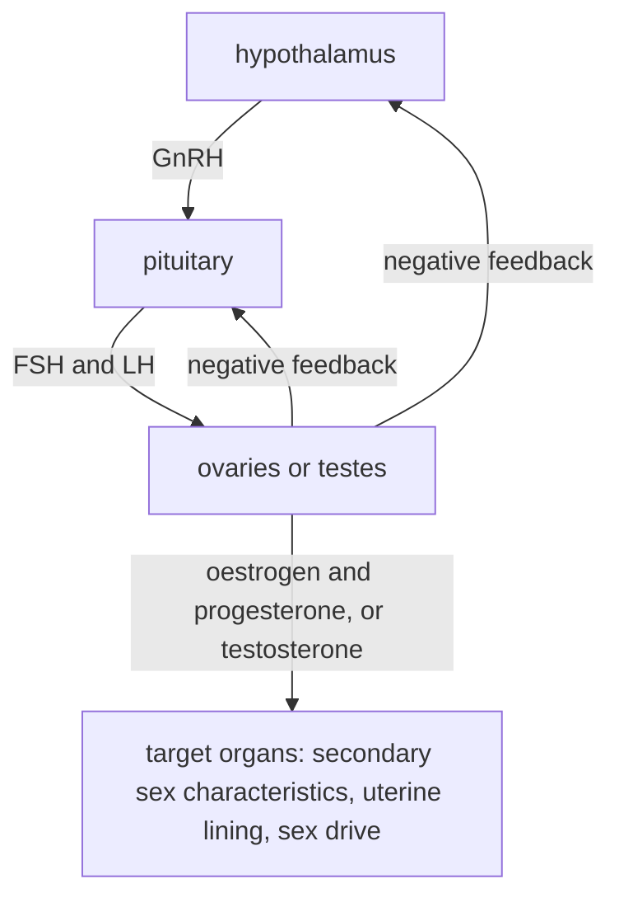

# D4 — Sexuality: notes

These are English explanations of every learning outcome in [README.md](README.md), and every topic is *drafted*: written from the CCVX syllabus and standard VWO biology, not yet checked against an open source text or exam question.

- **In Dutch VWO:** school exam (SE) only, as O8 *Seksualiteit*, so the [CvTE syllabus biologie vwo 2027](https://www.examenblad.nl/2027/vwo/documenten/syllabus-biologie-vwo-2027) doesn't specify it. CCVX still tests it.
- **Overlap:** CvTE O9.1 *Voortplanting* specs 6–7 (reproductive organs, sex hormones, menstrual cycle, contraception), O2.2 (hormonal regulation, feedback), O2.3 spec 1 (autonomic nervous system), M7.1 spec 3 (sex chromosomes) and O3.1 spec 6 (pathogens). A citation like *(overlap: CvTE O9.1 spec 7)* points there.

Dutch terms are in brackets. Binas tables are named, not numbered, because the numbers differ between editions.

## 1. Sexuality in reproduction and relationships

- Sexuality (*seksualiteit*) covers sexual feelings, desire, attraction, behaviour and identity. In humans it serves reproduction, but far more often intimacy, pleasure and maintaining a relationship.
- For reproduction, sexual intercourse brings sperm cells into the vagina; they swim through the uterus into the oviducts, where fertilization can take place ([E03](../../E-reproduction/E03-reproduction-of-organisms/README.md)). *(overlap: CvTE O9.1 spec 6)*
- Most human sexual activity can't lead to pregnancy: people have sex throughout the menstrual cycle, during pregnancy, after the menopause and with contraception. Women also show no clear outward sign of ovulation, unlike female chimpanzees, whose genital skin swells around ovulation.
- This suggests that human sexuality also evolved to strengthen the bond between partners: human children need care for many years, and a stable bond between parents helps to raise them.
- Bonding works partly through hormones released during touch and sex, such as oxytocin (outcome 9). Bonobos also use sexual contact to make up after conflicts and maintain social relationships.
- **Trap:** In humans sexual behaviour and reproduction are largely uncoupled: most sex isn't aimed at reproduction, and reproduction is possible without sex (artificial insemination, IVF).

## 2. Sexuality at different life stages

- A life stage (*levensfase*) is a period of life with its own physical and social features: childhood, adolescence, adulthood and old age. Sexuality changes with each of them.
- Young children are curious about bodies and may touch their own genitals because it feels pleasant; this has no adult sexual meaning.
- Adolescence (*adolescentie*) is the transition from child to adult, roughly between 10 and 20 years of age, and includes puberty (*puberteit*), the physical maturation. On average girls start one to two years earlier than boys.
- Puberty starts when the hypothalamus begins to release GnRH in pulses: the pituitary then releases FSH and LH, and the ovaries and testes start producing sex hormones and gametes (hormonal regulation, outcome 9). *(overlap: CvTE O9.1 spec 7)*
- In girls oestrogen causes breast development and wider hips, and menstruation starts (menarche, in the Netherlands on average at about 13). In boys the testes grow first; testosterone then causes growth of the penis, a lower voice, facial hair and more muscle, and the first ejaculations follow. Both sexes get pubic and armpit hair and a growth spurt.
- Sex differences that only develop in puberty, such as breasts, facial hair and a lower voice, are secondary sex characteristics (*secundaire geslachtskenmerken*); the reproductive organs present from birth are the primary ones.
- In adolescence many young people fall in love for the first time, discover their sexual orientation and gender identity and have their first sexual experiences; they also learn to make their wishes known and respect boundaries (outcome 8).
- Adults may form long-term relationships and have children; desire changes with pregnancy, stress, illness and age.
- Around the age of 50 women reach the menopause (*menopauze*), their last menstruation; the years around it are called the *overgang*. The ovaries stop releasing eggs and make much less oestrogen. In men testosterone declines gradually with age, and for many older people sexuality remains important.
- **Trap:** Puberty is the physical maturation; adolescence is the wider period that also includes psychological and social development.

## 3. Sexual behaviour and reproductive behaviour

- Reproductive behaviour (*voortplantingsgedrag*) is behaviour that leads to offspring: courtship, mating and parental care ([D03](../D03-behaviour-and-interaction/README.md)).
- In most mammals mating happens only when the female is fertile (in heat, *bronst*), and hormones that follow the seasons or the reproductive cycle switch the behaviour on and off.
- CCVX's "reproductive stimulus" probably means a stimulus that triggers reproductive or sexual behaviour, a sexual sign stimulus. Examples: the scent (pheromone) of a female silk moth, which attracts males from far away; the red belly of a courting male stickleback; the swollen genital skin of a female chimpanzee.
- In humans sexual stimuli include touch, sight, smell, words and fantasies; their effect depends strongly on emotions, the relationship, experience and culture, and less on hormones than in most animals.
- Sexual behaviour (*seksueel gedrag*) in humans is therefore much broader than reproductive behaviour: it also serves pleasure and intimacy, happens between partners of the same sex, and is often combined with contraception.
- **Trap:** Not every sexual act is reproductive behaviour, and in humans the timing of sex isn't tied to ovulation.

## 4. Contraceptives

- Contraceptives (*anticonceptiemiddelen*) prevent pregnancy by preventing ovulation, by stopping sperm cells from reaching the egg, or by preventing implantation. *(overlap: CvTE O9.1 spec 7)*
- The combined pill (*anticonceptiepil*) contains a synthetic oestrogen and a progestogen. By negative feedback they suppress the release of FSH and LH, so no follicle matures and no ovulation takes place; they also thicken the mucus in the cervix.
- Using the pill effectively: take one every day at about the same time, as the pack says (often 21 days followed by a 7-day stop with a withdrawal bleed), and follow the package leaflet after a late or forgotten pill, after vomiting or severe diarrhoea, or when taking other medicines that can weaken it.
- The vaginal ring (three weeks in, one week out) and the patch (a new one each week for three weeks, then a week without) contain the same two types of hormone.
- Progestogen-only methods are the mini-pill, the injection every 12 weeks, the implant in the upper arm (works for about three years) and the hormonal IUD (*hormoonspiraal*, works for several years). The implant and the injection mainly suppress ovulation; the hormonal IUD works mainly in the uterus, by thickening the cervical mucus and thinning the uterine lining; the mini-pill thickens the mucus and, depending on the type, also suppresses ovulation.
- The copper IUD (*koperspiraal*) in the uterus releases copper ions that are toxic to sperm cells and hinder implantation; depending on the type it works for five to ten years.
- The condom (*condoom*) is a barrier that catches the semen. Using it effectively: check the expiry date and the packet; roll it onto the erect penis before any genital contact, squeezing the air out of the tip; use only water- or silicone-based lubricant, because oil damages latex; hold the base while withdrawing after ejaculation; use a new one every time.
- Condoms, including the internal (female) condom, are the only contraceptives that also protect against sexually transmitted diseases.
- Sterilization is permanent: in men the sperm ducts are cut (vasectomy), in women the oviducts are closed. After a vasectomy the semen still contains sperm cells for a while, so other contraception is needed until a test shows none.
- Natural methods are much less reliable. Ovulation is about 14 days before the next menstruation, not 14 days after the last one (around day 18 in a 32-day cycle, day 10 in a 24-day cycle), cycles vary, and sperm cells survive up to about 5 days, so the fertile window is about 6 days long.
- Withdrawal (*coïtus interruptus*) is unreliable because the fluid released before ejaculation can contain sperm cells.
- Emergency contraception (*morning-afterpil*) after unprotected sex is a pill that delays ovulation: take it as soon as possible, within 72 hours (3 days) or, for another type, 120 hours (5 days). A copper IUD placed within 5 days also works; neither ends an existing pregnancy.
- Choosing: consider how reliable a method is in everyday use (methods that don't depend on remembering, such as the implant and IUDs, are the most reliable in practice), side effects and health (oestrogen raises the risk of thrombosis, so the combined pill isn't advised for smokers over 35, for example), how often you have sex, and whether you need protection against STDs. Pill plus condom is called Double Dutch.
- **Trap:** The pill, ring, implant and IUD don't protect against STDs; only condoms do, and not completely, because herpes, HPV and syphilis can also spread through skin contact. The bleed in the stop week is not a real menstruation but a reaction to the drop in hormones.

## 5. Diversity in sexual orientation

- Sexual orientation (*seksuele oriëntatie*) is about whom someone is romantically and sexually attracted to. Heterosexual (*heteroseksueel*): to people of the other sex; homosexual (*homoseksueel*): to people of the same sex (gay men, lesbian women); bisexual (*biseksueel*): to people of more than one sex or gender. Some people feel little or no sexual attraction (asexual).
- Orientation is better described as a range than as three boxes: Kinsey (1948) used a scale from 0 (only heterosexual) to 6 (only homosexual), and for some people it shifts over time.
- Orientation is not a choice and can't be changed by therapy. Its causes are not fully known: twin studies show a hereditary component, large DNA studies find many genes each with a tiny effect (no single "gay gene"), and the hormone environment before birth may play a role; upbringing has not been shown to determine it.
- Same-sex sexual behaviour occurs in many animal species, for example in bonobos.
- Coming out (*uit de kast komen*) is the process of acknowledging your orientation, or gender identity, to yourself and then telling others. It usually happens step by step (first to yourself, then to friends or family) at a moment each person chooses, and acceptance by family and friends strongly supports well-being.
- **Trap:** Sexual orientation (whom you're attracted to), gender identity (who you are) and biological sex (your body) are three different things.

## 6. Acceptance of sexual diversity, opinions and culture

- Sex (*geslacht*, biological sex) refers to the body: sex chromosomes (usually XX or XY), gonads, genitals and hormones. Gender (*gender*) refers to the psychological and social side: gender identity (experiencing yourself as a man, a woman, both or neither), gender expression (how you show it) and gender roles (what a culture expects of men and women). *(overlap: CvTE M7.1 spec 3)*
- In most people sex and gender identity match (cisgender). Biological sex isn't always clear-cut either: in intersex variations the chromosomes, gonads and genitals don't all match one sex, as in XY people whose cells don't respond to testosterone and who develop a female body.
- CCVX's "transsexuality" (*transseksualiteit*) is now usually called being transgender (*transgender*): having a gender identity that differs from the sex assigned at birth. Some transgender people transition medically (hormones, sometimes surgery), others only socially (name, clothing) or not at all; "transsexual" is an older term, mostly used for people who transitioned medically.
- Transgender adolescents may be given puberty blockers, which stop the pituitary from releasing FSH and LH, so the gonads make little sex hormone and puberty pauses. Their use is bound by medical guidelines and is debated in several countries.
- Acceptance of sexual and gender diversity varies with culture, religion, upbringing, the law and personal contact. The Netherlands was the first country to open marriage to same-sex couples (2001), while in some countries homosexuality is still a crime.
- Relating your own opinion to this means separating facts (biology shows that diversity in orientation and gender identity occurs and is not chosen) from values (moral, religious and cultural views), and supporting your view with biological and ethical arguments while respecting other people.
- **Trap:** "It occurs in nature" and "it's unnatural" are both weak arguments about what is acceptable: biology describes the diversity, but acceptance is a question of values.

## 7. Sexual behaviour and STDs

- Sexually transmitted diseases (*seksueel overdraagbare aandoeningen*, *soa's*) are infections that spread through sexual contact: vaginal, anal or oral sex, and sometimes skin-to-skin contact. Some also spread through blood (HIV, hepatitis B) or from mother to child (for example HIV, hepatitis B and syphilis). *(overlap: CvTE O3.1 spec 6)*
- The risk rises with unprotected sex, more or changing partners and not getting tested; it falls with condom use, testing, treating partners and vaccination.
- Bacterial STDs can be cured with antibiotics: chlamydia, gonorrhoea (*gonorroe*), which is becoming resistant to more and more antibiotics, and syphilis (*syfilis*), which can damage the nervous system and blood vessels years later if untreated.
- Chlamydia is the most common bacterial STD in the Netherlands. Most infected people, especially women, have no symptoms and can pass it on unknowingly; untreated it can spread to the oviducts and scar them, which can lead to infertility or an ectopic pregnancy.
- Viral STDs can't be cured with antibiotics: HIV, genital herpes (the virus stays in nerve cells for life and can flare up again), HPV (genital warts; some types cause cervical cancer) and hepatitis B (liver damage). HPV and hepatitis B can be prevented by vaccination.
- Trichomoniasis is caused by a single-celled parasite, and pubic lice are insects.
- HIV (human immunodeficiency virus) is an RNA virus that infects T helper cells, which carry the receptor CD4. With the enzyme reverse transcriptase it makes a DNA copy of its RNA, which is built into the DNA of the host cell ([B05](../../B-self-regulation/B05-defence-in-organisms/README.md)).
- Over the years the number of T helper cells falls. Because T helper cells activate both B cells and cytotoxic T cells, both the humoral and the cellular response fail.
- AIDS (acquired immunodeficiency syndrome) is the final stage: the number of T helper cells has dropped below about 200 per µL of blood (normally roughly 500–1500), and infections and cancers that a healthy defence easily controls take over. Without treatment this often takes about ten years.
- HIV spreads through blood, semen, vaginal fluid and breast milk, not through saliva, sweat, kissing or sharing cups.
- Antiretroviral drugs can't cure HIV but suppress it so well that people with an undetectable virus level live an almost normal life and don't pass HIV on through sex. PrEP (drugs taken before possible exposure) and PEP (started within 72 hours after possible exposure) protect HIV-negative people; there is no vaccine.
- **Trap:** Having no symptoms doesn't mean having no STD, and antibiotics don't work against viral STDs such as HIV, herpes and HPV.

## 8. Making wishes known and respecting boundaries

- Every sexual act needs the free and active consent (*toestemming*) of everyone involved. Consent can be withdrawn at any moment, consent to one act isn't consent to another, and silence, not resisting or an earlier "yes" aren't consent.
- Someone who is asleep, very drunk, under the influence of drugs or under pressure can't give real consent. Many people freeze when something unwanted happens, a fear reaction of the nervous system, so not resisting never means agreement.
- Making your wishes known: say clearly what you do and don't want, preferably in "I" sentences ("I don't want this"), agree on condom use beforehand, and remember that you may always change your mind.
- Guarding and respecting boundaries: pay attention to verbal and non-verbal signals, ask when in doubt ("Is this OK?"), accept a "no" or hesitation without pressure or sulking, and stop at once.
- Transgressive sexual behaviour (*grensoverschrijdend seksueel gedrag*) is any sexual behaviour without consent, from unwanted remarks or touching to sharing someone's nude photos, sexual assault and rape. In the Netherlands the age of consent is 16, and spreading sexual images of someone without their consent is a criminal offence.
- Alcohol lowers inhibitions and impairs judgement (see outcome 13 of [D03](../D03-behaviour-and-interaction/README.md)), which makes it more likely that boundaries are crossed or not recognized.
- **Trap:** The absence of a "no" is not a "yes": consent has to be clear, and it can be withdrawn at any moment.

## 9. Hormones and the nervous system

- Hormonal regulation (*hormonale regulatie*) of sexuality and reproduction runs from the hypothalamus via the pituitary (*hypofyse*) to the gonads: the hypothalamus releases GnRH, the pituitary then releases FSH and LH, and these make the ovaries or testes produce gametes and sex hormones. *(overlap: CvTE O9.1 spec 7; CvTE O2.2 spec 3)*
- The sex hormones inhibit the hypothalamus and pituitary (negative feedback, *negatieve terugkoppeling*), which keeps their levels fairly constant. In the middle of the menstrual cycle a high oestrogen level has the opposite effect, a short positive feedback that causes the LH peak and ovulation ([E03](../../E-reproduction/E03-reproduction-of-organisms/README.md), the Binas table of human hormones). *(overlap: CvTE O2.2 spec 1)*

- In men LH makes the testes produce testosterone, and FSH together with testosterone stimulates sperm production. In women FSH makes follicles grow and produce oestrogen, and after ovulation the corpus luteum produces progesterone.
- Testosterone increases sex drive in men and women (women make small amounts in the ovaries and adrenal glands); oestrogen and progesterone mainly regulate the menstrual cycle and pregnancy.
- Arousal (*opwinding*) starts in the brain, from touch, sight, smell or thoughts, and runs through the autonomic nervous system: parasympathetic nerves release nitric oxide (NO) in the erectile tissue of the penis and clitoris, the arteries widen and the tissue fills with blood (erection), and in women the vaginal wall releases fluid. Heart rate, breathing and blood pressure rise. *(overlap: CvTE O2.3 spec 1)*
- Orgasm (*orgasme*) is the peak of arousal, with rhythmic contractions of the pelvic floor muscles (in women also of the vagina and uterus); in men sympathetic nerves cause ejaculation. After an orgasm men have a refractory period, in which a new orgasm isn't possible for a while; many women don't have such a period.
- During orgasm and touch the posterior pituitary releases oxytocin, which also makes the uterus contract and the breasts release milk; in the brain it is involved in bonding. Dopamine in the brain's reward system makes sex and being in love feel rewarding.
- In prairie voles, which form lasting pairs, bonding depends on receptors for oxytocin and vasopressin in reward areas of the brain: blocking these receptors prevents pair bonding. Human bonding is more complex but is thought to involve the same hormones.
- The hypothalamus links the nervous and hormonal systems: it receives information from the rest of the brain and controls the pituitary, so emotions and stress can also affect the menstrual cycle and sex drive ([B04](../../B-self-regulation/B04-self-regulation-of-organisms/README.md)).
- **Trap:** Oxytocin is made in the hypothalamus and only released by the posterior pituitary. Erection is controlled by the parasympathetic system, ejaculation by the sympathetic system.

## Specimen contexts

- Chlamydia screening (health): Because most chlamydia infections cause no symptoms, infected young people don't seek a test and keep passing it on, while untreated infections can cause infertility. Screening means offering a test to everyone in a risk group, here 16–29-year-olds, whether or not they have symptoms; whether a national programme is worthwhile depends on how common the infection is, how many people take part, whether it really reduces transmission and complications, how often people get reinfected, and the costs. Uses outcomes 4 and 7 and the defence against bacteria in [B05](../../B-self-regulation/B05-defence-in-organisms/README.md).
- Campaign against transgressive behaviour (communication): Knowledge alone rarely changes behaviour, so such a campaign also works on attitude (gender stereotypes, peer pressure, the idea that "no" might mean "yes") and skills (stating wishes, asking for consent, recognizing signals, intervening as a bystander). Uses outcomes 6, 8 and 9.
