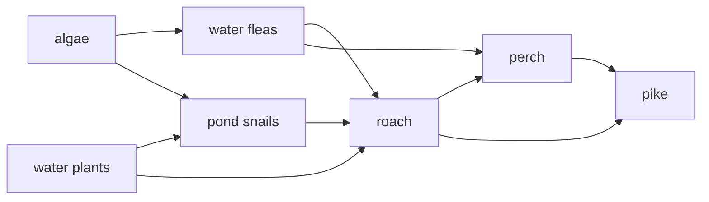

# D5 — Interaction in Ecosystems: notes

These are English explanations of every learning outcome in [README.md](README.md), and every topic is *drafted*: written from the CCVX syllabus, the Dutch CvTE syllabus and standard VWO biology, not yet checked against an open source text or exam question.

- **In Dutch VWO:** central exam (CE).
- **Dutch source:** [CvTE syllabus biologie vwo 2027](https://www.examenblad.nl/2027/vwo/documenten/syllabus-biologie-vwo-2027) (version 2, July 2025), P3 *Interactie in ecosystemen* (P3.1–P3.2). A citation like *(CvTE P3.1 spec 2)* means specification 2 of P3.1; its numbers don't match the CCVX numbers.

Dutch terms are in brackets. Binas tables are named, not numbered, because the numbers differ between editions.

## D5.1 Food Relationships

### 1. Food relationships between organisms

- A food relationship (*voedselrelatie*) is a link in which one organism gets its food from another, passing energy and matter from one trophic level (*trofisch niveau*) to the next. *(CvTE P3.1 spec 1)*
- Trophic levels: producers are level 1, herbivores (consumers of the first order) level 2, carnivores that eat herbivores level 3, and so on; decomposers feed on the remains of every level. Energy pyramids and transfer efficiencies are in [B08](../../B-self-regulation/B08-regulation-of-ecosystems/README.md).
- Predation (*predatie*): a predator kills and eats its prey, such as a pike eating roach or a ladybird eating aphids. Predators keep prey numbers down and, because they mostly catch young, old, sick or slow animals, act as a selection pressure.
- Grazing (*vraat*), more generally herbivory: an animal eats parts of a plant, usually without killing the whole plant, such as cattle on grass or caterpillars on oak leaves.
- Signal substances (*signaalstoffen*) carry information between organisms in food relationships: a cabbage plant attacked by caterpillars releases volatile substances that attract parasitic wasps, which lay their eggs in the caterpillars.
- Prey can also smell their enemies: water fleas grow protective spines in water that contains substances from their predators. Signalling between cells is in [D02](../D02-cellular-interaction/README.md).
- **Trap:** Grazing usually leaves the plant alive and able to regrow, whereas predation kills the prey.

### 2. Relationships in a food chain

- A food chain (*voedselketen*) is a series of organisms in which each one is eaten by the next, such as grass → rabbit → fox. It starts with a producer (*producent*) and continues with consumers (*consumenten*), and decomposers (*reducenten*) break down the remains of every link. *(CvTE P3.1 spec 2)*
- The relationships along a food chain are grazing (plant to herbivore), predation (prey to predator) and parasitism (host to parasite), with decomposition at every level.
- Symbiosis (*symbiose*) is the close, long-lasting living together of two different species. In its broad biological sense it covers three forms, mutualism, commensalism and parasitism, and the Dutch syllabus lists *symbiose* together with these three; in everyday Dutch and English, and in some texts, symbiosis means only the form in which both partners benefit.
- Mutualism (*mutualisme*), +/+, both partners benefit: rhizobia in the root nodules of legumes get sugars and give the plant fixed nitrogen; mycorrhizal fungi on tree roots get sugars and give water and phosphate; in a lichen a fungus and an alga live as one; microorganisms in a cow's rumen digest cellulose for it.
- Commensalism (*commensalisme*), +/0, one partner benefits and the other is hardly affected: an orchid growing on a rainforest branch (an epiphyte) only uses the tree for support and light.
- Parasitism (*parasitisme*), +/−, the parasite lives on or in its host and feeds on it, usually without killing it quickly: a tapeworm in the gut, ticks on deer, and mistletoe (*maretak*), which taps water and minerals from a tree.

| Relationship | Species A | Species B | Example |
|---|---|---|---|
| mutualism | + | + | legume and root-nodule bacteria |
| commensalism | + | 0 | epiphytic orchid on a tree |
| parasitism | + (parasite) | − (host) | tapeworm in a human |
| predation | + (predator) | − (prey, killed) | pike and roach |
| grazing | + (herbivore) | − (plant, usually survives) | cattle and grass |
| competition (*concurrentie*) | − | − | beech and oak saplings competing for light |

- **Trap:** *Symbiose* doesn't automatically mean that both partners benefit. Name the specific form by its effect on each partner: mutualism, commensalism or parasitism.

### 3. Food chains in a food web

- A food web (*voedselweb*) is the set of connected food chains in an ecosystem; most species eat, and are eaten by, more than one other species. *(CvTE P3.1 spec 3)*
- When you draw a food web, give each organism its own place and point the arrows in the direction of the energy flow, from food to eater; this is the Dutch exam convention. *(CvTE appendix 5, tekenen)*
- A pond example, with water fleas (*watervlooien*), roach (*blankvoorn*), perch (*baars*) and pike (*snoek*):

- To find the food chains, follow every route from a producer to a top consumer: this web has 9 chains, and the three longest have five organisms, such as algae → water fleas → roach → perch → pike.
- One species can be at several trophic levels: roach is at level 2 when it eats water plants and at level 3 when it eats water fleas or snails, and pike is at levels 3, 4 and 5.
- A change spreads through the web: without pike, the perch lose their only predator and increase, they eat more water fleas, and then the algae can increase.
- A species with several food sources, such as roach, suffers less when one of them declines, so an ecosystem with a complex food web is usually more stable than one with a few simple chains.
- **Trap:** An arrow means "is eaten by" (the energy goes to), not "eats".

### 4. Accumulation of toxic substances

- Toxic substances build up, or accumulate (*accumulatie*), in a food chain when they are persistent and fat-soluble: each organism takes them in faster than it can break them down or excrete them, and passes them on to whatever eats it. *(CvTE P3.2 spec 4)*
- Persistent (*persistent*) substances are hardly broken down by organisms, light or water, such as DDT, PCBs, dioxins, mercury compounds and PFAS. Biodegradable (*biologisch afbreekbaar*) substances are broken down by decomposers to CO₂, water and minerals, so they don't accumulate.
- Fat-soluble (*vetoplosbaar*) substances dissolve in fat tissue and aren't excreted with the watery urine, so they stay in the body, whereas water-soluble substances are excreted. Hydrophobic and hydrophilic substances are in [chemistry B03](../../../CCVX-chemistry/B-substances-and-materials/B03-bonds-and-properties/README.md).
- The concentration rises at each step because only about 10% of the biomass of one level becomes biomass of the next, while most of a persistent substance is kept: the same amount of toxin ends up in less biomass.
- Worked example, a model with invented numbers: 1 000 kg of algae with 0.001 mg toxin per kg hold 1 mg. The water fleas that eat them build 100 kg of biomass; if the fleas keep all 1 mg, their concentration is 1 mg / 100 kg = 0.01 mg per kg, ten times higher.
- Two more steps give 0.1 mg per kg in 10 kg of roach and 1 mg per kg in 1 kg of pike: 1 000 times the concentration in the algae. If each level kept only half of the toxin, the factor per step would be 0.5 / 0.1 = 5, and the pike would reach 0.125 mg per kg, 125 times the algae.
- DDT made the eggshells of birds of prey so thin that they broke, and their numbers crashed until DDT was banned in most Western countries in the 1970s.
- In Minamata (Japan) in the 1950s, mercury from a factory accumulated in fish and shellfish and poisoned the people who ate them; top predators, humans included, get the highest doses.
- Microplastic (*microplastic*), plastic particles smaller than 5 mm, is persistent too: filter feeders such as mussels take it in, fish and seabirds swallow it, and fat-soluble toxins stick to it.
- Pesticides (*bestrijdingsmiddelen*) and other environmental pollution (*milieuvervuiling*) are the main sources. Pests also become resistant (*resistent*): spraying kills the sensitive individuals and leaves those with resistance alleles to reproduce, so more or other pesticide is needed (natural selection, see [F02](../../F-evolution/F02-speciation/README.md)).
- **Trap:** It's the concentration (mg per kg) that rises up the chain; the total amount of toxin at a level is at most the same as in the level below, but it sits in far less biomass.

## D5.2 Interaction with Biotic and Abiotic Factors

### 1. Changes in abiotic and biotic factors and their interactions

- Abiotic factors (*abiotische factoren*: light, temperature, water, wind, soil, pH, salinity, O₂, CO₂, minerals) and biotic factors (*biotische factoren*: food, predators, competitors, parasites, partners, people) change over days, seasons and years, and they affect each other. *(CvTE P1.3 spec 3)*
- Organisms change abiotic factors: trees shade the ground, fallen leaves add humus, and algae raise the O₂ level of water by day and lower it at night. Abiotic changes in turn change biotic ones: a drought kills plants, and then their herbivores go hungry.
- A microclimate (*microklimaat*) is the local climate of a small area, which differs from the general climate. Under a forest canopy it is darker, more humid, less windy and cooler by day than in an open field; under a log it stays cool and damp, which woodlice need; a south-facing slope is warmer and drier than a north-facing one.
- Tolerance (*tolerantie*) is the range of an abiotic factor, between a minimum and a maximum, within which a species can survive. The optimum (*optimum*) is the value at which it grows and reproduces best; near the limits it survives but grows or reproduces poorly.
- Brown trout need cold, oxygen-rich water, whereas carp tolerate warm, oxygen-poor water; corals have a narrow temperature range and bleach in a marine heat wave.
- A limiting factor (*beperkende factor*) is the factor furthest from what the organism needs, which therefore limits its growth or numbers; improving another factor has no effect until this one improves. In a greenhouse, extra CO₂ only speeds up photosynthesis if light and temperature aren't limiting; see [B03](../../B-self-regulation/B03-metabolism-in-organisms/README.md).
- Indicator species (*indicatorsoorten*) have a narrow tolerance for one factor, so their presence shows its value: stinging nettles for nitrogen-rich soil, stonefly larvae for clean, oxygen-rich water, and many lichens for clean air. More examples are in [C03](../../C-self-organization/C03-self-organization-of-ecosystems/README.md).
- **Trap:** The limiting factor is the one in shortest supply compared with what is needed, not the one present in the smallest amount: plants need far less iron than nitrogen, yet iron can be limiting.

### 2. Biotic and abiotic factors in maintenance and development

- Biotic and abiotic factors both keep an ecosystem as it is and make it change; maintenance and development are the two sides of its dynamics. *(CvTE P1.3 spec 3; P2.1 specs 1–2)*
- Maintenance: negative feedback between populations, such as predators that catch more when prey is plentiful and competition that rises with density, keeps numbers in a dynamic equilibrium (*dynamisch evenwicht*).
- The abiotic conditions must stay within the species' tolerances: a lake keeps its water plants as long as enough light reaches the bottom, and when extra nutrients push it past a turning point it flips to a turbid state (see C03).
- Development: organisms change the abiotic factors, which lets other species in. In the dunes, marram grass traps sand, sea buckthorn adds nitrogen, and the richer, sheltered soil then suits shrubs and trees: succession (see C03).

### 3. Toxic substances in a food chain

- This is the same outcome as D5.1 item 4: the explanation and the worked example are in [D5.1 outcome 4](#4-accumulation-of-toxic-substances). *(CvTE P3.2 spec 4)*
- What decides how far a substance accumulates is whether it is persistent or biodegradable, whether it is fat- or water-soluble, and how many trophic levels the food chain has.

### 4. Competition within and between populations

- Competition (*concurrentie*) happens when organisms need the same resource while it is scarce: food, light, water, minerals, space, nest sites or mates. It harms all the competitors. *(CvTE P1.3 spec 4)*
- Within a population (intraspecific competition, *concurrentie binnen een populatie*) all individuals have the same needs, so competition is often strongest there. It rises with density, holds the population around its carrying capacity, and is the basis of natural selection, because the best-adapted individuals leave the most offspring.
- Between populations of different species (interspecific competition, *concurrentie tussen populaties*) competition is strongest when their niches overlap.
- A niche (*niche*) is a species' role and the full set of conditions and resources it needs, set by its tolerances and its relationships with other species. Two species with exactly the same niche can't live together for long: in Gause's experiments with two Paramecium species in one culture, one always drove out the other (competitive exclusion).
- Species coexist by dividing the resources: in North American spruce forests, five warbler species feed in different parts of the same trees, so their niches differ.
- Competition shapes the ecosystem: it decides which species persist and drives succession when taller plants take the light. Its role in self-regulation is in [B08](../../B-self-regulation/B08-regulation-of-ecosystems/README.md).
- **Trap:** Competition isn't the same as fighting: competitors often never meet, as when one species simply uses up the food first.

### 5. Sustainable development, energy and food production

- Sustainable development (*duurzame ontwikkeling*) meets the needs of people today without making it impossible for future generations to meet theirs (the definition of the Brundtland report, 1987); it is often summarised as balancing people, planet and profit. *(CvTE P3.2 specs 1–3)*
- A closed cycle (*gesloten kringloop*) reuses substances within the system, as a natural forest does with its minerals; an open cycle (*open kringloop*) takes substances in from outside and loses them to the environment, like a farm that imports feed and leaks nitrate to the groundwater.
- Biodiversity (*biodiversiteit*) belongs to sustainability because species and their gene pools are a resource for the future and keep ecosystems working; see [F03](../../F-evolution/F03-biodiversity/README.md).
- Sustainable energy production uses renewable energy sources (*hernieuwbare energiebronnen*): sun, wind, moving water, geothermal heat, and biomass if it regrows as fast as it is used. Energy saving (*energiebesparing*), such as insulation, heat recovery and LED lighting, reduces the demand. See B08 and [chemistry F03](../../../CCVX-chemistry/F-industrial-chemical-processes/F03-energy-conversion/README.md).
- Sustainable food production (*voedselproductie*) keeps the soil fertile and limits losses: crop rotation with legumes, manure instead of artificial fertiliser, fertilising only what the crop takes up, and few pesticides.
- Pesticides kill pests but can also harm other species, accumulate in food chains and select for resistance; the EU banned the outdoor use of three neonicotinoid insecticides in 2018 because of the risk to bees.
- Organic farming (*biologische landbouw*) uses no artificial fertiliser and no synthetic pesticides, and relies on manure, crop rotation and biological control with natural enemies, such as ladybirds against aphids.
- Biodegradable products are broken down by decomposers, so they don't pile up or accumulate, whereas persistent ones do. Some plastics sold as biodegradable only break down in the warm conditions of industrial composting.
- **Trap:** Energy can't be cycled. A closed cycle is about matter; energy can only be used more efficiently or come from renewable sources.

### 6. Approaching issues of sustainable development

- A sustainability issue is approached by tracing the flows of energy and matter, finding where energy is wasted or substances leak, and weighing possible measures, keeping scientific arguments apart from social norms and personal views ([A09](../../A-skills/A09-evaluation-and-judgment/README.md)). *(CvTE P3.2 specs 2–3)*
- Technical measures make production more efficient or close cycles, such as heat storage, recirculated water and recovered nutrients; recycling and cradle to cradle are in [chemistry C03](../../../CCVX-chemistry/C-chemical-processes-and-conservation-laws/C03-conservation-laws-and-cycles/README.md).
- Changes in behaviour reduce demand: less meat, less waste, less travel by car and plane.
- Policy steers both, with laws, taxes and subsidies, quotas, protected areas and labels for certified products.
- The ecological footprint (*ecologische voetafdruk*) is the area of productive land and sea needed to supply what a person or a country consumes and to absorb its CO₂, in global hectares. When humanity's total footprint is larger than what the Earth can produce (its biocapacity), resources are used faster than they regenerate.
- **Trap:** A measure can move a problem instead of solving it: biofuel from cleared rainforest saves fossil CO₂ but releases CO₂ from the forest and costs biodiversity.

## Specimen contexts

- A tomato grower managing the greenhouse cycle (food production): the grower can close cycles by recirculating drain water with its nutrients, use bumblebees for pollination and natural enemies such as the parasitic wasp Encarsia formosa against whitefly instead of pesticides, and feed the CO₂ from the gas-fired combined heat and power unit (*warmtekrachtkoppeling*) to the crop, while insulating screens, geothermal heat or underground heat storage cut energy use. The yield depends on whichever of light, CO₂ and temperature is limiting (D5.1 outcome 2, D5.2 outcomes 1 and 5–6). The Dutch version of this context (CvTE appendix 4) says *productdiversiteit*, more kinds of product, which fits "reduce dependency on a particular product" better than the CCVX "productivity".
- Measuring ecological footprints (sustainability): schoolchildren's footprints come mostly from food, energy at home, transport and the things they buy. They can shrink them by eating less meat (fewer trophic levels, so less land per kJ, see B08), using less fossil energy, travelling by bike or train, and buying less and reusing more (D5.2 outcomes 5–6).

## CCVX versus the Dutch syllabus

- **In both:** food relationships with trophic levels, predation, grazing (*vraat*), signal substances, symbiosis and its three forms; food chains and webs; accumulation of persistent toxins; biodegradable substances; sustainable energy and food production.
- **Dutch syllabus only:** open and closed cycles and biodiversity (P3.2 spec 1), renewable energy sources and energy saving (spec 2), pesticides and organic farming (spec 3), and resistant, microplastic and environmental pollution (spec 4); the notes cover them briefly. The drawing rule for food webs, arrows along the energy flow, is in CvTE appendix 5.
- **CCVX only:** nothing that is missing from the Dutch syllabus as a whole, but D5.2 items 1, 2 and 4, with microclimate, niche, indicator species, limiting factor, tolerance and optimum, are CvTE P1.3 (specs 1–4) rather than P3, so Dutch textbooks may put them with ecosystem dynamics ([B08](../../B-self-regulation/B08-regulation-of-ecosystems/README.md)).
