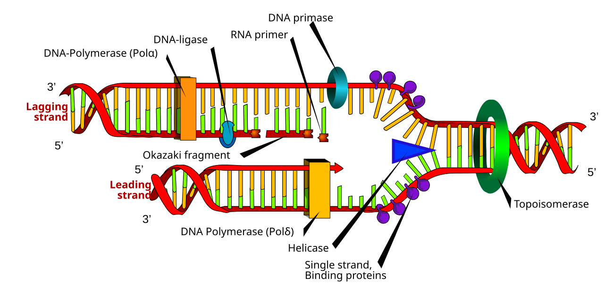

# E1 — DNA Replication: notes

These are English explanations of every learning outcome in [README.md](README.md), and every topic is *drafted*: written from the CCVX syllabus and standard VWO biology, not yet checked against an open source text or exam question.

- **In Dutch VWO:** school exam (SE) only, as M5 *DNA-replicatie*, so the [CvTE syllabus biologie vwo 2027](https://www.examenblad.nl/2027/vwo/documenten/syllabus-biologie-vwo-2027) doesn't specify it. CCVX still tests it.
- **Overlap:** CvTE M1.1 spec 1 (nucleotides, base pairing, double-stranded DNA), M1.2 spec 2 (DNA polymerase, coding and template strand), M4.1 spec 2 (the parts of an operon), M8.2 specs 1–2 (types and causes of mutations, the DNA repair system), M8.4 spec 3 (recombinant DNA, cisgenic, transgenic) and O9.1 (reproduction, mitosis and meiosis). A citation like *(overlap: CvTE M1.2 spec 2)* points there.

Dutch terms are in brackets. Binas tables are named, not numbered, because the numbers differ between editions.

## 1. The process of DNA replication

- DNA replication (*DNA-replicatie*) is the copying of all the DNA of a cell, so that each daughter cell can get a complete copy. *(overlap: CvTE M1.1 spec 1 and M1.2 spec 2)*
- DNA is a double strand (*dubbelstrengs DNA*): two chains of nucleotides (*nucleotiden*), each nucleotide made of a phosphate group, the sugar deoxyribose and one of the bases A, T, G and C; the strands are held together by hydrogen bonds (*waterstofbruggen*) between complementary base pairs (*basenparen*), A with T and G with C ([B01](../../B-self-regulation/B01-protein-synthesis/README.md)).
- Each strand has a 3' and 5' end (*3'-uiteinde* and *5'-uiteinde*): the 5' end has the phosphate group on carbon atom 5 of the last sugar, the 3' end has the free –OH group on carbon atom 3. The two strands run in opposite directions (antiparallel).
- Replication is semi-conservative (*semiconservatief*): the two strands separate and each serves as a template strand (*template/matrijsstreng*), a strand that is read to build a complementary new strand, so every new DNA molecule consists of one old and one new strand.
- Evidence: Meselson and Stahl (1958) grew E. coli on heavy nitrogen (¹⁵N) and then moved it to normal ¹⁴N. After one division all DNA had intermediate density and after two divisions half was intermediate and half light, as semi-conservative copying predicts; after three divisions the prediction is a quarter intermediate and three quarters light.
- When: eukaryotes copy their nuclear DNA in the S phase (*S-fase*) of interphase, before mitosis (*mitose*) or meiosis (*meiose*); mitochondria and chloroplasts copy their own DNA separately.
- Where it starts: a bacterial chromosome has one origin of replication; the human genome (*genoom*) has tens of thousands. Chromosome 1 has about 250 million base pairs, and copying it from a single origin, with two forks each adding about 50 nucleotides per second, would take about a month; with many origins working at once the S phase takes hours.
- Helicase unwinds the double helix and breaks the hydrogen bonds between the base pairs, opening a replication fork; proteins keep the single strands apart.
- An enzyme called primase makes a short RNA primer, about 5–10 nucleotides long, because DNA polymerase (*DNA-polymerase*) can only extend an existing strand, not start one.
- DNA polymerase adds free DNA nucleotides (*vrije DNA-nucleotiden*), nucleotides floating in the nucleus that carry three phosphate groups, to the 3' end of the growing strand, each complementary to the base opposite. Splitting off two phosphate groups provides the energy for the new bond.
- So DNA polymerase reads the template strand from 3' to 5' and builds the new strand from 5' to 3', antiparallel to the template.
- Leading strand: on the template strand that runs 3' to 5' towards the fork, the new strand can be built continuously, following the fork, from one primer (continuous replication, *continue replicatie*).
- Lagging strand: on the other template strand the new strand has to be built away from the fork, so it is made in pieces, each starting with its own primer, as the fork opens further (discontinuous replication, *discontinue replicatie*).
- These pieces are the Okazaki fragments (*Okazaki-fragmenten*): about 1000–2000 nucleotides long in bacteria and 100–200 in eukaryotes.
- The RNA primers are removed and replaced by DNA, and the enzyme DNA ligase joins the fragments into one continuous strand.

*A replication fork. Helicase opens the double helix, primase lays RNA primers, and DNA polymerase builds each new strand from 5' to 3': continuously on the leading strand, and in Okazaki fragments on the lagging strand, which DNA ligase joins. Ignore the Greek letters after DNA polymerase: you don't need the types, and newer research assigns them differently. Image: Mariana Ruiz (LadyofHats), public domain, [Wikimedia Commons](https://commons.wikimedia.org/wiki/File:DNA_replication_en.svg).*

- Replication runs in both directions from each origin, so each of the two forks has a leading and a lagging strand.
- In eukaryotes the two copies of each chromosome stay attached at the centromere as two sister chromatids (*chromatiden*) until anaphase of mitosis, when they separate ([E02](../E02-cell-life-cycle/README.md)).
- At the very end of a linear chromosome the last primer can't be replaced, so the chromosome would get shorter with every replication; the telomeres (*telomeren*), repeats of TTAGGG at the ends, buffer this loss, and the enzyme telomerase can lengthen them in stem cells (*stamcellen*) and in the cells that form gametes (*gameten*) ([E02](../E02-cell-life-cycle/README.md)).
- PCR uses the same rules in a test tube: heat replaces helicase, two DNA primers mark where copying starts, and a heat-resistant DNA polymerase adds free nucleotides ([B01](../../B-self-regulation/B01-protein-synthesis/README.md)).
- In transcription (*transcriptie*), RNA polymerase (*RNA-polymerase*) reads only one strand of a gene, the template strand; the other strand is the coding strand (*coderende streng*), which has the same sequence as the mRNA, with T instead of U ([B01](../../B-self-regulation/B01-protein-synthesis/README.md)). In replication both strands are template strands.
- **Trap:** the lagging strand is also built from 5' to 3'; it is discontinuous because it is built away from the fork, not because DNA polymerase works in the other direction there.

## 2. What can go wrong and the consequences

- A mutation (*mutatie*) is a permanent change in the base sequence (*basenvolgorde*) of DNA; replication errors are one cause, damage by mutagenic radiation (*mutagene straling*) and mutagenic substances (*mutagene stoffen*) is another. *(overlap: CvTE M8.2 specs 1–2)*
- DNA polymerase pairs about 1 in 100,000 bases wrongly. It checks each new base and replaces a wrong one at once (proofreading), and after replication repair enzymes find most of the remaining mismatches, so in the end only about 1 in 10⁹–10¹⁰ bases is wrong.
- A human cell copies 6.4·10⁹ base pairs (two sets of 3.2·10⁹), so even this accuracy leaves roughly 0.6 to 6 new mutations per cell division.
- A point mutation (*puntmutatie*) changes one base pair. It can change one amino acid (*aminozuur*), as in sickle cell anaemia, make a stop codon (*stopcodon*) or change nothing, because of the redundancy of the genetic code (*genetische code*); an insertion or deletion of one or two bases in the coding part of a gene causes a frameshift (*leesraamverschuiving*) that changes all the codons after it ([B01](../../B-self-regulation/B01-protein-synthesis/README.md), [F01](../../F-evolution/F01-selection/README.md)).
- In repeats the polymerase can slip, so a copy gains or loses repeat units: this makes STRs vary between people (see specimen contexts), and a CAG repeat in one gene that grows to about 40 copies or more causes Huntington's disease.
- UV light, especially UV-B, links two neighbouring thymines (or other pyrimidine bases) in the same strand into a thymine dimer (*thyminedimeer*), which bends the DNA and blocks replication and transcription; X-rays break DNA strands, and benzo[a]pyrene from smoke binds to G bases.
- The DNA repair system (*DNA-repairsysteem*) fixes most damage: in excision repair enzymes cut out the damaged stretch of one strand, DNA polymerase fills the gap using the other strand as template, and DNA ligase seals it.
- Damage that isn't repaired before the next replication becomes permanent: the wrong base is copied, and after that both strands carry the mutation, which repair enzymes can no longer recognise as an error.
- Consequences in body cells: most mutations are harmless or kill only one cell, but mutations in proto-oncogenes (*proto-oncogenen*) and tumour suppressor genes (*tumorsuppressorgenen*) can lead to cancer (*kanker*) ([D01](../../D-interaction/D01-molecular-interaction/README.md), [E02](../E02-cell-life-cycle/README.md)).
- Consequences in gametes: the mutation is passed on to the offspring and adds to genetic variation, the raw material of evolution ([F01](../../F-evolution/F01-selection/README.md)).
- People with a faulty repair gene get many more mutations: in xeroderma pigmentosum excision repair fails, so sunlight causes skin cancer at a young age, and in Lynch syndrome mismatch repair fails, which raises the risk of bowel cancer.
- **Trap:** a mutation in a body cell can cause cancer in that person but isn't passed on to children; only mutations in the cells that form gametes are inherited.

## 3. Incorporating DNA, naturally and artificially

- DNA can move into a cell and become part of its genome, both from the same species and from other species, naturally or by genetic engineering. *(overlap: CvTE M8.4 spec 3)*
- Bacteria take up DNA in three natural ways (horizontal gene transfer):
    - transformation (*transformatie*): a bacterium takes up free DNA from its surroundings, for example from dead bacteria. Griffith (1928) found that harmless pneumococci became deadly after contact with killed deadly ones, and Avery (1944) showed that the transforming substance was DNA;
    - transduction (*transductie*): a bacteriophage, a virus that infects bacteria, accidentally packs bacterial DNA and injects it into the next bacterium;
    - conjugation (*conjugatie*): a donor bacterium transfers DNA, usually a copy of a plasmid (*plasmide*), to a recipient through a direct connection (a pilus).
- Consequence: genes for antibiotic resistance (*antibioticaresistentie*) on plasmids spread quickly, even between different species of bacteria, and every use of antibiotics selects for the bacteria that carry them ([B05](../../B-self-regulation/B05-defence-in-organisms/README.md)). *(overlap: CvTE O9.1 spec 2)*
- Eukaryotes incorporate foreign DNA naturally too: retroviruses insert DNA copies of their genome into host chromosomes, and about 8% of the human genome consists of remnants of old retrovirus infections.
- The soil bacterium Agrobacterium tumefaciens inserts part of its own DNA into the genome of plant cells, which then form a tumour (crown gall); sweet potatoes still carry Agrobacterium genes that entered an ancestor long ago.
- Within a species, sexual reproduction combines the DNA of two parents in every zygote ([F01](../../F-evolution/F01-selection/README.md)).
- Artificially, recombinant DNA (the technique: *recombinant-DNA-technologie*) is made by cutting a gene and a carrier DNA with the same restriction enzyme (*restrictie-enzym*), so both get matching sticky ends, and joining them with DNA ligase.
- Vectors (*vectoren*) carry the DNA into the cell: plasmids for bacteria and yeast, Agrobacterium or a gene gun that shoots DNA-coated metal particles for plants, and harmless viruses or microinjection into a fertilised egg for animals. The gene-editing tool CRISPR-Cas9 cuts the genome at a chosen sequence, so DNA can be inserted or changed precisely there.
- Only some cells take up the DNA, so a marker gene (*markergen*), often for antibiotic resistance, is built in next to it: on a medium with the antibiotic only the cells with the new DNA survive.
- Depending on where the gene comes from, the result is transgenic (*transgeen*, another species) or cisgenic (*cisgeen*, the same or a crossable species) ([D01](../../D-interaction/D01-molecular-interaction/README.md)).
- Consequences: bacteria and yeast that make human insulin, growth hormone and the hepatitis B vaccine, and crops with resistance to insects or diseases; risks to weigh include genes spreading to wild relatives and insects becoming resistant to the Bt protein.
- In bacteria a gene only works with a suitable promoter, and the operon model (*operonmodel*) describes how bacteria switch groups of genes: structural genes (*structuurgenen*) with one promoter (*promotor*) and an operator, where a repressor made by a regulator gene (*regulatorgen*) can block transcription ([D01](../../D-interaction/D01-molecular-interaction/README.md)). *(overlap: CvTE M4.1 spec 2)*
- Genetic engineers use this: an inserted gene placed behind the promoter and operator of the lac operon stays off until a lactose-like substance is added, which inactivates the repressor.
- **Trap:** horizontal gene transfer isn't reproduction: in transformation, transduction and conjugation a bacterium changes its genes without dividing, and new bacteria only arise by division.

## 4. DNA replication underlies reproduction

- Every form of reproduction starts with copying the DNA, so that each new cell, and each new organism, gets a complete set of genetic information. *(overlap: CvTE O9.1 specs 1–4)*
- Mitosis (*mitose*): a human cell has 46 chromosomes (*chromosomen*); after the S phase each consists of two identical chromatids (92 chromatids in total), and mitosis separates them so that both daughter cells get the same 46 chromosomes ([E02](../E02-cell-life-cycle/README.md)).
- The amount of DNA per cell doubles in the S phase and halves again at cell division, so it stays constant over generations of cells.
- Asexual reproduction (*ongeslachtelijke voortplanting*) uses mitosis only, so the offspring are clones with the same DNA as the parent: strawberry runners, potato tubers, cuttings and buds that grow on a Hydra.
- Bacteria replicate their circular chromosome and then split in two (binary fission), which is also asexual.
- Meiosis (*meiose*): DNA is replicated once and then divided twice, so it gives four haploid (*haploïd*) cells with 23 chromosomes each in humans; these give rise to gametes (*gameten*), which fuse at fertilisation into a diploid (*diploïd*) zygote.
- Sexual reproduction (*geslachtelijke voortplanting*) in plants works the same way: meiosis in the anthers and ovules of a flower leads to the pollen grains and egg cells.
- After fertilisation the zygote divides by mitosis; reaching the roughly 3.7·10¹³ cells of an adult human takes at least about 45 rounds of doubling (2⁴⁵ ≈ 3.5·10¹³), and each round needs a full replication.
- Meiosis and fertilisation shuffle the parents' chromosomes into new combinations, which together with replication errors gives the genetic variation (*genetische variatie*) between offspring ([F01](../../F-evolution/F01-selection/README.md)).
- Mitochondria and chloroplasts replicate their own DNA and divide inside the cell; children get their mitochondria only from the egg cell, so mitochondrial DNA comes from the mother ([E03](../E03-reproduction-of-organisms/README.md)).
- **Trap:** after the S phase a human cell still has 46 chromosomes, each made of two chromatids; count the centromeres, not the chromatids, to count the chromosomes.

## Specimen contexts

- Forensic DNA evidence (safety): a trace at a crime scene often holds very little DNA, so PCR multiplies a set of STR loci, using primers on both sides of each STR and the principles of replication; 30 cycles give about 2³⁰ ≈ 10⁹ copies. The STR lengths differ between people because replication slippage adds or removes repeats, and if each of 10 independent loci had a 1-in-10 match chance, an unrelated person would match by chance with a probability of 0.1¹⁰ = 10⁻¹⁰; identical twins share the same profile. This uses outcomes 1 and 2.
- Sunburn and skin cancer (health): UV-B radiation in sunlight (see the Binas table of the electromagnetic spectrum) makes thymine dimers in skin cells; the damage triggers an inflammatory reaction, the redness of sunburn, and badly damaged cells die by apoptosis (*apoptose*). Damage that is copied before repair becomes permanent mutations, and skin cancers carry typical UV mutations in genes such as p53, often appearing decades after the sunburns. This uses outcome 2 and [D01](../../D-interaction/D01-molecular-interaction/README.md).
