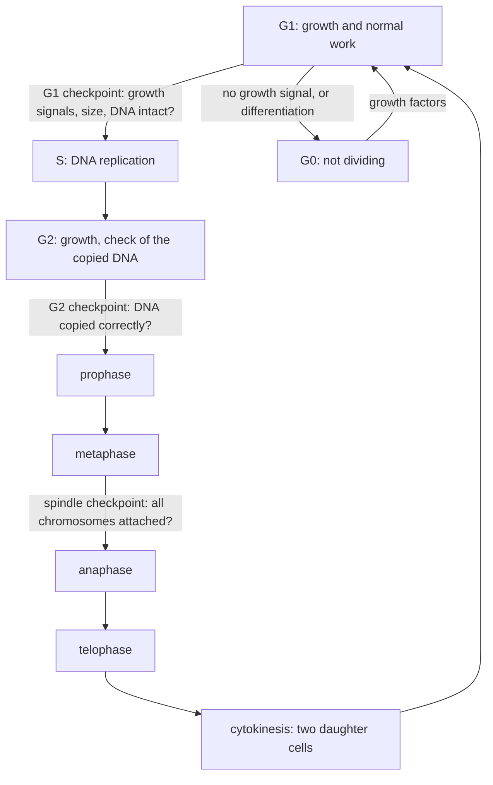

# E2 — Cell Life Cycle: notes

These are English explanations of every learning outcome in [README.md](README.md), and every topic is *drafted*: written from the CCVX syllabus and standard VWO biology, not yet checked against an open source text or exam question.

- **In Dutch VWO:** school exam (SE) only, as M6 *Levenscyclus van de cel*, so the [CvTE syllabus biologie vwo 2027](https://www.examenblad.nl/2027/vwo/documenten/syllabus-biologie-vwo-2027) doesn't specify it. CCVX still tests it.
- **Overlap:** CvTE M3.2 *Celdifferentiatie* (differentiation, stem cells, apoptosis), M4.1 *Genregulatie en interactie met (a)biotische factoren* (RNAi, proto-oncogenes, tumour suppressor genes), M4.2 *Celcommunicatie en interactie met (a)biotische factoren* (signals), M8.2 *Mutatie* (DNA repair), M8.3 *Recombinatie* and O9.1 *Voortplanting* (mitosis, meiosis, haploid, diploid). A citation like *(overlap: CvTE M3.2 spec 6)* points there.

Dutch terms are in brackets. Binas tables are named, not numbered, because the numbers differ between editions.

## 1. Cell division in growth, healing and reproduction

- Unicellular (*eencellig*) organisms reproduce by dividing: one cell becomes two organisms. Bacteria do this by binary fission (*tweedeling*) without mitosis, because they have no nucleus; yeasts, amoebas and unicellular algae divide by mitosis, and yeast also by budding. *(overlap: CvTE O9.1 spec 1)*
- Multicellular (*meercellig*) organisms start as one cell, the zygote, and grow by mitosis followed by growth of the daughter cells. An adult human has a few times 10¹³ cells; if every cell kept dividing, about 45 rounds of doubling would be enough to reach that.
- Healing and replacement: cells next to a wound divide to close it, stimulated by growth factors from blood platelets, and skin, gut lining and blood cells are replaced throughout life. Red blood cells, for example, last about 120 days and are replaced by stem cells in the bone marrow.
- A somatic cell (*lichaamscel*) is any body cell that is not a reproductive cell; in humans it is diploid, with 46 chromosomes, and it divides by mitosis.
- Reproductive cells (*voortplantingscellen*) are the gametes (egg and sperm cells) and, in plants, spores. They are formed by meiosis and are haploid (23 chromosomes in humans); after fertilisation, mitosis builds the new organism ([E03](../E03-reproduction-of-organisms/README.md)). *(overlap: CvTE O9.1 spec 3)*
- Asexual reproduction by mitosis gives genetically identical offspring (clones): potato tubers, strawberry runners and cuttings.
- **Trap:** growth is more than division, because cells also enlarge and differentiate; and bacteria divide without mitosis.

## 2. The influence of adjacent cells

- In a tissue a cell divides only when signals from other cells tell it to. Growth factors (*groeifactor*) are signal proteins that bind receptor proteins on the cell and, through a signal cascade, switch on the genes that take it from G1 into S. *(overlap: CvTE M4.2 spec 1)*
- Examples: platelet-derived growth factor (PDGF), released at a wound, makes connective-tissue cells divide, and the kidney hormone erythropoietin (EPO) makes bone-marrow cells produce more red blood cells.
- Contact inhibition: normal cells stop dividing once they touch neighbours on all sides. In a culture dish they form a single layer; if a strip is scraped away, the cells at its edge divide and move into the gap until they touch again.
- Normal cells also need to be attached to a surface (the extracellular matrix, or the bottom of the dish) before they divide.
- Neighbours can also make a cell differentiate or start apoptosis, for example in the web between developing fingers (outcome 5).
- Cancer cells ignore these signals: they divide without growth factors and pile up in layers in a culture dish (outcome 7). Cell signalling itself is covered in [D02](../../D-interaction/D02-cellular-interaction/README.md).
- **Trap:** a growth factor is a signal, not a nutrient; and contact inhibition stops division, it doesn't kill the cell.

## 3. The phases of the cell cycle

- The cell cycle (*celcyclus*) is the sequence of phases from one division to the next: interphase (*interfase*: G1, S and G2) followed by the M phase (mitosis and cytokinesis). A typical human cell in culture takes about 24 hours per cycle, of which mitosis takes about 1 hour. *(overlap: CvTE O9.1 spec 3)*
- G1: the cell grows, makes proteins and organelles, and does its normal work.
- S phase: DNA replication (*replicatie*). Each chromosome (*chromosoom*) is copied into two identical sister chromatids (*chromatide*), held together at the centromere (*centromeer*) ([E01](../E01-dna-replication/README.md)); in animal cells the pair of centrioles is copied as well.
- G2: the cell grows further, checks that its DNA is copied completely and correctly, and makes the proteins needed for mitosis, such as tubulin for the spindle.
- Mitosis (*mitose*) divides the nucleus into two genetically identical nuclei in four phases.
- Prophase (*profase*): the chromosomes condense by coiling up (CCVX's spiralization, *spiralisatie*) and become visible, each as two chromatids, and the nucleolus disappears. The spindle apparatus (*spoelfiguur*), made of microtubules (*microtubuli*), forms between the two poles, where the centrioles go in animal cells; at the end the nuclear envelope breaks up and spindle fibres attach to the centromeres.
- Metaphase (*metafase*): the chromosomes line up in the middle of the cell, each attached to fibres from both poles. They are now at their most condensed, so this is the stage used to count and photograph chromosomes for a karyogram.
- Anaphase (*anafase*): the centromeres split and shortening spindle fibres pull the sister chromatids to opposite poles; from now on each chromatid counts as a chromosome.
- Telophase (*telofase*): the chromosomes reach the poles and uncoil, a nuclear envelope and a nucleolus form around each set, and the spindle disappears.
- Cytokinesis (*cytokinese*) splits the cytoplasm. In animal cells a ring of actin and myosin pinches the cell in two; in plant cells vesicles from the Golgi apparatus build a cell plate in the middle, which becomes the new cell wall.
- G0 phase (*G0-fase*): cells that stop dividing leave the cycle from G1. Mature nerve cells and heart muscle cells stay in G0 almost permanently; liver cells rest in G0 but return to G1 when part of the liver is lost.
- The spindle is part of the cytoskeleton (*cytoskelet*): its microtubules are tubes of the protein tubulin that grow and shrink ([B02](../../B-self-regulation/B02-metabolism-in-cells/README.md)). Colchicine blocks their assembly, which stops cells in metaphase; it is used to make karyograms and to double chromosome numbers in plant breeding. Plant cells form a spindle without centrioles.
- A human cell (2n = 46) through mitosis, counting one chromosome per centromere, with the DNA amount in units of one haploid set:

| Stage | Chromosomes in the cell | Chromatids per chromosome | DNA amount |
|---|---|---|---|
| G1 | 46 | 1 | 2 |
| G2, prophase, metaphase | 46 | 2 | 4 |
| anaphase (both poles together) | 92 | 1 | 4 |
| each daughter cell after cytokinesis | 46 | 1 | 2 |

- In a microscope preparation of dividing tissue, such as an onion root tip, the share of cells in a phase is roughly proportional to how long that phase lasts: if mitosis takes 1 of 24 hours, only about 4% of the cells are in mitosis.
- **Trap:** interphase is not a resting phase (the cell grows and replicates its DNA then); chromosomes are copied in S phase, before mitosis starts; and G0 lies outside the cycle and is not the same as G1.

## 4. Mitosis versus reduction division (meiosis)

- CCVX's "reduction division (meiosis)" (*reductiedeling*, *meiose*) is two divisions after one round of DNA replication, giving four haploid cells from one diploid cell. *(overlap: CvTE O9.1 spec 3; M8.3 spec 1)*
- Diploid (*diploïd*, 2n) cells have two sets of chromosomes, one from each parent, forming homologous pairs (*homologe chromosomen*: the same genes in the same order, possibly with different alleles). Haploid (*haploïd*, n) cells have one set. In humans 2n = 46 and n = 23.
- The difference lies in meiosis I. In prophase I the homologous chromosomes pair up, and non-sister chromatids exchange pieces (crossing-over). In metaphase I the pairs, not single chromosomes, line up in the middle.
- In anaphase I the homologous chromosomes separate, each still made of two chromatids, which halves the chromosome number. In mitosis homologues don't pair, and anaphase separates sister chromatids, so the number stays the same.
- Meiosis II resembles mitosis: without new replication, the sister chromatids separate. After meiosis I a human cell has 23 chromosomes of two chromatids each (DNA amount 2); after meiosis II, 23 chromosomes of one chromatid (DNA amount 1).
- Functions: mitosis gives two genetically identical cells with the same chromosome number, for growth, repair and asexual reproduction. Meiosis gives gametes (in plants, spores) with half the chromosome number, so that fertilisation restores 2n (23 + 23 = 46), and with new combinations of alleles.
- Each homologous pair is shared out independently in metaphase I, so one person can make 2²³ ≈ 8.4·10⁶ different chromosome combinations and a couple 2⁴⁶ ≈ 7.0·10¹³ combinations in a child, before crossing-over adds even more ([F01](../../F-evolution/F01-selection/README.md)).

| | Mitosis | Meiosis |
|---|---|---|
| divisions | 1 | 2 (meiosis I and meiosis II) |
| daughter cells | 2, diploid | 4, haploid |
| pairing of homologues, crossing-over | no | yes, in prophase I |
| what separates in anaphase | sister chromatids | homologues (I), then sister chromatids (II) |
| daughter cells genetically | identical | all different |
| where in humans | somatic cells | testes and ovaries |

- Triploid plants (3n) can't share their chromosomes out evenly in meiosis I, so they make hardly any working gametes; that is why cultivated bananas and seedless watermelons have no proper seeds.
- **Trap:** the reduction happens in meiosis I, so cells after meiosis I are already haploid although each chromosome still has two chromatids; and it is meiosis II, not meiosis I, that looks like mitosis.

## 5. Regulation of the cell cycle and what goes wrong

- The cycle is controlled at checkpoints, where the cell goes on only if conditions are right: at the end of G1 (enough growth factors, nutrients and size, undamaged DNA), at the end of G2 (all DNA copied correctly), and in metaphase (all chromosomes attached to both poles). *(overlap: CvTE M4.1 spec 5)*
- If a check fails, the cycle pauses for repair, or the cell enters G0 or apoptosis.
- Proteins called cyclins rise and fall through the cycle; they activate enzymes (cyclin-dependent kinases) that switch on the proteins for the next phase.
- Proto-oncogenes (*proto-oncogen*) are normal genes for proteins that stimulate division, such as growth factors, their receptors and signal-cascade proteins. A mutation can turn one into an oncogene, whose product is overactive or overproduced, so the cell divides without a signal; one mutated allele is enough.
- Tumour suppressor genes (*tumorsuppressorgen*; CCVX's "suppressor" in [D01](../../D-interaction/D01-molecular-interaction/README.md)) code for brakes: proteins that stop the cycle, repair DNA or start apoptosis. Usually both alleles must be lost before the brake fails.
- Examples: p53 halts the cycle in G1 when DNA is damaged and triggers repair or apoptosis, and it is mutated in about half of all human cancers. BRCA1 and BRCA2 work in DNA repair, and inherited mutations in them raise the risk of breast and ovarian cancer.
- Mutagenic factors (*mutagene factor*) cause these mutations: UV light, ionising radiation, chemicals in tobacco smoke, some viruses (human papillomavirus, HPV, in cervical cancer) and copying errors. A tumour usually needs several mutations in one cell line, which is one reason why cancer becomes more common with age.
- RNA interference (*RNAi*) also regulates cell-cycle genes: short RNA molecules (about 20–25 nucleotides) in a protein complex bind to an mRNA with a complementary sequence, which is then broken down or not translated, so the gene is silenced after transcription. *(overlap: CvTE M4.1 spec 4)*
- The cell makes its own such RNAs, microRNAs, from genes in its genome; CCVX's "microDNA" probably means these microRNAs. Some microRNAs block the mRNA of growth-promoting proteins and others that of tumour suppressor proteins, and many tumours have abnormal microRNA levels.
- Researchers use synthetic short RNAs to switch off a chosen gene in cultured cells and see what happens to division (CCVX writes "iRNA" for RNAi in [D01](../../D-interaction/D01-molecular-interaction/README.md)).
- Apoptosis (*apoptose*) is programmed cell death: on a signal, the cell cuts up its own DNA and proteins, shrinks and falls apart into small membrane-wrapped pieces, which phagocytes take up and digest in their lysosomes (*lysosoom*), without inflammation. *(overlap: CvTE M3.2 specs 6–7)*
- Apoptosis removes damaged or unwanted cells: cells with DNA damage (via p53), the web between the fingers of an embryo and the tail of a tadpole. Cancer cells often escape it ([C01](../../C-self-organization/C01-self-organization-of-cells/README.md)).
- **Trap:** an oncogene is the mutated, overactive form of a proto-oncogene; tumour suppressor genes contribute to cancer when they are switched off, not when they are overactive; and apoptosis is a controlled process, unlike death from injury (necrosis).

## 6. Growth and development of daughter cells

- After division each daughter cell is about half the size of the mother cell; in G1 it makes new proteins, membranes and organelles until it is big enough to divide again or to specialise. *(overlap: CvTE M3.2 specs 2–4)*
- Mitochondria and chloroplasts are not made by mitosis: they grow and divide by themselves and are shared out over the daughter cells, a sign of their endosymbiotic origin ([B02](../../B-self-regulation/B02-metabolism-in-cells/README.md)).
- Many daughter cells leave the cycle (G0) and differentiate (*celdifferentiatie*): genes for a specific shape and function are switched on and others are switched off, giving cell types such as muscle, nerve or xylem cells, which keep the full genome.
- Stem cells (*stamcel*) often divide unequally: one daughter stays a stem cell and the other differentiates, for example in the bone marrow, the skin and the gut lining.
- Some daughter cells change drastically: mammalian red blood cells lose their nucleus, and plant xylem cells die and leave only their thickened walls as pipes.
- Plant cells grow mainly by taking up water into a growing vacuole while the wall stretches, so plant growth depends on turgor.
- **Trap:** differentiation switches genes on and off and doesn't remove them; the mature red blood cell, which loses its whole nucleus, is the exception.

## 7. Uncontrolled division and tumours

- A tumour (*tumor*, *gezwel*) is a mass of cells that keep dividing because the controls of outcomes 2 and 5 have failed: they no longer need growth factors, ignore contact inhibition and checkpoints, and avoid apoptosis. *(overlap: CvTE M4.1 spec 5)*
- A tumour starts from one cell that has collected several mutations. Each further mutation that makes cells divide faster or survive better spreads within the tumour, so it becomes more abnormal over time.
- Cancer cells in culture pile up in layers, divide without a surface to attach to, keep dividing indefinitely (often with active telomerase, outcome 11) and have abnormal chromosome numbers.
- A growing tumour can make new blood vessels grow into it, which supply O₂ and nutrients.
- Example: colon cancer usually starts as a small benign polyp in the gut lining that turns malignant over years as more mutations build up.
- Treatments target dividing cells: radiotherapy damages DNA, and chemotherapy drugs block DNA replication or the spindle (taxol, for example). They also hit fast-dividing normal cells, which causes hair loss, damage to the gut lining and low blood counts.
- Prevention follows from the causes: avoiding mutagens (sunscreen, not smoking), vaccination against HPV, and screening to find tumours early ([C02](../../C-self-organization/C02-self-organization-of-organisms/README.md) covers cancer and its causes).
- **Trap:** most tumours need several mutations, not one; and not every tumour is cancer (outcome 8).

## 8. Benign and malignant tumours

- A benign tumour (*goedaardig*) grows slowly, stays in one place (often inside a capsule) and consists of cells that still resemble the original tissue; it doesn't invade or spread. Examples: warts, fatty lumps (lipomas) and most moles.
- A benign tumour is harmful only by pressing on organs, which is dangerous inside the skull, or by producing hormones.
- A malignant tumour (*kwaadaardig*) is cancer (*kanker*): its cells are less differentiated and grow into the surrounding tissue.
- Malignant cells can metastasise (*uitzaaiing*): they break loose, travel with the blood or lymph and start secondary tumours elsewhere, as when breast cancer spreads to the lymph nodes and bone. Metastases make cancer much harder to treat, so early detection matters.
- **Trap:** a metastasis consists of cells from the original tumour: breast cancer in a bone is still breast cancer, not bone cancer.

## 9. Uncorrected DNA errors in uncontrolled division

- DNA is damaged all the time (UV light, chemicals, copying errors), but a DNA repair system (*DNA-repairsysteem*) of enzymes corrects most of the damage, and DNA polymerase checks its own work during replication. *(overlap: CvTE M8.2 spec 2)*
- In a normal cell, checkpoint proteins such as p53 stop the cycle until the damage is repaired, or start apoptosis if repair fails, so errors are rarely passed on.
- In uncontrolled division these brakes are often the very genes that are broken: the cell replicates and divides with the damage still there, so the error becomes a permanent mutation in all its daughter cells.
- Every round adds new errors, and when the spindle checkpoint fails whole chromosomes are shared out wrongly. The tumour becomes genetically unstable and produces ever more aggressive or drug-resistant cells.
- Example: people with xeroderma pigmentosum have an inherited defect in repairing UV damage and get skin cancer very easily from sunlight; the sunburn and skin-cancer context of [E01](../E01-dna-replication/README.md) rests on the same mechanism.
- **Trap:** mutations in somatic cells are not passed on to children; what can be inherited is a raised risk (such as a BRCA1 mutation), not the tumour itself.

## 10. Cell ageing and the limit of about fifty divisions

- Normal human body cells can divide only a limited number of times, about 50 (40–60), and then stop for good (senescence) and are eventually removed or die. This is the Hayflick limit, found by Leonard Hayflick in 1961 with human fibroblasts in culture.
- The counter behind the limit is the shortening of the telomeres at every division (outcome 11).
- Cells also age through accumulated damage to DNA, proteins and membranes, partly from reactive oxygen compounds formed in mitochondria; ageing tissues renew more slowly, so wounds heal more slowly in old people.
- The limit hardly restricts growth: one cell whose descendants all divided 50 times would give 2⁵⁰ ≈ 1.1·10¹⁵ cells, far more than the few times 10¹³ cells of a human body.
- Stem cells and germ cells can divide more often because they keep telomerase active, and cancer cells escape the limit altogether: HeLa cells, grown from a cervical tumour in 1951, still divide in laboratories today.
- **Trap:** the limit counts divisions, not time, so cells that stay in G0 (most nerve cells) don't use it up; and reaching it means the cell stops dividing, not that it dies at once.

## 11. Telomeres and telomerase

- Telomeres (*telomeren*) are the ends of linear chromosomes: hundreds to thousands of repeats of a short base sequence (TTAGGG in humans) with proteins, forming a cap that carries no genes and stops the cell from treating the ends as broken DNA.
- DNA polymerase can't copy the very end of the lagging strand, because it needs a primer and the gap left by the last primer can't be filled, so a chromosome loses a piece of telomere at every replication ([E01](../E01-dna-replication/README.md)).
- When the telomeres get too short, the cell detects this as DNA damage (via p53) and stops dividing or enters apoptosis: this is what sets the Hayflick limit.
- Telomerase is an enzyme that carries its own RNA template and adds new TTAGGG repeats to the chromosome ends. It is active in germ cells, embryonic cells and many stem cells, almost absent in most body cells, and switched back on in most cancer cells, which makes them immortal.
- **Trap:** telomeres shorten because of the way DNA is replicated, not because of mutations; and telomerase only lengthens telomeres, it doesn't repair other DNA damage.

## 12. Tissue culture in food production and medical research

- Tissue culture (*weefselkweek*) is growing cells, tissues or organs outside the organism in a sterile medium with nutrients (glucose, amino acids, salts, vitamins) and growth factors or plant hormones, at the right temperature and pH; human and other mammalian cells are usually kept at 37 °C.
- Plant tissue culture works because many plant cells can still form a whole plant. A small piece of tissue on a gel with plant hormones forms a callus, a mass of undifferentiated dividing cells, and the ratio of the hormones auxin and cytokinin decides whether shoots or roots grow from it.
- Food production: thousands of genetically identical plants (clones) can be grown from one plant, such as orchids, strawberries, bananas and seed potatoes. Culturing the growing tip of a shoot (meristem) gives virus-free plants, because viruses rarely reach the meristem.
- Plant breeding: cultured pollen precursors grow into haploid plants, and doubling their chromosomes with colchicine gives completely homozygous plants in one step (doubled haploids), which speeds up the breeding of new seed varieties.
- Cultured meat grows animal muscle stem cells in culture; Mark Post of Maastricht University presented the first cultured-meat burger in 2013. Algae are cultured for food, feed and fuel (specimen context).
- Medical research: human cell cultures and cell lines such as HeLa are used to study the cell cycle and cancer and to test drugs and possibly toxic or carcinogenic substances with fewer animal tests. Cultured cells also produce vaccines and therapeutic proteins, skin is grown for burn patients, and organoids (mini-organs) are grown from stem cells.
- Normal cells in culture show contact inhibition and the Hayflick limit and cancer cells don't, so a culture that loses these properties after exposure to a substance points to a carcinogenic effect.
- **Trap:** plant tissue culture is asexual (no meiosis), so all plants from one culture are genetically identical and equally vulnerable to the same disease; and normal animal cells can't be cultured forever, only cell lines (often from tumours) can.

## Specimen contexts

- Energy (algae at Wageningen): unicellular algae reproduce by mitosis, so with enough light, CO₂, nutrients and a suitable temperature a culture keeps doubling (outcomes 1 and 3). In many algae a shortage of nitrogen stops division and makes the cells store more oil, so growers have to balance growth against oil content (outcome 12; photosynthesis in [B02](../../B-self-regulation/B02-metabolism-in-cells/README.md)).
- Health or healthcare (carcinogen tests in cell cultures): cultured cells are exposed to a substance and checked for DNA damage, chromosome abnormalities, loss of contact inhibition and unlimited division, the signs of change into tumour cells (outcomes 2, 5, 7, 9 and 12).
- Food production (seed yields): seeds only form after meiosis and fertilisation, so parent plants with a normal meiosis are essential, and the embryo and food reserve inside the seed grow by mitosis. Tissue culture and doubled haploids speed up breeding (outcomes 1, 4 and 12).
