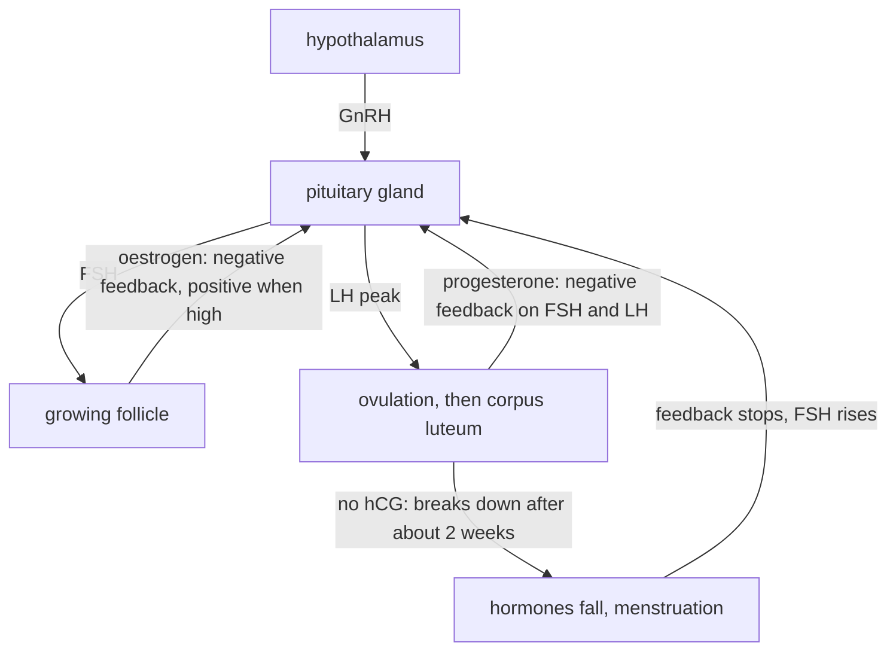

# E3 — Reproduction of Organisms: notes

These are English explanations of every learning outcome in [README.md](README.md), and every topic is *drafted*: written from the CCVX syllabus, the Dutch CvTE syllabus and standard VWO biology, not yet checked against an open source text or exam question.

- **In Dutch VWO:** central exam (CE).
- **Dutch source:** [CvTE syllabus biologie vwo 2027](https://www.examenblad.nl/2027/vwo/documenten/syllabus-biologie-vwo-2027) (version 2, July 2025), O9.1 *Voortplanting* (specs 1–8, for E3.1) and M7.1 *Erfelijke eigenschap* (specs 1–6, for E3.2). A citation like *(CvTE O9.1 spec 3)* means specification 3 of O9.1; its numbers don't match the CCVX numbers.

Dutch terms are in brackets. Binas tables are named, not numbered, because the numbers differ between editions.

## E3.1 Reproduction

### 1. Sexual and asexual reproduction, and genetic variation

- In sexual reproduction (*geslachtelijke voortplanting*), two haploid gametes (*gameten*) fuse at fertilization (*bevruchting*) into a diploid zygote, so the offspring get half their DNA from each parent and differ from both. *(CvTE O9.1 specs 1–2)*
- In asexual reproduction (*ongeslachtelijke voortplanting*), one parent produces offspring by mitosis (*mitose*), or by binary fission (*tweedeling*) in prokaryotes. Apart from new mutations, the offspring are genetically identical to the parent and to each other: they form a clone (*kloon*).
- Examples of asexual reproduction: bacteria dividing, yeast budding (*knopvorming*), strawberry runners (*uitlopers*), potato tubers (*knollen*), cuttings (*stekken*) taken by growers, and unicellular algae dividing by mitosis.
- So what makes reproduction sexual is meiosis plus fertilization.
- A spore (*spore*) is a single cell that grows into a new organism without fusing with another cell. The mould *Penicillium* makes masses of spores by mitosis (asexual); mosses and ferns make haploid spores by meiosis (*meiose*) as one step of their sexual life cycle.
- A bacterial endospore is different: it's a resistant resting stage, and one cell forms only one endospore, so it doesn't increase the number of bacteria.
- A life cycle (*levenscyclus*) is the series of stages from zygote to adult to the next zygote. In animals only the gametes are haploid (*haploïd*, n); all other cells are diploid (*diploïd*, 2n). Humans: 2n = 46, n = 23. Life cycles of plants, insects and mammals are in [C02](../../C-self-organization/C02-self-organization-of-organisms/README.md).
- In mosses and ferns a haploid plant generation alternates with a diploid one (alternation of generations, *generatiewisseling*).
- Polyploid (*polyploïd*) cells have more than two complete chromosome sets. Polyploidy arises when chromosomes fail to separate during meiosis or mitosis; breeders cause it on purpose with colchicine, which blocks the spindle.
- Many crops are polyploid: potato has four sets (4 × 12 = 48 chromosomes), bread wheat six sets (6 × 7 = 42), and the seedless Cavendish banana three sets (3 × 11 = 33).
- Triploids are usually sterile, because three sets can't be shared out evenly in meiosis; that is why such bananas have no seeds and are propagated vegetatively.
- Sexual reproduction creates genetic variation (*genetische variatie*) in three ways. Independent assortment of the homologous chromosomes in meiosis I gives 2²³ ≈ 8.4·10⁶ chromosome combinations per human gamete. Crossing-over (*crossing-over*) in prophase I mixes parts of homologous chromosomes. Random fertilization gives 2²³ × 2²³ = 2⁴⁶ ≈ 7.0·10¹³ combinations per couple, even without crossing-over. Meiosis itself is in [E02](../E02-cell-life-cycle/README.md); recombination in [F01](../../F-evolution/F01-selection/README.md).
- New mutations add new alleles in both kinds of reproduction. Asexually reproducing eukaryotes vary mainly through those mutations.
- Prokaryotes reproduce only asexually, by binary fission: the circular chromosome is copied, the two copies move apart and the cell splits in two.
- Prokaryotes still vary a lot. Mutations spread fast because bacteria have short generation times and huge populations: *E. coli* can divide about every 20 minutes in ideal conditions, so in theory one cell gives 2³⁰ ≈ 1.1·10⁹ cells in 10 hours.
- Prokaryotes also exchange genes without reproducing (horizontal gene transfer): by transformation (*transformatie*, taking up free DNA from the surroundings), conjugation (*conjugatie*, passing a copy of a plasmid through a pilus) and transduction (*transductie*, DNA carried over by a bacteriophage). See [E01](../E01-dna-replication/README.md) and [B02](../../B-self-regulation/B02-metabolism-in-cells/README.md).
- Asexual reproduction is fast, needs no partner and keeps a successful genotype intact. But a clone lacks variation, so one new disease can wipe it out: the Gros Michel banana disappeared from export plantations in the 20th century through Panama disease, a fungal infection.
- Sexual reproduction is slower and needs a partner, but the variation lets a population adapt. Many algae divide asexually while conditions are good and switch to sexual reproduction under stress; *Chlamydomonas*, for example, forms gametes when nitrogen runs out, and the zygote becomes a resistant resting stage.
- **Trap:** bacterial conjugation is gene transfer, not reproduction: it doesn't produce an extra cell.

### 2. Gametes and zygote

- Gametes are haploid cells specialised for fertilization. A human gamete has 23 chromosomes: 22 autosomes plus one sex chromosome, which is always an X in an egg cell and an X or a Y in a sperm cell. *(CvTE O9.1 specs 3–4)*
- The sperm cell (*spermacel*) is small and moves itself. Its head holds the haploid nucleus and the acrosome, a cap of enzymes that digest a path through the layers around the egg. Its midpiece is packed with mitochondria that supply ATP for the tail (a flagellum).
- The ovum or egg cell (*eicel*) is one of the largest human cells (about 0.1 mm) and can't move itself. It has a lot of cytoplasm with nutrients and organelles, and it's surrounded by a protective glycoprotein coat and follicle cells.
- Spermatogenesis takes place in the seminiferous tubules (*zaadbuisjes*) of the testes, continuously from puberty on. Spermatogonia (2n) divide by mitosis. Some grow into primary spermatocytes (2n), which go through meiosis I (giving two secondary spermatocytes, n) and meiosis II (giving four spermatids, n). Each spermatid matures into a sperm cell.
- Oogenesis starts before birth. Oogonia multiply by mitosis and begin meiosis I, then stop in prophase I as primary oocytes, each inside a small follicle.
- From puberty on, a few follicles start growing every cycle and usually one matures. Just before ovulation it completes meiosis I with a very unequal division: one large secondary oocyte and a small first polar body. Meiosis II then stops in metaphase II and is completed only if a sperm cell enters, giving the egg and a second polar body.
- A polar body (*poollichaampje*) is a small cell with a haploid chromosome set and almost no cytoplasm; it dies off. The unequal divisions let the egg lose surplus chromosome sets while keeping nearly all the cytoplasm.
- The follicle (*follikel*) is the oocyte with its surrounding follicle cells. Under FSH it grows into a mature, fluid-filled follicle at the surface of the ovary, and its follicle cells make oestrogen.
- At ovulation (*ovulatie*, *eisprong*) the mature follicle bursts and releases the oocyte, which is caught by the oviduct (*eileider*). The trigger is a peak in LH.
- The empty follicle turns into the corpus luteum (*geel lichaam*) under LH and makes progesterone (and some oestrogen). Without pregnancy it breaks down after about two weeks; in a pregnancy the embryo's hCG keeps it working.
- Fertilization usually takes place in the upper part of the oviduct. Acrosome enzymes digest a path, one sperm cell fuses with the egg membrane, and the egg's coat then changes so that no further sperm cells can enter. The two haploid nuclei combine into the diploid zygote (*zygote*, 2n = 46).
- The egg can be fertilized for only about a day after ovulation. Sperm cells can survive a few days in the uterus and oviducts.
- Cleavage (*klievingsdeling*) is the series of rapid mitotic divisions of the zygote without growth, so the cells get smaller each time. It runs while the embryo moves down the oviduct: 2, 4, 8, 16 cells, then a solid ball (morula), then a hollow ball (blastocyst). The blastocyst has an inner cell mass, which becomes the embryo, and an outer layer, which helps form the placenta.
- About a week after fertilization the blastocyst implants (*innesteling*) in the uterine lining, the endometrium (*baarmoederslijmvlies*). These early stages (morula, blastula) are also in [C02](../../C-self-organization/C02-self-organization-of-organisms/README.md).
- During embryonic development (*embryonale ontwikkeling*) the cells differentiate into germ layers, then tissues and organs ([C01](../../C-self-organization/C01-self-organization-of-cells/README.md)). *(CvTE O9.1 spec 5)* After about 8 weeks all organs are laid down and the embryo (*embryo*) is called a foetus (*foetus*). The foetus mainly grows and matures until birth.
- Birth comes about 38 weeks after fertilization, which is 40 weeks counted from the first day of the last menstruation. The two counts differ by the two weeks between menstruation and ovulation.
- The placenta (*placenta*) grows from the embryo's outer layer (the chorion with its villi) together with the mother's endometrium. Foetal capillaries in the villi lie in spaces filled with maternal blood, and the two blood streams don't mix.
- Across the placenta, O₂, glucose, amino acids, water and antibodies pass from mother to foetus, while CO₂ and urea pass from foetus to mother. Harmful things can cross too: alcohol, nicotine, many drugs and some viruses, such as rubella.
- The umbilical cord (*navelstreng*) has two arteries carrying oxygen-poor blood to the placenta and one vein carrying oxygen-rich blood to the foetus. The placenta also makes hormones: hCG, and later progesterone and oestrogen.
- **Trap:** polar bodies are not extra eggs. One primary oocyte gives one egg, but one primary spermatocyte gives four sperm cells. Strictly, ovulation releases a secondary oocyte, not a finished egg.

### 3. Human reproductive organs and hormones

- The reproductive organs (*voortplantingsorganen*) present from birth are the primary sex characteristics (*primaire geslachtskenmerken*). Secondary sex characteristics (*secundaire geslachtskenmerken*) develop at puberty under sex hormones: breasts and wider hips in women; beard, a lower voice and more muscle in men; pubic hair in both. *(CvTE O9.1 specs 6–7)*
- The reproductive organs of eukaryotes in general make gametes or spores: gonads (ovaries and testes) in animals, and sporangia in mosses, ferns and fungi.
- In flowering plants the reproductive organ is the flower. Stamens (*meeldraden*) have anthers (*helmknoppen*) that make pollen (*stuifmeel*), which carries the male gametes. The ovary (*vruchtbeginsel*) of the pistil (*stamper*) contains ovules (*zaadbeginsels*), each with an egg cell. After pollination (*bestuiving*) a pollen tube grows down to the ovule. The fertilized ovule becomes a seed and the ovary becomes a fruit.

| Organ (man) | Structure and function |
|---|---|
| testis (*teelbal*) in the scrotum (*balzak*) | seminiferous tubules make sperm cells, and cells between the tubules make testosterone; the scrotum keeps the testes a few degrees below body temperature, which sperm production needs |
| epididymis (*bijbal*) | stores sperm cells while they mature |
| vas deferens (*zaadleider*) | carries sperm cells to the urethra |
| seminal vesicles (*zaadblaasjes*), prostate (*prostaat*) | add fluids (the seminal vesicles' fluid contains fructose as fuel); sperm cells plus these fluids form semen (*sperma*) |
| penis (*penis*) | erectile tissue fills with blood (erection); its urethra (*urinebuis*) carries urine or semen |

| Organ (woman) | Structure and function |
|---|---|
| ovary (*eierstok*) | contains follicles with oocytes; makes oestrogen and progesterone |
| oviduct (*eileider*) | catches the oocyte; cilia and muscle contractions move it to the uterus; the usual place of fertilization |
| uterus (*baarmoeder*) | muscular organ whose lining (endometrium) thickens every cycle for implantation; the embryo and foetus develop here |
| cervix (*baarmoederhals*) | neck of the uterus; its mucus is thick most of the cycle and thin around ovulation |
| vagina (*vagina*) | receives the penis and semen; birth canal |
| clitoris (*clitoris*) | small, very sensitive erectile organ with a role in sexual arousal |

- The sex hormones (*geslachtshormonen*) are the steroid hormones of the gonads: oestrogen, progesterone and testosterone. The pituitary gland (*hypofyse*) controls the gonads with FSH and LH, and the hypothalamus controls the pituitary with a releasing hormone (GnRH). See the Binas table on human hormones and [B04](../../B-self-regulation/B04-self-regulation-of-organisms/README.md).

| Hormone | Made by | Main effects |
|---|---|---|
| FSH (follicle-stimulating hormone) | pituitary gland | woman: follicles grow and make oestrogen; man: sperm production |
| LH (luteinizing hormone) | pituitary gland | woman: the LH peak triggers ovulation and turns the follicle into the corpus luteum; man: testosterone production |
| oestrogen (*oestrogeen*) | growing follicle (also corpus luteum, placenta) | endometrium thickens; female secondary sex characteristics; feedback on FSH and LH |
| progesterone (*progesteron*) | corpus luteum, later the placenta | keeps the endometrium thick and ready for implantation; inhibits FSH and LH |
| testosterone (*testosteron*) | testes | sperm production; male secondary sex characteristics; inhibits LH and FSH |
| hCG (human chorionic gonadotropin, *HCG*) | outer layer of the embryo, later the placenta | keeps the corpus luteum alive, so progesterone stays high; detected by pregnancy tests |

- The menstrual cycle (*menstruatiecyclus*) lasts about 28 days (commonly 21–35). Day 1 is the first day of menstruation (*menstruatie*), when the endometrium is shed because progesterone and oestrogen are low.
- In the first half of the cycle, the low sex-hormone levels give little negative feedback, so FSH rises. Follicles grow and make oestrogen, which rebuilds the endometrium. Rising oestrogen at first inhibits FSH (negative feedback).
- Just before ovulation, a high oestrogen level kept up for a while switches to positive feedback: the pituitary releases an LH peak (with a smaller FSH peak), and ovulation follows about a day later.
- In the second half, the corpus luteum makes progesterone (plus oestrogen). This keeps the endometrium thick and inhibits FSH and LH, so no new follicles mature.
- Without pregnancy the corpus luteum breaks down after about two weeks. Progesterone and oestrogen fall, the endometrium is shed, the negative feedback stops, FSH rises again, and a new cycle starts.
- In a pregnancy, hCG from the embryo keeps the corpus luteum going, so progesterone stays high and there is no menstruation. From roughly the third month the placenta takes over progesterone production.
- The corpus luteum phase is fairly constant at about 14 days, so ovulation comes about 14 days before the next menstruation: around day 14 in a 28-day cycle, but around day 18 in a 32-day cycle.

- In men the same hypothalamus–pituitary system runs without a cycle. LH makes the testes produce testosterone, FSH (together with testosterone) drives sperm production, and testosterone inhibits GnRH, LH and FSH.
- That negative feedback is why users of anabolic steroids (testosterone-like drugs) suppress their own LH and FSH: their testes shrink and make fewer sperm cells.
- Contraception (*anticonceptie*) prevents fertilization or implantation; choosing and using contraceptives and STDs are in [D04](../../D-interaction/D04-sexuality/README.md).

| Method | How it works |
|---|---|
| condom (*condoom*) | barrier for sperm cells; the only method that also lowers the risk of STDs |
| combined pill (*anticonceptiepil*) | synthetic oestrogen and progestogen keep FSH and LH low by negative feedback, so no follicle matures and there's no ovulation; also thickens the cervical mucus |
| progestogen-only methods: mini-pill, injection (*prikpil*), implant (*staafje*), hormonal IUD (*hormoonspiraal*) | thicker cervical mucus and a thinner endometrium; the injection and the implant also suppress ovulation, while the hormonal IUD works mainly locally in the uterus |
| copper IUD (*koperspiraal*) | copper ions hinder sperm cells and prevent implantation |
| morning-after pill (*morning-afterpil*) | taken within a few days after unprotected sex; mainly delays ovulation |
| sterilization (*sterilisatie*) | the vasa deferentia or the oviducts are cut or closed |
| periodic abstinence (temperature method) | no sex around ovulation; after ovulation progesterone raises body temperature by a few tenths of a degree; one of the least reliable methods |

- In the stop week of the combined pill the hormone levels drop and the endometrium is shed: a withdrawal bleed, not a real menstruation, because no ovulation took place.
- **Trap:** ovulation is triggered by the LH peak (caused by high oestrogen through positive feedback), not by FSH. And the pill works by negative feedback on the pituitary gland, not by killing sperm cells.

### 4. Views on intervention in reproduction

- In artificial insemination (*kunstmatige inseminatie*), semen is placed in the uterus through a thin tube instead of by intercourse. In humans it's used when the sperm count is low or with donor semen. In cattle breeding, the frozen semen of one bull can inseminate thousands of cows. *(CvTE O9.1 spec 8)*
- In vitro fertilization (*in vitro fertilisatie*, IVF) is fertilization "in glass". Hormone treatment makes several follicles mature at once. The oocytes are collected with a needle (follicle puncture) and fertilized with sperm cells in a dish. After a few days of cleavage, one (sometimes two) embryos are placed in the uterus, and surplus embryos can be frozen. IVF is used, for example, when the oviducts are blocked.
- ICSI (intracytoplasmic sperm injection) is a form of IVF in which a single sperm cell is injected straight into the oocyte with a micropipette. It's used when a man has very few or poorly moving sperm cells.
- Clones (*klonen*) are genetically identical individuals. Natural clones are the offspring of asexual reproduction and identical twins (*eeneiige tweeling*), who come from a single fertilized egg that split into two embryos. Fraternal twins (*twee-eiige tweeling*) come from two eggs and are ordinary siblings.
- Artificial cloning uses cuttings and tissue culture (*weefselkweek*) in plants, or embryo splitting in animals.
- Cloning by nuclear transfer puts the nucleus of a body cell into an egg cell whose own nucleus has been removed. The egg develops into an embryo, which a surrogate mother carries. Dolly the sheep (born 1996) was the first mammal cloned from an adult body cell; she was the only lamb out of 277 attempts.
- A clone made by nuclear transfer isn't completely identical to its donor: its mitochondrial DNA comes from the egg cell, its epigenetic marks can differ, and its environment differs.
- Biological arguments (*biologisch argument*) are about facts and effects that can be investigated. Examples: success rates; health risks such as twins and triplets after several embryos, side effects of the hormones, or health problems in cloned animals; and population effects, since inseminating with a few popular bulls lowers genetic variation and raises inbreeding.
- Ethical arguments (*ethisch argument*) are about values: the wish and right to have children, the moral status of embryos (what to do with frozen surplus embryos), whether intervening is "unnatural", the welfare of the future child, animal welfare, and fair access and costs. Weighing such arguments is skill [A09](../../A-skills/A09-evaluation-and-judgment/README.md).
- **Trap:** "it's unnatural" is an ethical argument even when it's about biology. A biological argument such as "IVF raises the chance of twins" doesn't by itself say whether IVF is right or wrong.

## E3.2 Hereditary Characteristics

### 1. Phenotype, genotype, environment and epigenetics

- A gene (*gen*) is a piece of DNA at a fixed place (locus) on a chromosome that codes for a protein or a functional RNA. An allele (*allel*) is one version of a gene. *(CvTE M7.1 spec 1)*
- The genome (*genoom*) is all the DNA of a cell or organism. The human nuclear genome has about 3·10⁹ base pairs per haploid set and roughly 20 000 protein-coding genes.
- The genotype (*genotype*) is the set of alleles an individual has, e.g. Aa. Homozygous (*homozygoot*) means two identical alleles (AA or aa); heterozygous (*heterozygoot*) means two different ones (Aa).
- The phenotype (*fenotype*) is what can be observed or measured, including biochemical traits such as blood group or enzyme activity.
- The phenotype develops from the genotype together with environmental factors (*milieufactoren*), as these examples show:
  - Siamese cats and Himalayan rabbits make a pigment enzyme that only works at lower temperatures, so only their cooler ears, paws and tail turn dark.
  - Hydrangeas with the same genotype flower blue on acid soil and pink on alkaline soil.
  - A child with the genotype for phenylketonuria (PKU) stays healthy on a low-phenylalanine diet. That's why Dutch newborns are screened with the heel prick (*hielprik*).
  - Height depends on many genes and on nutrition.
- Traits acquired during life, such as trained muscles or a scar, change the phenotype but not the DNA sequence, so genes don't pass them on.
- Epigenetics (*epigenetica*) covers changes in gene activity that are passed on to daughter cells, and sometimes to offspring, without any change in the base sequence. *(CvTE M7.1 spec 5)*
- The best-known mechanism is DNA methylation (*methylering*): methyl groups (–CH₃) are attached to cytosines, which usually switches a gene off. Chemical changes to the histones that DNA is wound around also play a part. Gene regulation is in [D01](../../D-interaction/D01-molecular-interaction/README.md).
- Epigenetic inheritance differs from genetic inheritance. Epigenetic marks can be set by the environment (diet, stress, toxins), they can be reversed, and most are erased during gamete formation, though some escape this.
- An example: people conceived during the Dutch Hunger Winter (1944–45) had, about six decades later, less methylation of the *IGF2* gene than their brothers or sisters who weren't exposed to the famine. This is the context in [C02](../../C-self-organization/C02-self-organization-of-organisms/README.md).
- **Trap:** an epigenetic change is not a mutation, because the base sequence stays the same. Identical twins have the same genotype but can still differ in phenotype through environment and epigenetics.

### 2. Autosomes and sex chromosomes

- A human body cell has 46 chromosomes (*chromosomen*) in 23 pairs: 22 pairs of autosomes (*autosomen*), the same in men and women, and one pair of sex chromosomes (*geslachtschromosomen*), XX in women and XY in men. *(CvTE M7.1 specs 2–3)*
- The two autosomes of a pair are homologous: same size and shape, with the same genes in the same order. The X and Y chromosomes are not.
- The X chromosome (*X-chromosoom*) is large and carries many hundreds of genes, most of which have nothing to do with sex, such as genes for clotting factors and for colour vision.
- The Y chromosome (*Y-chromosoom*) is small with few genes, among them *SRY*. Only short end regions of X and Y match, and these let them pair in meiosis.
- Every egg cell carries an X; a sperm cell carries either an X or a Y. So the sperm cell determines the sex, and XX × XY gives on average 1/2 daughters and 1/2 sons.
- The *SRY* gene makes the embryo's still undifferentiated gonads develop into testes, whose testosterone then drives male development. Without *SRY* the gonads become ovaries.
- The Dutch syllabus says the sex chromosomes determine sex "usually" (*meestal*), because there are exceptions:
  - People with 45,X (Turner syndrome) develop as women, and people with 47,XXY (Klinefelter syndrome) as men. So the presence of a Y with *SRY* is decisive, not the number of X chromosomes.
  - An XY person whose cells can't respond to testosterone (androgen insensitivity) develops a female body.
  - Rarely, *SRY* ends up on an X chromosome, giving an XX man.
- Other organisms use other systems: in birds the female is ZW and the male ZZ, and in crocodiles and many turtles the egg temperature determines the sex.
- **Trap:** the mother can't determine her child's sex, because all her eggs carry an X. And a son never gets his X chromosome from his father.

### 3. Crosses and pedigrees

- A cross diagram (*kruisingsschema*) shows the parents' genotypes, their gametes and all combinations of gametes in a grid (a Punnett square). P is the parental generation, F1 their offspring, and F2 the offspring of F1 × F1. *(CvTE M7.1 spec 4)*
- Alleles get one letter: a capital for the dominant allele (*dominant*), the same small letter for the recessive one (*recessief*). A dominant allele shows in the heterozygote; a recessive one only shows when homozygous.
- Complete/incomplete dominance: with complete dominance the heterozygote Aa looks exactly like AA. Incomplete dominance and intermediate inheritance are below.
- Mendel's laws (*wetten van Mendel*): by the law of segregation, the two alleles of a gene separate in meiosis, so each gamete gets one. By the law of independent assortment, alleles of genes on different chromosomes end up in the gametes independently of each other. *(CvTE M7.1 spec 5)*
- A ratio is a probability for each child separately. A 3:1 ratio means each child has a 3/4 chance of the dominant phenotype. Children are independent, so the chance of two affected children in a row, at 1/4 each, is 1/4 × 1/4 = 1/16.

#### Monohybrid cross

- A monohybrid cross (*monohybride kruising*) follows one gene. In Mendel's peas, round seeds (R) are dominant over wrinkled seeds (r).
- P: RR × rr gives an F1 that is all Rr (round).
- F1 × F1: Rr × Rr gives F2 genotypes RR : Rr : rr = 1 : 2 : 1 and phenotypes round : wrinkled = 3 : 1. Of the round F2 plants, 2/3 are heterozygous.

| gametes | R | r |
|---|---|---|
| R | RR | Rr |
| r | Rr | rr |

- A test cross (*terugkruising*) crosses an individual with the dominant phenotype with a homozygous recessive one (rr). If all offspring are round, it was probably RR. If about half are round and half wrinkled (1 : 1), it was Rr.
- **Trap:** one wrinkled offspring proves the parent was Rr, but all-round offspring only make RR likely: with few offspring, chance can hide the r allele.

#### Dihybrid cross with independent genes

- A dihybrid cross (*dihybride kruising*) follows two genes. Take seed shape (R round, r wrinkled) and seed colour (Y yellow, y green), on different chromosomes.
- RrYy makes four kinds of gametes, RY, Ry, rY and ry, each with probability 1/4 (independent assortment).
- RrYy × RrYy gives 16 equally likely combinations, 9 different genotypes, and phenotypes in the ratio 9 round yellow : 3 round green : 3 wrinkled yellow : 1 wrinkled green.

| gametes | RY | Ry | rY | ry |
|---|---|---|---|---|
| RY | RRYY | RRYy | RrYY | RrYy |
| Ry | RRYy | RRyy | RrYy | Rryy |
| rY | RrYY | RrYy | rrYY | rrYy |
| ry | RrYy | Rryy | rrYy | rryy |

- Shortcut, the product rule: handle each gene separately. P(round) = 3/4 and P(yellow) = 3/4, so P(round and yellow) = 9/16; P(wrinkled and green) = 1/4 × 1/4 = 1/16.
- The test cross RrYy × rryy gives four phenotypes in the ratio 1 : 1 : 1 : 1.
- **Trap:** 9 : 3 : 3 : 1 is the phenotype ratio. The genotype ratio has nine classes (1 : 2 : 1 : 2 : 4 : 2 : 1 : 2 : 1).

#### Linked genes

- Linked genes (*gekoppelde genen*) lie on the same chromosome, so they tend to be inherited together and the law of independent assortment doesn't hold for them.
- Write AB/ab when one chromosome carries A and B and its homologue carries a and b.
- Without crossing-over, AB/ab makes only two kinds of gametes, AB and ab (1/2 each). The test cross AB/ab × ab/ab then gives only the two parental phenotypes, in the ratio 1 : 1, instead of 1 : 1 : 1 : 1.
- Also without crossing-over, AB/ab × AB/ab gives 3 A_B_ : 1 aabb, and Ab/aB × Ab/aB gives 1 A_bb : 2 A_B_ : 1 aaB_.
- Crossing-over between the two genes in prophase I produces recombinant gametes (Ab and aB). The recombination frequency is the number of recombinant offspring divided by the total in a test cross. The further apart two genes are, the more often crossing-over occurs between them. The recombination frequency can't go above 50%; at 50% the genes behave as if they were unlinked.
- With a recombination frequency of 20%, AB/ab produces 40% AB, 40% ab, 10% Ab and 10% aB gametes, and the test cross gives the four phenotypes in those percentages.
- From data: a test cross gives 412 AB, 388 ab, 104 Ab and 96 aB offspring. The two large classes are parental, the two small ones recombinant, so the recombination frequency is (104 + 96) / 1000 = 20%.
- **Trap:** linkage shows up in a test cross as two large and two small classes instead of four equal ones. The large classes tell you which alleles sit together on one chromosome.

#### X-linked genes

- X-linked (*X-chromosomaal*) genes lie on the X chromosome and have no counterpart on the Y. A woman has two alleles of such a gene, a man only one, so a recessive X-linked allele always shows in men. Examples are haemophilia (*hemofilie*) and red–green colour blindness (*kleurenblindheid*).
- Notation: XH (normal blood clotting) is dominant over Xh (haemophilia). A carrier woman (*draagster*) is XHXh; an affected man is XhY.
- XHXh × XHY, with the mother's egg cells in the rows and the father's sperm cells in the columns:

| gametes | XH | Y |
|---|---|---|
| XH | XHXH | XHY |
| Xh | XHXh | XhY |

- So all daughters are healthy, and half of them are carriers. Half of the sons have haemophilia. Per child, the chance of an affected son is 1/4.
- An affected man (XhY) with a homozygous healthy woman (XHXH) has only carrier daughters and only healthy sons, since sons get their father's Y.
- A colour-blind man (XbY) with a carrier woman (XBXb) has colour-blind children of both sexes: half the daughters and half the sons.
- **Trap:** "the chance that a son is affected" (1/2 here) differs from "the chance that a child is an affected son" (1/4). Read which condition the question sets.

#### Multiple alleles and codominance

- Multiple alleles (*multipele allelen*) means a gene has more than two alleles in the population, although each person still carries at most two. The ABO blood-group gene has three: IA, IB and i.
- IA and IB are both dominant over i. With each other they're codominant: a person with IAIB makes both the A and the B antigen and has blood group AB. See the Binas tables on blood groups.
- Blood groups by genotype: IAIA or IAi gives A; IBIB or IBi gives B; IAIB gives AB; ii gives O.
- The cross IAi × IBi gives each of the blood groups AB, A, B and O with probability 1/4:

| gametes | IB | i |
|---|---|---|
| IA | IAIB | IAi |
| i | IBi | ii |

- A parent with blood group AB can never have a child with blood group O, because every gamete carries IA or IB.
- If the mother is O (ii) and the child is A, the child got IA from the father, so the father has blood group A or AB.
- **Trap:** codominance (both products fully present, as in AB) is not the same as intermediate inheritance (a phenotype in between, such as pink).

#### Incomplete dominance and intermediate inheritance

- With incomplete dominance (*onvolledig dominant*), the heterozygote's phenotype differs from both homozygotes. When it lies exactly halfway, the inheritance is called intermediate (*intermediair*). Textbooks differ in how strictly they separate the two terms, but either way heterozygotes are recognisable, so the phenotype ratio equals the genotype ratio.
- Neither allele is dominant, so both get a capital letter or a superscript.
- In snapdragons (*leeuwenbek*), RR is red, RW pink and WW white. RW × RW gives 1 red : 2 pink : 1 white, and RW × WW gives 1 pink : 1 white.
- **Trap:** an F2 with phenotypes in the ratio 1 : 2 : 1 points to incomplete dominance; 3 : 1 points to complete dominance.

#### Lethal factor

- A lethal factor (*letale factor*) is an allele that kills its carrier when homozygous, usually before birth.
- Yellow mice are the classic example. The allele Y is dominant for the yellow coat colour but lethal when homozygous: YY embryos die, Yy mice are yellow and yy mice are grey.
- Yellow × yellow (Yy × Yy) gives zygotes in the ratio 1 YY : 2 Yy : 1 yy, so the born offspring are 2 yellow : 1 grey. Every living yellow mouse is therefore heterozygous.
- A 2 : 1 ratio among the offspring of two heterozygotes is the signature of a lethal factor. Another example is the tailless Manx cat.
- **Trap:** in the 2 : 1 ratio, 2/3 and 1/3 are fractions of the born offspring; the quarter that died isn't counted.

#### Reading a pedigree

- In a pedigree (*stamboom*), a square is a man and a circle a woman, and a filled symbol means affected. A horizontal line joins two parents, and a vertical line runs down to their children. Generations are numbered I, II, III and individuals 1, 2, 3 from left to right. Some pedigrees mark known carriers with a dot or a half-filled symbol.
- Step 1 decides dominant or recessive:
  - Two unaffected parents with an affected child prove the trait is recessive, with both parents carriers.
  - Two affected parents with an unaffected child prove it is dominant, with both parents heterozygous.
- Step 2 decides autosomal or X-linked:
  - For a recessive trait, an affected daughter with an unaffected father proves it's autosomal: if it were X-linked, she would have needed Xa from her father, who would then be affected. An affected mother with an unaffected son also proves it's autosomal.
  - For a dominant trait, an affected father with an unaffected daughter proves it's autosomal, because an X-linked dominant allele goes from the father to every daughter. An unaffected mother with an affected son also proves it's autosomal.
  - An affected son of an affected father and an unaffected mother rules out X-linked dominant, but not X-linked recessive, because the mother may be a carrier.
- Typical signs of X-linked recessive inheritance: mostly men are affected, affected men have carrier daughters, the trait skips a generation through carrier women, and it never passes from father to son.
- Typical signs of mitochondrial inheritance: an affected mother has only affected children, and an affected father has none (outcome 4).
- If nothing excludes a mode of inheritance, name the modes that remain possible and say which is most likely.
- **Trap:** one counterexample is enough to exclude a mode of inheritance, but a pattern that fits doesn't prove one: a pedigree that fits X-linked recessive usually also fits autosomal recessive.

#### Pedigree probabilities

- In cystic fibrosis (*taaislijmziekte*), an autosomal recessive disorder, two healthy parents have an affected child, so both parents are Aa. A healthy brother or sister can't be aa, which leaves AA : Aa = 1 : 2, so the chance that this sibling is a carrier is 2/3.
- If that sibling has a child with a known carrier (Aa), the chance of an affected child is 2/3 × 1/4 = 1/6.
- For haemophilia, an X-linked disorder, take a woman with healthy parents and a brother with haemophilia. Her mother must be a carrier (XHXh), so the woman's own chance of being a carrier is 1/2.
- Her son then has a 1/2 × 1/2 = 1/4 chance of haemophilia, and her next child has a 1/8 chance of being an affected son.
- For a partner from the general population, the carrier chance follows from the Hardy-Weinberg principle in [F02](../../F-evolution/F02-speciation/README.md).
- **Trap:** once you know a person is healthy, drop aa before calculating: the carrier chance is then 2/3, not 1/2.

### 4. Non-Mendelian inheritance: mitochondria and epigenetics

- Mitochondrial DNA (*mitochondriaal DNA*, mtDNA) is a small circular DNA molecule in every mitochondrion. Human mtDNA has about 16 600 base pairs and 37 genes: 13 for proteins of the electron transport chain and ATP synthase, 22 for tRNAs and 2 for rRNAs. A cell holds hundreds to thousands of copies. *(CvTE M7.1 spec 5)* Mitochondria are in [B02](../../B-self-regulation/B02-metabolism-in-cells/README.md), mtDNA in [B01](../../B-self-regulation/B01-protein-synthesis/README.md).
- The zygote gets its mitochondria from the egg cell; the sperm cell's mitochondria practically never contribute. So mtDNA is inherited from the mother only: an affected mother passes a mitochondrial disorder to all her children, sons and daughters alike, and an affected father to none.
- This breaks Mendel's laws: mtDNA doesn't come in allele pairs that segregate in meiosis, so there are no 3 : 1 or 1 : 1 ratios and no dominant or recessive alleles.
- One cell can contain a mixture of normal and mutant mtDNA (heteroplasmy). The mix is shared out at random when cells divide, so affected siblings can differ in how ill they are.
- Mitochondrial disorders mostly hit tissues that use a lot of energy, such as muscles and nerves. Examples are MERRF (the context in [B02](../../B-self-regulation/B02-metabolism-in-cells/README.md)) and Leber's hereditary optic neuropathy.
- Epigenetic marks can also give non-Mendelian patterns. In genomic imprinting, for some genes the allele from one parent is methylated (silenced) during gamete formation, so only the allele from the other parent works; *IGF2*, for example, is normally active only on the allele from the father. The phenotype then depends on which parent passed the allele on, which never matters in Mendelian inheritance.
- Methylation patterns are copied when DNA replicates, so a cell's daughter cells keep them.
- **Trap:** mitochondrial inheritance is not X-linked inheritance. An affected father passes an X-linked allele to all his daughters, but a mitochondrial disorder to nobody.

### 5. Views on intervention in inheritance

- People intervene in the inheritance of prokaryotes by putting genes into bacteria. Genetically modified bacteria carrying the human insulin gene in a plasmid (recombinant DNA) have supplied insulin since the early 1980s; others make enzymes such as chymosin for cheese. The technique is in [F01](../../F-evolution/F01-selection/README.md). *(CvTE M7.1 spec 6)*
- In eukaryotes the interventions include breeding and selection, GM crops such as Bt maize (carrying an insecticide gene from a bacterium), gene editing with CRISPR-Cas9, gene therapy, embryo selection after IVF for a known hereditary disorder, and cloning.
- Somatic gene therapy changes only the patient's body cells. A change to the germ line (gametes or an early embryo) passes to all descendants. When a Chinese researcher announced in 2018 that he had edited the DNA of twin embryos, this was widely condemned, and he was later sent to prison.
- Biological arguments in favour: higher yields, less spraying with insecticides, and possible cures for hereditary disorders.
- Biological arguments against: genes spreading from GM crops to wild relatives, pests and weeds becoming resistant, unintended changes elsewhere in the DNA, and loss of genetic diversity.
- Ethical arguments: naturalness and "playing God", consent of future generations (germ line), patents and company control over seed, fair access, "designer babies", and animal welfare.
- **Trap:** "GM pollen can reach wild relatives" is a biological argument because it can be tested; "GM is unnatural" is an ethical one.

## Specimen contexts

- Energy (algae test facility): most microalgae grown for fuel multiply asexually by mitosis as long as light, CO₂ and nutrients suffice, so a culture is a fast-growing clone. Under nitrogen shortage many algae store more oil but grow more slowly, and some switch to sexual reproduction, so growers have to balance growth against oil content. Uses E3.1.1 and E3.2.1 (the same genotype gives a different phenotype in another environment).
- Health (leaflet on sexuality and STDs): STDs spread through contact between mucous membranes and body fluids during sex, and the condom is the only contraceptive that also lowers that risk. Chlamydia often causes no symptoms but can scar the oviducts and cause infertility, which is why early testing matters. Uses E3.1.3 and [D04](../../D-interaction/D04-sexuality/README.md).
- Food production (Greenpeace literature on GMOs): sorting biological arguments (gene flow to wild relatives, resistance in pests and weeds, effects on other organisms) from ethical ones (naturalness, patents on seed, freedom of choice for consumers). Uses E3.2.5 and E3.1.4; the GM technique itself is in [F01](../../F-evolution/F01-selection/README.md).

## CCVX versus the Dutch syllabus

- **In both:** sexual and asexual reproduction with genetic variation, gametes and zygote, the human reproductive organs and hormones, ethics of intervention, phenotype from genotype and environment, autosomes and sex chromosomes, monohybrid and dihybrid crosses (independent and linked, autosomal and X-linked, multiple alleles, lethal factors), mitochondrial inheritance and epigenetics.
- **Dutch syllabus only:** cleavage (*klievingsdeling*) and foetus (O9.1 specs 3–5); primary and secondary sex characteristics and the named organs (ovary, oviduct, uterus, vagina, clitoris, testis, penis) (O9.1 specs 6–7); ICSI (O9.1 spec 8); homozygous and heterozygous (M7.1 spec 4); and the word "usually" (*meestal*) in "the sex chromosomes determine sex" (M7.1 spec 3). The notes cover all of these briefly.
- **CCVX only:** methylation by name (CvTE says only *epigenetica*), "reproductive organs of eukaryotes" in general (CvTE only human ones), and in E3.2.1 the explicit contrast with epigenetic inheritance (CvTE puts epigenetics only in M7.1 spec 5).
