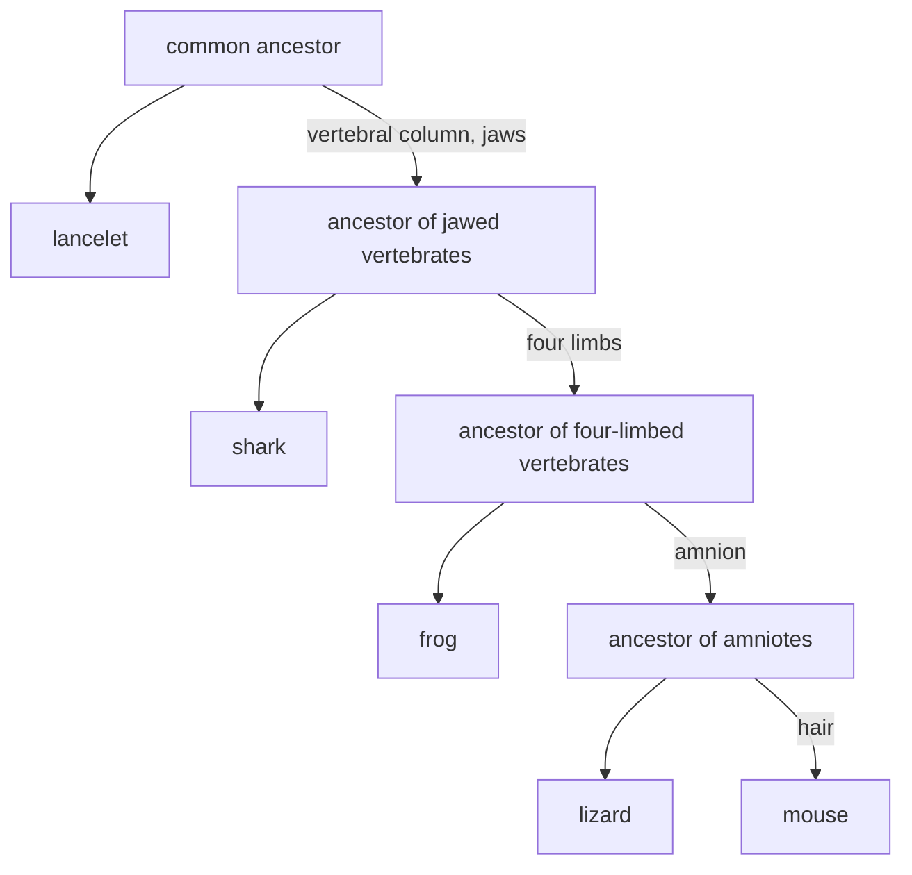

# F2 — Speciation: notes

These are English explanations of every learning outcome in [README.md](README.md), and every topic is *drafted*: written from the CCVX syllabus, the Dutch CvTE syllabus and standard VWO biology, not yet checked against an open source text or exam question.

- **In Dutch VWO:** central exam (CE).
- **Dutch source:** [CvTE syllabus biologie vwo 2027](https://www.examenblad.nl/2027/vwo/documenten/syllabus-biologie-vwo-2027) (version 2, July 2025), P4 *Soortvorming* (P4.1–P4.4). A citation like *(CvTE P4.2 spec 3)* means specification 3 of P4.2; its numbers don't match the CCVX numbers.

Dutch terms are in brackets. Binas tables are named, not numbered, because the numbers differ between editions.

## F2.1 Population

### 1. Population

- A population (*populatie*) is a group of individuals of one species (*soort*) that live in the same area at the same time and can interbreed, so they share one gene pool. An example is the great tits of the Hoge Veluwe National Park. *(CvTE P4.1 spec 1)*
- A species is a group of populations whose members can interbreed in nature and produce fertile offspring, and that is reproductively isolated from other such groups (more in F2.4.1).
- A species usually consists of several populations, separated by distance or barriers, with limited gene flow between them.
- For asexual organisms such as bacteria, and for fossils, the interbreeding criterion can't be used; there, species are told apart by shared characteristics and DNA.
- **Trap:** a population is not the same as a species: one species can have many populations, and these can differ in allele frequencies.

### 2. Frequencies change over time and space

- The frequency of an allele, genotype or phenotype is its share of the population, such as 0.3 or 30%. *(CvTE P4.1 spec 2)*
- Over time, frequencies change through mutation, natural selection, genetic drift, gene flow and non-random mating. Without these processes they would stay constant (Hardy-Weinberg, F2.2.3).
- A change over time: in the industrial areas of 19th-century England the dark form of the peppered moth (*Biston betularia*) became common on soot-blackened trees, where birds spotted it less easily. After clean-air laws in the 20th century, the light form became common again.
- A difference in space: the sickle-cell allele is much more common in regions with malaria, because heterozygotes are better protected against malaria. Lactase persistence is common in north-western Europe and rare in East Asia.
- In hospitals, the frequency of antibiotic-resistant bacteria rises where antibiotics are used a lot (see the specimen context).
- **Trap:** individuals don't evolve. A population evolves when its allele frequencies change over generations.

### 3. Emergent properties of populations

- An emergent property (*emergente eigenschap*) is a property of a whole that none of its parts has on its own. *(CvTE P4.1 spec 3)*
- A population has properties that no individual has: size and density, birth and death rates, age structure, sex ratio, growth curve, spatial distribution, and a gene pool with allele frequencies and genetic variation. An individual has a genotype, but only a population has an allele frequency.
- Collective behaviour is emergent too: a flock of starlings wheeling as one, or the division of labour in an ant colony, arises from simple interactions between individuals.

## F2.2 Variation

### 1. Genetic variation in a population

- Genetic variation (*genetische variatie*) in a population is the variety of alleles and genotypes among its members: how many alleles of each gene occur, how common each one is, and how many individuals are heterozygous. *(CvTE P4.2 spec 1)*
- The allele frequency (*allelfrequentie*) is the share of one allele among all copies of that gene in the population. For a gene with two alleles, A with frequency p and a with frequency q, p + q = 1.
- Variation comes from mutation and recombination ([F01](../F01-selection/README.md)) and from gene flow. It's the raw material for natural selection (F2.3).
- Low variation makes a population vulnerable. Cheetahs have very little genetic variation, probably after one or more bottlenecks. A crop grown as one clone can be wiped out by a single disease, as happened to the Gros Michel banana.
- Fitness (*fitness*) is an individual's or genotype's reproductive success compared with others: how many fertile offspring it adds to the next generation.
- Adaptation (*adaptatie*) is both the process by which a population becomes better suited to its environment through selection over generations, and the inherited trait that raises fitness there. Examples are the white winter fur of the arctic fox and the deep, strong beak of seed-cracking finches.
- Divergence (*divergentie*) is when populations or species with a common ancestor become more and more different. The forelimbs of mammals became arms, wings, flippers and legs, and Darwin's finches evolved different beaks on different islands.
- Convergence (*convergentie*) is when unrelated species become similar because they face similar selection pressures. Sharks (fish) and dolphins (mammals) have the same streamlined shape, and cacti in the Americas and some euphorbias in Africa both have spiny, water-storing stems.
- **Trap:** fitness is about leaving fertile offspring, not about being strong or healthy. A strong animal that never reproduces has a fitness of zero.

### 2. Random mutation, genetic drift and gene flow

- Random mutations (*willekeurige mutaties*) add new alleles, at first at a very low frequency. Mutation on its own changes allele frequencies only very slowly. *(CvTE P4.2 specs 1–2)*
- Genetic drift (*genetic drift*) is a random change in allele frequencies from one generation to the next, because chance decides which individuals reproduce and which alleles end up in the gametes.
- Drift is strongest in small populations. It can make an allele disappear, or make it the only one left (fixation), whether or not the allele is useful.
- Gene flow (*gene flow*) is the exchange of alleles between populations through migrating individuals or dispersed gametes, such as pollen carried by the wind. It makes populations more alike, can bring in new alleles, and works against divergence.
- Isolation (*isolatie*): once a barrier stops gene flow, the populations change independently (F2.4).
- The founder effect (*stichtereffect*) arises when a few individuals start a new population, for example on an island. Their alleles are a small random sample of the source population, so some rare alleles become common and others are lost.
- For example, the Old Order Amish of Pennsylvania descend from a small group of founders, and a rare hereditary syndrome with extra fingers and short stature (Ellis–van Creveld syndrome) is far more common among them than elsewhere.
- The bottleneck effect (*flessenhalseffect*) arises when a population shrinks drastically through a disaster or hunting. The survivors carry only part of the original variation, and the variation stays low even after the population grows again.
- For example, the northern elephant seal was hunted almost to extinction in the 19th century. Today there are well over 100 000 again, but with very little genetic variation.
- **Trap:** genetic drift and the founder and bottleneck effects are chance processes, not selection: the survivors or founders weren't necessarily better adapted.

### 3. The Hardy-Weinberg principle

- The Hardy-Weinberg principle (*regel van Hardy-Weinberg*) says that in an idealized population the allele frequencies p and q stay the same from generation to generation. The genotype frequencies then follow (p + q) × (p + q) = p² + 2pq + q² = 1, where p² is the frequency of AA, 2pq of Aa and q² of aa. *(CvTE P4.2 spec 3)*
- It holds only under five conditions:
  - a very large population, so there's no genetic drift;
  - random mating;
  - no mutation;
  - no migration, so no gene flow;
  - no selection: all genotypes survive and reproduce equally well.
- Real populations never meet all the conditions, so the principle works as a null model: a population that deviates from it is evolving or not mating at random. It also lets you calculate all genotype frequencies from one known frequency.
- Example 1, from the recessive phenotype to the carriers:
  - In a population, 1 in 2500 newborns has an autosomal recessive disorder, so q² = 1/2500. Then q = 1/50 = 0.02 and p = 0.98.
  - The carrier frequency is 2pq = 2 × 0.98 × 0.02 = 0.0392: about 1 in 26 people (3.9%).
  - The chance that a healthy person from this population is a carrier is 2pq / (1 − q²) ≈ 0.039. A known carrier who has a child with such a person has a 0.039 × 1/4 ≈ 0.0098 chance (about 1 in 102) of an affected child. The pedigree side of this is in [E03](../../E-reproduction/E03-reproduction-of-organisms/README.md).
- Example 2, from genotype counts to allele frequencies and the next generation:
  - A population of 1000 plants has 420 AA, 360 Aa and 220 aa. Each plant has two copies of the gene, so there are 2000 copies in total.
  - p = (2 × 420 + 360) / 2000 = 0.6 and q = 0.4.
  - Hardy-Weinberg expects 0.36 × 1000 = 360 AA, 0.48 × 1000 = 480 Aa and 0.16 × 1000 = 160 aa. The observed 360 heterozygotes are fewer than the expected 480, which points to, for example, inbreeding.
  - After one generation of random mating with all conditions met, 1000 offspring are expected to be 360 AA, 480 Aa and 160 aa, and p is still 0.6.
- Example 3, an X-linked trait: men have one X, so for an X-linked recessive trait the frequency among men equals q. Suppose 8% of men are red–green colour-blind. Then q = 0.08, the expected frequency among women is q² = 0.0064 (0.64%), and 2pq ≈ 0.147 (about 15%) of women are carriers.
- **Trap:** p² is the frequency of the homozygous dominant genotype, not of the dominant phenotype (that is p² + 2pq). Always start from the recessive phenotype, because q² is the only genotype frequency you can observe directly.

## F2.3 Selection

### 1. Adaptation through selection

- Natural selection (*natuurlijke selectie*) was proposed by Darwin and Wallace in 1858, and explained at length in Darwin's *On the Origin of Species* (1859). It follows from a few facts. *(CvTE P4.3 spec 1)*
  - Individuals vary in heritable traits.
  - More offspring are born than can survive, and they compete for limited resources.
  - Individuals whose traits suit the environment survive and reproduce more: they have a higher fitness.
  - So their alleles become more common in the next generation, and over many generations the population adapts.
- For example, after a drought in 1977 on the Galápagos island Daphne Major, mainly large, hard seeds were left. Medium ground finches with deeper beaks could crack them and survived more often, and the next generation had deeper beaks on average.
- Selection comes in three types. Directional selection favours one extreme, as with antibiotic resistance. Stabilizing selection favours the average, as with human birth weight: very small and very large babies used to survive less often. Disruptive selection favours both extremes, for example when only very small and very large seeds are available.
- **Trap:** individuals don't adapt genetically during their lives. Selection acts on phenotypes, but what changes is the frequency of alleles in the population over generations.

### 2. Selection pressure and reproductive success

- A selection pressure (*selectiedruk*) is an environmental factor that makes individuals with certain traits more or less likely to survive and reproduce: predators, climate, food supply, parasites and diseases, competitors, antibiotics or pesticides, and mates. The stronger the pressure, the faster allele frequencies change. *(CvTE P4.3 spec 2)*
- Over generations, a selection pressure brings together the traits that raise reproductive success (*voortplantingssucces*), and that is how adaptations arise. Examples are insects resistant to an insecticide after years of spraying, weeds resistant to a herbicide, and malaria parasites resistant to chloroquine.
- CCVX speaks of the "reproductive success of the species". Strictly, selection works on individuals (and their alleles), and the population as a whole becomes better adapted as a result.
- Island theory probably means the theory of island biogeography (MacArthur and Wilson, 1967). The number of species on an island settles at a balance between the arrival of new species and extinction, so larger islands, and islands closer to the mainland, hold more species. The same idea applies to "habitat islands", such as nature reserves surrounded by farmland ([F03](../F03-biodiversity/README.md)).
- Islands matter for selection and speciation too. Island populations are small and isolated, often started by a few founders (founder effect, F2.2.2), and they face their own selection pressures, so they diverge quickly, as Darwin's finches did on the Galápagos.
- Some island animals evolve unusual body sizes: dwarf elephants, now extinct, lived on several Mediterranean islands.
- **Trap:** the environment doesn't create adaptations; it only selects among variation that already exists.

### 3. Natural, artificial and sexual selection

- In artificial selection (*kunstmatige selectie*), humans decide which individuals reproduce, as in plant breeding (*veredeling*) and animal breeding (*fokken*). *(CvTE P4.3 spec 3)*
- Natural and artificial selection have a lot in common. Both act on existing heritable variation and change allele frequencies over generations, and both can produce large changes: kale, cabbage, cauliflower, broccoli, Brussels sprouts and kohlrabi were all bred from one wild cabbage species, and all dog breeds descend from wolves.
- They also differ:
  - In artificial selection the selecting agent is humans, not the environment.
  - The favoured traits are useful or attractive to humans, not necessarily good for fitness; some even lower fitness, like the breathing problems of very flat-faced dog breeds.
  - Artificial selection is usually faster, because selection is strong and mating is controlled.
- Breeders often use inbreeding (*inteelt*) to fix desired traits in pure lines, at the cost of lower variation and inbreeding depression. Crossing two different inbred lines gives vigorous F1 hybrids (heterosis), which is how much maize seed is produced.
- Sexual selection (*seksuele selectie*) is selection through success in getting mates. It works through mate choice, as when peahens prefer males with large, colourful tails, and through competition within one sex, as when red deer stags fight with their antlers. Such traits can lower survival but raise reproductive success, and they often make the two sexes look different.
- **Trap:** artificial selection doesn't create new alleles; breeders can only select from the variation that mutation and recombination have produced.

## F2.4 Speciation

### 1. Species and reproductive isolation

- A species is a group of individuals that can interbreed in nature and produce fertile offspring, and that is reproductively isolated (*reproductieve isolatie*) from other species. *(CvTE P4.4 spec 1)*
- Prezygotic isolation prevents fertilization. Species may use different habitats, breed or flower at different times, have different courtship (songs, dances, light signals), have genitals or flowers that don't fit, or have gametes that don't recognize each other; the last matters for animals like sea urchins, which release eggs and sperm into the water.
- Postzygotic isolation acts after fertilization: the hybrid dies early, is sterile, or has weak offspring.
- A mule (*muildier*) is a sterile hybrid of a horse (2n = 64) and a donkey (2n = 62). It gets 32 + 31 = 63 chromosomes, which can't pair properly in meiosis. So horse and donkey are separate species.
- In the README's list, "sex" is a mistranslation of the Dutch *geslacht*, which means both "sex" and, in taxonomy, "genus"; the Dutch syllabus lists *geslacht (genus)*.
- A genus is a group of closely related species, and its name is the first part of a scientific name. *Panthera leo* (lion) and *Panthera tigris* (tiger) both belong to the genus *Panthera*; humans are *Homo sapiens*.
- The classification levels, from broad to narrow, are domain, kingdom (*rijk*), phylum (*stam*; in plants, division, *afdeling*), class (*klasse*), order (*orde*), family (*familie*), genus (*geslacht*) and species (*soort*). See the Binas table on the classification of organisms.
- **Trap:** producing offspring isn't enough to make two animals one species; the offspring must be fertile, and a mule isn't. And in F2.4, "sex" means genus.

### 2. Populations diverge

- When gene flow between two populations stops, each population changes on its own: different mutations arise in each, genetic drift shifts allele frequencies differently, and different selection pressures favour different traits. The populations diverge. *(CvTE P4.2 spec 1; P4.4 spec 1)*
- Over many generations the differences pile up, in genes, body structure, behaviour or the timing of reproduction. Eventually members of the two populations can no longer interbreed, even if they meet again: they have become separate species.
- One ancestral species can diverge into many species that each fill a different niche (adaptive radiation). Darwin's finches on the Galápagos have beaks for seeds, for insects or for cactus flowers, and hundreds of cichlid fish species live in Lake Victoria.
- **Trap:** divergence needs separate, or nearly separate, gene pools. As long as there's a lot of gene flow, the populations stay alike.

### 3. Speciation through reproductive isolation

- Speciation (*soortvorming*) is the formation of new species; it's complete once reproductive isolation is complete. *(CvTE P4.4 spec 1)*
- In allopatric speciation (*allopatrische soortvorming*), a geographic barrier, such as a sea, a mountain range, a river or a wide desert, splits a population. Without gene flow the parts diverge until they're reproductively isolated. Finches that reached different Galápagos islands are an example.
- In sympatric speciation (*sympatrische soortvorming*), a new species arises in the same area, without a geographic barrier. Two routes:
  - Polyploidy, common in plants. A tetraploid plant (4n) crossed with its diploid parent (2n) gives triploid offspring (3n), which are sterile, so the tetraploid is reproductively isolated at once. For example, a diploid with 2n = 14 makes gametes with 7 chromosomes and a tetraploid with 4n = 28 makes gametes with 14, so their hybrid gets 21 chromosomes: three sets, which meiosis can't divide evenly. Bread wheat arose through hybridization and polyploidy.
  - Different preferences within one area. In North America the apple maggot fly (*Rhagoletis pomonella*) is splitting into a form living on apples and a form living on hawthorn, because the flies mate on the kind of fruit they grew up in. In Lake Victoria, female cichlids choosing mates by colour helps split populations.
- Coevolution (*co-evolutie*) is when two species evolve in response to each other, because each is a selection pressure for the other:
  - Flowers and pollinators: Darwin predicted that a Madagascan orchid with a nectar spur about 30 cm long had to be pollinated by a moth with an equally long tongue, and such a hawk moth was found decades later.
  - Parasites and hosts: after the myxoma virus was released in Australia to control rabbits, the virus became less deadly and the rabbits more resistant.
  - Predators and prey, which select each other for speed, camouflage or defences.
- **Trap:** geographic isolation is not yet reproductive isolation. Two separated populations are still one species as long as they could interbreed when they meet again.

### 4. Kinship and descent in a cladogram

- A cladogram (*cladogram*) is a branching diagram of kinship (*verwantschap*) and descent (*afstamming*). Each branching point (node) stands for the most recent common ancestor of everything beyond it. Only the branching order counts: in a cladogram the branch lengths don't show time. A phylogenetic tree (*stamboom*) may also show time or the amount of change along its branches. *(CvTE P4.4 spec 2)*
- A clade (*clade*) is an ancestor together with all its descendants: everything you can cut off the tree with a single cut. Mammals form a clade. Birds belong to the dinosaur clade, so "reptiles" without birds is not a clade.
- A taxon (*taxon*, plural taxa) is any named group in classification, at any level: the species *Homo sapiens*, the genus *Panthera*, the class of mammals. Modern classification aims to make every taxon a clade.
- Cladograms are built from shared derived characteristics (features that a group's ancestor gained and passed on to all its descendants) or from DNA and protein differences ([F01](../F01-selection/README.md)).
- A worked example, with the lancelet as outgroup because it lacks all five features:

| Taxon | vertebral column | jaws | four limbs | amnion | hair |
|---|---|---|---|---|---|
| lancelet | no | no | no | no | no |
| shark | yes | yes | no | no | no |
| frog | yes | yes | yes | no | no |
| lizard | yes | yes | yes | yes | no |
| mouse | yes | yes | yes | yes | yes |

- Each feature defines a group, and the groups are nested: vertebral column and jaws (shark, frog, lizard, mouse), then four limbs (frog, lizard, mouse), then the amnion, the membrane around the embryo (lizard, mouse), then hair (mouse). So lizard and mouse are each other's closest relatives, sharing four derived features; the frog is next, then the shark:

- Homology (*homologie*) means structures with the same evolutionary origin and the same basic build, whatever their function. The arm of a human, the wing of a bat, the flipper of a whale and the leg of a horse all have the same bones (one upper-arm bone, two forearm bones, wrist bones, hand bones and finger bones): the result of divergent evolution. *(CvTE P4.3 spec 2)*
- Analogy (*analogie*) means structures with the same function but a different origin and build, the result of convergent evolution: the wings of insects and of birds, or the camera eyes of octopuses and of vertebrates.
- Only homologous features say something about kinship; analogous features mislead.
- (Radioactive) isotopes (*(radioactieve) isotoop*) are used to date fossils and rocks. Dates show when branches appear in the fossil record and calibrate molecular clocks.
- A radioactive isotope decays at a fixed rate, set by its half-life (*halveringstijd*); carbon-14 has a half-life of about 5730 years. A living organism takes in ¹⁴C (through CO₂ or food) in the same ratio to ¹²C as in the atmosphere, and after death its ¹⁴C decays.
- So a bone with 25% of its original ¹⁴C is two half-lives old: about 2 × 5730 = 11 460 years. After about 50 000 years less than 0.3% is left, so older material is dated with other isotopes, such as potassium-40 (half-life about 1.25 billion years) in volcanic rock.
- **Trap:** branches can rotate around a node without changing a cladogram's meaning, so taxa that stand side by side aren't necessarily the closest relatives. Read kinship from the most recent shared node.

## Specimen contexts

- Health (hospital bacteriologist studying resistant bacteria): where antibiotics are used, sensitive bacteria die, while rare resistant mutants, or bacteria that picked up a resistance plasmid by horizontal gene transfer, survive and multiply. The frequency of resistance in the population rises: natural selection, with the antibiotic as selection pressure. Infection prevention tries to stop the spread (hygiene, isolating carriers) and to lower the selection pressure (antibiotics only when needed); the Netherlands is known for its strict "search and destroy" policy against MRSA. Uses F2.1.2, F2.2.2 and F2.3.1–2.
- World view (evolutionary biologists at Naturalis): they compare characteristics of plants and their DNA or RNA sequences, choose homologous features, and count shared derived features or sequence differences. From these they build phylogenetic trees, which the README calls "phylogenetic pedigrees" (*stambomen*), showing kinship and descent. Uses F2.4.4 and [F01](../F01-selection/README.md) (kinship from DNA).

## CCVX versus the Dutch syllabus

- **In both:** population and species, changing genotype and phenotype frequencies, emergent properties, genetic variation, adaptation, fitness, genetic drift, gene flow, allele frequency, founder and bottleneck effects, the Hardy-Weinberg principle, natural, artificial and sexual selection, selection pressure, homology and analogy, reproductive isolation, coevolution, sympatric and allopatric speciation, cladogram and clade, and genus (CCVX's "sex").
- **Dutch syllabus only:** divergence and convergence (P4.2 spec 1), isolation (P4.2 spec 2), reproductive success (*voortplantingssucces*, P4.3 spec 2), plant and animal breeding (*veredeling*, *fokken*) and inbreeding (P4.3 spec 3), and (radioactive) isotopes for dating (P4.4 spec 2). The notes cover all of them.
- **CCVX only:** island theory and taxon. CCVX also lists homology and analogy under speciation (F2.4), where the Dutch syllabus has them under selection (P4.3 spec 2).
