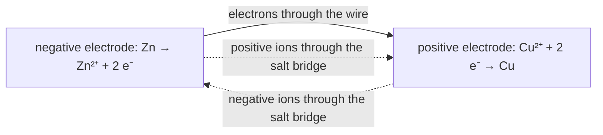

# C1 — Chemical Processes: notes

These are English explanations of every learning outcome in [README.md](README.md), and every topic is *drafted*: written from the CCVX and CvTE syllabi and standard VWO chemistry, not yet checked against an open source text or exam question (see [PLAN.md](../../PLAN.md) for the statuses).

Dutch terms are in brackets. A code such as *(CvTE M1.4)* points to the matching specification in the [CvTE 2027 syllabus](../../syllabus/cvte-syllabus-scheikunde-vwo-2027.pdf); Binas tables are named by subject, because their numbers differ between editions.

## C1.1 Dissolving molecular substances and salts

- Dissolving (*oplossen*) in water breaks the bonds between the particles of the substance and some of the hydrogen bridges (hydrogen bonds, *waterstofbruggen*) between water molecules, and forms new bonds between the particles and water molecules. When a substance only dissolves, the atomic bonds (covalent bonds, *atoombindingen*) inside its molecules and inside composite ions such as SO₄²⁻ stay intact; acids and some bases also react with water (C1.2). *(CvTE M3.9)*

### Molecular substances

- The Van der Waals bonds (molecular bonds, *vanderwaalsbindingen, molecuulbindingen*) between the molecules break, and so do the hydrogen bridges between them if the molecules have OH or NH groups. New hydrogen bridges and Van der Waals bonds form between the dissolved molecules and water molecules. Glucose: C₆H₁₂O₆(s) → C₆H₁₂O₆(aq). *(CvTE M3.1, M3.9)*
- Molecules that can form hydrogen bridges with water, such as small molecules with OH or NH₂ groups, are hydrophilic (*hydrofiel*) and dissolve well. Apolar molecules such as hexane form only weak Van der Waals bonds with water, which don't make up for the hydrogen bridges between water molecules that would have to break, so they hardly dissolve: they are hydrophobic (*hydrofoob*). More in [B03](../../B-substances-and-materials/B03-bonds-and-properties/notes.md). *(CvTE M3.6, M3.7)*

### Salts

- The ion bonds (*ionbindingen*) in the ionic lattice break, and ion-dipole bonds (*ion-dipoolbindingen*) form between the ions and water molecules. A water molecule is a dipole: it turns its partially negative O atom towards a positive ion and its partially positive H atoms towards a negative ion. An ion surrounded by water molecules in this way is hydrated; the process is hydration (*hydratatie*), and (aq) shows it. NaCl(s) → Na⁺(aq) + Cl⁻(aq). *(CvTE M3.1, M3.9)*
- **Trap:** a salt solution contains separate hydrated ions and no NaCl units, so write it as Na⁺(aq) + Cl⁻(aq), not NaCl(aq).
- **Trap:** ions bind to water by ion-dipole bonds, molecules by hydrogen bridges or Van der Waals bonds; the bond between Na⁺ and water is not a hydrogen bridge.

## C1.2 Dissolving and ionising acids and bases

- An acid (*zuur*) is a particle that can give off an H⁺ ion, a proton: a proton donor. A base (*base*) is a particle that can take up an H⁺ ion: a proton acceptor. Recognise the acids HCl, H₂SO₄, HNO₃, H₂O + CO₂ ('H₂CO₃'), H₃PO₄ and CH₃COOH and the bases NH₃, OH⁻, CO₃²⁻, O²⁻ and HCO₃⁻ ([B01](../../B-substances-and-materials/B01-particle-models/notes.md)). *(CvTE R1.5, R1.6)*

### Acids

- Pure acids such as HCl(g) and CH₃COOH(l) are molecular substances. Ions only form when the acid reacts with water (*ioniseren*). *(CvTE M3.9)*
- Hydrogen chloride: HCl(g) + H₂O(l) → H₃O⁺(aq) + Cl⁻(aq). The H–Cl atomic bond breaks, and its electron pair stays with Cl, which becomes Cl⁻. The H⁺ binds to a lone pair (*vrij elektronenpaar*) on the O atom of a water molecule: a new O–H atomic bond forms, giving the oxonium ion (*oxoniumion*) H₃O⁺. Both ions are then hydrated by ion-dipole bonds. The solution is hydrochloric acid (*zoutzuur*), H₃O⁺(aq) + Cl⁻(aq). *(CvTE M3.9, R1.4, R1.7)*
- In ethanoic acid (acetic acid, *azijnzuur*) only a small fraction of the molecules reacts: CH₃COOH(aq) + H₂O(l) ⇌ CH₃COO⁻(aq) + H₃O⁺(aq). In those molecules the O–H bond of the carboxyl group breaks; the rest stay intact, bound to water by hydrogen bridges. Carbon dioxide in water acts as the acid 'H₂CO₃' in the same way: CO₂(aq) + 2 H₂O(l) ⇌ H₃O⁺(aq) + HCO₃⁻(aq). *(CvTE M3.9, R1.5)*

### Bases

- Ammonia (*ammoniak*, NH₃) dissolves well through hydrogen bridges with water, and a small part reacts as a base: NH₃(aq) + H₂O(l) ⇌ NH₄⁺(aq) + OH⁻(aq). An O–H bond of a water molecule breaks, and a new N–H bond forms with the lone pair of N. The solution of NH₃ in water is what the Dutch call *ammonia*, written NH₃(aq). *(CvTE M3.9, R1.4)*
- Dissolving sodium hydroxide is just a salt dissolving: NaOH(s) → Na⁺(aq) + OH⁻(aq). Ion bonds break and ion-dipole bonds form, and no proton moves. The solution is caustic soda (*natronloog*), Na⁺(aq) + OH⁻(aq). *(CvTE M3.9, R1.4)*
- A carbonate dissolves the same way, Na₂CO₃(s) → 2 Na⁺(aq) + CO₃²⁻(aq), and then the carbonate ion partly reacts as a weak base: CO₃²⁻(aq) + H₂O(l) ⇌ HCO₃⁻(aq) + OH⁻(aq). *(CvTE M3.9, R1.6)*
- The oxide ion is a strong base and reacts completely with water: O²⁻ + H₂O → 2 OH⁻. So sodium oxide gives caustic soda: Na₂O(s) + H₂O(l) → 2 Na⁺(aq) + 2 OH⁻(aq). *(CvTE R1.6)*
- **Trap:** hydrochloric acid contains no HCl molecules: write H₃O⁺(aq) + Cl⁻(aq), not HCl(aq). You may write H⁺ instead of H₃O⁺, as the CvTE syllabus does. *(CvTE R1.4, R&A1.4)*

## C1.3 Phase changes

- In a phase change (*fase-overgang*) only the bonds between the particles change; the particles themselves stay the same, so it isn't a chemical reaction. *(CvTE M1.3, M3.4)*
- Melting (*smelten*): part of the bonds between the particles break. The lattice falls apart, and the particles can move past each other but still attract each other. Solidification (*stollen*) is the reverse: these bonds form again and a lattice forms. *(CvTE M3.4)*
- Evaporation (*verdampen*): the remaining bonds between the particles break, so in the gas the particles move freely and far apart. Condensation (*condenseren*) is the reverse. *(CvTE M3.4)*
- The kind of bond depends on the substance. *(CvTE M3.1, M3.2, M3.4)*
    - Molecular substances: Van der Waals bonds, plus dipole-dipole bonds (*dipool-dipoolbindingen*) and hydrogen bridges where the molecules form them, but never the atomic bonds inside the molecules. When ice melts and water evaporates, hydrogen bridges and Van der Waals bonds between H₂O molecules break.
    - Salts: ion bonds. Metals: metallic bonds (*metaalbindingen*).
    - An atomic lattice (*atoomrooster*) such as quartz, SiO₂, is the exception: melting it breaks atomic bonds, which is why its melting point is so high.
- Breaking bonds costs energy, so melting and evaporation are endothermic, and solidification and condensation exothermic. The stronger the bonds between the particles, the higher the melting and boiling points ([B03](../../B-substances-and-materials/B03-bonds-and-properties/notes.md)). *(CvTE M3.3, R5.1)*
- **Trap:** the bubbles in boiling water are water vapour, H₂O(g), not hydrogen and oxygen: no O–H atomic bonds break.
- **Trap:** condensation as a phase change (*condenseren*) has nothing to do with a condensation reaction (*condensatiereactie*, C1.16), in which two molecules join and split off water.

## C1.4 Equations for dissolving and phase changes

- A phase change keeps the formula and changes only the state symbol (*toestandsaanduiding*): melting H₂O(s) → H₂O(l), evaporation H₂O(l) → H₂O(g), condensation H₂O(g) → H₂O(l), solidification H₂O(l) → H₂O(s). *(CvTE M1.3, M3.4)*
- A molecular substance that only dissolves keeps its formula: C₆H₁₂O₆(s) → C₆H₁₂O₆(aq), C₂H₅OH(l) → C₂H₅OH(aq). *(CvTE M3.9)*
- A salt splits into its hydrated ions. Water isn't written as a reactant, because it only surrounds the ions, which (aq) shows. Composite ions stay together, and the coefficients follow from the charges. *(CvTE R1.2, M3.9)*
    - CaCl₂(s) → Ca²⁺(aq) + 2 Cl⁻(aq)
    - (NH₄)₂SO₄(s) → 2 NH₄⁺(aq) + SO₄²⁻(aq)
    - Al₂(SO₄)₃(s) → 2 Al³⁺(aq) + 3 SO₄²⁻(aq), where 2 × 3+ balances 3 × 2−
    - A hydrate also releases its crystal water (*kristalwater*): CuSO₄·5H₂O(s) → Cu²⁺(aq) + SO₄²⁻(aq) + 5 H₂O(l) *(CvTE M1.11)*
- Acids, ammonia and oxides react with water, so H₂O(l) is a reactant: HNO₃(l) + H₂O(l) → H₃O⁺(aq) + NO₃⁻(aq), and the equations in C1.2. *(CvTE R1.2, R1.7)*
- Give the notation from the name and back: hydrochloric acid (*zoutzuur*) is H₃O⁺(aq) + Cl⁻(aq), caustic soda (*natronloog*) Na⁺(aq) + OH⁻(aq), and ammonia (*ammonia*) NH₃(aq). *(CvTE R1.4)*
- Check every equation with an element balance (*elementbalans*: the same number of atoms of each element on both sides) and a charge balance (*ladingsbalans*: the same total charge on both sides); the conservation laws are in [C03](../C03-conservation-laws-and-cycles/notes.md). Change only the coefficients (*coëfficiënten*), never the indices (*indices*) in a formula. *(CvTE R1.1, M1.3)*
- **Trap:** two chloride ions are 2 Cl⁻, not Cl₂⁻; Cl₂ is chlorine.
- **Trap:** writing H₂O as a reactant for a salt that only dissolves, or leaving out the crystal water of a hydrate, makes the equation unbalanced.

## C1.5 Bonds in distillation and adsorption

- The Dutch syllabus dropped this outcome, but CCVX still lists it. The principle of separation is now in R&A2.1–R&A2.2, and the techniques themselves are in [D01](../../D-development-of-chemical-knowledge/D01-chemical-techniques/notes.md). *(CvTE R&A2.1, R&A2.2)*

### Distillation

- Distillation (*destilleren*) separates liquids by boiling point (*kookpunt*). On heating, the bonds between the molecules break (evaporation) most easily in the substance with the weakest bonds between its molecules, so that substance evaporates most. In the condenser (*koeler*) the bonds between its molecules form again (condensation), and the liquid collected is the distillate (*destillaat*); what stays behind is the residue (*residu*). *(CvTE R&A2.1, R&A2.2, M3.3)*
- No atomic bonds break, so the distillate consists of the same molecules as the mixture. *(CvTE M3.4)*
- Example: in a mixture of ethanol (boiling point about 78 °C) and water (100 °C), the bonds between ethanol molecules are weaker overall, so the first distillate is richer in ethanol. *(CvTE M3.3)*

### Adsorption

- In adsorption (*adsorberen*) particles stick to the surface of a solid by forming bonds with it. Activated carbon (*actieve kool*) is porous, with a very large surface area, and mostly apolar, so it binds particles mainly by Van der Waals bonds. *(CvTE M3.8, R&A2.1)*
- The particles that bind most strongly to the surface are held back; the rest stay in the liquid or gas. On activated carbon, large and apolar molecules (many colourings, smells and organic pollutants) adsorb well, because they form many Van der Waals bonds with the surface. Water, small polar molecules and ions adsorb poorly, because they stay bound to water by hydrogen bridges or ion-dipole bonds; a particle adsorbed from a solution first has to break those bonds with the solvent. The carbon is then filtered off. *(CvTE M3.8)*
- Activated carbon purifies drinking water, decolourises solutions and removes smells in cooker hoods and gas masks. In chromatography the balance between adsorbing to the stationary phase and dissolving in the mobile phase separates the substances ([D01](../../D-development-of-chemical-knowledge/D01-chemical-techniques/notes.md)). *(CvTE R&A2.1)*
- **Trap:** adsorption is sticking to a surface; absorption is taking a substance up into the whole material, as a sponge does.

## C1.6 Combustion and other reaction equations

### Complete combustion

- In a complete combustion (*volledige verbranding*) of a compound of carbon, hydrogen and possibly oxygen, all C atoms end up in CO₂ and all H atoms in H₂O; the other reactant is O₂. *(CvTE R1.2, R1.3)*
- Balance C first (the coefficient of CO₂), then H (the coefficient of H₂O is half the number of H atoms), then O: count the O atoms on the right, subtract the O atoms in the fuel and halve the rest to get the coefficient of O₂. If that gives a half, multiply everything by 2. *(CvTE R1.1, R1.2)*
    - methane: CH₄ + 2 O₂ → CO₂ + 2 H₂O
    - propane: C₃H₈ + 5 O₂ → 3 CO₂ + 4 H₂O
    - ethanol: C₂H₅OH + 3 O₂ → 2 CO₂ + 3 H₂O (the right side has 7 O atoms and ethanol supplies 1, so 3 O₂)
    - glucose: C₆H₁₂O₆ + 6 O₂ → 6 CO₂ + 6 H₂O
    - octane: 8 CO₂ and 9 H₂O contain 25 O atoms, so one C₈H₁₈ needs 12½ O₂; doubling gives 2 C₈H₁₈ + 25 O₂ → 16 CO₂ + 18 H₂O
- With too little oxygen, combustion is incomplete (*onvolledige verbranding*) and also gives CO or soot (C): 2 CH₄ + 3 O₂ → 2 CO + 4 H₂O. If a question says complete combustion, the only products are CO₂ and H₂O. *(CvTE R1.3)*
- **Trap:** the O atoms inside the fuel (ethanol, glucose) lower the amount of O₂ needed; forgetting them is the usual mistake.

### Other processes

- When the reactants and products are given, write their formulas first (names in [B01](../../B-substances-and-materials/B01-particle-models/notes.md)), then balance with coefficients and check the element and charge balance. *(CvTE R1.1, R1.2)*
    - thermolysis of limestone: CaCO₃(s) → CaO(s) + CO₂(g)
    - photosynthesis: 6 CO₂ + 6 H₂O → C₆H₁₂O₆ + 6 O₂
- The Dutch syllabus also asks for equations in which one reactant or product isn't given: find it from the atoms left over. "Iron(III) oxide reacts with carbon monoxide to form iron and a gas": the O atoms leaving Fe₂O₃ have to end up with C, so the gas is CO₂, and Fe₂O₃ + 3 CO → 2 Fe + 3 CO₂. *(CvTE R1.2)*
- The coefficients give the mole ratio for calculations ([C02](../C02-chemical-calculations/notes.md)). *(CvTE R&A1.1)*
- **Trap:** H₂, N₂, O₂ and the halogens (F₂, Cl₂, Br₂, I₂) are diatomic; and never balance by changing a formula.

## C1.7 Donor-acceptor reactions

- In a donor-acceptor reaction (*donor-acceptorreactie*) one particle, the donor, passes a particle to another, the acceptor. Classifying reaction types in general is in [C07](../C07-classification-of-reactions/notes.md). *(CvTE R1.3)*

### Acid-base reactions: proton transfer

- In an acid-base reaction (*zuur-basereactie*) an H⁺ ion moves from the acid (proton donor) to the base (proton acceptor). Example: NH₃ + H₃O⁺ → NH₄⁺ + H₂O; the donor is H₃O⁺ and the acceptor NH₃. *(CvTE R1.3)*
- An acid that has given off H⁺ has become its conjugate base (*geconjugeerde base*), and a base that has taken up H⁺ its conjugate acid: CH₃COOH/CH₃COO⁻, NH₄⁺/NH₃, H₃O⁺/H₂O and H₂O/OH⁻ are conjugate acid-base pairs. A particle that can act as both, such as H₂O or HCO₃⁻, is an ampholyte (*amfolyt*). *(CvTE R1.3)*

### Redox reactions: electron transfer

- In a redox reaction (*redoxreactie*) electrons move from the reductor (reducing agent, *reductor*: the electron donor) to the oxidator (oxidizing agent, *oxidator*: the electron acceptor). The reductor is oxidised, the oxidator is reduced. *(CvTE R1.3, R1.11)*
- Zinc in copper(II) sulfate solution: Zn(s) + Cu²⁺(aq) → Zn²⁺(aq) + Cu(s). Zn gives off two electrons, Zn → Zn²⁺ + 2 e⁻, so Zn is the reductor; Cu²⁺ takes them up, Cu²⁺ + 2 e⁻ → Cu, so Cu²⁺ is the oxidator. The SO₄²⁻ ions don't take part: they are spectator ions (*tribune-ionen*). *(CvTE R1.11)*
- Magnesium in hydrochloric acid: Mg(s) + 2 H₃O⁺(aq) → Mg²⁺(aq) + H₂(g) + 2 H₂O(l). Mg is the reductor, Mg → Mg²⁺ + 2 e⁻, and H₃O⁺ the oxidator, 2 H₃O⁺ + 2 e⁻ → H₂ + 2 H₂O. So an acid can also react as an oxidator, and this is a redox reaction, not an acid-base reaction. *(CvTE R1.11)*
- To tell them apart, try to split the reaction into two half-reactions with electrons (C1.14): if that works, it's a redox reaction; if only an H⁺ moves from one particle to another, it's an acid-base reaction. Oxidators and reductors are listed in the Binas table of standard electrode potentials, acids and bases in the Binas table of acid and base constants. *(CvTE R1.3, R1.11)*
- **Trap:** the oxidator and reductor are particles, not substances: in zinc plus copper(II) sulfate solution the oxidator is Cu²⁺, not CuSO₄.

## C1.8 Electrochemical cells

- An electrochemical cell (*elektrochemische cel*) gets electrical energy from a redox reaction by keeping the reductor and the oxidator apart, so the electrons have to travel through an external connection (*externe verbinding*: a wire with a lamp or a motor). That flow of electrons is the electric current. A battery (*batterij*) consists of one or more such cells. *(CvTE R1.14)*
- The cell has two half-cells (*halfcellen*), each an electrode in contact with an electrolyte (*elektrolyt*: a solution or paste that contains ions). *(CvTE R1.14)*
- The reductor reacts at the negative electrode (*negatieve elektrode*), where it gives off electrons; the oxidator reacts at the positive electrode (*positieve elektrode*), where it takes them up. Electrons flow through the external circuit from the negative to the positive electrode (electron transport, *elektronentransport*). *(CvTE R1.14)*
- Inside the cell the charge is carried by ions (ion transport, *ionentransport*). A salt bridge (*zoutbrug*, a tube with a salt solution) or a membrane (*membraan*) joins the two electrolytes: it lets ions through but keeps the oxidator away from the reductor. Positive ions move towards the positive electrode and negative ions towards the negative electrode, so each half-cell stays electrically neutral. *(CvTE R1.14)*
- Daniell cell: a zinc electrode in a solution with Zn²⁺ and a copper electrode in a solution with Cu²⁺, joined by a salt bridge. Negative electrode: Zn → Zn²⁺ + 2 e⁻. Positive electrode: Cu²⁺ + 2 e⁻ → Cu. Total: Zn + Cu²⁺ → Zn²⁺ + Cu. *(CvTE R1.14)*



- The cell voltage (*bronspanning*) under standard conditions is ΔV = V₀(oxidator) − V₀(reductor), with both values from the Binas table of standard electrode potentials. For the Daniell cell: 0.34 − (−0.76) = 1.10 V. *(CvTE R1.10, R1.14)*
- The current (*stroomsterkte*, in ampere) is the charge that passes per second, so it shows how fast the electrode reactions run. *(CvTE R1.14)*
- A battery is empty when its reductor or oxidator is used up. A fuel cell (*brandstofcel*) is supplied continuously with fuel (the reductor, such as H₂ or methanol) and oxygen, so it keeps working; its half-reactions are in C1.14. Rechargeable batteries are in C1.9, and the sustainability of batteries and fuel cells in [F03](../../F-industrial-chemical-processes/F03-energy-conversion/notes.md). *(CvTE R1.14)*
- **Trap:** electrons never go through the electrolyte or the salt bridge, and ions never go through the wire.
- **Trap:** English books call the electrode where oxidation happens the anode and the one where reduction happens the cathode, so the anode is the negative electrode in a battery but the positive electrode in electrolysis. Dutch and CCVX questions say positive and negative electrode; reason with those.

## C1.9 Electrolysis

- Electrolysis (*elektrolyse*) is a redox reaction that doesn't run by itself and is forced by a direct-current source (*gelijkspanningsbron*): electrical energy is turned into chemical energy. When one substance is split up, as water into hydrogen and oxygen, it's a decomposition reaction (*ontledingsreactie*), like thermolysis and photolysis ([C07](../C07-classification-of-reactions/notes.md)). *(CvTE R1.3, T6.5)*
- The source pushes electrons into the negative electrode, where the strongest oxidator present takes them up: reduction at the negative electrode. It pulls electrons out of the positive electrode, where the strongest reductor present gives them off: oxidation at the positive electrode. *(CvTE R1.14)*
- Consider every particle present, including water, and at the positive electrode the electrode metal itself unless it's inert, like platinum or carbon (graphite). The strongest oxidator has the highest V₀ and the strongest reductor the lowest (C1.13). *(CvTE R1.10)*
- Example: a copper(II) sulfate solution with carbon electrodes. At the negative electrode Cu²⁺ (+0.34 V) is a stronger oxidator than water (−0.83 V): Cu²⁺ + 2 e⁻ → Cu. At the positive electrode water is the strongest reductor (sulfate ions are a far weaker one): 2 H₂O → O₂ + 4 H⁺ + 4 e⁻. Total: 2 Cu²⁺ + 2 H₂O → 2 Cu + O₂ + 4 H⁺. *(CvTE R1.10, R1.13)*
- With a copper positive electrode instead, copper (+0.34 V) is a stronger reductor than water (+1.23 V), so the electrode itself dissolves: Cu → Cu²⁺ + 2 e⁻. This is how copper is purified. *(CvTE R1.10)*

### Hydrogen production

- Water is electrolysed with an electrolyte added, because pure water conducts very poorly. In both acidic and basic solution the total reaction is 2 H₂O → 2 H₂ + O₂, so hydrogen and oxygen form in the volume ratio 2 : 1. With electricity from sun or wind this is a sustainable way to make hydrogen (often called green hydrogen). *(CvTE T6.5)*
    - Acidic solution: negative electrode 2 H⁺ + 2 e⁻ → H₂; positive electrode 2 H₂O → O₂ + 4 H⁺ + 4 e⁻.
    - Basic solution: negative electrode 2 H₂O + 2 e⁻ → H₂ + 2 OH⁻; positive electrode 4 OH⁻ → O₂ + 2 H₂O + 4 e⁻.

### Battery charging

- Charging a rechargeable battery (*accu*) is an electrolysis that runs the discharge reaction backwards. It only works if the products of discharging stay at the electrodes. *(CvTE T6.5, R1.14)*
- Lead-acid battery (*loodaccu*), with sulfuric acid as the electrolyte. Discharging: *(CvTE R1.14)*
    - negative electrode: Pb + SO₄²⁻ → PbSO₄ + 2 e⁻
    - positive electrode: PbO₂ + 4 H⁺ + SO₄²⁻ + 2 e⁻ → PbSO₄ + 2 H₂O
    - total: Pb + PbO₂ + 4 H⁺ + 2 SO₄²⁻ → 2 PbSO₄ + 2 H₂O
- Charging: the negative pole of the charger is connected to the negative electrode, where now PbSO₄ + 2 e⁻ → Pb + SO₄²⁻ (reduction at the negative electrode, as in every electrolysis). The total is the discharge reaction reversed: 2 PbSO₄ + 2 H₂O → Pb + PbO₂ + 4 H⁺ + 2 SO₄²⁻. *(CvTE T6.5)*
- **Trap:** the oxidation happens at the negative electrode in a battery but at the positive electrode in electrolysis. Work it out from where the electrons come from instead of memorising it.
- **Trap:** forgetting water as a possible oxidator or reductor, or a positive electrode that isn't inert.

## C1.10 Strong and weak acids

- A strong acid (*sterk zuur*) reacts completely with water (*aflopende reactie*): the solution contains no acid molecules. A weak acid (*zwak zuur*) reacts only partly, in an equilibrium (*evenwicht*) in which most acid particles stay intact. *(CvTE R1.8, R4.1)*
- Strong acids: HCl, HNO₃, and H₂SO₄ in its first step, H₂SO₄ + H₂O → H₃O⁺ + HSO₄⁻ (HSO₄⁻ is itself a weak acid). HBr and HI are strong as well. Weak acids: CH₃COOH, HCOOH, HF, H₃PO₄, NH₄⁺ and CO₂ + H₂O. *(CvTE R1.5, R1.8)*
- The Binas table of acid and base constants gives the strength of weak acids and bases: the larger K<sub>z</sub>, the stronger the acid, and the larger K<sub>b</sub>, the stronger the base. K<sub>z</sub>(HCOOH) = 1.8·10⁻⁴ is larger than K<sub>z</sub>(CH₃COOH) = 1.8·10⁻⁵, so methanoic acid is the stronger acid. Calculations with K<sub>z</sub> and K<sub>b</sub> are in [C05](../C05-chemical-equilibrium/notes.md). *(CvTE R1.8, R&A1.6)*
- The stronger an acid, the weaker its conjugate base. For a conjugate pair K<sub>z</sub> × K<sub>b</sub> = K<sub>w</sub>: for CH₃COOH and CH₃COO⁻, 1.8·10⁻⁵ × 5.6·10⁻¹⁰ = 1.0·10⁻¹⁴. The conjugate base of a strong acid, such as Cl⁻ or NO₃⁻, is too weak to react as a base in water. *(CvTE R&A1.6)*
- At equal concentration a strong acid has a higher [H₃O⁺], so a lower pH, a better conductivity (more ions) and a faster reaction with, for example, magnesium or marble. 0.10 M hydrochloric acid has pH 1.00; 0.10 M ethanoic acid has a pH of about 2.9. *(CvTE R1.8, R&A1.5)*
- Notation: a solution of a strong acid as its ions, such as H₃O⁺(aq) + Cl⁻(aq) or H₃O⁺(aq) + NO₃⁻(aq); a solution of a weak acid as molecules, CH₃COOH(aq). *(CvTE R1.4, R1.8)*
- OH⁻ and O²⁻ are strong bases (O²⁻ reacts completely to OH⁻); NH₃, CO₃²⁻, HCO₃⁻ and CH₃COO⁻ are weak bases, with K<sub>b</sub>(NH₃) = 1.8·10⁻⁵. Write ammonia as NH₃(aq) and caustic soda as Na⁺(aq) + OH⁻(aq). *(CvTE R1.4, R1.6)*
- **Trap:** strong isn't the same as concentrated. Very dilute hydrochloric acid (1.0·10⁻⁴ M, pH 4.00) has a higher pH than 1.0 M ethanoic acid (pH about 2.4).
- **Trap:** a weak acid neutralises just as much base as the same chemical quantity (*chemische hoeveelheid*) of a strong acid, because OH⁻ keeps taking protons until all the acid has reacted. Equal volumes of 0.10 M HCl and 0.10 M CH₃COOH need the same volume of caustic soda in a titration.

## C1.11 Acid-base reactions

- Write an acid-base equation in four steps. *(CvTE R1.7)*
    1. List the particles actually present: a strong acid as H₃O⁺ and its negative ion, a weak acid as molecules, a dissolved salt as its ions, and a salt that doesn't dissolve, such as CaCO₃, as (s) (check the Binas table of salt solubilities). *(CvTE R1.4)*
    2. Pick the strongest acid and the strongest base among them (Binas table of acid and base constants).
    3. Let the acid pass H⁺ to the base and write only the particles that react: leave out spectator ions (*tribune-ionen*) such as Na⁺ and Cl⁻.
    4. Check the element and charge balance. *(CvTE R1.1)*
- Examples: *(CvTE R1.7)*
    - hydrochloric acid and caustic soda: H₃O⁺(aq) + OH⁻(aq) → 2 H₂O(l)
    - hydrochloric acid and sodium carbonate solution: 2 H₃O⁺(aq) + CO₃²⁻(aq) → CO₂(g) + 3 H₂O(l)
    - hydrochloric acid and marble: 2 H₃O⁺(aq) + CaCO₃(s) → Ca²⁺(aq) + CO₂(g) + 3 H₂O(l)
    - hydrochloric acid and sodium hydrogencarbonate solution: H₃O⁺(aq) + HCO₃⁻(aq) → CO₂(g) + 2 H₂O(l)
    - ethanoic acid and caustic soda: CH₃COOH(aq) + OH⁻(aq) → CH₃COO⁻(aq) + H₂O(l)
    - ammonia and hydrochloric acid: NH₃(aq) + H₃O⁺(aq) → NH₄⁺(aq) + H₂O(l)
    - calcium oxide and hydrochloric acid: CaO(s) + 2 H₃O⁺(aq) → Ca²⁺(aq) + 3 H₂O(l)
- **Trap:** a weak acid stays a molecule in the equation (CH₃COOH, not H₃O⁺), and a salt that doesn't dissolve stays (s).
- **Trap:** with enough acid, carbonate and hydrogencarbonate give CO₂ gas and water (it fizzes); the Dutch write 'H₂CO₃' in quotes because it is really CO₂ + H₂O. With too little acid, CO₃²⁻ takes up only one H⁺: H₃O⁺ + CO₃²⁻ → HCO₃⁻ + H₂O. Check which reactant is in excess (*overmaat*), as in [C02](../C02-chemical-calculations/notes.md).

## C1.12 Buffer systems

- A buffer solution (*bufferoplossing*) contains a weak acid and its conjugate base in comparable amounts. Its pH hardly changes when a little acid or base is added, or when it's diluted. *(CvTE R1.9)*
- Examples: ethanoic acid with sodium ethanoate (CH₃COOH/CH₃COO⁻), ammonium chloride with ammonia (NH₄⁺/NH₃), and in blood CO₂ + H₂O with HCO₃⁻, which keeps the pH at about 7.4. *(CvTE R1.9)*
- Added H₃O⁺ reacts with the base of the buffer and added OH⁻ with the acid, so the strong acid or base is replaced by the weak acid or base of the buffer. The ratio of acid to base changes only a little, so the pH hardly changes. *(CvTE R1.9)*
    - CH₃COO⁻ + H₃O⁺ → CH₃COOH + H₂O and CH₃COOH + OH⁻ → CH₃COO⁻ + H₂O
    - NH₃ + H₃O⁺ → NH₄⁺ + H₂O and NH₄⁺ + OH⁻ → NH₃ + H₂O
    - blood: HCO₃⁻ + H₃O⁺ → CO₂ + 2 H₂O and CO₂ + OH⁻ → HCO₃⁻
- You can make a buffer by mixing the two, or by adding a strong base to a weak acid (or a strong acid to a weak base) until part of it has reacted; when half has reacted, acid and base are present in equal amounts. *(CvTE R1.9)*
- The pH of a buffer follows from K<sub>z</sub> and the ratio of acid to base; that calculation belongs to [C05](../C05-chemical-equilibrium/notes.md). *(CvTE R&A1.6)*
- **Trap:** a buffer has a limited capacity (*buffercapaciteit*): once one of its two particles is used up, the pH changes sharply.
- **Trap:** a strong acid with its conjugate base, such as HCl with NaCl, is no buffer, because Cl⁻ doesn't take up H⁺.

## C1.13 Standard electrode potentials

- The Binas table of standard electrode potentials lists half-reactions with the oxidator on the left and the reductor on the right, and the standard electrode potential (*standaardelektrodepotentiaal*) V₀ in volts, at standard conditions (298 K, 1 mol L⁻¹, p₀). *(CvTE R1.10)*
- The higher V₀, the stronger the oxidator on the left; the lower V₀, the stronger the reductor on the right. Some values from Binas: *(CvTE R1.10)*

| Half-reaction | V₀ (V) |
|---|---|
| F₂ + 2 e⁻ → 2 F⁻ | +2.87 |
| Cl₂ + 2 e⁻ → 2 Cl⁻ | +1.36 |
| O₂ + 4 H⁺ + 4 e⁻ → 2 H₂O | +1.23 |
| Ag⁺ + e⁻ → Ag | +0.80 |
| Fe³⁺ + e⁻ → Fe²⁺ | +0.77 |
| I₂ + 2 e⁻ → 2 I⁻ | +0.54 |
| O₂ + 2 H₂O + 4 e⁻ → 4 OH⁻ | +0.40 |
| Cu²⁺ + 2 e⁻ → Cu | +0.34 |
| 2 H⁺ + 2 e⁻ → H₂ | 0.00 |
| Fe²⁺ + 2 e⁻ → Fe | −0.44 |
| Zn²⁺ + 2 e⁻ → Zn | −0.76 |
| 2 H₂O + 2 e⁻ → H₂ + 2 OH⁻ | −0.83 |
| Mg²⁺ + 2 e⁻ → Mg | −2.37 |
| Na⁺ + e⁻ → Na | −2.71 |

- A redox reaction can run when the oxidator has a higher V₀ than the reductor. Zn + Cu²⁺ → Zn²⁺ + Cu runs, because +0.34 V is higher than −0.76 V; Cu with Zn²⁺ doesn't react. Cl₂ + 2 I⁻ → 2 Cl⁻ + I₂ runs, because +1.36 V is higher than +0.54 V. *(CvTE R1.10, R1.11)*
- Metals with a negative V₀, such as Mg, Zn and Fe, react with hydrochloric acid and give H₂; copper and silver, with a positive V₀, don't. The weaker a metal is as a reductor, the more noble (*edel*) it is and the less easily it corrodes, unless a protective layer changes that ([B04](../../B-substances-and-materials/B04-bonds-structures-and-properties/notes.md)). *(CvTE R1.10, M4.1)*
- Some oxidators are stronger in acid: O₂ has +1.23 V in acidic solution but +0.40 V in basic solution, and Binas lists both half-reactions. *(CvTE R1.10)*
- **Trap:** use both V₀ values as printed; don't change the sign of the reductor's value because its half-reaction runs backwards.
- **Trap:** V₀ tells you whether a reaction can run under standard conditions, not how fast it goes ([C04](../C04-reaction-kinetics/notes.md)).

## C1.14 Half-reactions

- A redox couple (*redoxkoppel*) is an oxidator together with the reductor it turns into, written oxidator/reductor, such as MnO₄⁻/Mn²⁺. To derive its half-reaction (*halfreactie*) in acidic solution: *(CvTE R1.12)*
    1. put the oxidator and the reductor on opposite sides and balance the atom that isn't O or H;
    2. balance O with H₂O;
    3. balance H with H⁺;
    4. balance the charge with electrons, e⁻.
- In basic solution, first derive it as in acid, then add as many OH⁻ to both sides as there are H⁺, turn each H⁺ and OH⁻ into H₂O, and cancel water that appears on both sides. *(CvTE R1.12)*
- Examples: *(CvTE R1.12)*
    - MnO₄⁻/Mn²⁺: MnO₄⁻ + 8 H⁺ + 5 e⁻ → Mn²⁺ + 4 H₂O
    - Cr₂O₇²⁻/Cr³⁺: Cr₂O₇²⁻ + 14 H⁺ + 6 e⁻ → 2 Cr³⁺ + 7 H₂O
    - hydrogen peroxide as a reductor (O₂/H₂O₂): H₂O₂ → O₂ + 2 H⁺ + 2 e⁻; as an oxidator (H₂O₂/H₂O): H₂O₂ + 2 H⁺ + 2 e⁻ → 2 H₂O
    - O₂/H₂O in acid: O₂ + 4 H⁺ + 4 e⁻ → 2 H₂O. In base, adding 4 OH⁻ to both sides gives O₂ + 4 H₂O + 4 e⁻ → 2 H₂O + 4 OH⁻, so O₂ + 2 H₂O + 4 e⁻ → 4 OH⁻.
- In a fuel cell the fuel is the reductor at the negative electrode and oxygen the oxidator at the positive electrode. The electrolyte decides whether you balance with H⁺ (a membrane that conducts H⁺) or with OH⁻ (an alkaline fuel cell with a potassium hydroxide solution). *(CvTE R1.12, R1.14)*
    - hydrogen: H₂ → 2 H⁺ + 2 e⁻ in acid, H₂ + 2 OH⁻ → 2 H₂O + 2 e⁻ in base
    - methanol, in acid: CH₃OH + H₂O → CO₂ + 6 H⁺ + 6 e⁻ (C is balanced; one H₂O supplies the second O atom; 6 H⁺ balance the H atoms; 6 e⁻ balance the charge)
- **Trap:** electrons on the left mean the oxidator's half-reaction, electrons on the right the reductor's. Check the charge: for MnO₄⁻, −1 + 8 − 5 = +2 on both sides.
- **Trap:** a half-reaction in basic solution contains no H⁺, and one in acidic solution no OH⁻.

## C1.15 Total redox equations

- Multiply the two half-reactions so that they contain the same number of electrons, add them, and cancel the electrons and any particle (H⁺, H₂O, OH⁻) that appears on both sides. Then check the element and charge balance. *(CvTE R1.1, R1.13)*
- Permanganate and iron(II) in acid: MnO₄⁻ + 8 H⁺ + 5 e⁻ → Mn²⁺ + 4 H₂O (× 1) and Fe²⁺ → Fe³⁺ + e⁻ (× 5) give MnO₄⁻ + 8 H⁺ + 5 Fe²⁺ → Mn²⁺ + 5 Fe³⁺ + 4 H₂O, with a charge of +17 on both sides. *(CvTE R1.13)*
- Hydrogen fuel cell: 2 × (H₂ → 2 H⁺ + 2 e⁻) plus O₂ + 4 H⁺ + 4 e⁻ → 2 H₂O gives 2 H₂ + O₂ → 2 H₂O. The alkaline cell has the same total reaction and therefore the same cell voltage: 1.23 − 0.00 = 1.23 V in acid and 0.40 − (−0.83) = 1.23 V in base. *(CvTE R1.10, R1.13)*
- Methanol fuel cell: CH₃OH + H₂O → CO₂ + 6 H⁺ + 6 e⁻ (× 2) and O₂ + 4 H⁺ + 4 e⁻ → 2 H₂O (× 3) both contain 12 electrons; adding them and cancelling 12 H⁺ and 2 H₂O gives 2 CH₃OH + 3 O₂ → 2 CO₂ + 4 H₂O. That's the equation for burning methanol: a fuel cell gets electrical energy from the same reaction as combustion. *(CvTE R1.13)*
- **Trap:** multiply every particle in a half-reaction, H⁺ and H₂O included, not only the electrons.
- **Trap:** spectator ions such as K⁺ from KMnO₄ or SO₄²⁻ from the acid don't appear in the total equation.

## C1.16 Bonds broken and formed in organic reactions

### Condensation: ester and peptide/amide

- In a condensation reaction (*condensatiereactie*) two molecules join and a small molecule, usually water, splits off. *(CvTE R1.3, R1.15)*
- Ester formation (*estervorming*): a carbon acid (carboxylic acid, *carbonzuur*) and an alkanol (*alkanol*) give an ester and water. The acid loses its OH group and the alcohol the H of its OH group: the C–O bond to the OH of the acid and the O–H bond of the alcohol break, and a new C–O bond (from the carboxyl C to the alcohol O) and the O–H bond of water form. *(CvTE R1.15)*
    - CH₃COOH + CH₃CH₂OH ⇌ CH₃COOCH₂CH₃ + H₂O: ethanoic acid and ethanol give ethyl ethanoate (an alkyl alkanoate; CCVX calls esters alkoxy alkanoates) and water. It's an equilibrium; a little strong acid as catalyst makes it set in faster, without shifting it. *(CvTE R4.3)*
- Amide (peptide) formation: a COOH group and an NH₂ group give an amide group, –CO–NH–, and water. The C–O bond to the OH of the acid and an N–H bond of the amine (CCVX: alkanoic amine) break; a C–N bond and the O–H bond of water form. Between two amino acids this C–N bond is the peptide bond (*peptidebinding*). *(CvTE R1.15)*
    - CH₃COOH + CH₃NH₂ → CH₃CONHCH₃ + H₂O
    - glycine and alanine: H₂N–CH₂–COOH + H₂N–CH(CH₃)–COOH → H₂N–CH₂–CO–NH–CH(CH₃)–COOH + H₂O. Alanine can also react with its COOH group, which gives the other dipeptide.

### Addition to C=C, 1,2- and 1,4-addition

- In an addition reaction (*additiereactie*) to C=C, one of the two bonds of the double bond breaks and so does the bond in the added molecule X–Y; X and Y each form a new single bond to one of the two C atoms. There is only one product. *(CvTE R1.15)*
    - CH₂=CH₂ + Br₂ → CH₂Br–CH₂Br (1,2-dibromoethane; bromine water loses its colour, a test for C=C)
    - CH₂=CH₂ + H₂ → CH₃–CH₃ (with a catalyst)
    - CH₂=CH₂ + H₂O → CH₃–CH₂OH (ethanol, with a catalyst)
    - CH₂=CH₂ + HCl → CH₃–CH₂Cl (chloroethane)
- Buta-1,3-diene, CH₂=CH–CH=CH₂, has two double bonds separated by one single bond, and adds Br₂ in two ways. *(CvTE R1.15)*
    - 1,2-addition: CH₂=CH–CH=CH₂ + Br₂ → CH₂Br–CHBr–CH=CH₂ (3,4-dibromobut-1-ene). Br binds to C1 and C2; the other double bond stays.
    - 1,4-addition: CH₂=CH–CH=CH₂ + Br₂ → CH₂Br–CH=CH–CH₂Br (1,4-dibromobut-2-ene). Br binds to C1 and C4; both double bonds break and a new double bond forms between C2 and C3.
- Resonance (mesomeric) structures (*grensstructuren, mesomerie*) explain the two products. The Br–Br bond breaks: one Br atom binds to C1, using the electron pair of the C1=C2 bond, and the other leaves as Br⁻. That leaves a positive charge on C2, and this positive ion has a second resonance structure with the charge on C4, so the charge is spread over C2 and C4. Br⁻ then binds to C2 (1,2-addition) or to C4 (1,4-addition). Electron-pair arrows for such mechanisms are in [C04](../C04-reaction-kinetics/notes.md). *(CvTE M1.15, R2.5)*

```text
CH₂=CH–CH=CH₂ + Br₂  →  CH₂Br–CH⁺–CH=CH₂ + Br⁻

CH₂Br–CH⁺–CH=CH₂   ↔   CH₂Br–CH=CH–CH₂⁺
```

- **Trap:** a condensation always gives a second, small product (water); an addition gives a single product.
- **Trap:** in an ester the O atom between the C=O group and the alkyl group comes from the alcohol; the O atom of the water comes from the acid.

## C1.17 Organic equations in structural formulas

- Write every molecule as a structural formula (*structuurformule*) and check that the atoms balance, just as with molecular formulas. A C atom forms four bonds, N three, O two, H and the halogens one. *(CvTE R1.16, M1.12)*
- CvTE drawing rules: you may leave out the C–H bond lines if each C shows its right number of H atoms; in OH and NH₂ groups always write the H atoms and draw the bond from the O or N atom to the carbon chain; always draw a carbonyl group (C=O) out. In a Lewis structure (*lewisstructuur*) also draw the lone pairs, as a line or two dots, and put a formal charge on the atom that carries it. *(CvTE Bijlage 3A, M1.15, M1.17)*
- To turn the four drawings below into Lewis structures, add two lone pairs to every O atom, one to every N atom and three to every Cl and Br atom; none of these atoms carries a charge. Drawing Lewis structures is in [B01](../../B-substances-and-materials/B01-particle-models/notes.md). *(CvTE R1.16, M1.12)*

### Condensation

- Ester, from ethanoic acid and ethanol; read from bottom to top, the same drawing is the hydrolysis. *(CvTE R1.16)*

```text
    H   O                     H   H
    |   ||                    |   |
H – C – C – O – H  +  H – O – C – C – H
    |                         |   |
    H                         H   H

                  ⇌

    H   O       H   H
    |   ||      |   |
H – C – C – O – C – C – H  +  H – O – H
    |           |   |
    H           H   H
```

- Amide, from ethanoic acid and methanamine. *(CvTE R1.16)*

```text
    H   O                     H
    |   ||                    |
H – C – C – O – H  +  H – N – C – H
    |                     |   |
    H                     H   H

                  →

    H   O       H
    |   ||      |
H – C – C – N – C – H  +  H – O – H
    |       |   |
    H       H   H
```

### Hydrolysis

- Hydrolysis (*hydrolyse*) is the reverse of condensation: water splits an ester into a carbon acid and an alkanol, and an amide or peptide into a carbon acid and an amine. The dipeptide from C1.16 plus water gives glycine and alanine back; in digestion, enzymes hydrolyse proteins into amino acids. *(CvTE R1.16)*
- With OH⁻ instead of water, an ester gives an alkanoate ion and an alcohol (saponification, *verzeping*): CH₃COOCH₂CH₃ + OH⁻ → CH₃COO⁻ + CH₃CH₂OH. Saponifying fats gives soap ([C07](../C07-classification-of-reactions/notes.md)). *(CvTE R1.16)*

### Addition

- Ethene and bromine give 1,2-dibromoethane. *(CvTE R1.16)*

```text
    H   H                     H   H
    |   |                     |   |
    C = C  +  Br – Br  →  H – C – C – H
    |   |                     |   |
    H   H                     Br  Br
```

### Substitution

- In a substitution (*substitutie*) an atom or group is replaced by another. Under UV light chlorine replaces an H atom of methane (a radical mechanism, [C04](../C04-reaction-kinetics/notes.md)); further substitution gives CH₂Cl₂, CHCl₃ and CCl₄. The C–H and Cl–Cl bonds break, and C–Cl and H–Cl bonds form. *(CvTE R1.16)*

```text
    H                         H
    |                         |
H – C – H  +  Cl – Cl  →  H – C – Cl  +  H – Cl
    |                         |
    H                         H
```

- Bromoethane and hydroxide ions: CH₃CH₂Br + OH⁻ → CH₃CH₂OH + Br⁻, in which the OH⁻ ion replaces the Br atom. In Lewis structures the O of OH⁻ has three lone pairs and carries the negative charge, the Br in C–Br has three lone pairs, the O in ethanol two, and Br⁻ four, with the negative charge. *(CvTE R1.16, M1.15)*
- Addition and condensation polymerisation are the same reactions repeated over and over ([D03](../../D-development-of-chemical-knowledge/D03-chemical-synthesis/notes.md)). *(CvTE R2.1)*
- **Trap:** count the bonds on every C atom; a carbon with three or five bonds is wrong.

## C1.18 Analogue reactions

- Exam questions often give one reaction and ask for the same reaction with related, analogue compounds (*analoge verbindingen*). Find which groups react and which bonds break and form, keep the rest of the molecule unchanged, make the same change in the new compound, and balance. *(CvTE R1.17)*
- Given that ethanoic acid and ethanol form ethyl ethanoate and water, methanol and propanoic acid give methyl propanoate and water: CH₃CH₂COOH + CH₃OH ⇌ CH₃CH₂COOCH₃ + H₂O. *(CvTE R1.17)*
- Given the addition of Br₂ to ethene, propene gives 1,2-dibromopropane: CH₂=CH–CH₃ + Br₂ → CH₂Br–CHBr–CH₃. *(CvTE R1.17)*
- **Trap:** a molecule with two reacting groups can react twice: ethane-1,2-diol and ethanoic acid can form a diester, HO–CH₂–CH₂–OH + 2 CH₃COOH ⇌ CH₃COO–CH₂–CH₂–OOCCH₃ + 2 H₂O. With two reacting groups on both molecules, long chains form: condensation polymers ([D03](../../D-development-of-chemical-knowledge/D03-chemical-synthesis/notes.md)).
- **Trap:** keep the carbon skeleton as it is; only the reacting group changes.

## CCVX versus the Dutch syllabus

- **In both:** everything above except C1.5. CCVX C1 matches CvTE R1 (R1.1–R1.17), with dissolving and phase changes in M3.1, M3.4 and M3.9 and electrolysis also in T6.5.
- **CCVX only:** C1.5, the bonds broken and formed in distillation and adsorption; the Dutch syllabus dropped it and moved the principle of separation to R&A2.1–R&A2.2. Also the term oxonium ion, which the omnummeringstabel says was dropped from M3.9 (Dutch exams still write H₃O⁺).
- **Dutch syllabus only:** equations in which one reactant or product isn't given (R1.2); recognising transesterification (*omestering*: an ester and an alcohol giving another ester and another alcohol) as a reaction type (R1.3), which CCVX only meets through biodiesel production in [F03](../../F-industrial-chemical-processes/F03-energy-conversion/notes.md); and half-reactions for any given redox couple (R1.12), where CCVX C1.14 names batteries and fuel cells as the context.
- **Wording:** C1.16 says resonance (mesomeric) structures where R1.15 now says Lewis structures; resonance structures are still in M1.15 and R2.5, so the 1,4-addition explanation is needed for both.
- **Numbering:** CCVX inserted item C1.8 (electrochemical cell), so CCVX C1.9–C1.18 are old Dutch C1.8–C1.17 in the omnummeringstabel; CCVX C1.10 (strong and weak acids), for example, is old C1.9 and now R1.8. Match by content.
