# C2 — Exercises

Five whole past exam questions, each with every part, every figure and the complete official answers. Each exercise names the parts that practise chemical calculations; those parts also get a worked answer. The other parts link to the folder for their topic.

> Exam texts, figures and answers are © CCVX and © College voor Toetsen en Examens (CvTE); the CvTE figures are by Stichting Cito Instituut voor Toetsontwikkeling. They're quoted here for study. The sub- and superscripts, arrows and multiplication signs that the PDF text loses have been restored, fractions are written on one line with brackets, and page furniture such as page numbers is left out. The answer sheet for question 22 of exercise 5 is printed sideways in the exam and is turned upright here. CCVX's worked answers carry the note *“aan deze uitwerking kunnen geen rechten worden ontleend”* (no rights can be derived from them).

| # | Question | Source | Points | Parts on calculations |
|---|---|---|---|---|
| 1 | Ammonia | CCVX example exam 1, question 1 (a–g) | 19 | b, d |
| 2 | Deodorant | CCVX example exam 2, question 2 (a–d) | 10 | a, d |
| 3 | Explosive | CCVX example exam 1, question 5 (a–d) | 12 | b |
| 4 | Battolyser | CvTE vwo 2024 period 1, questions 6–10 | 15 | 8, 10 |
| 5 | Dinitrogen tetroxide | CvTE vwo 2024 period 2, questions 18–25 | 24 | 25 |

Sources: CCVX [example exam 1](https://www.ccvx.nl/VoorbeeldTentamensEngels/Voorbeeldtentamen%20scheikunde%201%20-%20EN.pdf) and its [worked answers](https://www.ccvx.nl/VoorbeeldTentamens/Voorbeeldtentamen%20scheikunde%201%20-%20Uitwerking.pdf), [example exam 2](https://www.ccvx.nl/VoorbeeldTentamensEngels/Voorbeeldtentamen%20scheikunde%202%20-%20EN.pdf) and its [worked answers](https://www.ccvx.nl/VoorbeeldTentamens/Voorbeeldtentamen%20scheikunde%202%20-%20Uitwerking.pdf). CvTE exams via [Examenblad 2024](https://www.examenblad.nl/2024/vwo/vakken/exacte-vakken/scheikunde-vwo): 2024 period 1 [exam](https://www.examenblad.nl/system/files/exam-document/2024-07/vw-1028-a-24-1-o-spr.pdf), [marking scheme](https://www.examenblad.nl/system/files/exam-document/2024-05/vw-1028-a-24-1-c.pdf) and [addendum](https://www.examenblad.nl/system/files/exam-document/2024-05/vw-1028-a-24-1-c-a.pdf); 2024 period 2 [exam](https://www.examenblad.nl/system/files/exam-document/2024-07/vw-1028-a-24-2-o-spr.pdf), [answer sheet](https://www.examenblad.nl/system/files/exam-document/2024-07/vw-1028-a-24-2-u-spr.pdf) and [marking scheme](https://www.examenblad.nl/system/files/exam-document/2024-06/vw-1028-a-24-2-c.pdf), which has no addendum.

Not covered yet: the pH of a strong acid or base (none of these exams asks for it), and the yield question 2025 period 2, question 19 (its marking scheme wasn't retrieved).

## 1. Ammonia

**Source:** CCVX example exam 1, question 1, 19 points. The question is in English; the official answers are in Dutch.

**Parts on chemical calculations:** b (pH and pOH) and d (molarity and the stoichiometric ratio). **Other parts:** a, dissolving a gas and hydrogen bridges ([B03](../../B-substances-and-materials/B03-bonds-and-properties/README.md), [C01](../C01-chemical-processes/README.md)); c, e and f, weak acids and buffers ([C01](../C01-chemical-processes/README.md)); the Kb step in b, and g, acid and base constants ([C05](../C05-chemical-equilibrium/README.md)).

**Question** (CCVX, English original):

> **QUESTION 1 - ammonia**
>
> For this question, assume T=298 K and p = p₀
>
> Uncle Twan, a chemistry teacher, while doing a cleaning job tells his niece Nina that ammonia gas dissolves remarkably well in water: ‘In one liter of water, more than 100 liters of ammonia gas may be dissolved’. Nina answers that you would then have 101 liters of solution. ‘No’, says uncle Twan to his astonished niece, ‘no, the volume remains one liter’.
>
> a. Explain how it is possible to dissolve 100 liters of ammonia gas in 1 liter of water while the volume of the final solution is still about 1 liter.
>
> You have a 0.100 M solution of ammonia in water.
>
> b. Show by calculation that the pH of this solution is 11.1
>
> You transfer 25.0 mL of this solution into a beaker and you titrate the solution using diluted hydrochloric acid. During the titration, the pH of the solution is monitored continuously. The results of these measurements are depicted in the diagram below:
>
> 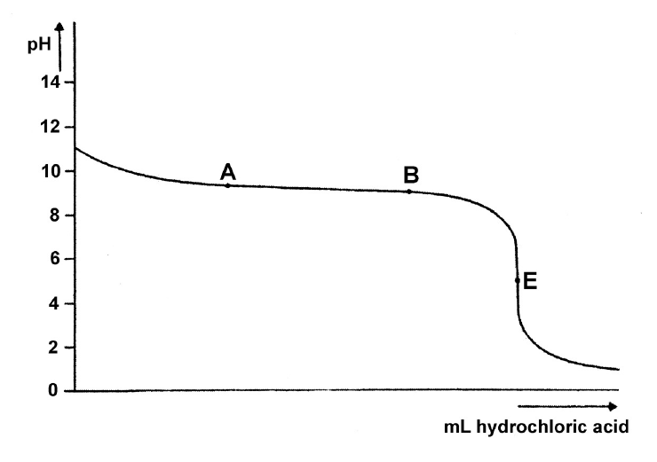
>
> In this diagram the pH is drawn against the number of added mL hydrochloric acid. The end- or equivalence point E is at a pH value below 7.
>
> c. Explain that this was to be expected.
>
> It took 20.0 mL of diluted hydrochloric acid to reach E.
>
> d. Calculate the molarity of the hydrochloric acid solution that was used.
>
> The line between points A and B in the diagram is virtually horizontal.
>
> e. Explain why the pH is almost constant here although a solution of strong acid was added.
>
> From the diagram, one might read the pH value at the moment that 10.0 mL of the hydrochloric acid solution had been added, exactly halfway the titration. The solution then has a particularly special composition.
>
> f. Explain what is special about the composition of the solution being titrated at that moment in comparison to other moments during the titration.
>
> Halfway the titration, the pH value turns out to be 9.3.
>
> g. Using this pH value, and your answer in f, calculate the acid constant (Ka) of the NH₄⁺-ion.

**Official answers** (CCVX, Dutch original):

> **Opgave 1 - ammoniak**
>
> 4p a. Een ammoniakmolecuul is zeer welkom in water, vanwege het polaire karakter van beide molecuulsoorten en de ruime mogelijkheid om H-bruggen te vormen. In een gas is de intermoleculaire ruimte veel groter dan in een vloeistof. 100 L gas is ongeveer 4 mol en die kruipen makkelijk in de intermoleculaire ruimte van circa 56 mol water, dus zonder het volume sterk te vergroten.
>
> 4p b. NH₃ + H₂O ⇌ NH₄⁺ + OH⁻ Kb = [NH₄⁺][OH⁻]/[NH₃] = 1,8.10⁻⁵\
> Stel [NH₄⁺] = [OH⁻] = x, dus [NH₃] = 0,1 –x Invullen in Kb levert x = [OH⁻] = 1.3.10⁻³ dus pOH = 2,9 en pH = 11,1 (Eén significant cijfer).
>
> 2p c. In het eindpunt is alle NH₃ omgezet in NH₄⁺; dit is een zwak zuur volgens\
> NH₄⁺ + H₂O ⇌ NH₃ + H₃O⁺
>
> 2p d. Toegevoegd mol H⁺ = aanwezige mol NH₃, dus 20,0.M = 25,0x 0,100 M = 0,125 mol.L⁻¹
>
> 3p e. In dit gebied is de [NH₄⁺] in orde van grootte gelijk aan [NH₃], de oplossing gedraagt zich als een buffer, de pH verandert dus nauwelijks.
>
> 2p f. Op dit punt is precies [NH₄⁺] = [NH₃] Ook juist: pOH = pKb dus pH = pKz
>
> 2p g. dus Kz = [NH₃][H₃O⁺]/[NH₄⁺] = [H₃O⁺] = 10−9,3 = 5.10⁻¹⁰
>
> Totaal opgave 1: 19 p

In English:

> a (4 points). An ammonia molecule is very welcome in water, because both kinds of molecule are polar and there is ample opportunity to form hydrogen bridges. In a gas the space between the molecules is much larger than in a liquid. 100 L of gas is about 4 mol, and those molecules easily fit into the space between about 56 mol of water molecules, so without increasing the volume much.
>
> b (4 points). NH₃ + H₂O ⇌ NH₄⁺ + OH⁻, Kb = [NH₄⁺][OH⁻]/[NH₃] = 1.8·10⁻⁵. Set [NH₄⁺] = [OH⁻] = x, so [NH₃] = 0.1 − x. Substituting into Kb gives x = [OH⁻] = 1.3·10⁻³, so pOH = 2.9 and pH = 11.1 (one significant figure).
>
> c (2 points). At the end point all NH₃ has been converted into NH₄⁺, which is a weak acid:\
> NH₄⁺ + H₂O ⇌ NH₃ + H₃O⁺
>
> d (2 points). mol H⁺ added = mol NH₃ present, so 20.0 × M = 25.0 × 0.100 M, which gives M = 0.125 mol L⁻¹.
>
> e (3 points). In this region [NH₄⁺] is of the same order of magnitude as [NH₃]; the solution behaves as a buffer, so the pH hardly changes.
>
> f (2 points). At this point [NH₄⁺] = [NH₃] exactly. Also correct: pOH = pKb, so pH = pKa.
>
> g (2 points). So Ka = [NH₃][H₃O⁺]/[NH₄⁺] = [H₃O⁺] = 10−9.3 = 5·10⁻¹⁰.
>
> Total for question 1: 19 points.

**Worked answers:**

- b.
  1. Ammonia is a weak base: NH₃ + H₂O ⇌ NH₄⁺ + OH⁻, with Kb = 1.8·10⁻⁵ (Binas table 49). Setting up and solving this equilibrium is [C05](../C05-chemical-equilibrium/README.md) work.
  2. x² / (0.100 − x) = 1.8·10⁻⁵ gives x = [OH⁻] = 1.33·10⁻³ mol L⁻¹. With the shortcut 0.100 − x ≈ 0.100 you get 1.34·10⁻³ mol L⁻¹ and pH 11.13; both round to 11.1.
  3. pOH = −log [OH⁻] = −log 1.33·10⁻³ = 2.88.
  4. pH = 14.00 − pOH = 14.00 − 2.88 = 11.12, which is 11.1 to one decimal, as the question says.

  Kb and [OH⁻] have two significant figures, so the rule for logarithms gives two decimals: 11.12. The question and CCVX's answer round to one decimal.
- d.
  1. NH₃ + H₃O⁺ → NH₄⁺ + H₂O, so at the equivalence point n(H₃O⁺) = n(NH₃).
  2. n(NH₃) = 25.0·10⁻³ L × 0.100 mol L⁻¹ = 2.50·10⁻³ mol.
  3. [H₃O⁺] = 2.50·10⁻³ mol / 20.0·10⁻³ L = 0.125 mol L⁻¹, so the acid is 0.125 M.

## 2. Deodorant

**Source:** CCVX example exam 2, question 2, 10 points. The question is in English; the official answers are in Dutch.

**Parts on chemical calculations:** a and d (mole ratio, excess and a back-titration). **Other parts:** b and c, reaction equations with states ([C01](../C01-chemical-processes/README.md)).

**Question** (CCVX, English original):

> **QUESTION 2 - deodorant**
>
> When merging a potassium bromate solution (KBrO₃), a solution of potassium bromide and hydrochloric acid the following reaction occurs:
>
> BrO₃⁻ + 5 Br⁻ + 6 H⁺ → 3 Br₂ + 3 H₂O
>
> a. Calculate the amount of bromine (in mmol) created when 7.00 mmol of potassium bromate reacts with excess potassium bromide and sufficient hydrochloric acid.
>
> If oxine (C₉H₇NO) is added to the resulting solution, a reaction that exclusively produces dibromo-oxine (C₉H₅Br₂NO) as a carbon bond will occur. Oxine and dibromo-oxine are both molecular substances that are relatively easily soluble in water. The mole ratio for the reaction of oxine and bromine is oxine : bromine = 1: 2
>
> b. Write down the equation for the reaction that occurred and indicate the different states of matter.
>
> Some deodorants contain an Al³⁺ solution. The above reaction can be used to determine the levels of Al³⁺ in these types of solutions.
>
> Assume you are testing the Al³⁺ level in a deodorant by adding a solution of excess sodium oxinate (Na⁺C₉H₆NO⁻) to 10.0 mL of the deodorant in question. Sodium oxinate is a salt of oxine, which is a weak acid. Following the addition of this sodium salt solution, aluminium oxinate, which is a poorly soluble salt, forms a sediment.
>
> c. Write down the equation for this sediment reaction.
>
> The aluminium oxinate is filtered and subsequently converted into Al³⁺ and oxine using hydrochloric acid. Next, 7.00 mmol of a potassium bromate solution is added, as well as the necessary amount of potassium bromide to convert all bromate into bromine. The oxine fully reacts with the bromine created in the above process (in a mole ratio of 1 : 2). The remaining amount of bromine is determined by titration, producing an outcome of 0.660 mmol.
>
> d. Calculate the amount of Al³⁺ in 1.00 mL of the deodorant.

*[Editorial: “as a carbon bond” is CCVX's translation of the Dutch* koolstofverbinding*, carbon compound: dibromo-oxine is the only carbon compound that forms.]*

**Official answers** (CCVX, Dutch original):

> **Uitwerking opgave 2 - deodorant**
>
> 1p 2a molverhouding is 1 : 3 dus 21,0 mmol broom.
>
> 2p 2b C₉H₇NO(aq) + 2 Br₂(aq) → C₉H₅Br₂NO(aq) + 2 H⁺(aq) + 2 Br⁻(aq)
>
> 2p 2c Al³⁺(aq) + 3 C₉H₆NO⁻(aq) → Al(C₉H₆NO)₃(s)
>
> 5p 2d Van 21,0 mmol broom is 0,660 mmol over,\
> dus 20,34 mmol heeft gereageerd met (:2)\
> 10,17 mmol oxine; dit is vrijgekomen uit (:3)\
> 3,39 mmol aluminiumoxinaat en dus was aanwezig\
> 3,39 mmol Al³⁺ in 10,0 mL deodorant. Dit is\
> 3,39 . 26,98 mg = 91,5 mg dus per ml 9,15 mg.
>
> Totaal opgave 2: 10 p

In English:

> 2a (1 point). The mole ratio is 1 : 3, so 21.0 mmol bromine.
>
> 2b (2 points). C₉H₇NO(aq) + 2 Br₂(aq) → C₉H₅Br₂NO(aq) + 2 H⁺(aq) + 2 Br⁻(aq)
>
> 2c (2 points). Al³⁺(aq) + 3 C₉H₆NO⁻(aq) → Al(C₉H₆NO)₃(s)
>
> 2d (5 points). Of the 21.0 mmol bromine, 0.660 mmol is left over, so 20.34 mmol reacted with (÷ 2) 10.17 mmol oxine. That oxine was released from (÷ 3) 3.39 mmol aluminium oxinate, so 3.39 mmol Al³⁺ was present in 10.0 mL of deodorant. That is 3.39 × 26.98 mg = 91.5 mg, so 9.15 mg per mL.
>
> Total for question 2: 10 points.

**Worked answers:**

- a. BrO₃⁻ : Br₂ = 1 : 3, so n(Br₂) = 3 × 7.00 = 21.0 mmol.
- d.
  1. The chain of reactions: Al³⁺ + 3 C₉H₆NO⁻ → Al(C₉H₆NO)₃ (s); the acid turns each Al(C₉H₆NO)₃ back into Al³⁺ and 3 oxine; each oxine takes 2 Br₂.
  2. Bromine is in excess, and what is left is titrated (a back-titration): reacted Br₂ = 21.0 − 0.660 = 20.34 mmol.
  3. Oxine = 20.34 / 2 = 10.17 mmol, so Al³⁺ = 10.17 / 3 = 3.39 mmol in 10.0 mL.
  4. In 1.00 mL: 0.339 mmol Al³⁺, which is 0.339 × 26.98 = 9.15 mg.

“Amount” can mean mmol or mg; CCVX answers in mg, so give both if a question is unclear.

## 3. Explosive

**Source:** CCVX example exam 1, question 5, 12 points. The question is in English; the official answers are in Dutch.

**Parts on chemical calculations:** b (stoichiometric ratio, excess, mass percentage and conservation of mass). **Other parts:** a, heat of reaction ([C06](../C06-energy-calculations/README.md)); c, esterification ([C01](../C01-chemical-processes/README.md)) of cellulose ([G01](../../G-society-chemistry-and-technology/G01-chemistry-of-life/README.md)); d, complete combustion ([C01](../C01-chemical-processes/README.md)).

**Question** (CCVX, English original):

> **QUESTION 5 - explosive**
>
> Glyceryltrinitrate is a well-known explosive:
>
> 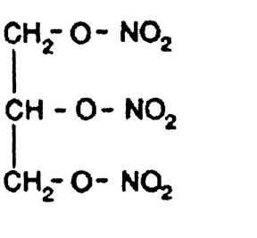
>
> On explosion, glyceryltrinitrate decomposes as follows:
>
> 4 C₃H₅N₃O₉(l) → 12 CO₂(g) + 10 H₂O(g) + 6 N₂(g) + O₂(g)
>
> A lot of energy is released in this reaction.
>
> a. Calculate the energy change (298 K, p = p₀) of this reaction per mole of glyceryltrinitrate. Use data in Binas and the fact that the energy of formation of glyceryltrinitrate is –3,56·10⁵ J mol⁻¹ (298 K, p = p₀).
>
> Glyceryltrinitrate is synthesized by esterification of glycerol (propane-1,2,3-triol) with nitric acid. Nitric acid is added in excess. The esterification takes place in the presence of sulphuric acid.\
> A reactor is filled with 100 kg glycerol, 250 kg nitric acid and 150 kg sulphuric acid. Only glyceryltrinitrate and water are formed and all substances involved are fluids under the reaction conditions. After full conversion of the glycerol, the content of the reactor is emptied.
>
> b. Calculate the mass percentage of glyceryltrinitrate in the mixture from the reactor.
>
> The decomposition of glyceryltrinitrate can be looked upon as an internal combustion. The oxygen needed for its combustion is present within the compound itself. The internal combustion of glyceryltrinitrate is complete; sufficient oxygen is present for full combustion, there is even a surplus of oxygen.
>
> Guncotton or ‘nitrocotton’ is an explosive compound as well.\
> It is produced by complete esterification of cellulose using nitric acid.\
> The structural formula of cellulose is depicted in part below:
>
> 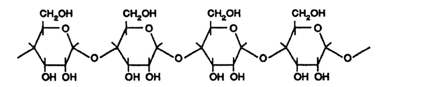
>
> Upon explosion, guncotton decomposes. This decomposition may also be viewed upon as an internal combustion.
>
> c. Give the molecular formula of guncotton.
>
> d. Explain on the basis of the molecular formula whether guncotton decomposes fully or only partially by internal combustion.

**Official answers** (CCVX, Dutch original):

> **Opgave 5 - explosief**
>
> 4p a. −4.ΔE(C₃H₅N₃O₉) + 12 ΔE(CO₂) + 10.ΔE(H₂O(l)) = 4.ΔE(reactie)\
> −4.−3.56.10⁵ + 12. −3.935.10⁵ + 10.−2.42.10⁵ = 4.ΔE(reactie) dus ΔE = −1.43.10⁶ J.mol⁻¹\
> glycerylttrinitraat
>
> 3p b. 100 kg glycerol, C₃H₈O₃, = 100/92.1 kmol. Er ontstaat dus 100/92.1 kmol glycerylttrinitraat = (x 227) 246.5 kg. Totale massa reactor is onveranderd (100+250+150 = 500 kg) dus massa-% is (246.5/500).100% = 49.3 %
>
> 3p c. (C₆H₇N₃O₁₁)ₙ
>
> 2p d. Alleen voor de C’s (→ CO₂) zijn per eenheid al 12 O’s nodig, er zijn er maar 11, dus niet volledig.
>
> Totaal opgave 5: 12 p

In English:

> a (4 points). −4 × ΔE(C₃H₅N₃O₉) + 12 × ΔE(CO₂) + 10 × ΔE(H₂O(l)) = 4 × ΔE(reaction); −4 × −3.56·10⁵ + 12 × −3.935·10⁵ + 10 × −2.42·10⁵ = 4 × ΔE(reaction), so ΔE = −1.43·10⁶ J per mol of glyceryl trinitrate.
>
> b (3 points). 100 kg glycerol, C₃H₈O₃, is 100/92.1 kmol. So 100/92.1 kmol glyceryl trinitrate forms, which is (× 227) 246.5 kg. The total mass in the reactor is unchanged (100 + 250 + 150 = 500 kg), so the mass percentage is (246.5/500) × 100% = 49.3%.
>
> c (3 points). (C₆H₇N₃O₁₁)ₙ
>
> d (2 points). The C atoms alone (→ CO₂) already need 12 O atoms per unit, and there are only 11, so not completely.
>
> Total for question 5: 12 points.

*[Editorial: in a, “H₂O(l)” should be H₂O(g). The equation forms water vapour, and −2.42·10⁵ J mol⁻¹ is the heat of formation of water vapour (liquid water's is −2.86·10⁵ J mol⁻¹), so the numbers are right.]*

**Worked answer:**

- b.
  1. C₃H₈O₃ + 3 HNO₃ → C₃H₅N₃O₉ + 3 H₂O, so glycerol : glyceryl trinitrate = 1 : 1.
  2. n(glycerol) = 100·10³ g / 92.09 g mol⁻¹ = 1.086·10³ mol.
  3. Check the excess: n(HNO₃) = 250·10³ / 63.02 = 3.97·10³ mol, more than the 3 × 1.086·10³ = 3.26·10³ mol needed. So glycerol limits the product, as the question says.
  4. m(C₃H₅N₃O₉) = 1.086·10³ mol × 227.1 g mol⁻¹ = 246.6 kg.
  5. Nothing leaves the reactor, so the mixture still weighs 100 + 250 + 150 = 500 kg (the sulfuric acid, the leftover nitric acid and the water formed are all in it).
  6. Mass percentage = 246.6 / 500 × 100% = 49.3%.

  CCVX's 246.5 kg comes from rounding the molar masses to 92.1 and 227; the percentage is the same.

## 4. Battolyser

**Source:** CvTE central exam vwo 2024, period 1 (*tijdvak 1*), the context *Battolyser*: questions 6–10, 15 points. Dutch original with an English translation. The official answers are from the marking scheme (*correctievoorschrift*) and its addendum (*aanvulling*).

**Parts on chemical calculations:** 8 (amount of substance, the electron ratio and a conversion of time) and 10 (yield, mole ratio, density and significant figures). **Other parts:** 6 and 7, half-reactions and the movement of ions during electrolysis ([C01](../C01-chemical-processes/README.md)); 9, activation energy and reaction rate ([C04](../C04-reaction-kinetics/README.md), [C10](../C10-activation-energy/README.md)).

**At the start of the exam:** *Tenzij anders vermeld, is er sprake van standaardomstandigheden: T = 298 K en p = p₀.* (Unless stated otherwise, standard conditions apply: T = 298 K and p = p₀.)

**Question** (CvTE, Dutch original):

> **Battolyser**
>
> Onderzoekers van de TU Delft hebben de battolyser ontwikkeld.\
> De battolyser ontleent zijn naam aan twee functies: het is een oplaadbare batterij die kan worden gebruikt voor energieopslag en voor de elektrolyse van water. De vrijgekomen waterstof kan worden gebruikt als brandstof of als grondstof voor de productie van andere (brand)stoffen. In figuur 1 is de battolyser schematisch weergegeven voorafgaand aan het opladen.
>
> figuur 1
>
> 
>
> Als de batterij wordt opgeladen, wordt aan de linker elektrode ijzer(II)hydroxide omgezet tot onder andere ijzer.\
> Aan de rechter elektrode wordt nikkel(II)hydroxide omgezet tot onder andere de vaste stof nikkel(III)oxidehydroxide, NiO(OH).\
> De elektrolyt-oplossing is natronloog. Tijdens de elektrolyse bewegen alleen hydroxide-ionen door het membraan.
>
> 3p **6** Geef de vergelijkingen van de halfreacties die verlopen tijdens het opladen en geef de totaalvergelijking.
>
> 2p **7** Leg uit in welke richting de hydroxide-ionen het membraan passeren tijdens het opladen.
>
> In een volledig opgeladen prototype van de battolyser werd 1,4 kg water gedurende 18 maanden geëlektrolyseerd.\
> Per molecuul water dat wordt omgezet, worden twee elektronen getransporteerd. Neem aan dat tijdens dit proces alle toegevoerde lading is gebruikt voor de elektrolyse van water.
>
> 3p **8** Bereken de lading in coulomb die in die periode gemiddeld per seconde is getransporteerd.\
> Gebruik onder andere de volgende gegevens:
> - Een mol elektronen heeft een lading van 9,65·10⁴ C.
> - Een maand heeft gemiddeld 30 dagen.
>
> De reactiesnelheid van deze elektrolyse van water bleek vooral te worden bepaald door de halfreactie die aan de rechter elektrode verloopt.\
> Het bleek dat de reactiesnelheid veranderde als in het NiO(OH)-laagje op de rechter elektrode ook FeO(OH) aanwezig was. In het onderzoek is de activeringsenergie van de reactie bepaald, afhankelijk van het massapercentage FeO(OH) in het laagje.\
> In figuur 2 zijn de resultaten te zien van enkele experimenten.
>
> figuur 2
>
> 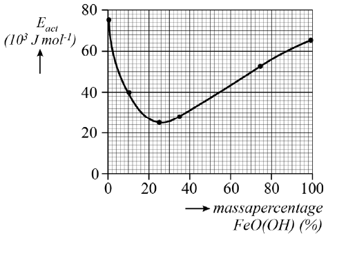
>
> 2p **9** Leg uit bij welke waarde van het massapercentage FeO(OH) de reactiesnelheid het hoogst is.
>
> Er zijn momenteel auto’s verkrijgbaar die waterstof gebruiken als energiebron. Een van deze auto’s heeft een tank met daarin maximaal 6,33 kg waterstof onder hoge druk. Onderzocht wordt of het mogelijk is om de risico’s van het gebruik van waterstof te verminderen door de waterstof eerst om te zetten tot methaanzuur. Methaanzuur is een vloeistof die eenvoudig kan worden getankt en vervoerd.\
> In een auto wordt het methaanzuur dan in een reactor omgezet tot waterstof volgens reactie 1.
>
> CH₂O₂ → CO₂ + H₂ (reactie 1)
>
> De ontstane waterstof wordt vervolgens in een brandstofcel geleid om elektrische energie op te wekken.\
> Reactie 1 heeft een rendement van 90,0%. De dichtheid van methaanzuur is 1,22·10³ kg m⁻³.
>
> 5p **10** Bereken het volume in liter methaanzuur dat nodig is om 6,33 kg waterstof te produceren.\
> **Geef je antwoord in het juiste aantal significante cijfers.**

In English:

> **Battolyser**
>
> Researchers at TU Delft have developed the battolyser.\
> The battolyser takes its name from two functions: it is a rechargeable battery that can be used for energy storage and for the electrolysis of water. The hydrogen released can be used as a fuel or as a raw material for making other substances and fuels. Figure 1 is a diagram of the battolyser before charging.
>
> Figure 1
>
> 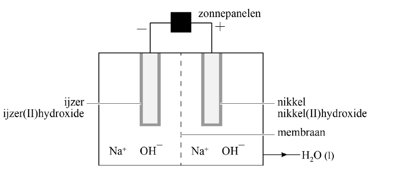
>
> *Labels: zonnepanelen = solar panels; ijzer = iron; ijzer(II)hydroxide = iron(II) hydroxide; nikkel = nickel; nikkel(II)hydroxide = nickel(II) hydroxide; membraan = membrane.*
>
> When the battery is charged, iron(II) hydroxide at the left electrode is converted into, among other things, iron.\
> At the right electrode, nickel(II) hydroxide is converted into, among other things, the solid nickel(III) oxide hydroxide, NiO(OH).\
> The electrolyte solution is sodium hydroxide solution (*natronloog*). During the electrolysis only hydroxide ions move through the membrane.
>
> **6** (3 points) Give the equations of the half-reactions that take place during charging, and give the overall equation.
>
> **7** (2 points) Explain in which direction the hydroxide ions pass through the membrane during charging.
>
> In a fully charged prototype of the battolyser, 1.4 kg of water was electrolysed over a period of 18 months.\
> For each molecule of water converted, two electrons are transported. Assume that during this process all the charge supplied was used for the electrolysis of water.
>
> **8** (3 points) Calculate the charge in coulombs that was transported per second, on average, during that period.\
> Use, among other things, the following data:
> - One mole of electrons has a charge of 9.65·10⁴ C.
> - A month has 30 days on average.
>
> The rate of this electrolysis of water turned out to be determined mainly by the half-reaction at the right electrode.\
> It turned out that the reaction rate changed when the NiO(OH) layer on the right electrode also contained FeO(OH). In the research, the activation energy of the reaction was determined as a function of the mass percentage of FeO(OH) in the layer.\
> Figure 2 shows the results of some experiments.
>
> Figure 2
>
> 
>
> *Labels: Eact = activation energy, in 10³ J mol⁻¹; massapercentage FeO(OH) (%) = mass percentage of FeO(OH), in %.*
>
> **9** (2 points) Explain at which value of the mass percentage of FeO(OH) the reaction rate is highest.
>
> Cars that use hydrogen as their energy source are currently available. One of these cars has a tank that holds at most 6.33 kg of hydrogen under high pressure. Researchers are investigating whether the risks of using hydrogen can be reduced by first converting the hydrogen into methanoic acid (formic acid). Methanoic acid is a liquid that is easy to fill up and transport.\
> In a car, a reactor then converts the methanoic acid into hydrogen according to reaction 1.
>
> CH₂O₂ → CO₂ + H₂ (reaction 1)
>
> The hydrogen formed is then fed into a fuel cell to generate electrical energy.\
> Reaction 1 has a yield of 90.0%. The density of methanoic acid is 1.22·10³ kg m⁻³.
>
> **10** (5 points) Calculate the volume in litres of methanoic acid needed to produce 6.33 kg of hydrogen.\
> **Give your answer in the correct number of significant figures.**

**Official answers** (CvTE marking scheme, Dutch original):

> **6** maximumscore 3
>
> Fe(OH)₂ + 2 e⁻ → Fe + 2 OH⁻ (× 1)\
> Ni(OH)₂ + OH⁻ → NiO(OH) + H₂O + e⁻ (× 2)\
> Fe(OH)₂ + 2 Ni(OH)₂ → Fe + 2 NiO(OH) + 2 H₂O
>
> - de halfreactie van ijzer(II)hydroxide — 1
> - de halfreactie van nikkel(III)oxidehydroxide — 1
> - de gegeven halfreacties in de juiste verhouding opgeteld en OH⁻ en e⁻ links en rechts van de pijl tegen elkaar weggestreept — 1
>
> *Opmerkingen*
> - De volgende halfreacties goed rekenen:\
>   Ni(OH)₂ → NiO(OH) + H⁺ + e⁻\
>   en Ni(OH)₂ + H₂O → NiO(OH) + H₃O⁺ + e⁻
> - Wanneer evenwichtstekens zijn gebruikt in plaats van reactiepijlen, dit goed rekenen.
>
> **7** maximumscore 2
>
> Een voorbeeld van een juist antwoord is:\
> Tijdens het opladen bewegen de elektronen van rechts naar links.\
> Omdat de totale lading links en rechts gelijk moet blijven, bewegen de OH⁻-ionen van links naar rechts.
>
> - De elektronen bewegen van rechts naar links. — 1
> - inzicht dat elektro-neutraliteit moet gelden en consequente conclusie — 1
>
> *Opmerking*\
> Een antwoord als het volgende goed rekenen:\
> Tijdens het opladen worden aan de linker elektrode OH⁻-ionen gevormd en aan de rechter elektrode verbruikt. De OH⁻-ionen bewegen dus van links naar rechts.
>
> *[Editorial: the addendum adds this note to question 7:]*\
> *Opmerking*\
> Als een onjuist antwoord op vraag 7 het consequent gevolg is van een onjuist antwoord op vraag 6, dit niet aanrekenen.
>
> **8** maximumscore 3
>
> Voorbeelden van een juiste berekening zijn:\
> Er is dan (1,4 × 10³ / 18,0) × 2 = 1,56·10² (mol) elektronen getransporteerd.\
> De getransporteerde lading is 1,56·10² × 9,65·10⁴ = 1,50·10⁷ (C).\
> De lading per seconde is 1,50·10⁷ / (18 × 30 × 24 × 60 × 60) = 3,2·10⁻¹ (C s⁻¹).
>
> - omrekening van de massa water naar de chemische hoeveelheid elektronen — 1
> - omrekening naar de getransporteerde lading — 1
> - omrekening naar de getransporteerde lading in coulomb per seconde — 1
>
> of
>
> Er is dan per seconde 1,4 × 10³ / (18 × 30 × 24 × 60 × 60) = 3,00·10⁻⁵ (g) water omgezet.\
> De chemische hoeveelheid elektronen per seconde is (3,00·10⁻⁵ / 18,0) × 2 = 3,33·10⁻⁶ (mol).\
> De lading per seconde is 3,33·10⁻⁶ × 9,65·10⁴ = 3,2·10⁻¹ (C s⁻¹).
>
> - berekening van de verbruikte massa water per seconde — 1
> - omrekening naar de chemische hoeveelheid elektronen per seconde — 1
> - omrekening naar de getransporteerde lading in coulomb per seconde — 1
>
> **9** maximumscore 2
>
> Een voorbeeld van een juist antwoord is:\
> Als de activeringsenergie laag is, is de reactiesnelheid het hoogst.\
> De activeringsenergie is het laagst bij 25 massa% (± 2 massa%) FeO(OH), dus dan is de reactiesnelheid het hoogst.
>
> - inzicht dat de reactiesnelheid het hoogst is als de activeringsenergie laag is — 1
> - consequente conclusie — 1
>
> **10** maximumscore 5
>
> Een voorbeeld van een juiste berekening is:\
> Een volle tank bevat 6,33 × 10³ / 2,02 = 3,134·10³ (mol) waterstof.\
> Hiervoor is 3,134·10³ × 10² / 90,0 = 3,482·10³ (mol) methaanzuur nodig.\
> De massa methaanzuur is 3,482·10³ × 46,0 × 10⁻³ = 1,602·10² (kg).\
> Het volume methaanzuur is 1,602·10² / 1,22·10³ × 10³ = 1,31·10² (L).
>
> - omrekening van de massa waterstof naar de chemische hoeveelheid — 1
> - omrekening naar de benodigde chemische hoeveelheid methaanzuur — 1
> - omrekening naar de massa methaanzuur — 1
> - omrekening naar het volume in liter methaanzuur — 1
> - significantie — 1

In English:

> **6** maximum score 3
>
> Fe(OH)₂ + 2 e⁻ → Fe + 2 OH⁻ (× 1)\
> Ni(OH)₂ + OH⁻ → NiO(OH) + H₂O + e⁻ (× 2)\
> Fe(OH)₂ + 2 Ni(OH)₂ → Fe + 2 NiO(OH) + 2 H₂O
>
> - the half-reaction of iron(II) hydroxide — 1
> - the half-reaction of nickel(III) oxide hydroxide — 1
> - the given half-reactions added in the correct ratio, with OH⁻ and e⁻ cancelled against each other on both sides of the arrow — 1
>
> *Notes*
> - Count the following half-reactions as correct:\
>   Ni(OH)₂ → NiO(OH) + H⁺ + e⁻\
>   and Ni(OH)₂ + H₂O → NiO(OH) + H₃O⁺ + e⁻
> - If equilibrium signs are used instead of reaction arrows, count this as correct.
>
> **7** maximum score 2
>
> An example of a correct answer is:\
> During charging, the electrons move from right to left.\
> Because the total charge on the left and on the right has to stay equal, the OH⁻ ions move from left to right.
>
> - The electrons move from right to left. — 1
> - insight that electroneutrality must hold, and a consistent conclusion — 1
>
> *Note*\
> Count an answer like the following as correct:\
> During charging, OH⁻ ions are formed at the left electrode and used up at the right electrode. So the OH⁻ ions move from left to right.
>
> *[Editorial: the addendum adds this note to question 7:]*\
> *Note*\
> If an incorrect answer to question 7 follows consistently from an incorrect answer to question 6, don't penalise it.
>
> **8** maximum score 3
>
> Examples of a correct calculation are:\
> Then (1.4 × 10³ / 18.0) × 2 = 1.56·10² (mol) of electrons were transported.\
> The charge transported is 1.56·10² × 9.65·10⁴ = 1.50·10⁷ (C).\
> The charge per second is 1.50·10⁷ / (18 × 30 × 24 × 60 × 60) = 3.2·10⁻¹ (C s⁻¹).
>
> - converting the mass of water to the amount of electrons — 1
> - converting to the charge transported — 1
> - converting to the charge transported in coulombs per second — 1
>
> or
>
> Then per second 1.4 × 10³ / (18 × 30 × 24 × 60 × 60) = 3.00·10⁻⁵ (g) of water was converted.\
> The amount of electrons per second is (3.00·10⁻⁵ / 18.0) × 2 = 3.33·10⁻⁶ (mol).\
> The charge per second is 3.33·10⁻⁶ × 9.65·10⁴ = 3.2·10⁻¹ (C s⁻¹).
>
> - calculating the mass of water used per second — 1
> - converting to the amount of electrons per second — 1
> - converting to the charge transported in coulombs per second — 1
>
> **9** maximum score 2
>
> An example of a correct answer is:\
> When the activation energy is low, the reaction rate is highest.\
> The activation energy is lowest at 25 mass% (± 2 mass%) FeO(OH), so that is where the reaction rate is highest.
>
> - insight that the reaction rate is highest when the activation energy is low — 1
> - a consistent conclusion — 1
>
> **10** maximum score 5
>
> An example of a correct calculation is:\
> A full tank contains 6.33 × 10³ / 2.02 = 3.134·10³ (mol) hydrogen.\
> This needs 3.134·10³ × 10² / 90.0 = 3.482·10³ (mol) methanoic acid.\
> The mass of methanoic acid is 3.482·10³ × 46.0 × 10⁻³ = 1.602·10² (kg).\
> The volume of methanoic acid is 1.602·10² / 1.22·10³ × 10³ = 1.31·10² (L).
>
> - converting the mass of hydrogen to the amount of substance — 1
> - converting to the amount of methanoic acid needed — 1
> - converting to the mass of methanoic acid — 1
> - converting to the volume of methanoic acid in litres — 1
> - significant figures — 1

**Worked answers:**

- 8.
  1. n(H₂O) = 1.4·10³ g / 18.02 g mol⁻¹ = 77.7 mol. Two electrons per molecule, so n(e⁻) = 2 × 77.7 = 1.55·10² mol.
  2. Charge = 1.55·10² mol × 9.65·10⁴ C mol⁻¹ = 1.50·10⁷ C.
  3. Time = 18 × 30 × 24 × 60 × 60 s = 4.67·10⁷ s.
  4. Charge per second = 1.50·10⁷ C / 4.67·10⁷ s = 3.2·10⁻¹ C s⁻¹, in 2 significant figures because 1.4 kg has 2.

  The scheme's 1.50·10⁷ C uses the unrounded 155.6 mol; 1.56·10² × 9.65·10⁴ would give 1.51·10⁷ C and the same final answer. The CCVX syllabus doesn't list charge or the Faraday constant, but the question gives the charge of a mole of electrons, so this is an ordinary conversion through the amount of substance.
- 10.
  1. Reaction 1 turns 1 mol CH₂O₂ into 1 mol H₂ when the yield is 100%.
  2. n(H₂) = 6.33·10³ g / 2.016 g mol⁻¹ = 3.140·10³ mol.
  3. With a 90.0% yield you need more methanoic acid than that, so divide by the yield: n(CH₂O₂) = 3.140·10³ / 0.900 = 3.489·10³ mol.
  4. m(CH₂O₂) = 3.489·10³ mol × 46.03 g mol⁻¹ = 1.606·10⁵ g = 160.6 kg.
  5. V = m / ρ = 160.6 kg / 1.22·10³ kg m⁻³ = 0.1316 m³ = 1.32·10² L, in 3 significant figures because 6.33, 90.0 and 1.22·10³ all have 3.

  The marking scheme gets 1.31·10² L because it rounds M(H₂) to 2.02 g mol⁻¹. Its calculation is only “an example of a correct calculation”, and rule 1 of its subject rules says a deviation caused by acceptable intermediate rounding isn't penalised, so 1.32·10² L scores full marks too. Multiplying by 0.900 instead of dividing is the usual mistake: a yield under 100% means you need more starting material, not less.

## 5. Dinitrogen tetroxide

**Source:** CvTE central exam vwo 2024, period 2 (*tijdvak 2*), the context *Distikstoftetraoxide*: questions 18–25, 24 points, with the answer sheet (*uitwerkbijlage*) for questions 19, 20, 22 and 24. Dutch original with an English translation; the official answers are from the marking scheme.

**Parts on chemical calculations:** 25 (molar volume, volume-ppm and significant figures). **Other parts:** 18, an equation and the heat of reaction ([C01](../C01-chemical-processes/README.md), [C06](../C06-energy-calculations/README.md)); 19, the position of equilibrium ([C05](../C05-chemical-equilibrium/README.md)); 20, a block diagram ([F01](../../F-industrial-chemical-processes/F01-industrial-processes/README.md)); 21, a combustion equation ([C01](../C01-chemical-processes/README.md)); 22, energy diagrams ([C06](../C06-energy-calculations/README.md), [C10](../C10-activation-energy/README.md)); 23, melting points ([B02](../../B-substances-and-materials/B02-properties-and-models/README.md)); 24, Lewis structures and moving electron pairs ([B01](../../B-substances-and-materials/B01-particle-models/README.md), [C04](../C04-reaction-kinetics/README.md)).

**At the start of the exam:** *Tenzij anders vermeld, is er sprake van standaardomstandigheden: T = 298 K en p = p₀.* (Unless stated otherwise, standard conditions apply: T = 298 K and p = p₀.)

**Question** (CvTE, Dutch original):

> **Distikstoftetraoxide**
>
> Distikstoftetraoxide (N₂O₄) is een sterke oxidator, die onder andere wordt gebruikt in raketmotoren. N₂O₄ ontstaat als bijproduct bij de productie van salpeterzuur (HNO₃). Door de toegenomen vraag naar N₂O₄ wordt onderzoek gedaan of het mogelijk is om salpeterzuurfabrieken om te bouwen naar N₂O₄-fabrieken.\
> Op basis van het onderzoek werd een aangepast proces voorgesteld met twee reactoren. In reactor 1 (R1) reageert ammoniak met een overmaat zuurstof tot stikstofmono-oxide en waterdamp.
>
> 4p **18** Voer de volgende opdrachten uit:
> - Geef de vergelijking van de reactie die verloopt in R1.
> - Bereken de reactiewarmte van deze reactie in joule per mol ammoniak.
>
> Het gasmengsel afkomstig uit R1 wordt in scheidingsruimte 1 (S1) gebracht, waar water volledig wordt afgescheiden. Het gevormde stikstofmono-oxide reageert vervolgens in reactor 2 (R2) met zuurstof tot stikstofdioxide, waarbij zich twee evenwichten instellen.\
> 2 NO (g) + O₂ (g) ⇌ 2 NO₂ (g) (evenwicht 1)\
> 2 NO₂ (g) ⇌ N₂O₄ (g) (evenwicht 2)\
> De reactie naar rechts is voor beide evenwichten in R2 exotherm.\
> Onderdeel van het onderzoek was de vraag hoe het rendement van de productie van N₂O₄ kan worden verhoogd door de druk en de temperatuur in R2 te variëren.
>
> 2p **19** Noteer in de tabel op de uitwerkbijlage hoe de ligging van elk evenwicht wordt beïnvloed als de druk en/of de temperatuur wordt verhoogd.
> - Noteer ‘links’ als de reactie naar links wordt bevorderd.
> - Noteer ‘rechts’ als de reactie naar rechts wordt bevorderd.
>
> De uitstroom van R2 wordt in een scheidingsruimte gebracht, waar N₂O₄ in vloeibare vorm wordt afgescheiden van de rest van het gasmengsel.\
> De onderzoekers hebben op basis van het onderzoek een mogelijk blokschema voorgesteld van een N₂O₄-fabriek.
>
> 4p **20** Maak op de uitwerkbijlage het voorgestelde blokschema compleet.\
> Neem aan dat in de uitstroom van R2 geen zuurstof meer aanwezig is.
> - Teken ontbrekende reactoren en scheidingsruimtes.
> - Teken ontbrekende pijlen en noteer ontbrekende stoffen bij alle pijlen. Houd hierbij rekening met hergebruik van stoffen.
> - Neem aan dat bij het proces behalve water geen afval vrijkomt.
>
> N₂O₄ kan in een raketmotor worden gebruikt als oxidator. De brandstof is hierbij bijvoorbeeld monomethylhydrazine (MMH, zie de figuur).
>
> figuur
>
> 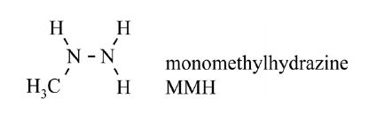
>
> MMH en N₂O₄ vormen een zogeheten ‘hypergool mengsel’. Dat is een mengsel dat spontaan ontbrandt als de stoffen worden gemengd.\
> Onderzoek heeft uitgewezen dat er bij contact tussen MMH en N₂O₄ twee reacties verlopen.\
> Eerst verloopt een ontstekingsreactie (reactie 1) die genoeg energie levert, zodat de uiteindelijke verbrandingsreactie (reactie 2) kan starten.\
> In reactie 2 worden MMH en N₂O₄ omgezet tot stikstof, koolstofdioxide en waterdamp.
>
> 3p **21** Geef de vergelijking van reactie 2. Gebruik hierbij molecuulformules.
>
> Op de uitwerkbijlage zijn twee energiediagrammen onvolledig weergegeven: een voor de ontstekingsreactie (reactie 1) en een voor de uiteindelijke verbrandingsreactie (reactie 2). Beide energiediagrammen zijn op dezelfde schaal weergegeven.
>
> 2p **22** Maak op de uitwerkbijlage beide energiediagrammen compleet met de energieniveaus van de geactiveerde toestanden en van de reactieproducten. Je hoeft geen bijschriften te vermelden.
>
> Bij onderzoek in de jaren 60 naar de ontstekingsreactie is de reactie tussen MMH en N₂O₄ onderzocht bij zeer lage temperaturen.\
> MMH is vloeibaar bij de gebruikte temperaturen terwijl N₂O₄ vast is.\
> Het smeltpunt van MMH is –52 °C.
>
> 2p **23** Leg uit tussen welke temperatuurgrenzen dit onderzoek heeft plaatsgevonden. Noteer je antwoord als volgt: … K ≤ temperatuur ≤ … K.\
> Gebruik Binas-tabel 42A of ScienceData-tabel 8.3a.
>
> Uit dit onderzoek volgde dat meerdere isomeren van N₂O₄ in het mengsel aanwezig waren en dat een van deze isomeren, ONONO₂ betrokken was bij de ontstekingsreactie.\
> Door de koeling vonden vervolgreacties niet plaats en was men in staat de reactieproducten van de ontstekingsreactie te onderzoeken.\
> Op de uitwerkbijlage is het ONONO₂-isomeer weergegeven samen met het MMH-molecuul waarmee het reageert. Verder zijn de reactieproducten van de ontstekingsreactie gegeven.
>
> 3p **24** Voer de volgende opdrachten uit:
> - Teken op de uitwerkbijlage links van de pijl de ontbrekende niet-bindende elektronenparen. Geef ook formele ladingen aan.
> - Geef met pijlen weer hoe elektronenparen worden verplaatst tijdens de reactie.
>
> In 1975 is er bijna een ongeluk gebeurd met een Apollo-ruimtevaartuig.\
> Tijdens de terugkeer in de dampkring werd een luchtinlaat geopend, waardoor N₂O₄ in de cabine terechtkwam. De drie aanwezige astronauten konden op tijd een zuurstofmasker opzetten.\
> Bij het incident is ongeveer 11 gram N₂O₄ in de cabine met een volume van 5,9 m³ terechtgekomen. Gehaltes van N₂O₄ boven de waarde 300 volume-ppm worden als levensgevaarlijk beschouwd.\
> Het molair volume van een gas is 2,39·10⁻² m³ mol⁻¹.
>
> 4p **25** Voer de volgende opdrachten uit:
> - Bereken het gehalte N₂O₄ in de cabine in volume-ppm. **Geef de uitkomst in het juiste aantal significante cijfers.**
> - Geef aan of het gehalte boven de grens van levensgevaar is gekomen.

In English:

> **Dinitrogen tetroxide**
>
> Dinitrogen tetroxide (N₂O₄) is a strong oxidising agent, used among other things in rocket engines. N₂O₄ forms as a by-product in the production of nitric acid (HNO₃). Because demand for N₂O₄ has grown, research is being done into whether nitric acid plants can be converted into N₂O₄ plants.\
> Based on the research, a modified process with two reactors was proposed. In reactor 1 (R1), ammonia reacts with an excess of oxygen to form nitrogen monoxide and water vapour.
>
> **18** (4 points) Do the following:
> - Give the equation of the reaction that takes place in R1.
> - Calculate the heat of this reaction in joules per mole of ammonia.
>
> The gas mixture from R1 is fed into separation unit 1 (S1), where all the water is separated off. The nitrogen monoxide formed then reacts in reactor 2 (R2) with oxygen to form nitrogen dioxide, and two equilibria are set up.\
> 2 NO (g) + O₂ (g) ⇌ 2 NO₂ (g) (equilibrium 1)\
> 2 NO₂ (g) ⇌ N₂O₄ (g) (equilibrium 2)\
> For both equilibria in R2, the reaction to the right is exothermic.\
> Part of the research was the question of how the yield of the N₂O₄ production can be increased by varying the pressure and the temperature in R2.
>
> **19** (2 points) Write in the table on the answer sheet how the position of each equilibrium is affected when the pressure and/or the temperature is increased.
> - Write ‘links’ (left) if the reaction to the left is favoured.
> - Write ‘rechts’ (right) if the reaction to the right is favoured.
>
> The outflow of R2 is fed into a separation unit, where N₂O₄ is separated off as a liquid from the rest of the gas mixture.\
> Based on the research, the researchers proposed a possible block diagram of an N₂O₄ plant.
>
> **20** (4 points) Complete the proposed block diagram on the answer sheet.\
> Assume that the outflow of R2 no longer contains any oxygen.
> - Draw the missing reactors and separation units.
> - Draw the missing arrows and write the missing substances at all the arrows. Take the reuse of substances into account.
> - Assume that apart from water the process produces no waste.
>
> N₂O₄ can be used as the oxidising agent in a rocket engine. The fuel is then, for example, monomethylhydrazine (MMH, see the figure).
>
> Figure
>
> 
>
> MMH and N₂O₄ form a so-called ‘hypergolic mixture’: a mixture that ignites spontaneously when the substances are mixed.\
> Research has shown that two reactions take place when MMH and N₂O₄ come into contact.\
> First an ignition reaction (reaction 1) takes place, which supplies enough energy for the final combustion reaction (reaction 2) to start.\
> In reaction 2, MMH and N₂O₄ are converted into nitrogen, carbon dioxide and water vapour.
>
> **21** (3 points) Give the equation of reaction 2. Use molecular formulas.
>
> The answer sheet shows two incomplete energy diagrams: one for the ignition reaction (reaction 1) and one for the final combustion reaction (reaction 2). Both energy diagrams are drawn to the same scale.
>
> **22** (2 points) Complete both energy diagrams on the answer sheet with the energy levels of the activated states and of the reaction products. You don't need to add labels.
>
> In research in the 1960s into the ignition reaction, the reaction between MMH and N₂O₄ was studied at very low temperatures.\
> At the temperatures used, MMH is liquid while N₂O₄ is solid.\
> The melting point of MMH is −52 °C.
>
> **23** (2 points) Explain between which temperature limits this research took place. Write your answer as follows: … K ≤ temperature ≤ … K.\
> Use Binas table 42A or ScienceData table 8.3a.
>
> This research showed that several isomers of N₂O₄ were present in the mixture, and that one of these isomers, ONONO₂, was involved in the ignition reaction.\
> Because of the cooling, follow-up reactions didn't take place, so the reaction products of the ignition reaction could be studied.\
> The answer sheet shows the ONONO₂ isomer together with the MMH molecule it reacts with. The reaction products of the ignition reaction are also given.
>
> **24** (3 points) Do the following:
> - On the answer sheet, draw the missing non-bonding electron pairs to the left of the arrow. Also show formal charges.
> - Use arrows to show how electron pairs move during the reaction.
>
> In 1975 an Apollo spacecraft nearly had an accident.\
> During re-entry into the atmosphere an air inlet was opened, which let N₂O₄ into the cabin. The three astronauts on board managed to put on oxygen masks in time.\
> In the incident about 11 grams of N₂O₄ got into the cabin, which has a volume of 5.9 m³. N₂O₄ levels above 300 volume-ppm are considered life-threatening.\
> The molar volume of a gas is 2.39·10⁻² m³ mol⁻¹.
>
> **25** (4 points) Do the following:
> - Calculate the N₂O₄ content of the cabin in volume-ppm. **Give the result in the correct number of significant figures.**
> - State whether the content went above the life-threatening limit.

**Answer sheet** (*uitwerkbijlage*, Dutch original, with the labels translated):

> **19**
>
> | evenwicht (equilibrium) | hogere temperatuur (higher temperature) | hogere druk (higher pressure) |
> |---|---|---|
> | 1 | | |
> | 2 | | |
>
> **20**
>
> 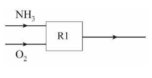
>
> **22**
>
> 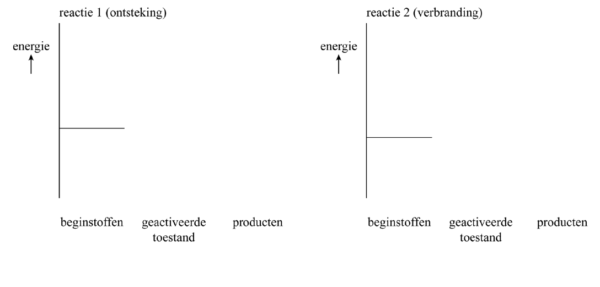
>
> *Labels: reactie 1 (ontsteking) = reaction 1 (ignition); reactie 2 (verbranding) = reaction 2 (combustion); energie = energy; beginstoffen = starting substances; geactiveerde toestand = activated state; producten = products.*
>
> **24**
>
> 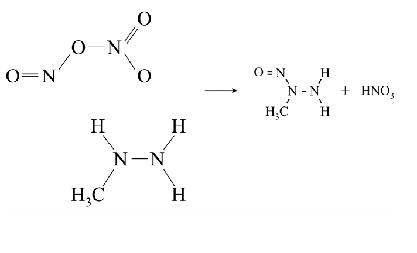

**Official answers** (CvTE marking scheme, Dutch original):

> **18** maximumscore 4
>
> Voorbeelden van een juist antwoord zijn:\
> 4 NH₃ + 5 O₂ → 4 NO + 6 H₂O\
> (0,459 + 0,913 − (6/4) × 2,42)·10⁵ = −2,26·10⁵ (J mol⁻¹)
>
> of
>
> 4 NH₃ + 5 O₂ → 4 NO + 6 H₂O\
> −Ebegin + Eeind = −[−0,459·10⁵] + [(0,913·10⁵) + (6/4) × (−2,42·10⁵)] = −2,26·10⁵ (J mol⁻¹)
>
> - links van de pijl uitsluitend NH₃ en O₂ — 1
> - rechts van de pijl uitsluitend NO en H₂O en de elementbalans — 1
> - absolute waardes van de vormingswarmtes en verwerking van de coëfficiënten — 1
> - rest van de berekening — 1
>
> *Opmerking*\
> De volgende berekening goed rekenen:\
> 0,459 + 0,913 − 1,5 × 2,42 = −2,26·10⁵ (J mol⁻¹)
>
> **19** maximumscore 2
>
> | evenwicht | hogere temperatuur | hogere druk |
> |---|---|---|
> | 1 | links | rechts |
> | 2 | links | rechts |
>
> - de invloed van de druk — 1
> - de invloed van de temperatuur — 1
>
> **20** maximumscore 4
>
> Een voorbeeld van een juist antwoord is:
>
> 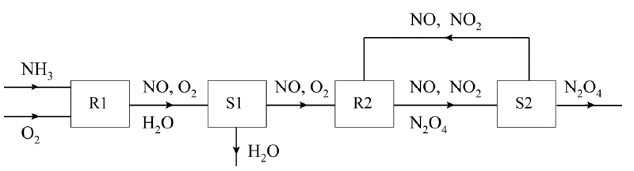
>
> - S1 aansluitend op R1, en de doorgaande stofstromen van NO en NO₂ — 1
> - de recycle van NO en NO₂ van S2 naar (de instroom van) R2 — 1
> - de stofstromen van H₂O en O₂ — 1
> - R2 aansluitend op S1, en S2 aansluitend op R2, en de stofstroom van N₂O₄ — 1
>
> *Opmerking*\
> Als NO ontbreekt zowel in de stofstroom van R2 naar S2 als in de recycle van S2 naar R2, dit slechts eenmaal aanrekenen.
>
> **21** maximumscore 3
>
> 4 CN₂H₆ + 5 N₂O₄ → 9 N₂ + 4 CO₂ + 12 H₂O
>
> - links van de pijl CN₂H₆ en N₂O₄ — 1
> - rechts van de pijl N₂ en CO₂ en H₂O — 1
> - de elementbalans bij uitsluitend de juiste formules links en rechts van de pijl — 1
>
> **22** maximumscore 2
>
> Een voorbeeld van een juist antwoord is:
>
> 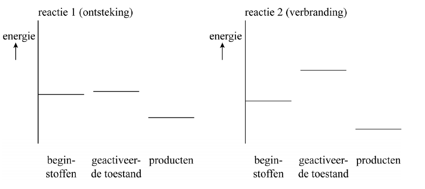
>
> - in beide energiediagrammen een exotherme reactie weergegeven — 1
> - de geactiveerde toestand voor de ontstekingsreactie lager dan die van de verbranding — 1
>
> **23** maximumscore 2
>
> Voorbeelden van een juist antwoord zijn:\
> Het smeltpunt van MMH is (273 – 52 =) 221 K.\
> Het smeltpunt van N₂O₄ is 264 K.\
> Het onderzoek is uitgevoerd bij een temperatuur 221 K ≤ T ≤ 264 K.
>
> - omrekening van celsius naar kelvin — 1
> - vergelijking met gegevens van N₂O₄ en consequente conclusie — 1
>
> *Opmerking*\
> Het volgende antwoord goed rekenen:\
> Het smeltpunt van MMH is –52 °C.\
> Het smeltpunt van N₂O₄ is (273 – 264 =) –9 °C.\
> Het onderzoek is uitgevoerd bij een temperatuur –52 °C ≤ T ≤ –9 °C.
>
> **24** maximumscore 3
>
> Een voorbeeld van een juist antwoord is:
>
> 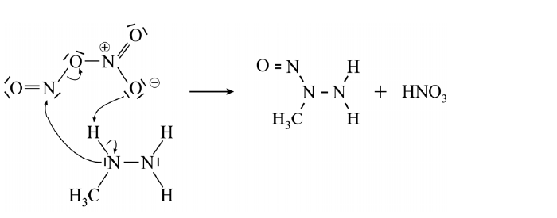
>
> - de niet-bindende elektronenparen — 1
> - de formele ladingen consequent — 1
> - de pijlen — 1
>
> **25** maximumscore 4
>
> Een voorbeeld van een juiste berekening is:\
> Er was 11 / 92,0 = 1,20·10⁻¹ (mol) N₂O₄ ontsnapt.\
> Dat is 1,20·10⁻¹ × 2,39·10⁻² = 2,86·10⁻³ (m³).\
> Het gehalte is 2,86·10⁻³ / 5,9 × 10⁶ = 4,8·10² (volume-ppm).\
> Het maximaal toelaatbare gehalte is 300 volume-ppm, dus de situatie was levensgevaarlijk.
>
> - omrekening van de gegeven massa N₂O₄ naar de chemische hoeveelheid — 1
> - omrekening naar het volume N₂O₄ — 1
> - omrekening naar het gehalte in volume-ppm en consequente conclusie — 1
> - significantie — 1

*[Editorial: in the note to question 23, “(273 – 264 =) –9 °C” is printed this way; it means 264 − 273 = −9 °C.]*

In English:

> **18** maximum score 4
>
> Examples of a correct answer are:\
> 4 NH₃ + 5 O₂ → 4 NO + 6 H₂O\
> (0.459 + 0.913 − (6/4) × 2.42)·10⁵ = −2.26·10⁵ (J mol⁻¹)
>
> or
>
> 4 NH₃ + 5 O₂ → 4 NO + 6 H₂O\
> −Estart + Eend = −[−0.459·10⁵] + [(0.913·10⁵) + (6/4) × (−2.42·10⁵)] = −2.26·10⁵ (J mol⁻¹)
>
> - only NH₃ and O₂ to the left of the arrow — 1
> - only NO and H₂O to the right of the arrow, and the element balance — 1
> - the absolute values of the heats of formation, and using the coefficients — 1
> - the rest of the calculation — 1
>
> *Note*\
> Count the following calculation as correct:\
> 0.459 + 0.913 − 1.5 × 2.42 = −2.26·10⁵ (J mol⁻¹)
>
> **19** maximum score 2
>
> | equilibrium | higher temperature | higher pressure |
> |---|---|---|
> | 1 | left | right |
> | 2 | left | right |
>
> - the effect of the pressure — 1
> - the effect of the temperature — 1
>
> **20** maximum score 4
>
> An example of a correct answer is the block diagram above.
>
> - S1 connected to R1, and the onward flows of NO and NO₂ — 1
> - the recycling of NO and NO₂ from S2 to (the inflow of) R2 — 1
> - the flows of H₂O and O₂ — 1
> - R2 connected to S1, S2 connected to R2, and the flow of N₂O₄ — 1
>
> *Note*\
> If NO is missing both from the flow from R2 to S2 and from the recycle from S2 to R2, penalise this only once.
>
> **21** maximum score 3
>
> 4 CN₂H₆ + 5 N₂O₄ → 9 N₂ + 4 CO₂ + 12 H₂O
>
> - CN₂H₆ and N₂O₄ to the left of the arrow — 1
> - N₂ and CO₂ and H₂O to the right of the arrow — 1
> - the element balance, with only the correct formulas on both sides of the arrow — 1
>
> **22** maximum score 2
>
> An example of a correct answer is the pair of energy diagrams above.
>
> - an exothermic reaction shown in both energy diagrams — 1
> - the activated state of the ignition reaction lower than that of the combustion — 1
>
> **23** maximum score 2
>
> Examples of a correct answer are:\
> The melting point of MMH is (273 − 52 =) 221 K.\
> The melting point of N₂O₄ is 264 K.\
> The research was done at a temperature 221 K ≤ T ≤ 264 K.
>
> - converting Celsius to kelvin — 1
> - comparing with the data for N₂O₄, and a consistent conclusion — 1
>
> *Note*\
> Count the following answer as correct:\
> The melting point of MMH is −52 °C.\
> The melting point of N₂O₄ is (273 − 264 =) −9 °C.\
> The research was done at a temperature −52 °C ≤ T ≤ −9 °C.
>
> **24** maximum score 3
>
> An example of a correct answer is the mechanism above.
>
> - the non-bonding electron pairs — 1
> - the formal charges, consistently — 1
> - the arrows — 1
>
> **25** maximum score 4
>
> An example of a correct calculation is:\
> 11 / 92.0 = 1.20·10⁻¹ (mol) N₂O₄ escaped.\
> That is 1.20·10⁻¹ × 2.39·10⁻² = 2.86·10⁻³ (m³).\
> The content is 2.86·10⁻³ / 5.9 × 10⁶ = 4.8·10² (volume-ppm).\
> The maximum permissible content is 300 volume-ppm, so the situation was life-threatening.
>
> - converting the given mass of N₂O₄ to the amount of substance — 1
> - converting to the volume of N₂O₄ — 1
> - converting to the content in volume-ppm, with a consistent conclusion — 1
> - significant figures — 1

**Worked answer:**

- 25.
  1. M(N₂O₄) = 2 × 14.01 + 4 × 16.00 = 92.02 g mol⁻¹, so n = 11 g / 92.02 g mol⁻¹ = 0.1195 mol (keep the extra digit until the end).
  2. V(N₂O₄) = n × Vm = 0.1195 mol × 2.39·10⁻² m³ mol⁻¹ = 2.86·10⁻³ m³.
  3. Content = V(N₂O₄) / V(cabin) × 10⁶ = 2.86·10⁻³ / 5.9 × 10⁶ = 4.8·10² volume-ppm, in 2 significant figures because 11 and 5.9 have 2.
  4. 4.8·10² is more than 300, so the content went above the life-threatening limit.

  The scheme's 2.86·10⁻³ m³ also keeps the unrounded amount; with 0.120 mol you'd get 2.87·10⁻³ m³ and the same final answer. CCVX's syllabus lists mass-ppm (mg kg⁻¹); volume-ppm works the same way with volumes.
