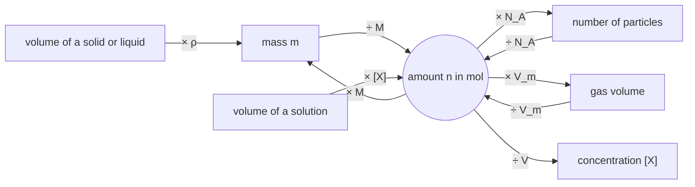

# C2 — Chemical calculations: notes

English notes on the two CCVX learning outcomes in [README.md](README.md). Every point says where it comes from:

- **spec**: the CvTE syllabus, quoted in [spec.nl.md](spec.nl.md) and translated in [spec.en.md](spec.en.md)
- **Bron 3**: the Stercollectie text on chemical calculations, in [Dutch](source/ecoreizen-bron3-chemisch-rekenen.nl.md) and [English](source/ecoreizen-bron3-chemisch-rekenen.en.md)
- **Kunstmest**: the Stercollectie experiment on ammonium in fertiliser, in [Dutch](source/kunstmest-proef5-ammonium-in-kunstmest.nl.md) and [English](source/kunstmest-proef5-ammonium-in-kunstmest.en.md)
- **exercise N**: the past exam questions in [exercises.md](exercises.md)

Dutch terms are in brackets. [checks.py](checks.py) recomputes every number on this page.

**Status** of each topic: *drafted* means written from the spec alone; *checked against source* means it matches Bron 3 or Kunstmest; *checked against exam* means an official exam answer uses it as well.

| Topic | Status |
|---|---|
| Amount of substance, molar mass | checked against exam |
| Concentration, molarity | checked against exam |
| Density | checked against exam |
| Molar volume of gases | checked against exam |
| Mass percentage | checked against exam |
| ppm | checked against exam (volume-ppm only) |
| Volume percentage, ppb | drafted |
| pH and pOH | drafted |
| Mass ratio | checked against source |
| Mole ratio and the five-step method | checked against exam |
| Volume ratio of gases | checked against source |
| Excess and deficiency | checked against exam |
| Yield | checked against exam |
| Significant figures | checked against exam |

## C2.1 Quantities

### Amount of substance and molar mass

- The amount of substance n (*chemische hoeveelheid*) is counted in mol. 1 mol is 6.022·10²³ particles, the Avogadro constant NA (Binas table 7), so N = n × NA. *(spec R&A1 spec 2; Bron 3 §3.2)*
- The molar mass M(X) in g mol⁻¹ (*molaire massa*) has the same number as the molecular mass in u (*molecuulmassa*): H₂O is 18.02 u and 18.02 g mol⁻¹. Look it up in Binas table 98, or add up atomic masses from table 99. Then n = m / M. *(spec R&A1 spec 2; Bron 3 §3.1–3.2; exercises 3–5)*
- CCVX calls this the relative molecular mass Mr, without a unit; the Dutch syllabus uses atomic mass A and molecular mass M in u. The numbers are the same. *(README; spec R&A1 spec 2)*

### Concentration and molarity

- Concentration [X] or c(X) = n / V, in mol L⁻¹ (*concentratie*); the number of mol per litre is also called the molarity (*molariteit*), and “0.100 M” means 0.100 mol L⁻¹. *(spec R&A1 spec 2; Bron 3 §3.3)*
- At the equivalence point of a titration the amounts are in the ratio of the reaction equation, so a known volume and concentration on one side give the concentration on the other. *(exercise 1)*

### Density

- ρ = m / V (*dichtheid*). 1 kg m⁻³ = 1 g L⁻¹ = 10⁻³ g mL⁻¹; the unit conversion is where most mistakes happen. *(spec R&A1 spec 2; Bron 3 §3.4)*
- Binas table 12 gives gas densities at 273 K and p₀ only. *(Bron 3 §3.4)* Exam questions give the density of other substances when it's needed, such as methanoic acid in exercise 4.

### Molar volume of gases

- Vm = V / n (*molair volume*). It depends on T and p but not on which gas it is (Avogadro's law). *(spec R&A1 spec 2; Bron 3 §3.4)*
- Vm = 22.4 L mol⁻¹ at 273 K and 24.5 L mol⁻¹ at 298 K, both at p = p₀ (Binas table 7). *(Bron 3 §3.4)*
- Dutch exams assume T = 298 K and p = p₀ unless a question says otherwise *(exercise 4)*, and often give Vm for other conditions, such as 2.39·10⁻² m³ mol⁻¹ *(exercise 5)*.

### Percentages, ppm and ppb

- Mass percentage = m(part) / m(total) × 100%; volume percentage = V(part) / V(total) × 100%. *(README; spec R&A1 spec 3)* Chlorine in PVC is 35.45 u / 62.49 u × 100% = 56.73%. *(Bron 3 §3.4; exercise 3)*
- ppm (parts per million) is the same kind of fraction × 10⁶, and ppb (parts per billion) × 10⁹. Mass-ppm is mg per kg and mass-ppb is μg per kg (CCVX gives both units); volume-ppm is cm³ per m³. *(README; spec R&A1 spec 3; exercise 5)*

### pH and pOH

- pH = −log [H₃O⁺] (or −log [H⁺]), and back again [H₃O⁺] = 10−pH. *(spec R&A1 spec 4; README)*
- pOH = −log [OH⁻], [OH⁻] = 10−pOH, and pH + pOH = 14.00 at 298 K. *(spec R&A1 spec 4; README)*
- A pH gets as many decimals as [H₃O⁺] has significant figures: [H₃O⁺] = 2.5·10⁻³ mol L⁻¹ gives pH = 2.60. *(spec A8 spec 3)*
- The pH of weak acids and bases, with Ka (*Kz*) and Kb, belongs to [C05](../C05-chemical-equilibrium/README.md). *(spec R&A1 specs 5–6)*
- One open text covers this, but it isn't imported yet: Bron 4.3 *Zwakke zuren* in the Stercollectie module [*Slikken of spuiten*](https://maken.wikiwijs.nl/61164/) ([Word file](https://maken.wikiwijs.nl/bestanden/577323/Intern%20dossier%20activiteit%204.doc), activity 4). It says that for a strong acid [H⁺] equals the molarity of the acid, and it converts 0.020 mol L⁻¹ to pH 1.70 and pH 2.60 to [H⁺] = 2.51·10⁻³ mol L⁻¹. Its worked HCl example is a Word drawing that the importer can't recover, and most of the text is about weak acids, so it belongs with C05.

## C2.2 Principles

### Mass ratio

- The molecular masses in u in a reaction equation can be read as grams, so masses scale in that ratio: 24.31 g Mg gives 120.4 g MgSO₄, so 200 g MgSO₄ needs 40.4 g Mg. This method is always allowed, in the exam too. *(spec R&A1 spec 1; Bron 3 §3.1)*

### Mole ratio and the five-step method

- The coefficients of a balanced equation give the mole ratio (*molverhouding*, or stoichiometric ratio): for 2 C₄H₁₀ + 13 O₂ → 8 CO₂ + 10 H₂O, n(C₄H₁₀)/2 = n(O₂)/13 = n(CO₂)/8 = n(H₂O)/10. *(spec R&A1 spec 1; Bron 3 §3.5)*
- The five steps (*SPA, systematische probleemaanpak*): (1) balanced equation, (2) convert the given substance to mol, (3) mole ratio between given and asked, (4) mol of the asked substance, (5) convert to the unit asked for. *(Bron 3 §3.6; exercises 1–5)*
- Don't use the mass ratio where the mole ratio belongs. *(Bron 3 §3.6)*

Bron 3's calculation scheme didn't survive the import. Rebuilt from its text (§3.2–3.4), it connects everything through the amount of substance:

### Volume ratio of gases

- At the same T and p, equal volumes of gases contain the same number of particles (Avogadro's law), so for gases the volume ratio equals the mole ratio from the equation: burning 1.0 L butane needs 13/2 × 1.0 = 6.5 L oxygen. *(spec R&A1 spec 1; Bron 3 §3.4–3.5)*

### Excess and deficiency

- A substance is in excess (*overmaat*) when there is more than enough to react with all of the other one. The other substance is in deficiency (*ondermaat*): it runs out first and decides how much product forms. *(spec R&A1 spec 1; Kunstmest theory)*
- So calculate the product from the substance in deficiency, and check which one that is when the question doesn't say. *(exercise 3)*
- A back-titration adds a known excess and then measures what's left over: reacted = added − left over. *(Kunstmest theory; exercise 2)*

### Yield

- Yield (*rendement*) = actual output / theoretical output, as a fraction or × 100%. *(spec R&A1 spec 1)*
- A yield under 100% means you need more starting material: divide by the yield, don't multiply. *(exercise 4)*

### Conservation of mass

- In a closed reactor the total mass doesn't change: 500 kg goes in and 500 kg comes out, whatever reacts. *(exercise 3)* The conservation laws themselves are in [C03](../C03-conservation-laws-and-cycles/README.md).

## Significant figures and the “calculate” verb

- Multiplying and dividing: give as many significant figures as the value with the fewest. Adding and subtracting: as many decimals as the value with the fewest decimals. Counted numbers and mathematical constants don't count. A logarithm gets as many decimals as the value had significant figures. *(spec A8 spec 3)*
- Significant figures are only marked when the question asks for them (“Geef je antwoord in het juiste aantal significante cijfers”); then they're worth 1 point, as in exercises 4 and 5. *(spec appendix 2)*
- “Calculate” (*berekenen*) means showing the formulas or principles, the values used and the steps, and giving the unit unless the question states it. CCVX asks the same: a number plus unit, with the formulae and data shown. *(spec appendix 2; CCVX verbs in spec.en.md)*
- Don't round in between. Marking schemes don't penalise a deviation caused by acceptable intermediate rounding, but rounding early can still change the last digit: Bron 3 gets 0.557 mol instead of 0.556 mol. *(exercise 4; Bron 3 §3.6)*

## CCVX versus the Dutch syllabus

- **In both:** everything above.
- **Dutch syllabus only:** charge Q and the Faraday constant F = Q / n, which CCVX doesn't list, and the reaction rate s = Δc / Δt, which CCVX covers in [C04](../C04-reaction-kinetics/README.md). *(spec R&A1 spec 2; README)*
- **CCVX only:** the relative molecular mass Mr without a unit, and volume percentage, mass-ppm (mg kg⁻¹) and mass-ppb (μg kg⁻¹) spelled out. The Dutch syllabus says only “percentage, ppm, ppb”. *(README; spec R&A1 spec 3)*
