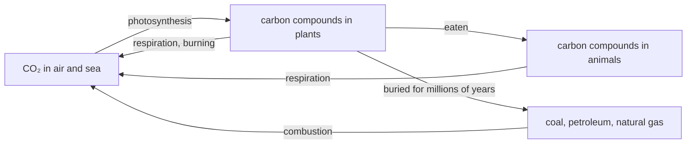

# C3 — Laws of Conservation and Cycles: notes

These are English explanations of every learning outcome in [README.md](README.md), and every topic is *drafted*: written from the CCVX and CvTE syllabi and standard VWO chemistry, not yet checked against an open source text or exam question (see [PLAN.md](../../PLAN.md) for the statuses).

Dutch terms are in brackets. A code such as *(CvTE M1.4)* points to the matching specification in the [CvTE 2027 syllabus](../../syllabus/cvte-syllabus-scheikunde-vwo-2027.pdf); Binas tables are named by subject, because their numbers differ between editions.

| Topic | Status |
|---|---|
| C3.1 Conservation laws and balances | drafted |
| C3.2 Cycles, recycling and cradle to cradle | drafted |

## C3.1 Conservation laws and balances

- In a chemical reaction atoms are only regrouped: none are made, destroyed or turned into another element. So three things stay the same: the number of atoms of each element (and with it the total mass), the total energy and the total charge. Exam questions use these laws as arguments ("explain with the law of conservation of mass why …") and as balances over a reactor or a whole process. *(CvTE R&A3.1)*

### Mass conservation and mass balance

- Element conservation (*elementbehoud*): every element has the same number of atoms before and after the reaction. Balancing an equation with coefficients applies this element balance (*elementbalans*): in CH₄ + 2 O₂ → CO₂ + 2 H₂O there are 1 C, 4 H and 4 O atoms on each side. *(CvTE R&A3.1, R1.1)*
- Mass conservation (*massabehoud*, the law of Lavoisier): every atom keeps its mass, so the total mass of the products equals the total mass of the reactants. In the equation above, 16.04 g CH₄ and 64.00 g O₂ (80.04 g in total) give 44.01 g CO₂ and 36.03 g H₂O (also 80.04 g). *(CvTE R&A3.1)*
- A mass balance (*massabalans*) applies this to a process: per batch, or per hour in a continuous process, the mass that goes in equals the mass that comes out, as long as nothing builds up inside. It holds for each block of a block diagram and for the process as a whole, so you can use it to find a missing stream. *(CvTE R&A3.1, T1.1)* Block diagrams are in [F01](../../F-industrial-chemical-processes/F01-industrial-processes/notes.md); calculations with the mole ratio are in [C02](../C02-chemical-calculations/notes.md).
- Example: suppose a reactor for N₂ + 3 H₂ → 2 NH₃ is fed 28 t N₂ and 6.0 t H₂ per hour. Then 34 t per hour leaves the reactor, whether everything reacts or only part of it (the outlet stream then holds NH₃ plus unreacted N₂ and H₂).
- Example with a gas leaving: heating 10.0 g calcium carbonate until it has all reacted, CaCO₃(s) → CaO(s) + CO₂(g), leaves 5.60 g CaO; the other 4.40 g escaped as CO₂. The mass of the solid drops, but the mass of solid plus gas stays 10.0 g.
- **Trap:** when the mass in an open vessel changes, a substance has left or entered. Marble in hydrochloric acid gets lighter because CO₂ escapes: CaCO₃(s) + 2 H₃O⁺(aq) → Ca²⁺(aq) + 3 H₂O(l) + CO₂(g). Burning magnesium gets heavier because it takes up oxygen: 2 Mg + O₂ → 2 MgO.
- **Trap:** atoms and mass are conserved, but the number of molecules (and so the chemical quantity in mol, or the volume of gas) is not: 2 H₂ + O₂ → 2 H₂O turns 3 mol of molecules into 2 mol.

### Energy conservation and energy balance

- Energy conservation (*energiebehoud*, the first law of thermodynamics): energy is never made or destroyed, only converted from one form into another, for example chemical energy into heat, light or electrical energy. *(CvTE R&A3.1, R5.5)*
- In a reaction the chemical energy of the products differs from that of the reactants, and the difference is exchanged with the surroundings. Exothermic: the system gives off energy, ΔE < 0. Endothermic: the system takes up energy, ΔE > 0. The calculations are in [C06](../C06-energy-calculations/notes.md). *(CvTE R5.1)*
- An energy balance (*energiebalans*) of a process: energy in = energy out + energy stored. For a reactor kept at a constant temperature, the heat produced by the reaction equals the heat carried off by the cooling water plus the heat lost to the surroundings. *(CvTE R&A3.1, T1.1)*
- Example: suppose a reactor produces 2.0·10⁶ J of heat per minute and all of it goes into cooling water that warms up by 15 K. With q = m·c·ΔT and c = 4.18·10³ J kg⁻¹ K⁻¹ (Binas), the water flow is m = 2.0·10⁶ / (4.18·10³ × 15) = 32 kg per minute.
- Heat released in one place can be used in another, for example to preheat a feed stream in a heat exchanger (*warmtewisselaar*). This energy management (*energiehuishouding*) belongs to [F01](../../F-industrial-chemical-processes/F01-industrial-processes/notes.md) and [F02](../../F-industrial-chemical-processes/F02-green-chemistry/notes.md). *(CvTE T1.1)*
- **Trap:** "energy loss" in everyday language means energy converted into a form you can't use, mostly heat that goes to the surroundings; the total stays the same. That is why the efficiency (*rendement*) of an energy conversion is below 100% (see [C06](../C06-energy-calculations/notes.md), and the quality of energy in [C09](../C09-quality-of-energy/notes.md)).

### Charge conservation and charge balance

- Charge conservation (*ladingbehoud*): the total charge doesn't change in a reaction, so in an ionic equation the charges on the left add up to the same total as the charges on the right (the charge balance, *ladingbalans*). Example: Zn(s) + Cu²⁺(aq) → Zn²⁺(aq) + Cu(s) has a total charge of 2+ on both sides. *(CvTE R&A3.1, R1.1)*
- In a half-reaction you balance the charge with electrons, after the atoms: Fe³⁺ + e⁻ → Fe²⁺ (left 3+ and 1−, so 2+ in total; right 2+), and O₂ + 4 H⁺ + 4 e⁻ → 2 H₂O (total charge 0 on both sides). *(CvTE R1.12)*
- To add two half-reactions, multiply them so that the number of electrons given off equals the number taken up. The electrons then cancel and the total equation is charge-balanced: Zn → Zn²⁺ + 2 e⁻ and 2 × (Ag⁺ + e⁻ → Ag) give Zn + 2 Ag⁺ → Zn²⁺ + 2 Ag. *(CvTE R1.13)* Half-reactions and redox are in [C01](../C01-chemical-processes/notes.md).
- A salt or a solution as a whole is electrically neutral: the total positive charge equals the total negative charge. In Al₂(SO₄)₃, 2 × 3+ = 3 × 2−; in a sodium sulfate solution, [Na⁺] = 2 × [SO₄²⁻].
- **Trap:** an equation can have the atoms right and the charge wrong. Fe³⁺ + Cu giving Fe²⁺ + Cu²⁺ has 3+ on the left and 4+ on the right; the correct equation is 2 Fe³⁺ + Cu → 2 Fe²⁺ + Cu²⁺, with 6+ on each side. Check the charge after the atoms, every time.

## C3.2 Cycles, recycling and cradle to cradle

- Because elements are conserved, nothing really disappears: atoms that have been used end up somewhere else, in waste, an emission or a new product. A cycle (*kringloop*) describes how matter goes round instead of piling up as waste. *(CvTE T2.3)*

### Substance cycle and element cycle

- In a substance cycle (*stofkringloop*) the same substance goes round and is used again without being converted into something else. Water evaporates, condenses, falls as rain and flows back as water; a solvent or an unreacted reactant is separated off and fed back into the reactor; a PET bottle is collected and made into PET again. *(CvTE T2.3)*
- In an element cycle (*elementkringloop*) the element is conserved, but chemical reactions carry it through different substances: carbon goes from CO₂ into glucose and back into CO₂; nitrogen goes from N₂ into ammonia, nitrate and proteins and back into N₂. *(CvTE T2.3)*
- **Trap:** the carbon cycle is an element cycle, not a substance cycle: the carbon atoms come back, but not in the same molecules. Ask whether the same substance returns or only the same element.

### The carbon cycle

- Photosynthesis (*fotosynthese*) in green plants converts light energy into chemical energy and takes CO₂ out of the air: 6 CO₂ + 6 H₂O → C₆H₁₂O₆ + 6 O₂ (endothermic). *(CvTE L1.2)*
- Respiration in cells (*dissimilatie*, often just called *verbranding*) in plants, animals and decomposers (the bacteria and fungi that break down dead remains) releases that energy again and returns the CO₂: C₆H₁₂O₆ + 6 O₂ → 6 CO₂ + 6 H₂O (exothermic). Burning biomass gives the same products.
- Fossil fuels (coal, petroleum, natural gas) formed from the remains of organisms over millions of years. Burning them, for example CH₄ + 2 O₂ → CO₂ + 2 H₂O, releases carbon that was stored long ago, so the amount of CO₂ in the air rises (the enhanced greenhouse effect, *versterkt broeikaseffect*). *(CvTE T5.2)*
- Burning biomass returns CO₂ that plants took up recently. In this short cycle the amount of CO₂ in the air doesn't rise, apart from the CO₂ released when the biomass is grown, processed and transported. Comparing fuels this way is part of [F03](../../F-industrial-chemical-processes/F03-energy-conversion/notes.md). *(CvTE T5.2)*
- Carbon is also stored for a long time in carbonate rock such as limestone (CaCO₃), and CO₂ dissolves in seawater.

- The nitrogen cycle is another element cycle. N₂ from the air is turned into nitrogen compounds by some bacteria, by lightning (N₂ + O₂ → 2 NO) and industrially by the ammonia synthesis (N₂ + 3 H₂ → 2 NH₃) for fertiliser. Plants take up nitrate and ammonium ions to make proteins; bacteria break down dead remains into ammonium and nitrate, and other bacteria finally return N₂ to the air.

### Recycling

- Recycling (*recycling*): used products or waste are collected and processed into raw material for new products. This saves raw materials and usually energy, and it reduces the amount of waste. *(CvTE T2.3, T2.1)*
- Metals can be melted down and used again and again, because the element is conserved; aluminium and copper are common examples. Thermoplastics can be melted and reshaped (mechanical recycling), although the quality tends to drop with each round; thermosets can't be melted because of their crosslinks. Chemical recycling breaks a polymer down into its monomers or other small molecules, for example by hydrolysis of a polyester. See [F02](../../F-industrial-chemical-processes/F02-green-chemistry/notes.md) for recycling plastics and metals, [D03](../../D-development-of-chemical-knowledge/D03-chemical-synthesis/notes.md) for polymers and [B04](../../B-substances-and-materials/B04-bonds-structures-and-properties/notes.md) for thermoplastics and thermosets.
- Inside one process, separating unreacted reactants from the product and sending them back into the reactor is called recirculation (*recirculatie*), as with N₂ and H₂ in the ammonia synthesis. *(CvTE T1.1)*
- Energy can't be recycled the way matter can: it is conserved, but after use it ends up as heat at a low temperature, which can do little useful work (see [C09](../C09-quality-of-energy/notes.md)).
- **Trap:** recycling a material into a product of lower quality (downcycling) only postpones the moment it becomes waste. It is recycling, but it isn't cradle to cradle.

### Cradle to cradle

- Cradle to grave (*cradle-to-grave*) is the traditional linear chain: raw material, product, use, and then waste on a dump or in an incinerator, the "grave".
- Cradle to cradle (*cradle-to-cradle*, C2C) is a design principle: a product is designed from the start so that after use every material becomes raw material for a new product of the same quality. Waste is food, so there is no waste. C2C distinguishes two kinds of material, each with its own cycle. *(CvTE T2.3)*
- Biological nutrients are materials that can safely break down in nature and return to the soil, such as natural fibres or compostable packaging (the biological cycle).
- Technical nutrients are materials such as metals and recyclable plastics that stay in a closed technical cycle and are used again and again without loss of quality (the technical cycle).
- So a C2C product must be easy to take apart into these two kinds of material and must not contain harmful substances; the C2C idea also asks for production with renewable energy.
- **Trap:** "biodegradable" doesn't automatically mean cradle to cradle: the breakdown products must be harmless and actually return to a biological cycle. A product that mixes biological and technical materials so that they can't be separated can't be cradle to cradle.
- Comparing products over their whole life cycle, and the wider sustainability arguments, are in [A14](../../A-skills/A14-sustainability/notes.md) and [E03](../../E-innovation-and-chemical-research/E03-sustainability/notes.md); green chemistry (waste, atom economy, E-factor) is in [F02](../../F-industrial-chemical-processes/F02-green-chemistry/notes.md). *(CvTE T6.1)*

## CCVX versus the Dutch syllabus

- **In both:** everything above. Element conservation is named separately in the Dutch R&A3.1; CCVX lists it in the basic knowledge ([sb12](../../0-basic-knowledge/04-reactions/notes.md)) and in [C10](../C10-activation-energy/notes.md). *(CvTE R&A3.1)*
- **Numbering:** CCVX C3.1 is CvTE R&A3.1, but CCVX C3.2 is CvTE T2.3, in the technology and sustainability sphere. The carbon cycle also appears in CvTE T5.2, which matches CCVX F3 ([F03](../../F-industrial-chemical-processes/F03-energy-conversion/notes.md)).
