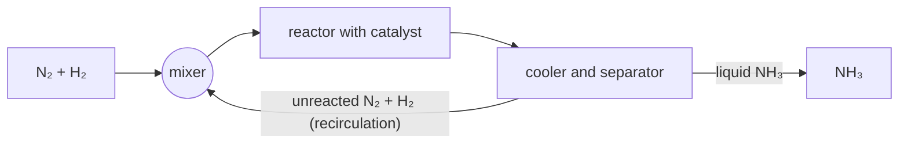

# C8 — Technological Aspects: notes

These are English explanations of every learning outcome in [README.md](README.md), and every topic is *drafted*: written from the CCVX and CvTE syllabi and standard VWO chemistry, not yet checked against an open source text or exam question (see [PLAN.md](../../PLAN.md) for the statuses).

Dutch terms are in brackets. A code such as *(CvTE M1.4)* points to the matching specification in the [CvTE 2027 syllabus](../../syllabus/cvte-syllabus-scheikunde-vwo-2027.pdf); Binas tables are named by subject, because their numbers differ between editions. This subdomain is school-exam only in the Netherlands, so the CvTE syllabus doesn't specify it: *(SLO C8)* points to the [SLO handreiking](https://www.slo.nl/handreikingen/havo-vwo/handreiking-se-schei-hv/toetsen-schoolexamen/vakinhoudelijke-0/), which names the same concepts, and CvTE codes mark overlap with the central exam.

| Topic | Status |
|---|---|
| Increasing scale | drafted |
| Reactors and reactivity | drafted |
| Thermal management | drafted |
| Separation techniques and block diagram | drafted |
| Lab-on-a-chip | drafted |
| Nanoprocesses | drafted |
| Chemistry of atmospheric radicals | drafted |

## Increasing scale

- Increasing scale (*schaalvergroting*, also *opschaling*): a process that works in the lab is scaled up in steps, from lab to pilot plant (*proeffabriek*) to full-scale plant, because what is easy in a flask can be hard in a large reactor. *(SLO C8)*
- Surface-to-volume ratio: if every length of a vessel becomes 10 times larger, its volume grows 10³ = 1000 times but its wall area only 10² = 100 times, so the area per unit of volume becomes 10 times smaller. A cube with 1 dm edges has 6 dm² / 1 dm³ = 6 dm⁻¹; a cube with 10 dm edges has 600 dm² / 1000 dm³ = 0.6 dm⁻¹. *(SLO C8)*
- Heat removal: the heat that an exothermic reaction produces grows with the volume, but the heat that can leave through the wall grows only with the area. A large reactor therefore needs extra cooling (cooling coils, an external heat exchanger); otherwise the temperature rises, the reaction speeds up, it releases heat even faster, and it can run away. *(SLO C8; CvTE T1.1)*
- Mixing and heating also take longer in a large vessel, so the temperature and concentrations are less even, which can cause side reactions (*nevenreacties*) and a lower yield. *(CvTE T2.1)*
- Safety: larger amounts mean larger consequences of a leak, a fire or a runaway reaction; large-scale risks are in [F04](../../F-industrial-chemical-processes/F04-risks-and-safety/notes.md). *(CvTE T4.1)*
- **Trap:** a reaction that stays at a steady temperature in a test tube can overheat in a 10 m³ reactor. The cause is the smaller surface-to-volume ratio, not a different reaction.

## Reactors and reactivity

- A reactor (*reactor*) is the vessel in which the reaction takes place. Its type and the conditions (temperature, pressure, concentrations, catalyst) are chosen to suit the reactivity of the substances: how fast they react and how much heat that releases. *(CvTE T1.1, T1.3)*
- Batch process (*batchproces*): the reactor is filled, the reaction runs, and the reactor is emptied, so the concentrations change in time. It is flexible and suits small amounts of fine chemicals (*fijnchemie*), such as medicines. *(CvTE T1.1)*
- Continuous process (*continuproces*): reactants flow in and products flow out all the time, and the conditions at each point stay the same. It suits large amounts of bulk chemicals (*bulkchemie*), such as ammonia. *(CvTE T1.1)*
- Common reactor types are a stirred tank (batch, or continuous with a steady flow in and out); a tubular reactor (*buisreactor*), a long tube in which the mixture reacts as it flows and which is easy to cool or heat through its wall; and a fixed-bed reactor, a tube packed with a solid catalyst through which the gases flow. *(CvTE T1.1)*
- Matching conditions to reactivity: a slow reaction is helped by a higher temperature, higher concentrations or pressure, a larger surface area of reacting substances (*verdelingsgraad*) or a catalyst; a fast, strongly exothermic reaction needs good cooling or dilution ([C04](../C04-reaction-kinetics/notes.md)). *(CvTE R3.1, R3.2)*
- **Trap:** a catalyst makes a reactor work faster but doesn't shift an equilibrium, so it doesn't raise the equilibrium yield. *(CvTE R4.3)*

## Thermal management

- Thermal management (*warmtehuishouding*; the CvTE calls it *energiehuishouding*) means removing heat from exothermic steps, supplying heat to endothermic steps and reusing as much heat as possible. *(CvTE T1.1)*
- A heat exchanger (*warmtewisselaar*) passes heat from a hot stream to a cold stream through a wall, without mixing them. Typically the hot product stream of an exothermic reactor preheats the cold feed, so less fuel is needed; the heat can also raise steam or heat a distillation column. *(CvTE T1.1)*
- In a counter-current heat exchanger (*tegenstroom*) the two streams flow in opposite directions, which transfers more heat than when they flow the same way. *(CvTE T1.1)*
- Energy balance (*energiebalans*): the heat released in the reactor equals the heat taken up by the coolant. Suppose a reactor releases 8.4·10⁸ J per hour and the cooling water may warm up by 20 K. With Q = m·c·ΔT and the specific heat of water from Binas, c = 4.18·10³ J kg⁻¹ K⁻¹, the cooling water needed is m = 8.4·10⁸ / (4.18·10³ × 20) = 1.0·10⁴ kg per hour. *(CvTE R&A3.1, R5.5)*
- **Trap:** heat flows only from hot to cold, so a heat exchanger can't warm the cold stream above the inlet temperature of the hot stream.

## Separation techniques and block diagram

- After the reactor, separation steps (*scheidingsmethodes*, carried out in separation units, *scheidingsinstallaties*) split the mixture into the product, unreacted starting materials and by-products. Each method uses a difference in one property, such as boiling point in distillation or solubility in extraction ([D01](../../D-development-of-chemical-knowledge/D01-chemical-techniques/notes.md)). *(CvTE T1.1, R&A2.2)*
- A block diagram (*blokschema*) shows a process as blocks (reactors, separation units, mixers) joined by arrows for the substance flows (*stofstromen*). Unreacted starting materials usually go back to the reactor (recirculation, *recirculatie*), and energy flows can be drawn as well. Drawing and calculating with block diagrams is in [F01](../../F-industrial-chemical-processes/F01-industrial-processes/notes.md). *(CvTE T1.1, T1.2)*
- Example, ammonia: N₂(g) + 3 H₂(g) ⇌ 2 NH₃(g) is an equilibrium, so only part of the N₂ and H₂ reacts in the reactor. Cooling the gas mixture condenses the ammonia, because its hydrogen bridges give it a much higher boiling point than N₂ and H₂, and the unreacted N₂ and H₂ are recycled. *(CvTE T1.2, T1.3)*

- **Trap:** every substance that enters a process must leave it somewhere or build up (mass balance, *massabalans*), and a recycle arrow goes back to the reactor or to a mixer before it. *(CvTE R&A3.1)*

## Lab-on-a-chip

- A lab-on-a-chip is a small plate, a few centimetres across, with channels narrower than a millimetre (often tens of micrometres) in which tiny volumes of liquid, microlitres or less, are moved, mixed, made to react and analysed. This is microfluidics: scaling down instead of up. *(SLO C8)*
- Several lab steps (dosing, mixing, separating, detecting) can be combined on one chip. *(SLO C8)*
- Advantages: very small amounts of sample and chemicals, so it is cheap, makes little waste and is safer; fast results, because diffusion distances are short and the very large surface-to-volume ratio makes heating and cooling quick; and portable devices for tests on the spot, such as a blood test at the doctor's or a water analysis in the field. *(SLO C8)*
- **Trap:** when asked for an advantage, name a concrete consequence of the small scale (less sample, less waste, faster heat exchange, portable), not just "it is smaller".

## Nanoprocesses

- Nanoprocesses work on the scale of 1–100 nm (1 nm = 10⁻⁹ m), with particles from a few atoms to hundreds of atoms across. *(SLO C8)*
- Nanoparticles have a very large surface area per gram. Cutting a 1 cm cube into cubes with 10 nm edges gives 10¹⁸ small cubes with a total area of 600 m², a million times the original 6 cm². *(CvTE R3.1)*
- This is why catalysts are used as nanoparticles, e.g. platinum metals spread as tiny particles over a ceramic support in a car's catalytic converter: a larger surface area of reacting substances (*verdelingsgraad*) means more collisions per second and a higher rate. *(CvTE R3.1, R3.2)*
- Properties can change at this scale: gold nanoparticles in water look red, not golden. Nanoparticles are also used in coatings ([E04](../../E-innovation-and-chemical-research/E04-new-materials/notes.md)). Their health effects are not fully known, because they can get deep into the lungs and into cells. *(SLO C8)*
- **Trap:** for the same mass, smaller particles have a larger total surface area; explain a higher rate with the larger area (more collisions), not with "smaller particles react better".

## Chemistry of atmospheric radicals

- In the ozone layer, high in the atmosphere, UV light splits oxygen molecules into atoms (photolysis). These O atoms have unpaired electrons, so they are radicals, and an O atom then adds to an O₂ molecule: O₂ → 2 O, then O + O₂ → O₃. Ozone absorbs UV in its turn, O₃ → O₂ + O, which is how the ozone layer shields life from UV radiation. *(CvTE R1.3, R2.5)*
- CFCs (chlorofluorocarbons, *cfk's*) such as CCl₂F₂ are so unreactive that they reach the ozone layer, where UV splits off Cl atoms: CCl₂F₂ → CClF₂• + Cl•. *(CvTE R2.5)*
- Each Cl• then destroys ozone in a cycle: Cl• + O₃ → ClO• + O₂, then ClO• + O → Cl• + O₂. Added up: O₃ + O → 2 O₂. *(CvTE R2.4, R2.5)*
- Cl• is formed again in the second step, so it is a catalyst: it doesn't appear in the overall equation, and one Cl atom can destroy many thousands of ozone molecules before it ends up in a more stable compound such as HCl. This is why CFCs were banned under the Montreal Protocol (1987). *(CvTE R3.2)*
- Near the ground, ozone is a pollutant in summer smog: sunlight splits NO₂ from traffic, NO₂ → NO + O, and the O atoms form ozone with O₂ as above. *(SLO C8)*
- **Trap:** the overall equation of a catalytic cycle contains neither the catalyst (Cl•) nor the intermediate (ClO•). And the same gas, ozone, protects life high up but is harmful at ground level.
