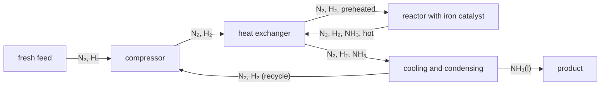

# F1 — Industrial Processes: notes

These are English explanations of every learning outcome in [README.md](README.md), and every topic is *drafted*: written from the CCVX and CvTE syllabi and standard VWO chemistry, not yet checked against an open source text or exam question (see [PLAN.md](../../PLAN.md) for the statuses).

Dutch terms are in brackets. A code such as *(CvTE M1.4)* points to the matching specification in the [CvTE 2027 syllabus](../../syllabus/cvte-syllabus-scheikunde-vwo-2027.pdf); Binas tables are named by subject, because their numbers differ between editions.

| Topic | Status |
|---|---|
| F1.1 Describing a process in a block diagram | drafted |
| F1.2 Explaining a process with its block diagram | drafted |
| F1.3 Concepts for describing a process | drafted |

## F1.1 Describing a process in a block diagram

- A block diagram (*blokschema*) shows a process as blocks joined by arrows. Each block stands for a unit where one step happens and is named by its function: a reactor (*reactor*), where substances react, or a separation unit (separation plant, *scheidingsinstallatie*), where a mixture is split, for instance by distillation. A block doesn't show what the equipment looks like. *(CvTE T1.1, T1.2)*
- Each arrow is a substance flow (*stofstroom*). It points the way the material moves and is labelled with the substances it carries, as formulas or names, not with a reaction. Arrows into the process carry the raw materials (*grondstoffen*); arrows out of it carry the product, by-products and waste. *(CvTE T1.1)*
- A reactor's outlet usually holds the products together with the starting materials that didn't react (incomplete conversion, often because of an equilibrium) and any by-products. *(CvTE T1.1, R4.1)*
- A separation unit takes in one or more flows (in extraction, also the extraction agent) and sends out two or more. Nothing reacts there: the substances that enter leave again, divided over the outgoing flows by the property the technique uses (F1.2). *(CvTE T1.1, R&A2.2)*
- Recirculation (*recirculatie*): unreacted starting materials are separated from the product and returned to the reactor, drawn as an arrow that runs back to the reactor feed. A reactor that converts only part of its feed per pass then still turns almost all of the raw material into product. *(CvTE T1.1)*
- If the feed contains a substance that neither reacts nor is separated off, such as argon in the ammonia process below, it builds up in the recycle loop, so a small purge stream is drawn off to remove it.
- A heat exchanger (*warmtewisselaar*) is a block that two flows pass through without mixing, with a wall between them, so that the hot flow heats the cold one. Draw each flow going in and coming out; its composition doesn't change. A common use is preheating the cold feed with the hot gas that leaves a reactor. *(CvTE T1.1)*
- What goes in must come out. In a continuous process at steady state, as much mass leaves each block as enters it, and every element that enters leaves in some flow. Use this mass and element balance to find the substances or the amount in a missing flow (see [C03](../../C-chemical-processes-and-conservation-laws/C03-conservation-laws-and-cycles/notes.md)). *(CvTE R&A3.1, A13.1)*
- Scale-up, reactors and heat management on a large scale are in [C08](../../C-chemical-processes-and-conservation-laws/C08-technological-aspects/notes.md).
- **Trap:** label every arrow, including the recycle and each flow leaving a separation unit, and check that a flow carries only substances that the block before it can supply.
- **Trap:** a heat exchanger isn't just a cooler. A cooler gives the heat to cooling water, and it's lost; a heat exchanger passes it to another flow of the same process.

### Worked example: the ammonia process

- Ammonia (*ammoniak*) is made from nitrogen (from air) and hydrogen (usually made from natural gas): N₂ + 3 H₂ ⇌ 2 NH₃. The reaction is exothermic and reaches an equilibrium. It runs over an iron catalyst at about 200 bar and about 450 °C. *(CvTE T1.3)*
- In the block diagram the compressed gas is preheated in a heat exchanger by the hot gas from the reactor. That gas is then cooled further until the ammonia condenses, and the N₂ and H₂ that didn't react go back to the compressor:

- Mass balance for one tonne of product: the chemical quantity of 1.00·10³ kg NH₃ is n = 1.00·10⁶ g ÷ 17.03 g mol⁻¹ = 5.872·10⁴ mol (an extra digit is kept until the end). The fresh feed must supply ½ × 5.872·10⁴ = 2.936·10⁴ mol N₂ (× 28.02 g mol⁻¹ = 823 kg) and 3/2 × 5.872·10⁴ = 8.808·10⁴ mol H₂ (× 2.016 g mol⁻¹ = 178 kg). Together that is 1.00·10³ kg, as conservation of mass requires (ignoring the small purge). *(CvTE R&A1.1, R&A3.1)*
- Recycle: suppose 20 % of the N₂ and H₂ that enter the reactor react per pass. At steady state the fresh feed replaces exactly what reacts, so the flow into the reactor is 1 ÷ 0.20 = 5.0 times the fresh feed: 5.0·10³ kg per tonne of NH₃, of which 4.0·10³ kg is recycle gas. Check the blocks: 5.0·10³ kg enters the reactor and the separation unit, and 1.00·10³ kg NH₃ plus 4.0·10³ kg recycle gas leaves the separation unit.
- Energy effect: ΔE = 2 × (−0.46·10⁵) − 0 = −0.92·10⁵ J per mol N₂ that reacts (Binas: heats of formation). Making 1.00·10³ kg NH₃ therefore releases 5.872·10⁴ mol × 0.46·10⁵ J mol⁻¹ = 2.7·10⁹ J, which preheats the feed and raises steam. *(CvTE R5.3)*

## F1.2 Explaining a process with its block diagram

### Reactions

- The flows into and out of a reactor show what reacts and what forms, so you can give the reaction equation. If one substance is unknown, find it with the element balance. *(CvTE R1.1, R1.2)*
- Explain the chosen conditions with the rate ([C04](../../C-chemical-processes-and-conservation-laws/C04-reaction-kinetics/notes.md)) and the equilibrium ([C05](../../C-chemical-processes-and-conservation-laws/C05-chemical-equilibrium/notes.md)). In the ammonia process a high pressure shifts the equilibrium to the side with fewer gas molecules (2 instead of 4) and raises the rate. A lower temperature would give more NH₃ at equilibrium, but too slowly, so about 450 °C is a compromise. The catalyst makes the equilibrium settle sooner without shifting it. *(CvTE T1.3, R3.1, R4.2, R4.3)*

### Separation techniques

- For each separation unit, name the technique and the difference in property it uses; more in [D01](../../D-development-of-chemical-knowledge/D01-chemical-techniques/notes.md). *(CvTE R&A2.1, R&A2.2)*

| Technique | Difference in property |
|---|---|
| distillation (*destilleren*), condensing by cooling (*condenseren*) | boiling point |
| filtration (*filtreren*) | particle size: an undissolved solid stays on the filter |
| settling (*bezinken*), centrifuging (*centrifugeren*) | density |
| extraction, washing (*extraheren, wassen*) | solubility in the extraction agent (*extractiemiddel*) |
| adsorption (*adsorberen*) | how strongly a substance sticks to a surface, such as activated carbon |
| evaporation (*indampen*) | volatility: the solvent evaporates, the dissolved solid stays |

- In the ammonia process NH₃ is separated by cooling, because it boils at a much higher temperature than N₂ and H₂ (at p₀ about −33 °C, against about −196 °C and −253 °C). NH₃ molecules are held together by hydrogen bridges (*waterstofbruggen*, hydrogen bonds), N₂ and H₂ molecules only by weak Van der Waals bonds (molecular bonds, *vanderwaalsbinding, molecuulbinding*). *(CvTE M3.1, M3.3)*
- Removing the product also helps the reaction: the recycled gas holds hardly any NH₃, so it reacts further when it enters the reactor again. *(CvTE R4.2)*

### Energy effect and energy management

- Energy effect (*energie-effect*): whether a reactor gives off heat (exothermic, ΔE < 0, so it must be cooled) or takes it up (endothermic, ΔE > 0, so it must be heated). Calculate it from heats of formation, as in [C06](../../C-chemical-processes-and-conservation-laws/C06-energy-calculations/notes.md). *(CvTE R5.1, R5.3)*
- Energy management (*energiehuishouding*): how the whole plant deals with its heat. Heat from exothermic reactors and hot product flows preheats feed in heat exchangers or raises steam; the steam heats other units, such as distillation columns, or drives turbines, for instance for the compressors. Cooling water carries off the rest. The energy balance (*energiebalans*) says that the energy going in equals the energy coming out. *(CvTE T1.1, R&A3.1)*
- **Trap:** for a separation step, name the property ("difference in boiling point"), not only the technique, and when the question asks why, explain the difference with the bonds between the particles.
- **Trap:** the energy effect belongs to one reaction; energy management is about the whole plant. A catalyst doesn't change ΔE; it saves energy only by allowing a lower temperature.

## F1.3 Concepts for describing a process

- Catalysis (*katalyse*): a catalyst (*katalysator*) takes part in the reaction but comes out unchanged. It provides a reaction path with a lower activation energy (*activeringsenergie*), so the reaction runs faster at the same temperature, or as fast at a lower one. *(CvTE R3.2, R5.1)*
- A catalyst speeds up the forward and the backward reaction alike, so an equilibrium is reached sooner, but its position doesn't change. *(CvTE R4.3)*
- A selective catalyst speeds up the desired reaction more than the side reactions, so less waste forms (see [F02](../F02-green-chemistry/notes.md)). A heterogeneous catalyst (*heterogene katalysator*), usually a solid such as the iron in the ammonia reactor, stays in the reactor; a homogeneous one (*homogene katalysator*), dissolved in the reaction mixture, has to be separated from the product. Solid catalysts are porous or finely divided to give a large surface area.
- Continuous process (*continuproces*): raw materials flow in and products flow out without stopping, often for months or years, at constant conditions. It suits large amounts of one product: little labour, constant quality, easy reuse of heat. The plant is expensive to build, and starting it up or shutting it down costs time and energy. *(CvTE T1.1)*
- Batch process (*batchproces*): a reactor is filled, the reaction runs, and the reactor is emptied and cleaned for the next batch. It suits small amounts, slow reactions and equipment shared by several products, and each batch can be checked and traced, which medicines require. Time is lost between batches, and the conditions change during each batch. *(CvTE T1.1)*
- Bulk chemicals (*bulkchemie*): simple substances made in very large amounts at a low price per kg, usually in continuous processes: ammonia, sulfuric acid, ethene, methanol. *(CvTE T1.1)*
- Fine chemicals (*fijnchemie*): complex substances made in small amounts, very pure and at a high price per kg, usually in batch processes: the active ingredients of medicines, fragrances, dyes. Their many synthesis steps usually give much more waste per kg of product, a higher E-factor ([F02](../F02-green-chemistry/notes.md)). *(CvTE T1.1)*
- **Trap:** "continuous" is about the flows, not the conversion: a continuous reactor may convert only part of its feed per pass, which is why it needs recirculation.
- **Trap:** a catalyst never raises the equilibrium yield. When a question asks why a catalyst is used, answer with the rate (or the selectivity), not with the position of the equilibrium.

## CCVX versus the Dutch syllabus

- **In both:** block diagrams with substance flows, recirculation, reactors, separation units and heat exchangers; the chosen conditions and separation steps; energy management; batch and continuous processes; bulk and fine chemicals. *(CvTE T1.1–T1.3)*
- **CCVX only, as an F1 concept:** catalysis. The Dutch syllabus dropped it from T1 but still tests it in R3.2, R4.3 and R5.1. It also took "reactions" and "energy effect" out of T1; the energy effect is now R5.1.
- **Dutch syllabus only, as T1 concepts:** waste, energy conservation and energy balance, green chemistry and recycling. CCVX covers these in [F02](../F02-green-chemistry/notes.md) and [C03](../../C-chemical-processes-and-conservation-laws/C03-conservation-laws-and-cycles/notes.md).
