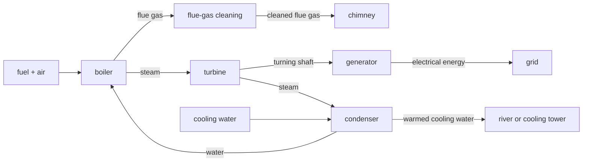

# F3 — Energy Conversion: notes

These are English explanations of every learning outcome in [README.md](README.md), and every topic is *drafted*: written from the CCVX and CvTE syllabi and standard VWO chemistry, not yet checked against an open source text or exam question (see [PLAN.md](../../PLAN.md) for the statuses).

Dutch terms are in brackets. A code such as *(CvTE M1.4)* points to the matching specification in the [CvTE 2027 syllabus](../../syllabus/cvte-syllabus-scheikunde-vwo-2027.pdf); Binas tables are named by subject, because their numbers differ between editions.

| Topic | Status |
|---|---|
| F3.1 Energy from biomass | drafted |
| F3.2 Fossil fuels in power stations | drafted |
| F3.3 Photosynthesis | drafted |
| F3.4 Comparing fuels | drafted |
| F3.5 Electrochemical cells, batteries and fuel cells | drafted |

## F3.1 Energy from biomass

- Biomass is material from living organisms: crops, wood, manure, food waste. Its chemical energy is solar energy stored by photosynthesis (F3.3). Exam questions describe the technique; you reason about it with reaction types, energy effects, separations, yields and the carbon cycle. *(CvTE T3.1)*
- Fermentation to bioethanol: yeast converts sugars anaerobically, C₆H₁₂O₆ → 2 C₂H₅OH + 2 CO₂, and the ethanol is distilled off and blended into petrol. Details are in [F02](../F02-green-chemistry/notes.md). *(CvTE T3.1)*
- Fermentation to biogas (*biogas*): micro-organisms break down manure, sewage sludge or food waste without oxygen into a gas of mainly methane and carbon dioxide; for glucose, overall, C₆H₁₂O₆ → 3 CH₄ + 3 CO₂. Biogas is burned for heat and electricity, or cleaned (CO₂ and H₂S removed) into green gas (*groen gas*) of natural-gas quality. *(CvTE T3.1)*
- Biodiesel production: vegetable oil or waste fat is transesterified with methanol into fatty-acid methyl esters ([F02](../F02-green-chemistry/notes.md)), which burn in diesel engines. *(CvTE T3.1)*
- Combustion: dry biomass such as wood, pellets or straw is burned for heat or in a power station (F3.2). For cellulose, per glucose unit: C₆H₁₀O₅ + 6 O₂ → 6 CO₂ + 5 H₂O. *(CvTE T3.1, R1.2)*
- Reasoning about a technique: wet biomass suits fermentation, because burning it would first spend energy on evaporating the water, while dry biomass suits combustion. Weigh the energy needed for growing, transport and distillation against the energy gained, and consider competition with food crops and what happens to the residues.
- **Trap:** burning a biofuel does release CO₂. A biofuel is only close to CO₂-neutral over the whole carbon cycle (F3.4), and the fossil energy used for farming, transport and processing still adds CO₂.

## F3.2 Fossil fuels in power stations

- Natural gas (mainly methane), petroleum (a mixture of hydrocarbons, refined into fuels, see [F02](../F02-green-chemistry/notes.md)) and coal (mainly carbon, with some hydrogen, oxygen, sulfur, nitrogen and minerals) are burned to generate electricity. The CvTE syllabus doesn't cover this outcome (see the last section).
- Combustion in a special combustion unit: in a power station this is the furnace of a boiler (*stoomketel*), where the fuel burns with air. Coal is ground to a powder first: the larger surface area (*verdelingsgraad*) makes it burn quickly and completely. *(CvTE R3.1)*
- Steam generation: the hot flue gas (*rookgas*) heats water in tubes in the boiler until it becomes steam at a high pressure and temperature.
- Dynamo: the steam drives a turbine (*stoomturbine*), and the turbine turns a generator (*generator, dynamo*), in which a rotating magnet induces an electric current in coils. The steam is then condensed with cooling water (*koelwater*) and pumped back into the boiler.
- The energy thus goes from chemical energy to heat, to kinetic energy of the turbine, to electrical energy. For a coal-fired station only about 40 % ends up as electricity; most of the rest leaves as heat in the cooling water and the flue gas. Using that heat for buildings or industry is combined heat and power (*warmtekrachtkoppeling*, see [G02](../../G-society-chemistry-and-technology/G02-environmental-impact-assessment/notes.md)). *(CvTE R5.5)*

- Reaction products: complete combustion gives CO₂ and H₂O, for example CH₄ + 2 O₂ → CO₂ + 2 H₂O and C + O₂ → CO₂. With too little oxygen the combustion is incomplete and gives CO and soot (C), for example 2 CH₄ + 3 O₂ → 2 CO + 4 H₂O. *(CvTE R1.2, R1.3)*
- Pollution: sulfur compounds in coal and oil burn to sulfur dioxide, S + O₂ → SO₂; in the hot flame nitrogen and oxygen from the air form NO, which becomes NO₂ in air (together NOₓ); coal also leaves ash and gives fine particulate matter (*fijnstof*). SO₂ and NOₓ cause acid rain (*zure regen*). *(CvTE T5.2)*
- Flue-gas cleaning: in flue-gas desulfurisation (*rookgasontzwaveling*) a suspension of limestone takes up the SO₂, 2 SO₂ + 2 CaCO₃ + O₂ + 4 H₂O → 2 CaSO₄·2H₂O + 2 CO₂, and the gypsum (*gips*) formed is used for plasterboard. NO is reduced with ammonia over a catalyst, 4 NO + 4 NH₃ + O₂ → 4 N₂ + 6 H₂O, and filters remove the dust.
- **Trap:** flue-gas cleaning removes SO₂, NOₓ and dust, not CO₂; desulfurisation with limestone even releases a little extra CO₂.

## F3.3 Photosynthesis

- In photosynthesis (*fotosynthese*) green plants, algae and some bacteria use light to make glucose from carbon dioxide and water: 6 CO₂ + 6 H₂O → C₆H₁₂O₆ + 6 O₂. The green pigment chlorophyll absorbs the light. *(CvTE L1.2)*
- The reaction is endothermic: light energy is converted into chemical energy, stored in glucose and from there in starch, cellulose, all other biomass and, over millions of years, fossil fuels. It's the reverse of the combustion of glucose, which releases about 2.8·10⁶ J per mol. *(CvTE L1.2, R5.1)*
- Capture of carbon dioxide (*vastleggen van koolstofdioxide, koolstofassimilatie*): carbon from CO₂ in the air ends up in organic compounds. This is the step of the carbon cycle that takes CO₂ out of the air (F3.4). *(CvTE L1.2)*
- Production of oxygen (*productie van zuurstof*): practically all the O₂ in the air was made this way. Experiments with water containing the isotope ¹⁸O show that the O₂ comes from the water, not from the CO₂. *(CvTE L1.2)*
- **Trap:** in the energy diagram of photosynthesis the products (glucose and O₂) lie above the reactants, and the energy comes from light, not from heat. Plants respire as well, so in the dark they give off CO₂.

## F3.4 Comparing fuels

### Biofuel, fossil fuel and the carbon cycle

- In the carbon cycle (*koolstofkringloop*), photosynthesis takes CO₂ out of the air, and respiration, decay and combustion put it back ([C03](../../C-chemical-processes-and-conservation-laws/C03-conservation-laws-and-cycles/notes.md) has the diagram). A biofuel releases carbon that the plants took up months or years earlier, so over the cycle it adds (almost) no CO₂. A fossil fuel releases carbon that was stored for millions of years, so it raises the CO₂ content of the air and strengthens the greenhouse effect (*versterkt broeikaseffect*). *(CvTE T5.2)*
- At the chimney there's no difference: methane from biogas and methane from natural gas give exactly the same CO₂ per joule. The difference is only where the carbon came from. Producing a biofuel (fertiliser, harvest, transport, distillation) usually costs some fossil energy, so it isn't completely neutral.

### C/H ratio and CO₂ per joule

- The more carbon atoms a fuel contains per hydrogen atom (a higher C/H ratio, *C/H-verhouding*), the more CO₂ it gives per joule, because burning hydrogen yields energy and only water. *(CvTE T5.2)*
- Worked comparison, with heats of formation from Binas (CO₂(g) −3.935, H₂O(l) −2.86 and CH₄(g) −0.75, all ·10⁵ J mol⁻¹) and liquid water as product; the method is in [C06](../../C-chemical-processes-and-conservation-laws/C06-energy-calculations/notes.md). Intermediate results keep an extra digit; only the answers per MJ are rounded. *(CvTE R5.3)*
    - Methane (C/H = 1 : 4): CH₄ + 2 O₂ → CO₂ + 2 H₂O gives ΔE = −3.935·10⁵ + 2 × (−2.86·10⁵) − (−0.75·10⁵) = −8.905·10⁵ J per mol. That is 44.01 g CO₂ per 0.8905 MJ, so 49.4 g CO₂ per MJ.
    - Octane, a model for petrol (C/H = 8 : 18): with a typical heat of formation of about −2.50·10⁵ J mol⁻¹ for liquid octane, 2 C₈H₁₈ + 25 O₂ → 16 CO₂ + 18 H₂O gives ΔE = 16 × (−3.935·10⁵) + 18 × (−2.86·10⁵) − 2 × (−2.50·10⁵) = −109.44·10⁵ J per 2 mol, so −54.72·10⁵ J per mol octane. That is 8 × 44.01 g CO₂ per 5.472 MJ, so 64.3 g CO₂ per MJ.
    - Carbon, a model for coal (no hydrogen at all): C + O₂ → CO₂ gives ΔE = −3.935·10⁵ J per mol, so 44.01 g CO₂ per 0.3935 MJ, which is 111.8 g CO₂ per MJ.
- Coal therefore gives about twice as much CO₂ per joule as natural gas. With water vapour as the product, as it leaves a chimney, methane and octane come out at 54.8 and 69.4 g CO₂ per MJ; the order stays the same.
- **Trap:** compare per joule, not per mol or per kg of fuel. A mol of octane gives eight times as much CO₂ as a mol of methane, but also about six times as much energy.

### Emissions from combustion

- CO₂: formed from every fuel that contains carbon; a greenhouse gas. A lower C/H ratio gives less per joule, but only fuels without carbon (hydrogen) give none. *(CvTE T5.2)*
- NOₓ (*stikstofoxiden*, NO and NO₂): at a high temperature nitrogen and oxygen from the air react, N₂ + O₂ → 2 NO, and NO reacts further in air, 2 NO + O₂ → 2 NO₂. Because the nitrogen comes from the air, even hydrogen flames give NOₓ. The first reaction is endothermic (ΔE = 2 × 0.90·10⁵ = +1.8·10⁵ J per mol N₂, Binas: heats of formation), so a hotter flame gives more NO. A car's catalytic converter removes it: 2 CO + 2 NO → 2 CO₂ + N₂. *(CvTE T5.2)*
- SO₂: formed from sulfur compounds in the fuel, S + O₂ → SO₂, so the amount depends on the fuel: coal and heavy oil contain more sulfur than natural gas. It's prevented by removing the sulfur from the fuel (with hydrogen in the refinery, [F02](../F02-green-chemistry/notes.md)) or from the flue gas (F3.2). *(CvTE T5.2)*
- **Trap:** most NOₓ comes from the nitrogen in the air, so a fuel without nitrogen still gives NOₓ; SO₂ comes only from sulfur in the fuel.

### Environmental factors

- Fuel delivery: coal and biomass arrive by ship, train or lorry, natural gas by pipeline. Transport costs energy, causes emissions and has risks, which is why power stations are built near ports, rivers or gas pipelines. *(CvTE T5.1)*
- Fuel storage: solid fuels need large stockpiles, which take space and give dust; liquid and gaseous fuels need closed tanks because of leaks and the risk of fire or explosion; hydrogen has to be stored under high pressure or very cold.
- Cooling water (*koelwater*): the condenser of a power station needs a large flow of cooling water from a river or the sea. It returns warmer, and warm water holds less dissolved oxygen, which harms aquatic life. Limits on the discharge temperature, or cooling towers, reduce this. *(CvTE T4.1)*
- Comparing whole power stations and fuels is in [G03](../../G-society-chemistry-and-technology/G03-energy-and-industry/notes.md), and the environmental effects of a plant in [G02](../../G-society-chemistry-and-technology/G02-environmental-impact-assessment/notes.md).

## F3.5 Electrochemical cells, batteries and fuel cells

### How an electrochemical cell works

- An electrochemical cell (*elektrochemische cel*) runs a redox reaction with the reducing agent (*reductor*) and the oxidizing agent (*oxidator*) kept apart. The reductor gives its electrons to one electrode; they flow through an external connection (wire, lamp, motor) to the other electrode, where the oxidator takes them up. Chemical energy becomes electrical energy. *(CvTE R1.14, R5.5)*
- Reducing and oxidizing agent: find them with the Binas table of standard electrode potentials. The strongest oxidator present (highest V₀) reacts with the strongest reductor present (lowest V₀), and a cell can deliver current when V₀ of the oxidator is higher than V₀ of the reductor. Redox basics are in [C01](../../C-chemical-processes-and-conservation-laws/C01-chemical-processes/notes.md). *(CvTE R1.10, R1.11)*
- Half-reactions (*halfreacties*) and total reaction (*totaalreactie*): write one half-reaction per electrode, multiply them so that the electrons cancel, and add them. In a zinc–copper cell: Zn → Zn²⁺ + 2 e⁻ and Cu²⁺ + 2 e⁻ → Cu, total Zn + Cu²⁺ → Zn²⁺ + Cu. *(CvTE R1.12, R1.13)*
- Positive and negative electrode (*positieve en negatieve elektrode*): the reductor reacts at the negative electrode, where the electrons leave the cell, and the oxidator at the positive electrode. The source voltage (*bronspanning*) is V₀(oxidator) − V₀(reductor): 0.34 − (−0.76) = 1.10 V for the zinc–copper cell (Binas: standard electrode potentials). *(CvTE R1.14)*
- Electrolyte (*elektrolyt*): a solution, paste, molten salt or polymer in which ions can move. Electrons travel through the wire and ions through the electrolyte; together they close the circuit. *(CvTE R1.14)*
- Membrane (*membraan*) or salt bridge (*zoutbrug*): separates the two halves of the cell so that the oxidator and the reductor can't react directly, but lets ions through, so that each half stays electrically neutral. *(CvTE R1.14)*
- **Trap:** Dutch exams say positive and negative electrode, not anode and cathode. In a cell or battery the negative electrode is where oxidation happens; in electrolysis, and so while charging, the negative electrode is where reduction happens.

### Batteries and charging

- A battery (*batterij*) is one or more cells in a closed package; it's empty when the reductor or the oxidator is used up. In a rechargeable battery (*accu*) the products stay at the electrodes, so the reaction can be reversed. *(CvTE T6.5)*
- Lead-acid battery (*loodaccu*), as in a car, with sulfuric acid as the electrolyte. While it discharges, at the negative electrode Pb + SO₄²⁻ → PbSO₄ + 2 e⁻, at the positive electrode PbO₂ + SO₄²⁻ + 4 H⁺ + 2 e⁻ → PbSO₄ + 2 H₂O, and in total Pb + PbO₂ + 4 H⁺ + 2 SO₄²⁻ → 2 PbSO₄ + 2 H₂O. *(CvTE R1.13, R1.14)*
- Charging (*opladen*): a charger pushes the electrons the other way, so the cell works as an electrolysis cell and electrical energy is stored as chemical energy. At the negative electrode PbSO₄ + 2 e⁻ → Pb + SO₄²⁻ (a reduction, as at the negative electrode of every electrolysis), and at the positive electrode PbSO₄ + 2 H₂O → PbO₂ + SO₄²⁻ + 4 H⁺ + 2 e⁻. *(CvTE T6.5)*
- **Trap:** a battery can only be recharged if the discharge products stay in place; a product that escapes, for instance as a gas, can't take part in the reverse reaction. *(CvTE A13.1)*

### Fuel cells

- A fuel cell (*brandstofcel*) gets its reductor (the fuel, such as hydrogen or methanol) and oxygen supplied continuously from outside, and the products leave; it doesn't run down or need charging. *(CvTE R1.14)*
- Hydrogen fuel cell with an acidic polymer membrane: at the negative electrode H₂ → 2 H⁺ + 2 e⁻, at the positive electrode O₂ + 4 H⁺ + 4 e⁻ → 2 H₂O, in total 2 H₂ + O₂ → 2 H₂O. The membrane lets only H⁺ ions through, from the negative to the positive side, and keeps H₂ and O₂ apart. Source voltage: 1.23 − 0.00 = 1.23 V. *(CvTE R1.12, R1.13, R1.14)*
- In an alkaline fuel cell the half-reactions are H₂ + 2 OH⁻ → 2 H₂O + 2 e⁻ and O₂ + 2 H₂O + 4 e⁻ → 4 OH⁻; the total is the same, and so is the voltage, 0.40 − (−0.83) = 1.23 V.
- Sustainability: the only product is water, but the hydrogen is only "green" if it's made by electrolysis of water, 2 H₂O → 2 H₂ + O₂, with renewable electricity; most hydrogen is still made from fossil fuels, mainly natural gas. *(CvTE T6.5)*

### Recycling and energy-mass ratio

- Recycling (*recycling*): batteries contain metals that are scarce, valuable or toxic (lead, nickel, cobalt, lithium, cadmium), so they're collected separately and the metals are recovered. This saves mining and keeps heavy metals out of the environment; lead-acid batteries are among the most recycled products. *(CvTE T5.1)*
- Energy-mass ratio (*verhouding energie/massa*): the energy a battery or fuel stores per kg, in J kg⁻¹ or Wh kg⁻¹ (1 Wh = 3600 J). It decides how far a car or a phone gets per kg it carries. *(CvTE T5.1)*
- Typical values: a lead-acid battery about 35 Wh kg⁻¹ (about 1.3·10⁵ J kg⁻¹), a lithium-ion battery about 150 to 250 Wh kg⁻¹ (about 5·10⁵ to 9·10⁵ J kg⁻¹).
- For a fuel, calculate it from the heat of combustion. Hydrogen gives 2.86·10⁵ J per mol (the heat of formation of H₂O(l), Binas), so 2.86·10⁵ J ÷ 2.016·10⁻³ kg = 1.42·10⁸ J kg⁻¹ (3.94·10⁴ Wh kg⁻¹). Octane, with the values used in F3.4, gives 5.472·10⁶ J ÷ 0.11422 kg = 4.791·10⁷ J kg⁻¹ (1.331·10⁴ Wh kg⁻¹), more than 50 times a lithium-ion battery. But a fuel needs a tank (heavy for hydrogen), and an engine turns more of its energy into heat than an electric motor does.
- **Trap:** when a question compares whole systems, count their whole mass: a hydrogen car carries a heavy pressure tank, and a battery's casing and electrolyte count as well.

## CCVX versus the Dutch syllabus

- **Numbering trap:** CCVX F3.3–F3.5 are old Dutch F3.2–F3.4 in the omnummeringstabel. Their new Dutch codes are L1.2 (photosynthesis), T5.2 (comparing fuels) and R1.14, T5.1 and T6.5 (cells, batteries, charging); CCVX F3.1 is T3.1.
- **In both:** energy from biomass (T3.1), photosynthesis (L1.2), the carbon cycle, the C/H ratio and the emissions (T5.2), the electrochemical cell (R1.14), charging (T6.5), and the energy-mass ratio and recycling (T5.1).
- **CCVX only:** F3.2, fossil fuels in power stations, which the CvTE syllabus doesn't cover; and the environmental factors of F3.4 (fuel delivery, storage, cooling water), dropped from the Dutch fuel comparison (T5.2), although T4.1 still names the use of cooling water and T5.1 the transport of raw materials.
- **Dutch syllabus only:** the salt bridge, named next to the membrane in R1.14, and the electrolysis of water to make hydrogen in T6.5, which CCVX has in [C01](../../C-chemical-processes-and-conservation-laws/C01-chemical-processes/notes.md).
