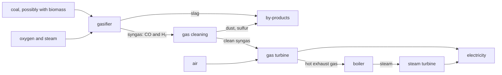

# G3 — Energy and Industry: notes

These are English explanations of every learning outcome in [README.md](README.md), and every topic is *drafted*: written from the CCVX and CvTE syllabi and standard VWO chemistry, not yet checked against an open source text or exam question (see [PLAN.md](../../PLAN.md) for the statuses).

Dutch terms are in brackets. A code such as *(CvTE M1.4)* points to the matching specification in the [CvTE 2027 syllabus](../../syllabus/cvte-syllabus-scheikunde-vwo-2027.pdf); Binas tables are named by subject, because their numbers differ between editions.

| Topic | Status |
|---|---|
| G3.1 Comparing power stations and the fuel cell | drafted |
| G3.2 Comparing energy sources: hydrogen, bioethanol, biogas and biodiesel | drafted |

## G3.1 Comparing power stations and the fuel cell

### How to compare processes

- Questions describe two or more processes with data and ask you to compare them on sustainability and argue for a choice. Go through the criteria of the Dutch syllabus: *(CvTE T5.1)*
    - waste (*afval*): what's left over and whether it can be used;
    - energy use (*energiegebruik*): the choice of energy source (*keuze van de energiebron*) and the energy/mass ratio (*verhouding energie/massa*), which counts for transport and storage;
    - use of raw materials (*grondstofgebruik*): renewable or finite, and how much per unit of product;
    - environmental aspects (*milieu-aspecten*): CO₂, SO₂, NOₓ, particulate matter, cooling water, land use;
    - recycling (*recycling*) of materials, heat and by-products;
    - transport of raw materials, products and waste (*transport van grondstoffen, producten en afvalstoffen*).
- Compare per unit of useful output, such as per MJ of electricity: CO₂ per MJ of electricity = CO₂ per MJ of fuel energy ÷ efficiency. With invented numbers: fuel A gives 50 g CO₂ per MJ of heat and is used at an efficiency of 55%, fuel B gives 100 g CO₂ per MJ at 40%; per MJ of electricity, A gives 50 / 0.55 = 91 g and B 100 / 0.40 = 2.5·10² g. *(CvTE T5.2, R5.5)*
- For hydrocarbons, the C/H ratio sets the CO₂ per joule: the more hydrogen per carbon atom, the less CO₂ per joule. Pure carbon gives more than twice as much CO₂ per joule as methane. The calculation, and the emissions of CO₂, NOₓ and SO₂ in general, are in [F03](../../F-industrial-chemical-processes/F03-energy-conversion/notes.md). *(CvTE T5.2)*

### Coal-fired power station

- A coal-fired power station (*kolencentrale*) burns powdered coal, which is mostly carbon with some hydrogen, oxygen, sulfur, nitrogen and minerals, in a boiler. The heat turns water into high-pressure steam that drives a turbine and generator; cooling water condenses the steam afterwards ([G02](../G02-environmental-impact-assessment/notes.md)). The efficiency is about 40 to 45%; the steam cycle itself is in [F03](../../F-industrial-chemical-processes/F03-energy-conversion/notes.md). *(CvTE T5.1)*
- Of the fossil fuels, coal gives the most CO₂ per joule, because it has the highest C/H ratio. *(CvTE T5.2)*
- It also emits SO₂ from the sulfur in the coal (S + O₂ → SO₂), NOₓ from nitrogen in the coal and in the air, and fly ash (*vliegas*) and other particulate matter. *(CvTE T5.2)*
- Flue-gas cleaning (*rookgasreiniging*): *(CvTE T5.2)*
    - filters or electrostatic precipitators remove the fly ash, which is used in cement and concrete;
    - a limestone slurry removes SO₂ as gypsum, which is used for plasterboard: 2 SO₂ + 2 CaCO₃ + O₂ + 4 H₂O → 2 CaSO₄·2H₂O + 2 CO₂;
    - ammonia reduces NO to N₂ over a catalyst: 4 NO + 4 NH₃ + O₂ → 4 N₂ + 6 H₂O.
- Burning biomass, such as wood pellets, together with the coal lowers the fossil CO₂ per joule. *(CvTE T5.2)*
- **Trap:** desulfurisation with limestone removes SO₂ but releases one CO₂ for every SO₂ removed.

### Natural gas-fired power station

- Natural gas is mainly methane: CH₄ + 2 O₂ → CO₂ + 2 H₂O. A modern gas-fired power station (*gascentrale*) is usually a combined cycle (*STEG-centrale*, steam and gas): the gas burns in a gas turbine, and the hot exhaust gas then raises steam for a steam turbine. With two turbines its efficiency is about 55 to 60%, the highest of the fossil power stations. *(CvTE T5.1)*
- Of the fossil fuels, natural gas gives the least CO₂ per joule, because CH₄ has the lowest C/H ratio; together with the higher efficiency, this gives much less CO₂ per MJ of electricity than coal. *(CvTE T5.2)*
- Hardly any SO₂, because sulfur compounds are removed from natural gas before it's distributed, and no ash. NOₓ still forms in the hot flame. *(CvTE T5.2)*
- Gas turbines can start and stop quickly, so gas-fired stations can fill in when wind and solar power fall short.
- **Trap:** "the least CO₂ per joule" is still fossil CO₂, and methane that leaks before it's burned is itself a strong greenhouse gas.

### Coal gasification plant

- In a coal gasification plant (*kolenvergassingscentrale*), coal, possibly mixed with biomass, reacts at high temperature with oxygen and steam to syngas (*synthesegas*), mainly CO and H₂: 2 C + O₂ → 2 CO, which supplies heat, and C + H₂O → CO + H₂, which takes up heat. *(CvTE T5.1)*
- The gas is cleaned before it's burned: dust is filtered out, and the sulfur, present as H₂S, is removed and turned into sulfur that can be sold. This is easier than cleaning flue gas afterwards, because the syngas is under pressure and isn't diluted with the nitrogen of the air. *(CvTE T5.2)*
- The clean gas burns in a gas turbine followed by a steam turbine, a combined cycle as in a gas-fired station: 2 CO + O₂ → 2 CO₂ and 2 H₂ + O₂ → 2 H₂O. *(CvTE T5.1)*
- CO₂ is easier to capture than at a coal-fired station. The CO can first react with steam, CO + H₂O → CO₂ + H₂, after which the CO₂ is separated from the concentrated gas before combustion and stored underground, and the H₂ is burned. Co-gasifying biomass lowers the fossil CO₂ further. *(CvTE T5.2)*
- Drawbacks: the plant is complex and expensive, and producing pure oxygen from air costs energy.
- **Trap:** gasification doesn't remove carbon: without capture, all the carbon of the coal still ends up as CO₂. The gains are the cleaning before combustion and the easier capture.

### Fuel cell

- A fuel cell (*brandstofcel*) is an electrochemical cell to which a fuel (the reductor) and oxygen (the oxidator) are supplied continuously. It converts chemical energy directly into electrical energy, without a flame, a heat engine or a turbine. *(CvTE R1.14)*
- A hydrogen fuel cell with an acidic electrolyte (a membrane that conducts H⁺ ions): *(CvTE R1.14)*
    - negative electrode: H₂ → 2 H⁺ + 2 e⁻
    - positive electrode: O₂ + 4 H⁺ + 4 e⁻ → 2 H₂O
    - overall: 2 H₂ + O₂ → 2 H₂O
- With the Binas table of standard electrode potentials, the maximum voltage is 1.23 − 0.00 = 1.23 V; in use it's lower, so many cells are stacked in series. Half-reactions are practised in [C01](../../C-chemical-processes-and-conservation-laws/C01-chemical-processes/notes.md), and cells, batteries and the energy/mass ratio in [F03](../../F-industrial-chemical-processes/F03-energy-conversion/notes.md). *(CvTE R1.10, R1.14)*
- With hydrogen the only product is water: no CO₂, SO₂ or particulate matter, and, because there's no flame, no NOₓ. Because it skips the heat step of an engine, a fuel cell is usually more efficient than an engine that burns the same fuel. *(CvTE T5.2)*
- Its overall sustainability depends on how the hydrogen is made (G3.2): from natural gas it still causes CO₂ emissions; from water by electrolysis with renewable electricity, hardly any. Many fuel cells also need a platinum catalyst, a scarce metal that should be recycled. *(CvTE T5.1)*
- **Trap:** in a fuel cell the fuel reacts at the negative electrode and oxygen at the positive electrode. And a fuel cell doesn't store energy like a battery: it supplies current as long as fuel and oxygen are supplied.

### The four compared

| Plant | CO₂ per MJ of electricity | SO₂, NOₓ and dust | Other points |
|---|---|---|---|
| Coal-fired power station | the highest | SO₂ and dust removed from the flue gas, NOₓ reduced with ammonia | efficiency about 40 to 45%; gives gypsum and fly ash |
| Natural gas-fired power station | the lowest of the fossil plants | hardly any SO₂ or dust; NOₓ forms | efficiency about 55 to 60%; starts and stops quickly |
| Coal gasification plant | about as high as coal-fired, unless the CO₂ is captured, which is easier here | sulfur and dust removed from the gas before combustion; NOₓ forms in the gas turbine | can co-gasify biomass; complex and expensive |
| Fuel cell on hydrogen | none at the cell; depends on how the H₂ is made | none | direct conversion; needs a catalyst such as platinum |

## G3.2 Comparing energy sources: hydrogen, bioethanol, biogas and biodiesel

### Hydrogen

- Hydrogen (*waterstof*) is an energy carrier, not an energy source: it hardly occurs free in nature, and making it costs more energy than it gives back. *(CvTE T5.1)*
- Most hydrogen is still made by steam reforming (*stoomreforming*) of natural gas at high temperature with a catalyst: CH₄ + H₂O → CO + 3 H₂, followed by the shift reaction CO + H₂O → CO₂ + H₂; overall CH₄ + 2 H₂O → CO₂ + 4 H₂. The reaction alone releases 44.01 / (4 × 2.016) = 5.458 kg CO₂ per kg H₂, and burning gas to heat the reactor adds more. Hydrogen made this way is called grey, or blue when the CO₂ is captured and stored. *(CvTE T5.1, R&A1.1)*
- Electrolysis of water (*elektrolyse*) with electricity from wind or sun gives green hydrogen, without CO₂: 2 H₂O → 2 H₂ + O₂. In an alkaline electrolyser the negative electrode reaction is 2 H₂O + 2 e⁻ → H₂ + 2 OH⁻ and the positive electrode reaction 4 OH⁻ → O₂ + 2 H₂O + 4 e⁻. The minimum voltage from the Binas table of standard electrode potentials is 0.40 − (−0.83) = 1.23 V. Electrolysis is also in [C01](../../C-chemical-processes-and-conservation-laws/C01-chemical-processes/notes.md). *(CvTE T6.5, R1.12)*
- Uses: in a fuel cell (G3.1), burned (2 H₂ + O₂ → 2 H₂O; in air some NOₓ forms in the hot flame), and as a raw material, for ammonia and in refineries.
- Energy/mass ratio, from Binas heats of formation with liquid water as the product: burning hydrogen gives 1.42·10⁸ J per kg, methane 5.55·10⁷ J kg⁻¹, so hydrogen gives about 2.6 times as much per kg. Per mol, and so per litre of gas at the same T and p, it's the other way round: 2.86·10⁵ J against 8.91·10⁵ J, only about a third. That's why hydrogen is stored under high pressure, as a liquid at about −253 °C, or bound in another compound. *(CvTE T5.1, R5.3)*
- **Trap:** hydrogen is only as clean as the way it's made. No CO₂ at the point of use says nothing about the CO₂ released when the hydrogen was produced.

### Bioethanol

- Bioethanol (*bio-ethanol*) is made by fermentation (*vergisting*) of sugars by yeast, without oxygen: C₆H₁₂O₆ → 2 C₂H₅OH + 2 CO₂. Starch, and in the second generation cellulose, must first be hydrolysed to glucose. The yeast stops working at a fairly low ethanol content, so the ethanol has to be separated by distillation, which costs energy. Fermentation is also in [F02](../../F-industrial-chemical-processes/F02-green-chemistry/notes.md) and [F03](../../F-industrial-chemical-processes/F03-energy-conversion/notes.md). *(CvTE T3.1)*
- First generation: from the sugar or starch of food crops such as sugar cane, sugar beet, maize and wheat, which competes with food production ([G05](../G05-business-processes/notes.md)). Second generation: from the cellulose in non-food plant material such as straw, wood and other residues, which is harder because cellulose and the lignin around it are difficult to break down. *(CvTE T3.1)*
- Burning: C₂H₅OH + 3 O₂ → 2 CO₂ + 3 H₂O. From Binas heats of formation, with liquid water, this gives 2.97·10⁷ J per kg, about half as much as methane, because ethanol is already partly oxidised. Petrol may contain some ethanol, up to 10% in E10. *(CvTE T5.2, R5.3)*
- The CO₂ from burning was taken from the air by the crop (the short carbon cycle), so the net CO₂ is much lower than for a fossil fuel, but not zero: farming, fertiliser, transport and distillation use energy, mostly fossil. *(CvTE T5.2)*
- **Trap:** fermentation itself also releases CO₂, two molecules per glucose; it's short-cycle CO₂ as well.

### Biogas

- Biogas forms when micro-organisms digest wet biomass, such as manure, sewage sludge, food waste and crop residues, without oxygen (anaerobic digestion, *vergisting*). It's mainly CH₄ and CO₂, with a little H₂S that must be removed. Net summary for glucose: C₆H₁₂O₆ → 3 CH₄ + 3 CO₂. *(CvTE T3.1)*
- It's burned in a gas engine, often as combined heat and power ([G02](../G02-environmental-impact-assessment/notes.md)), or upgraded to green gas (*groen gas*) by removing CO₂ and H₂S, after which it can go into the natural-gas grid.
- Advantages: it uses waste, so it doesn't compete with food; the digestate (*digestaat*) can go back to the land as fertiliser, recycling the nutrients; and digesting manure in a closed tank keeps its methane out of the air. *(CvTE T5.1)*
- **Trap:** biogas isn't pure methane: the CO₂ lowers the energy per m³, and the sulfur compounds would give SO₂ when burned.

### Biodiesel

- Biodiesel is made by transesterification (*omestering*) of vegetable oil or used frying fat with methanol, with a base as catalyst. The glycerol part of the triglyceride is replaced by methyl groups, giving methyl esters of the fatty acids (alkoxy alkanoates in CCVX terms) and glycerol as a by-product. With glyceryl tristearate: C₅₇H₁₁₀O₆ + 3 CH₃OH → 3 C₁₇H₃₅COOCH₃ + C₃H₈O₃, giving methyl octadecanoate. Transesterification is in [F02](../../F-industrial-chemical-processes/F02-green-chemistry/notes.md). *(CvTE R1.3, T3.1)*
- The methyl esters are much less viscous than the oil itself, so they can be used in diesel engines.
- The fatty acids come from plants, but the methanol is usually made from natural gas, so biodiesel is only partly renewable unless bio-based methanol is used. Oil crops on farmland compete with food; used frying fat doesn't. *(CvTE T5.1)*
- **Trap:** the glycerol is only waste if nobody uses it; counting it as a product improves the atom economy and the E-factor ([F02](../../F-industrial-chemical-processes/F02-green-chemistry/notes.md)).

### Choosing an energy source

- Use the criteria of G3.1, and look in particular at: *(CvTE T5.1, T5.2)*
    - the origin of the carbon: biomass gives short-cycle CO₂, fossil fuels add CO₂ to the air;
    - the energy needed to make the fuel (distillation, fertiliser, electrolysis) and its source;
    - competition with food and the land needed;
    - energy per kg and per litre, which matter for transport and storage, and whether pipelines, engines and filling stations exist;
    - by-products and waste: glycerol, digestate, CO₂ from reforming.
- Typical conclusions: biogas from manure and waste scores well on raw materials and waste; first-generation bioethanol and biodiesel compete with food; hydrogen gives no CO₂ where it's used, but is only sustainable when it's made with renewable electricity.

## CCVX versus the Dutch syllabus

- **In both:** comparing processes on sustainability and arguing for a choice (CvTE T5.1); comparing fuels by C/H ratio and CO₂ per joule, emissions, and biofuel against fossil fuel (CvTE T5.2, CCVX F3.4 in [F03](../../F-industrial-chemical-processes/F03-energy-conversion/notes.md)); energy from biomass (CvTE T3.1, CCVX F3.1); the fuel cell as an electrochemical cell (CvTE R1.14, CCVX F3.5).
- **CCVX only:** the named plants (coal gasification plant, natural gas-fired and coal-fired power station, fuel cell) and the named energy sources (hydrogen, bioethanol, biogas, biodiesel) as items to compare. The Dutch syllabus dropped the names because its exam questions describe the process, and it covers fuel cells only through the electrochemical cell in general; for CCVX you should know them.
- **Dutch syllabus only:** the explicit list of comparison criteria in T5.1; it's also the best way to structure a CCVX answer.
